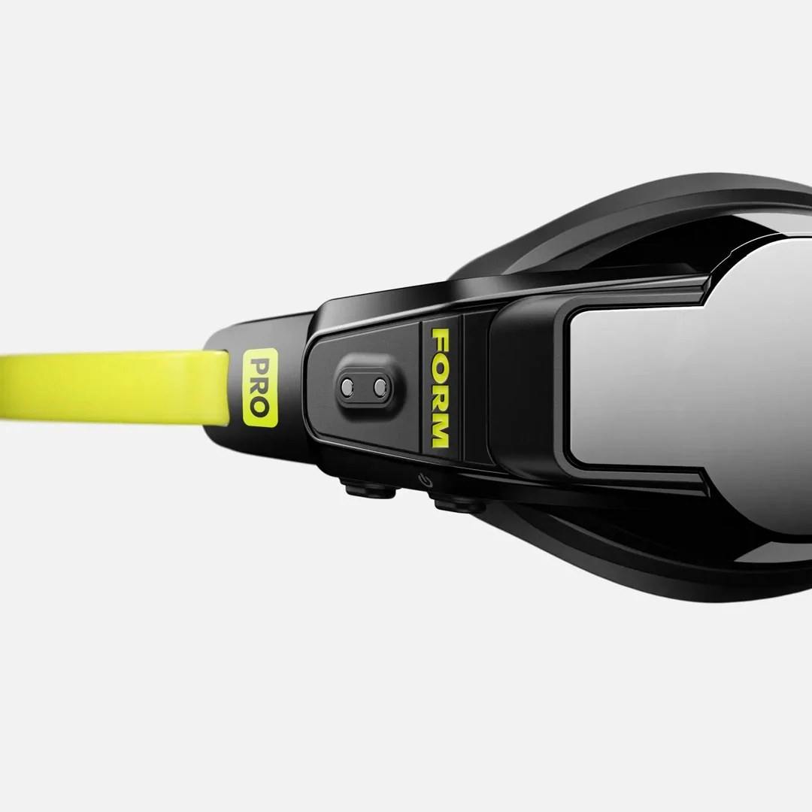
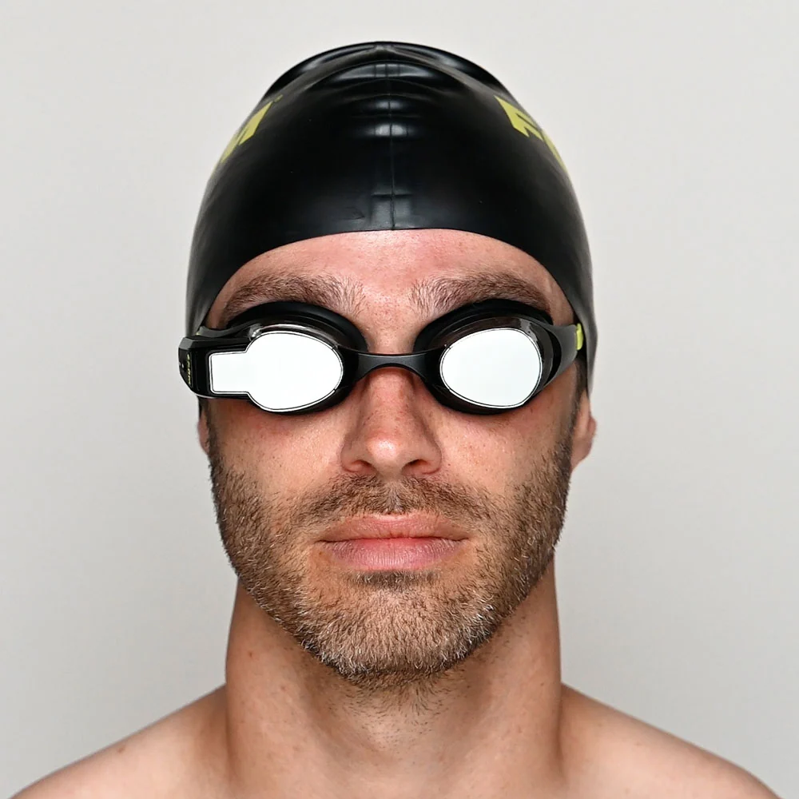
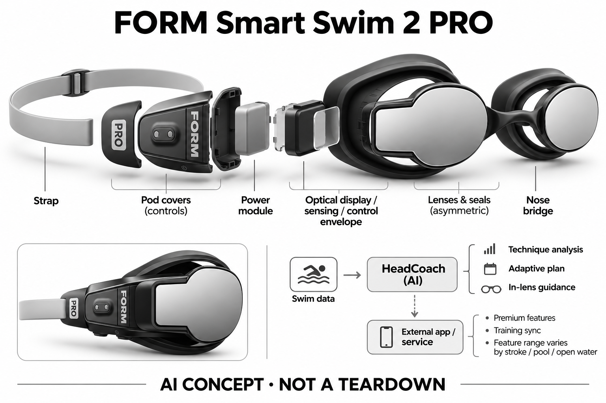

# FORM Smart Swim 2 PRO

**FORM** · 运动与训练 · 核查 2026-11-04

在泳镜中显示数据与个性化游泳提示

消费渠道：个人零售。

## 产品图片与结构参考

### 产品图

FORM Smart Swim 2 PRO官方产品外形图 · 来源：[FORM · 官方产品图片](<https://www.formswim.com/products/smart-swim-2-pro-goggles>) · [原始图片](<https://cdn.shopify.com/s/files/1/0216/5991/0208/files/SS2-Pro-Render_Pulse_still.jpg?v=1752168309&width=1200>)

### 参考图

FORM Smart Swim 2 PRO官方另一角度或使用场景参考 · 来源：[FORM · 官方产品图片](<https://www.formswim.com/products/smart-swim-2-pro-goggles>) · [原始图片](<https://cdn.shopify.com/s/files/1/0216/5991/0208/files/Dave_still.jpg?v=1752168309&width=1200>)

### AI 生成爆炸示意

**AI 生成 · 非实物拆机。** 内部为概念推断，不能作为元件布局、BOM 或维修依据。[生成提示词](../../content/hardware/prompts/form-smart-swim-2-pro.txt)

> 外形依据核验参考图；内部位置、模块形状与装配关系仅作AI概念展示。

> 已逐张查看并核对型号。源图未改色/裁切；场景、界面、附件、优惠及效果文案仅为厂商示意，不作为本目录性能或现价依据。

> 分析为基于公开资料的案头研究与 AI 辅助判断，未经用户访谈、销量审计或实物拆机。需求、画像、竞争冷门度、审美及商业机会均为研究假设，不是投资结论。

## 销售与购买

- 状态：在售。官方PRO商品页显示具体镜款、US$189促销价及Add to Cart；官方当前产品比较也确认PRO型号，未沿用已停产Smart Swim 1。

- 地区：美国、加拿大、英国、欧洲与澳大利亚官方区域站

- 价格：所见美国站促销 US$189。硬件标价与Premium会员分别展示；核心跟踪与HeadCoach高级服务范围不同，不将LT/普通版仅按镜片或套餐重复计数。

- 中国大陆：本次核实海外官方渠道，未确认同型号中国大陆官方销售、安装和完整软件服务。支持中文或品牌来自中国均不等同大陆可购买。

- [官方产品 / 商店](<https://www.formswim.com/products/smart-swim-2-pro-goggles>)

## AI 的实际作用

官方HeadCoach为AI个性化教练，使用游泳传感数据提供技术分析、适应性计划与镜内提示。

服务与联网依赖：部分HeadCoach和计划功能需Premium，App同步训练；不同泳姿、泳池或开放水域的功能范围不同，不能推定全部泳姿都支持同样反馈。

## 是否冷门

细分专业（研究判断）：依据用途与替代品的案头分类；不是销量、市场份额或用户访谈结论。

## 需求与市场

需求假设：游泳时停下来查看手表会打断节奏，镜内提示可能让训练更连续。价值应验证在真实水下可读性、注意力占用和反馈时机，而不是把数据始终可见自动等同技术提升。

## 用户画像

画像推断：有规律泳池训练或铁人三项计划、愿意跟踪动作的个人更匹配。休闲戏水或尚未建立基本游泳技能的人需求不同，智能显示也不能替代安全看护或水中技能训练。

## 竞争与替代

案头判断：显示泳镜较少见，但仍与运动手表、教练和传统训练计划竞争，属于专业细分而非无人竞争。没有销量或访谈证据支持普遍佩戴意愿，PRO与LT的镜片和传感差异不用于凑数。

## 供应链

官方可核对显示光学、运动传感和镜片材料，具体光机、传感器芯片及整机工厂未披露。推断密封、镜片耐久和佩戴贴合是制造重点；不能从品牌宣传直接推算防水寿命或良率。

## 技术路径

官方AI证据来自HeadCoach个性化分析与计划，而不是普通计圈功能。镜内提示与手机端分析分工存在，具体模型未公开；官方限制说明强调泳姿和装备会影响评分，不自行扩大适用范围。

## 产品审美

图示观察：泳镜侧面的电子模块使外观区别于普通泳镜，但镜片与绑带仍维持熟悉形态。是否压迫眼眶、起雾或适合不同鼻梁需实际试戴，宣传图不能代替水中长时佩戴反馈。

## 关键风险

风险包括显示分心、数据缺失和对开放水域导航的过度依赖；技术评分也可能受脚蹼等装备影响。应把它看作训练辅助，不能根据AI提示判断水域安全，会员变化也会影响高级功能。

## 机会与验证

市场差异是把训练提示直接放入水下视野。尚待验证的购买理由是用户能否在不增加注意负担的情况下使用反馈，以及镜片、密封与订阅服务在长期训练中是否保持可接受体验。

## 功能分层示意

这是功能关系，不是实物拆机、真实空间结构或已核实 BOM。

1. **泳姿数据**：运动及心率相关传感输入，功能图非实物拆机。（官方披露）

2. **设备处理**：本机跟踪与镜内显示提供实时游泳信息。（官方披露）

3. **训练同步**：App同步历史，部分功能受Premium授权影响。（官方披露）

4. **AI教练**：HeadCoach分析技术并提供个性化计划和提示。（官方披露）

5. **镜内反馈**：用户在支持场景中查看指导；不替代水域安全判断。（官方披露）

## 来源

1. [FORM PRO官方商店](<https://www.formswim.com/products/smart-swim-2-pro-goggles>) — 已打开，PRO型号与Add to Cart可见，会员单列。

2. [FORM HeadCoach官方说明](<https://support.formswim.com/hc/en-us/articles/22278213164691-What-is-HeadCoach>) — 已打开，明确反馈与泳姿/装备限制。

3. [FORM官方AI教练介绍](<https://www.formswim.com/blogs/media/form-expands-its-lineup-with-smart-swim-2-lt-the-simplest-way-to-get-started-with-the-form-swim-system>) — 已打开，明确HeadCoach为AI-powered；本条不另计LT款。

[返回目录](../hardware-market.md) · [网页分析](https://romanagent.github.io/Roman/#hardware/product/form-smart-swim-2-pro)
