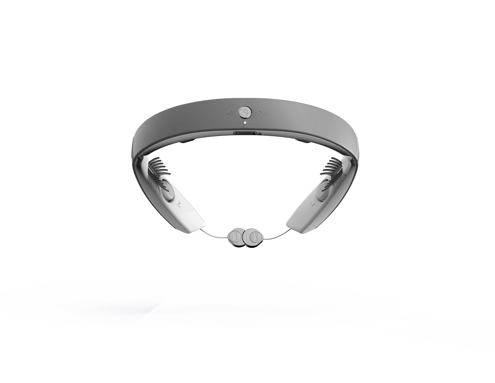
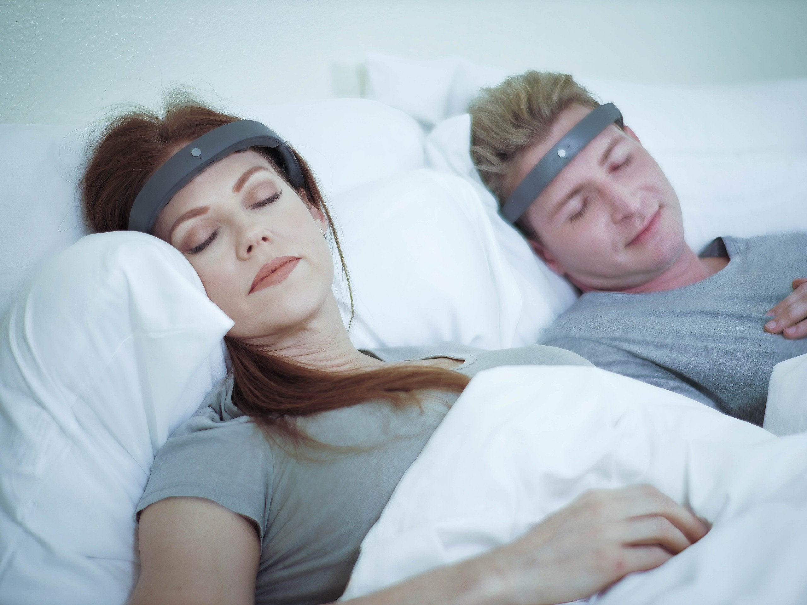
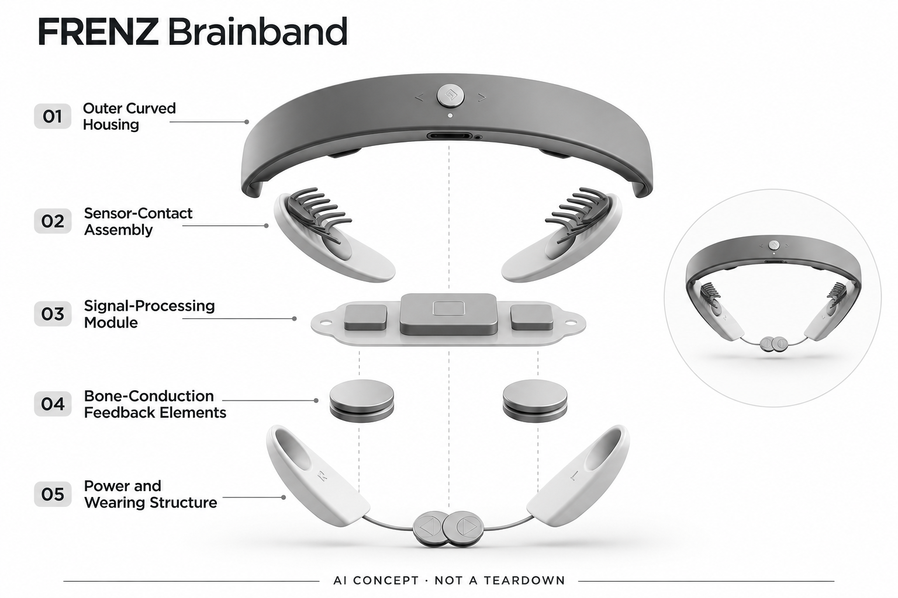

# FRENZ Brainband

**Earable Neuroscience** · 睡眠与放松 · 核查 2026-11-04

以睡眠信号采集与个性化音频反馈构成个人夜间可穿戴设备。

消费渠道：个人零售。

## 产品图片与结构参考

### 产品图

FRENZ Brainband 官方产品图 · 来源：[Earable Neuroscience](<https://frenzband.com/products/frenz-brainband>) · [原始图片](<https://cdn.shopify.com/s/files/1/0666/9330/0444/files/Grey_a30bcd9b-32b1-4cc0-9eb6-782cffa7e79c.png?v=1706933793>)

### 参考图

FRENZ Brainband 官方外观 / 使用参考图 · 来源：[Earable Neuroscience](<https://frenzband.com/products/frenz-brainband>) · [原始图片](<https://cdn.shopify.com/s/files/1/0666/9330/0444/files/grey-05.jpg?v=1710008239>)

### AI 生成爆炸示意

**AI 生成 · 非实物拆机。** 内部为概念推断，不能作为元件布局、BOM 或维修依据。[生成提示词](../../content/hardware/prompts/frenz-brainband.txt)

> 分析为基于公开资料的案头研究与 AI 辅助判断，未经用户访谈、销量审计或实物拆机。需求、画像、竞争冷门度、审美及商业机会均为研究假设，不是投资结论。

## 销售与购买

- 状态：在售。官方商品数据available=true，可见页面存在Add to cart；本轮按美国当前购买页面记录，不把旧描述中的全球配送承诺扩展到全部地区。

- 地区：美国官方店

- 价格：US$680。为所标地区和配置的核查参考；活动、税费、物流及可选服务以实际结算为准，不进行汇率换算或保证最低价。

- 中国大陆：本轮核查海外官方消费渠道，未验证中国大陆结算、型号、保修与全部AI服务可用性；不因品牌来源或支持中文推定国内可购。

- [官方产品 / 商店](<https://frenzband.com/products/frenz-brainband>)

## AI 的实际作用

官方称FRENZ AI分析睡眠相关信号并选择个性化音频，硬件与手机App共同工作；医学或疗效宣称不作为本目录独立结论。

服务与联网依赖：当前商品页强调手机App、iOS兼容及服务条件，Android和其他地区支持需单独确认；订阅、租赁和买断方案分别核价。

## 是否冷门

细分专业（研究判断）：睡眠神经科技属于消费可穿戴的窄分支，需要验证舒适度与持续价值，不能以技术复杂度推定蓝海。

## 需求与市场

需求假设：对夜间状态和个性化音频有兴趣的人，可能希望把记录与反馈放在同一个可穿戴设备中。需要验证的是持续佩戴后是否减少操作负担，而不是将“AI睡眠”标签本身当成付费动机。

## 用户画像

画像推断：愿意付出较高硬件费用并认真记录习惯的成年人，以及已有可穿戴经验的技术爱好者。手机系统兼容和睡姿会直接缩小适用人群，不能把所有睡眠困扰者当作同一目标市场。

## 竞争与替代

竞争判断：它和Elemind、Muse、手表及传统声音方案竞争，也可能被更简单的寝具改变替代。不同方案在采集信号、反馈方式和持续费用上差异很大，需要固定同一使用任务才能比较。

## 供应链

公开资料描述多模态生理感知和骨传导，未披露完整BOM或供应商合同。分析应关注传感器接触、织物舒适性、电池、音频耦合以及长期支持，不能通过外观推断真实代工和采购成本。

## 技术路径

技术价值来自把信号转换为状态判断，再选择时机与音频内容。识别、解释和反馈是不同环节，任何一环都可能受佩戴和环境影响；本目录没有把厂商性能描述转写为实测准确率。

## 产品审美

设计观察：柔性织物与低轮廓模块更适合卧室环境，视觉上弱化实验器材感。头侧和后脑接触、出汗清洁及夜间翻身仍是工业设计的核心验证点，仅靠静态图片不能评价整夜舒适。

## 关键风险

风险包括服务地区、系统兼容、订阅条款和个体体验差异。官网对效果的积极描述不能当作疾病治疗证据；涉及个人生理数据的保存和退出方式，也应在真实购买前核清。

## 机会与验证

待验证购买理由是设备能否带来稳定、低打扰的个人反馈流程。后续研究应纳入停用者和不愿佩戴者，观察数周使用及替代方案成本，本轮不提供商业成功概率或疗效建议。

## 功能分层示意

这是功能关系，不是实物拆机、真实空间结构或已核实 BOM。

1. **信号采集**：官方描述脑电等睡眠相关信号感知。（官方披露）

2. **AI状态分析**：厂商FRENZ AI对信号作个性化解读。（官方披露）

3. **音频反馈**：骨传导输出个性化音频。（官方披露）

4. **织物与电源**：可穿戴结构、电源和接触可靠性共同影响体验。（分析推断）

5. **App与服务**：手机系统和服务方案是交付的一部分。（官方披露）

## 来源

1. [FRENZ 官方商品页](<https://frenzband.com/products/frenz-brainband>) — 美国商品页面与可见加购控件。

2. [FRENZ 官方能力介绍](<https://frenzband.com/>) — 厂商AI、信号与个性化音频的描述。

3. [FRENZ 官方公开商品数据](<https://frenzband.com/products/frenz-brainband.js>) — 当前默认款available=true；仅作核查时点依据。

[返回目录](../hardware-market.md) · [网页分析](https://romanagent.github.io/Roman/#hardware/product/frenz-brainband)
