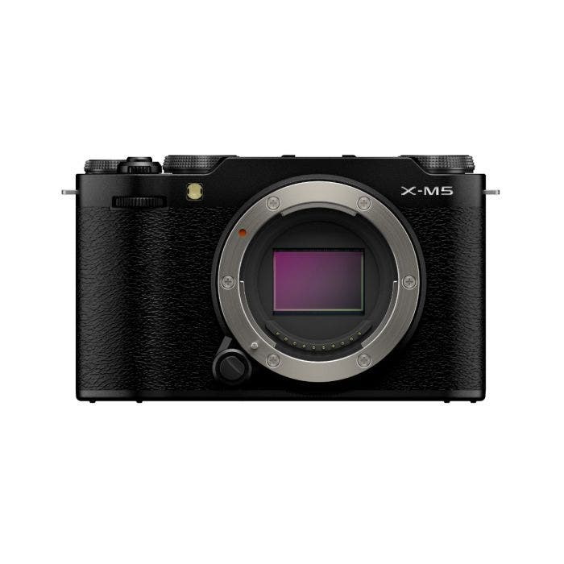
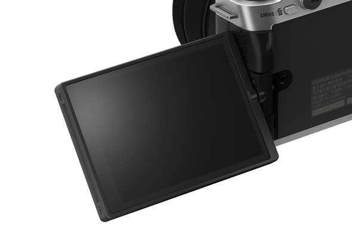
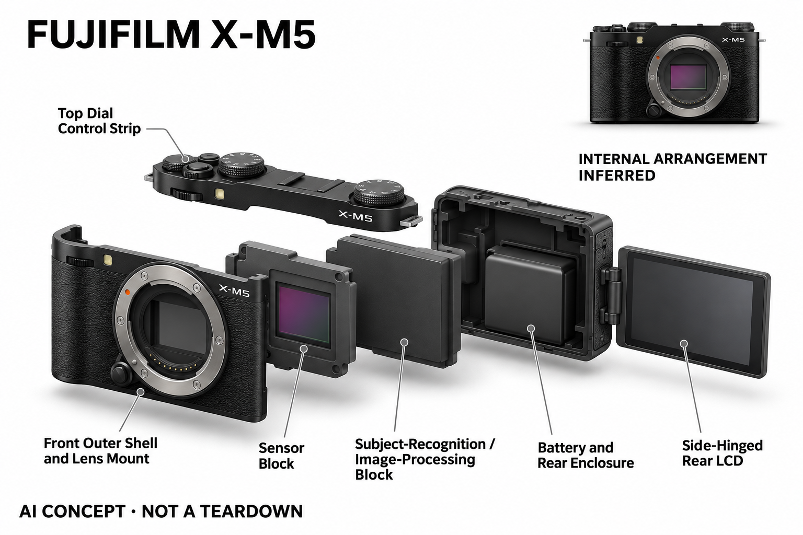

# FUJIFILM X-M5

**Fujifilm** · 影像与创作 · 核查 2026-11-04

在紧凑机身中提供深度学习主体对焦

消费渠道：个人零售。

## 产品图片与结构参考

### 产品图

FUJIFILM X-M5 · 官方产品图 · 来源：[Fujifilm · 官方图片](<https://eshop.fujifilm-x.com/uk/catalog/product/view/_ignore_category/1/id/3158/s/fujifilm-x-t3-body-1>) · [原始图片](<https://eshop.fujifilm-x.com/media/catalog/product/cache/495b3925f2d882830dd92457c3f7d74d/x/-/x-m5_front_cmos_black.jpg>)

### 参考图

FUJIFILM X-M5 · 官方参考图 · 来源：[Fujifilm · 官方图片](<https://eshop.fujifilm-x.com/uk/catalog/product/view/_ignore_category/1/id/3158/s/fujifilm-x-t3-body-1>) · [原始图片](<https://eshop.fujifilm-x.com/media/wysiwyg/HL-XSeries-590/X-M5_Touchscreen-LCD.jpg>)

### AI 生成爆炸示意

**AI 生成 · 非实物拆机。** 内部为概念推断，不能作为元件布局、BOM 或维修依据。[生成提示词](../../content/hardware/prompts/fujifilm-x-m5.txt)

> 主图黑色、参考图银色，均为X-M5，不作为两个产品计数。

> 分析为基于公开资料的案头研究与 AI 辅助判断，未经用户访谈、销量审计或实物拆机。需求、画像、竞争冷门度、审美及商业机会均为研究假设，不是投资结论。

## 销售与购买

- 状态：在售。已读取英国FUJIFILM官方eShop，显示X-M5 Body、In stock、Add to Cart及三工作日配送。历史URL含x-t3文字，实际页面型号与照片明确为X-M5；不计颜色套装。

- 地区：英国官方商店

- 价格：英国官方机身 £799 起。核查日页面快照；运费、税费、会员和配送区域按官方结算确认，不视为中国到手价。

- 中国大陆：本轮核实所列区域官方商店；未确认中国大陆官方现货、账户及完整服务，不把境外可购等同大陆可用。

- [官方产品 / 商店](<https://eshop.fujifilm-x.com/uk/catalog/product/view/_ignore_category/1/id/3158/s/fujifilm-x-t3-body-1>)

## AI 的实际作用

X-Processor 5提供基于深度学习的主体识别自动对焦，识别人和多类动物、交通工具。胶片模拟是独立色彩风格功能，不将其全部归为生成式AI。

服务与联网依赖：主体检测在机内使用，需要兼容镜头；机身、镜头、存储和远程应用各有条件，具体跟踪对象与模式按当前固件说明。

## 是否冷门

新兴竞争（研究判断）：面向随身摄影与个人视频创作形成具体使用场景；本轮没有销量与市场份额证据。

## 需求与市场

需求假设：希望随身拍照的人可能偏好较小的可换镜头机身，同时让主体跟踪降低操作负担。应观察它是否真的被带出门，以及用户更在意色彩风格还是识别功能，避免把多种动机混为一谈。

## 用户画像

画像推断：喜欢日常摄影、色彩风格与轻量视频，并愿意使用屏幕取景的个人创作者较匹配。小机身搭配大镜头可能失去体积优势，握持和操作也需要结合实际镜头而不是只看裸机。

## 竞争与替代

竞争判断：紧凑无反、固定镜头相机与高端手机都争夺随身记录场景，AI对焦已广泛出现。Fujifilm色彩和机身语言可能影响选择，但热度与缺货讨论不能直接转化为可持续市场需求。

## 供应链

供应链推断：小机身内的卡口、传感器、屏幕转轴和处理系统需要兼顾空间与散热，镜头生态影响总成本。官方未披露具体工厂及完整物料表，不根据相机外观或地域品牌猜测代工安排。

## 技术路径

官方明确主体检测采用深度学习，并将胶片模拟另列为色彩功能。技术判断应分别测试移动主体和风格输出，不能把审美预设称作生成模型，也不将检测类别丰富等同所有场景都可靠。

## 产品审美

审美判断：简洁机顶拨盘和小型轮廓延续传统相机语言，黑银配色提供风格选择但属于同一产品。按键尺寸、翻屏位置和单手握持比宣传照片更影响使用，需要真实拍摄过程来判断。

## 关键风险

风险判断：主体识别可能在复杂场景中误选，镜头、稳定方式和长录制条件也影响成片。不同地区库存页面可能不同，实际购买应确认版本、交期和保修，不能用旧搜索摘要代替当前下单证据。

## 机会与验证

市场观察：可分别访谈因色彩、体积和对焦而购买的人，记录四周后的真实携带及拍摄任务。将风格偏好与AI节省的操作步骤拆开验证，不用社交讨论量或审美评分预测产品成功。

## 功能分层示意

这是功能关系，不是实物拆机、真实空间结构或已核实 BOM。

1. **影像输入**：镜头与图像传感器采集场景。（官方披露）

2. **主体识别**：深度学习辅助目标检测跟踪。（官方披露）

3. **画面处理**：机内色彩和视频处理。（官方披露）

4. **创作交互**：实体拨盘与可翻转触屏。（官方披露）

## 来源

1. [X-M5英国官方eShop](<https://eshop.fujifilm-x.com/uk/catalog/product/view/_ignore_category/1/id/3158/s/fujifilm-x-t3-body-1>) — 已读取当前官方商品HTML；页面实际型号为X-M5，非URL旧名称。

2. [FUJIFILM X-M5官方技术](<https://www.fujifilm-x.com/en-us/products/cameras/x-m5/>) — 已实际打开官方页面；功能说明不等于独立性能测量。

[返回目录](../hardware-market.md) · [网页分析](https://romanagent.github.io/Roman/#hardware/product/fujifilm-x-m5)
