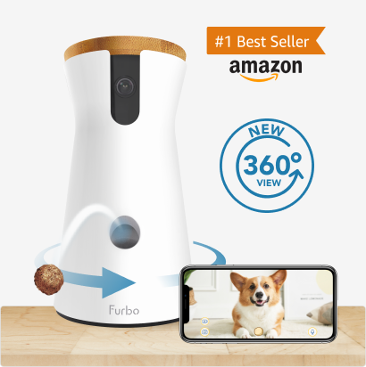
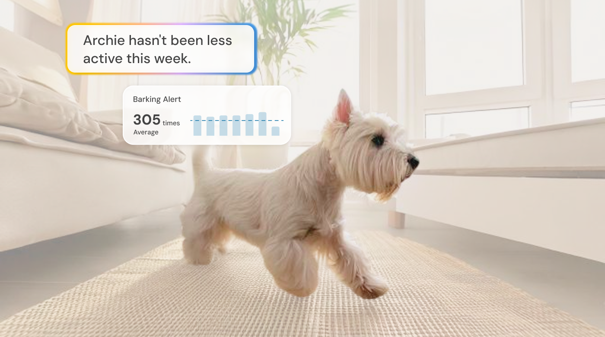
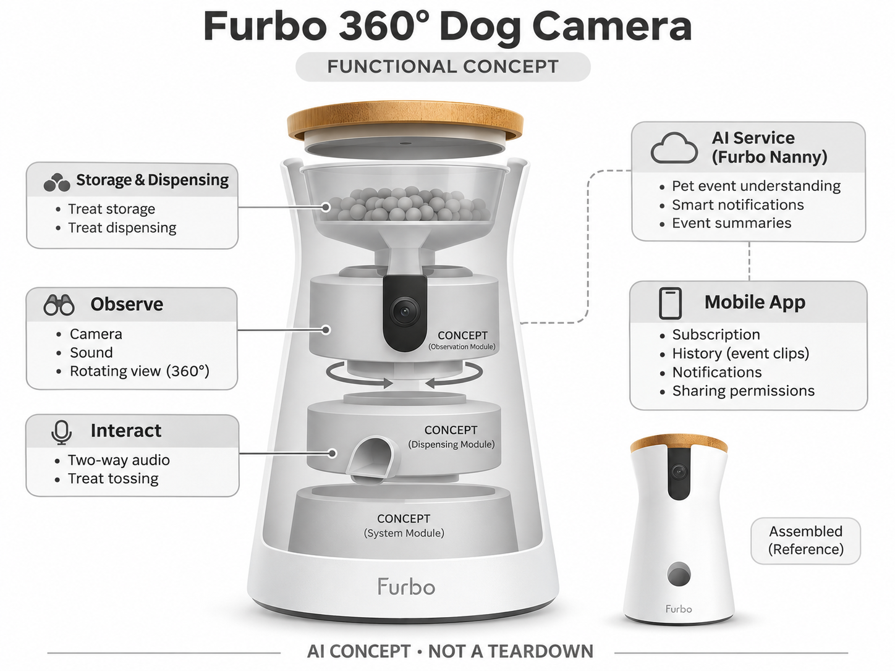

# Furbo 360° Dog Camera

**Furbo** · 宠物照护 · 核查 2026-11-04

把宠物观察、事件提醒和零食互动连接起来

消费渠道：个人零售。

## 产品图片与结构参考

### 产品图

Furbo 360° Dog Camera 官方产品外观图 · 来源：[Furbo · 官方图片](<https://furbo.com/us/products/furbo-360-dog-camera>) · [原始图片](<https://cdn.shopify.com/s/files/1/1362/5949/products/Furbo360img.png?v=1654580539&width=1200>)

### 参考图

Furbo官方Nanny行为报告场景示意，界面与数字为营销示例而非本轮实测 · 来源：[Furbo · 官方图片](<https://furbo.com/us/products/furbo-360-dog-camera>) · [原始图片](<https://cdn.shopify.com/s/files/1/1362/5949/files/AI_Nannyreport_pc.png?v=1779939440>)

### AI 生成爆炸示意

**AI 生成 · 非实物拆机。** 内部为概念推断，不能作为元件布局、BOM 或维修依据。[生成提示词](../../content/hardware/prompts/furbo-360-dog-camera.txt)

> 依据官方外观参考与公开功能生成；未披露的内部布局只作概念模块，不构成BOM或真实结构证据。

> 保留官方图原始内容与出处；画面中的营销声明不视为独立验证。

> 分析为基于公开资料的案头研究与 AI 辅助判断，未经用户访谈、销量审计或实物拆机。需求、画像、竞争冷门度、审美及商业机会均为研究假设，不是投资结论。

## 销售与购买

- 状态：在售。官方美国页明确显示硬件优惠US$54加所选首年Nanny费用US$83.92，Add to cart合计US$137.92；不把硬件补贴价误写为完整体验价格。

- 地区：美国官方零售；其他地区须分别确认

- 价格：US$137.92（页面所选首年套餐）。核查日官方页面参考；税运、订阅及优惠条件另计。会员价、服务套餐与硬件买断价不可直接混用。

- 中国大陆：本轮核实国际官方渠道；未核实中国大陆该型号的官方现货、地区服务与保修，不把跨境硬件可送达等同于全部AI功能可用。

- [官方产品 / 商店](<https://furbo.com/us/products/furbo-360-dog-camera>)

## AI 的实际作用

Furbo Nanny提供宠物事件理解、智能通知及摘要，结合摄像头和投食互动；普通旋转与投零食动作不是AI判断本身。

服务与联网依赖：高级AI告警、视频历史和摘要依赖Nanny方案与网络；补贴硬件套餐、独立硬件及续费条件需要分别核对。

## 是否冷门

竞争密集（研究判断）：宠物摄像头已有多个品牌及普通家庭摄像头替代，竞争集中在识别、通知、互动与订阅体验，不属于空白市场。

## 需求与市场

需求假设：狗主人外出时希望知道宠物是否焦躁或出现异常，并用声音、零食建立短暂联系。应测量通知的有效比例和互动是否让宠物更平静，不能从投食动作直接推导改善分离焦虑。

### 产品任务与边界 · 研究判断

需求假设：狗主人外出时希望知道宠物是否焦躁或出现异常，并用声音、零食建立短暂联系。应测量通知的有效比例和互动是否让宠物更平静，不能从投食动作直接推导改善分离焦虑。

依据：[Furbo 360° Dog Camera 官方商店](<https://furbo.com/us/products/furbo-360-dog-camera>) · [Furbo Nanny 官方服务说明](<https://furbo.com/us/pages/furbo-nanny>)

### 需求判断 · 研究判断

转动视角和零食反馈可能让主人觉得更有联系，但狗是否更平静需要单独观察，不能从主人安心推导动物福利。通知价值也不在数量，而在是否帮助确认真实事件；若频繁误报，设备可能增加查看与投食而没有减少负担。

依据：[Furbo 360° Dog Camera 官方商店](<https://furbo.com/us/products/furbo-360-dog-camera>) · [Furbo Nanny 官方服务说明](<https://furbo.com/us/pages/furbo-nanny>)

### 需求验证 · 待验证

可记录收到告警后实际查看与采取的动作，比较普通相机和带投食方案，并观察宠物自愿接近与结束后的状态。同步统计服务费用及清洁，不能把自动摘要、投食次数或用户主观安心直接解释为改善分离焦虑。

依据：[Furbo 360° Dog Camera 官方商店](<https://furbo.com/us/products/furbo-360-dog-camera>) · [Furbo Nanny 官方服务说明](<https://furbo.com/us/pages/furbo-nanny>)

## 用户画像

画像推断：经常离家、愿意支付服务费用且已有家庭Wi-Fi的狗主人。对食物敏感、过度兴奋或不适合零食的狗，互动方式需要调整；购买者还要能管理投食频率和家庭共享权限。

### 适用行为与条件 · 研究判断

画像推断：经常离家、愿意支付服务费用且已有家庭Wi-Fi的狗主人。对食物敏感、过度兴奋或不适合零食的狗，互动方式需要调整；购买者还要能管理投食频率和家庭共享权限。

依据：[Furbo 360° Dog Camera 官方商店](<https://furbo.com/us/products/furbo-360-dog-camera>) · [Furbo Nanny 官方服务说明](<https://furbo.com/us/pages/furbo-nanny>)

### 人群取舍 · 研究判断

零食适配与主人管理习惯比是否养狗更能决定产品适合度，多宠家庭还可能出现争抢或镜头目标混淆。对已有训练流程的人，设备可能是补充；只希望解决所有独处问题的用户则容易形成过高期待，画像应明确这些差别。

依据：[Furbo 360° Dog Camera 官方商店](<https://furbo.com/us/products/furbo-360-dog-camera>) · [Furbo Nanny 官方服务说明](<https://furbo.com/us/pages/furbo-nanny>)

### 画像验证 · 待验证

画像验证应让主人设定真实查看和投食规则，记录是否执行及家庭成员是否重复操作。观察不同宠物对声音、转动和出粮的反应，不强迫互动，再询问哪些告警值得付费，以区分硬件兴趣和持续服务需求。

依据：[Furbo 360° Dog Camera 官方商店](<https://furbo.com/us/products/furbo-360-dog-camera>) · [Furbo Nanny 官方服务说明](<https://furbo.com/us/pages/furbo-nanny>)

## 竞争与替代

竞争判断：Furbo与宠物相机和普通安防摄像头均存在替代关系，投食是显著的实体差异。竞争也围绕订阅补贴、告警质量与隐私信任；低首付不意味着总体成本较低。

### 比较对象与差异 · 研究判断

竞争判断：Furbo与宠物相机和普通安防摄像头均存在替代关系，投食是显著的实体差异。竞争也围绕订阅补贴、告警质量与隐私信任；低首付不意味着总体成本较低。

依据：[Furbo 360° Dog Camera 官方商店](<https://furbo.com/us/products/furbo-360-dog-camera>) · [Furbo Nanny 官方服务说明](<https://furbo.com/us/pages/furbo-nanny>)

### 竞争判断 · 研究判断

补贴硬件和独立购买会形成不同的长期成本，竞争比较不能只看首付。固定相机加独立互动也能满足部分需求，Furbo 需要证明通知与投食连接顺畅且维护可接受，云服务和隐私信任与机械功能一样重要。

依据：[Furbo 360° Dog Camera 官方商店](<https://furbo.com/us/products/furbo-360-dog-camera>) · [Furbo Nanny 官方服务说明](<https://furbo.com/us/pages/furbo-nanny>)

### 竞争验证 · 待验证

可在同一家庭比较只观察、声音和零食三种方式的实际使用，记录卡料、查看和宠物参与。明确套餐续费及历史条件后再询问选择，避免用低首付或免费试用阶段的数据推断完整拥有成本和长期订阅意愿。

依据：[Furbo 360° Dog Camera 官方商店](<https://furbo.com/us/products/furbo-360-dog-camera>) · [Furbo Nanny 官方服务说明](<https://furbo.com/us/pages/furbo-nanny>)

## 供应链

供应链分析：投食机构、料仓、旋转底座、相机和声学组件需要协同，食物碎屑会影响机械寿命。具体代工和BOM未披露；云推理与客服成本也不能忽略，应验证不同零食形状和长期卡料率。

### 功能模块拆分 · 研究判断

功能层包括相机、声音和转动视角，Nanny 事件理解及摘要，双向音频，储粮分发和应用权限。机械投食不是 AI 本身，公开资料没有具体供方和内部料道布局，功能示意不能被当作实际拆机或确定芯片架构。

依据：[Furbo 360° Dog Camera 官方商店](<https://furbo.com/us/products/furbo-360-dog-camera>) · [Furbo Nanny 官方服务说明](<https://furbo.com/us/pages/furbo-nanny>)

### 制造与供应约束 · 研究判断

供应链分析：投食机构、料仓、旋转底座、相机和声学组件需要协同，食物碎屑会影响机械寿命。具体代工和BOM未披露；云推理与客服成本也不能忽略，应验证不同零食形状和长期卡料率。

依据：[Furbo 360° Dog Camera 官方商店](<https://furbo.com/us/products/furbo-360-dog-camera>) · [Furbo Nanny 官方服务说明](<https://furbo.com/us/pages/furbo-nanny>)

### 候选与证据缺口 · 研究判断

歌尔可作为音视频与紧凑交互硬件候选，金宝可评估料仓及电子制造。两者没有 Furbo 点名合作证据，零食尺寸、碎屑和倾倒测试需专项确认，公开制造能力不能证明动物行为判断或投食效果。旋转复位后的视野也需核对。

依据：[Furbo 360° Dog Camera 官方商店](<https://furbo.com/us/products/furbo-360-dog-camera>) · [Furbo Nanny 官方服务说明](<https://furbo.com/us/pages/furbo-nanny>)

## 技术路径

官方展示Nanny的AI通知及视频理解。技术判断：叫声识别需要区分电视、邻居和自家狗，误分类会消耗用户注意力。应保留原始视频与可调告警，不把文本总结视为事实确定的行为诊断。

### 已披露技术边界 · 研究判断

官方展示Nanny的AI通知及视频理解。技术判断：叫声识别需要区分电视、邻居和自家狗，误分类会消耗用户注意力。应保留原始视频与可调告警，不把文本总结视为事实确定的行为诊断。

依据：[Furbo 360° Dog Camera 官方商店](<https://furbo.com/us/products/furbo-360-dog-camera>) · [Furbo Nanny 官方服务说明](<https://furbo.com/us/pages/furbo-nanny>)

### 系统难点判断 · 研究判断

声音事件可能来自电视、邻居或自家狗，视觉也会因遮挡和转向失去上下文，摘要不应把这些推断写成确定事实。系统需要保留原片、可调提醒和清楚原因，让用户区分正常查看、AI 分类和机械互动这三层。

依据：[Furbo 360° Dog Camera 官方商店](<https://furbo.com/us/products/furbo-360-dog-camera>) · [Furbo Nanny 官方服务说明](<https://furbo.com/us/pages/furbo-nanny>)

### 技术验证 · 待验证

验证应覆盖多声源、宠物离开视野和多人共享，分别记录告警、摘要和投食结果，并模拟网络中断。对不同套餐逐项核对，不能以一次叫声识别成功或流畅文字概括保证全部事件可靠，也不能据此诊断行为问题。

依据：[Furbo 360° Dog Camera 官方商店](<https://furbo.com/us/products/furbo-360-dog-camera>) · [Furbo Nanny 官方服务说明](<https://furbo.com/us/pages/furbo-nanny>)

## 产品审美

审美判断：竖向白色机身和木质感顶部有家居友好性，摄像头与出粮口易辨认。摆放稳定、宠物推倒风险、补粮手感和清洁料仓路径，比新增屏幕或灯效更影响日常使用。

### 外观与交互语言 · 研究判断

审美判断：竖向白色机身和木质感顶部有家居友好性，摄像头与出粮口易辨认。摆放稳定、宠物推倒风险、补粮手感和清洁料仓路径，比新增屏幕或灯效更影响日常使用。

依据：[Furbo 360° Dog Camera 官方商店](<https://furbo.com/us/products/furbo-360-dog-camera>) · [Furbo Nanny 官方服务说明](<https://furbo.com/us/pages/furbo-nanny>)

### 使用中审美判断 · 研究判断

家居外形有助长期摆放，但投食吸引宠物后，稳定性和料仓清洁比顶部材质更重要。放置高度同时影响视野、出粮和动物接触，设计应让这些取舍清楚，不能为了隐藏设备或获得好看画面牺牲维护与稳固。

依据：[Furbo 360° Dog Camera 官方商店](<https://furbo.com/us/products/furbo-360-dog-camera>) · [Furbo Nanny 官方服务说明](<https://furbo.com/us/pages/furbo-nanny>)

### 设计验证 · 待验证

设计验证应观察补粮、清理碎屑、设备转向及宠物接近，记录是否易被推倒和是否出现操作死角。还需检查主人能否理解出粮与通知状态，不把单独产品照片的温和外观当作真实家庭里低干扰的保证。

依据：[Furbo 360° Dog Camera 官方商店](<https://furbo.com/us/products/furbo-360-dog-camera>) · [Furbo Nanny 官方服务说明](<https://furbo.com/us/pages/furbo-nanny>)

## 关键风险

风险判断：频繁投食可能打乱饮食，远程互动也不能替代遛狗与人工照护。补贴套餐的续费、云端影像和账号共享需要明确；AI健康或行为描述不能替代专业兽医及行为评估。

### 主要失效与依赖 · 研究判断

风险判断：频繁投食可能打乱饮食，远程互动也不能替代遛狗与人工照护。补贴套餐的续费、云端影像和账号共享需要明确；AI健康或行为描述不能替代专业兽医及行为评估。

依据：[Furbo 360° Dog Camera 官方商店](<https://furbo.com/us/products/furbo-360-dog-camera>) · [Furbo Nanny 官方服务说明](<https://furbo.com/us/pages/furbo-nanny>)

### 风险传播判断 · 研究判断

当主人把每次告警都用零食回应，可能偏离原有饮食和训练安排，应用活跃并不等于更好照护。设备和服务需要保持边界，提示只是辅助信息，既不能替代人工陪伴，也不能以行为或健康文字代替专业判断。

依据：[Furbo 360° Dog Camera 官方商店](<https://furbo.com/us/products/furbo-360-dog-camera>) · [Furbo Nanny 官方服务说明](<https://furbo.com/us/pages/furbo-nanny>)

### 风险验证 · 待验证

风险验证应演练重复远程投食、卡料、共享操作和服务到期，检查是否能清楚发现并停止。记录误报与漏报对主人行为的影响，不能以宠物靠近设备或用户安心作为健康、情绪或长期独处安全的证据。

依据：[Furbo 360° Dog Camera 官方商店](<https://furbo.com/us/products/furbo-360-dog-camera>) · [Furbo Nanny 官方服务说明](<https://furbo.com/us/pages/furbo-nanny>)

## 机会与验证

机会假设：先验证主人愿为哪些少见但重要的事件付费，例如真正有效的异常提醒与人工联系流程。新产品应比较不带投食的观察方案，避免把复杂互动机构当成所有宠物家庭的必要配置。

### 可能的机会入口 · 研究判断

机会假设：先验证主人愿为哪些少见但重要的事件付费，例如真正有效的异常提醒与人工联系流程。新产品应比较不带投食的观察方案，避免把复杂互动机构当成所有宠物家庭的必要配置。

依据：[Furbo 360° Dog Camera 官方商店](<https://furbo.com/us/products/furbo-360-dog-camera>) · [Furbo Nanny 官方服务说明](<https://furbo.com/us/pages/furbo-nanny>)

### 机会成立条件 · 研究判断

值得研究的是少见但可行动事件与后续人工联系流程，而非更多花样通知。若主人主要需要确认宠物正常休息，简单可靠观察可能足够；是否增加投食应由真实互动需求决定，不应把复杂机构视作宠物摄像头必备。

依据：[Furbo 360° Dog Camera 官方商店](<https://furbo.com/us/products/furbo-360-dog-camera>) · [Furbo Nanny 官方服务说明](<https://furbo.com/us/pages/furbo-nanny>)

### 下一步验证 · 待验证

下一步可追踪告警到查看再到行动的全过程，比较没有投食的方案及不同摘要设计，记录持续使用与维护。用真正减少无效查看且不误导的事件判断价值，避免通过放大离家焦虑或计算互动次数预测市场。

依据：[Furbo 360° Dog Camera 官方商店](<https://furbo.com/us/products/furbo-360-dog-camera>) · [Furbo Nanny 官方服务说明](<https://furbo.com/us/pages/furbo-nanny>)

## 对应供应链公司

能力候选用于选型研究，不代表本产品实际采用；未公开的供货关系不作推断。

- [goertek](../supply-chain/goertek.md) — **能力候选 · 非已采用** / 宠物相机声音与旋转交互整合：歌尔公开声学和智能硬件能力可对应收音、发声及紧凑终端评估，但叫声分类、投食和动物接受需独立验证；没有 Furbo 型号供货披露，当前仅为工程候选。

- [new-kinpo-group](../supply-chain/new-kinpo-group.md) — **能力候选 · 非已采用** / 料仓机构与电子制造评估：金宝家电、PCBA和模塑能力可支持料仓外壳及电子制造评审，但零食适配、卡料和清洁需专项确认；未见 Furbo 点名合作证据，不能据此认定实际代工或行为效果。

[浏览供应链目录](../supply-chain.md)

## 功能分层示意

这是功能关系，不是实物拆机、真实空间结构或已核实 BOM。

1. **观察**：相机、声音和转动视角。（官方披露）

2. **AI服务**：Nanny事件理解、智能提醒和摘要。（官方披露）

3. **互动**：双向音频与投零食。（官方披露）

4. **料仓机构**：储粮与分发的功能模块，非实际拆机。（分析推断）

5. **手机端**：订阅、历史、通知和共享权限。（官方披露）

## 来源

1. [Furbo 360° Dog Camera 官方商店](<https://furbo.com/us/products/furbo-360-dog-camera>) — 已实际打开；核查购物入口、产品形态与AI声明，未完成支付或收货。

2. [Furbo Nanny 官方服务说明](<https://furbo.com/us/pages/furbo-nanny>) — 已实际打开的官方技术或服务说明；厂商声明不视为独立性能或疗效验证。

[返回目录](../hardware-market.md) · [网页分析](https://romanagent.github.io/Roman/#hardware/product/furbo-360-dog-camera)
