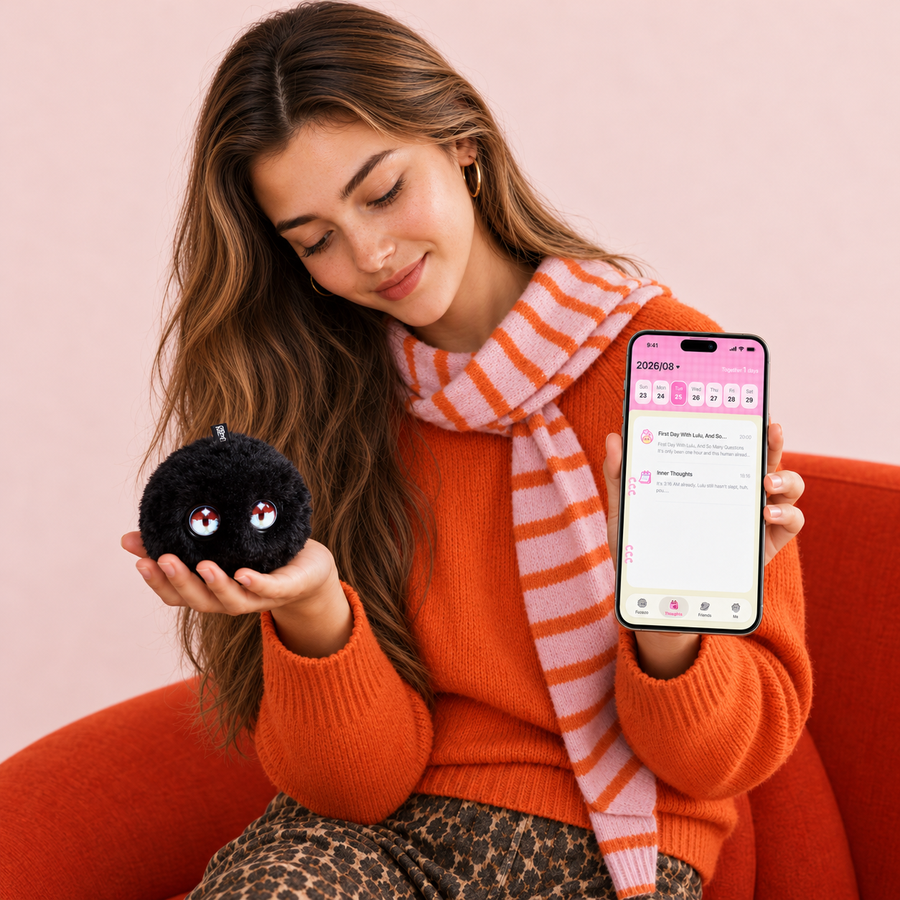
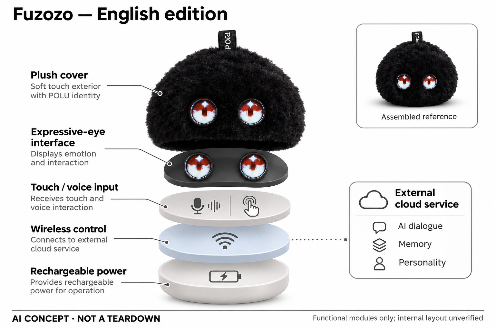

# Fuzozo 芙崽 AI Pet（英语版）

**Robopoet / 珞博智能** · AI玩具 · 核查 2026-11-06

把对话、触摸回应和角色养成放进随身毛绒电子宠物。

消费渠道：个人零售。

## 产品图片与结构参考

### 产品图

Fuzozo英语版POLU 官方产品图 · 来源：[Fuzozo / Robopoet · 官方图片](<https://fuzozo.net/>) · [原始图片](<https://fuzozo.net/cdn/shop/files/fuzozo-polu-scene-aligned-1101.jpg?v=1793539537&width=1600>)

### 参考图

Fuzozo英语版POLU 官方参考图（含厂商展示场景） · 来源：[Fuzozo / Robopoet · 官方图片](<https://fuzozo.net/>) · [原始图片](<https://fuzozo.net/cdn/shop/files/fuzozo-designer-privacy-data-1031.png?v=1793406404&width=900>)

### AI 生成爆炸示意

**AI 生成 · 非实物拆机。** 内部为概念推断，不能作为元件布局、BOM 或维修依据。[生成提示词](../../content/hardware/prompts/fuzozo-ai-pet.txt)

> 单独内置ImageGen生成并目视核验；云端与机内功能分开，未知结构为抽象功能层，不代表原厂PCB或真实装配。

> 保留官方原图内容；场景或宣传文字不代表本研究实测，Kumma两张为同款外观展示。

> 分析为基于公开资料的案头研究与 AI 辅助判断，未经用户访谈、销量审计或实物拆机。需求、画像、竞争冷门度、审美及商业机会均为研究假设，不是投资结论。

## 销售与购买

- 状态：在售。官方英语商店各角色显示Add to cart、199美元与付款后发货说明；购买证据不来自奖项或媒体发布。

- 地区：美国、加拿大及官网列示34个地区（英语版）、日本（独立日语版）

- 价格：US$199；可选Plus US$9.90/月。英语版免费每日对话及移动数据有额度，Plus增加额度；日本版价格、语言与服务另行确认，不把颜色角色拆开计价。

- 中国大陆：核查英语版官方配送名单不含中国大陆，只列香港等地区，亦不保证中文对话；国内芙崽版本存在品牌介绍但本轮未验证具体官方订单，不推定海外款可在大陆完整使用。

- [官方产品 / 商店](<https://fuzozo.net/>)

## AI 的实际作用

语音转文字后结合上下文生成角色回答，并把对话与互动用于日记、记忆和性格成长；触摸反馈与眼睛表情配合呈现。厂商未公开完整模型或证明系统真的理解情绪。

服务与联网依赖：英语版需手机App、账户与互联网，支持2.4GHz Wi-Fi和列示地区4G；联网AI限15岁以上，15—17岁需监护同意，免费额度外可选Plus。

## 是否冷门

新兴竞争（研究判断）：随身养成玩具正在出现更多竞争者，角色与服务连续性是差异候选，不等于低竞争市场。

## 需求与市场

Fuzozo英语版面向愿意与小型电子宠物建立日常互动的人，通过毛绒触感、眼睛表情、对话和回忆日记维持关系。它的核心任务是娱乐陪伴与角色养成，不是学习机或心理治疗；需求判断要看用户是否愿意反复分享生活，而不是根据可爱外观或官方用户数量推断持续价值。

### 需求判断 · 研究判断

Fuzozo英语版面向愿意与小型电子宠物建立日常互动的人，通过毛绒触感、眼睛表情、对话和回忆日记维持关系。它的核心任务是娱乐陪伴与角色养成，不是学习机或心理治疗；需求判断要看用户是否愿意反复分享生活，而不是根据可爱外观或官方用户数量推断持续价值。

依据：[Fuzozo英语版官方直售](<https://fuzozo.net/>) · [Fuzozo FAQ](<https://fuzozo.net/pages/faq>)

### 关系与任务 · 研究判断

相比一次性问答，日记和性格成长把多次互动连接起来，可能让使用者在出门、回家或休息时主动找它。但记住内容也会增加隐私和错误记忆的成本，用户可能只希望有轻松的角色反应；不能把更长对话、更深依赖或更频繁开启都当作更好的陪伴结果。

依据：[Fuzozo英语版官方直售](<https://fuzozo.net/>) · [Fuzozo FAQ](<https://fuzozo.net/pages/faq>)

### 需求验证 · 待验证

可跟踪成年人在一个月内主动互动的场景、分享内容的意愿和日记回看的次数，再与普通毛绒及手机角色应用比较。观察新鲜感过后是否仍有具体使用理由，同时记录不愿被记住的内容和想暂停关系的时刻，本轮不以这些建议冒充已完成的访谈结果。

依据：[Fuzozo英语版官方直售](<https://fuzozo.net/>) · [Fuzozo FAQ](<https://fuzozo.net/pages/faq>)

## 用户画像

英语版FAQ明确账户和联网AI服务只面向十五岁及以上，未成年人需要监护人的明确同意与监督。即使主页存在家庭照片，也不能将其直接推荐给幼儿；用户画像更应聚焦符合该版本要求、能理解云端对话边界且愿意管理账户的青少年和成人。

### 年龄边界 · 官方资料

英语版FAQ明确账户和联网AI服务只面向十五岁及以上，未成年人需要监护人的明确同意与监督。即使主页存在家庭照片，也不能将其直接推荐给幼儿；用户画像更应聚焦符合该版本要求、能理解云端对话边界且愿意管理账户的青少年和成人。

依据：[Fuzozo英语版官方直售](<https://fuzozo.net/>) · [Fuzozo FAQ](<https://fuzozo.net/pages/faq>)

### 地区画像 · 研究判断

英语版以自然英语对话为目标，不保证其他语言，官方配送与移动网络又有地区范围。中国品牌身份不能证明海外款自动适合国内家庭，购买者需要区分英语、日本及国内版本；实际画像应包括主要语言、居住地区和网络，而不是只按喜欢潮玩的人划分。

依据：[Fuzozo英语版官方直售](<https://fuzozo.net/>) · [Fuzozo FAQ](<https://fuzozo.net/pages/faq>)

### 画像验证 · 待验证

应让符合年龄条件的使用者先解释免费额度、联网需求和数据删除方式，再观察其是否仍愿意携带。对英语学习者还要区分为了聊天娱乐还是为了纠正语言，后者不能从自然英语宣传推定教学效果；未达到服务年龄的人群不应纳入联网体验验证。

依据：[Fuzozo英语版官方直售](<https://fuzozo.net/>) · [Fuzozo FAQ](<https://fuzozo.net/pages/faq>)

## 竞争与替代

Fuzozo同时与潮流毛绒、电子宠物和手机角色聊天竞争，差异在随身触摸反馈与持续日记结合。Moflin偏向非语言情感行为，传统毛绒没有云端回应，而手机角色更容易输入长文；选择取决于用户想养成角色、随手聊天还是只要装饰，不适合统一按聪明程度排序。

### 替代方案 · 研究判断

Fuzozo同时与潮流毛绒、电子宠物和手机角色聊天竞争，差异在随身触摸反馈与持续日记结合。Moflin偏向非语言情感行为，传统毛绒没有云端回应，而手机角色更容易输入长文；选择取决于用户想养成角色、随手聊天还是只要装饰，不适合统一按聪明程度排序。

依据：[Fuzozo英语版官方直售](<https://fuzozo.net/>) · [Fuzozo FAQ](<https://fuzozo.net/pages/faq>)

### 系列去重 · 研究判断

官网五种颜色具有不同初始角色，但共享相同核心对话与养成任务，本目录按系列收一条。日本版与英语版有语言及服务差异，仍不把它们包装成五到十种独立需求；比较时保留版本限制，避免消费者以为更换颜色或地区就一定得到新的技术能力。

依据：[Fuzozo英语版官方直售](<https://fuzozo.net/>) · [Fuzozo FAQ](<https://fuzozo.net/pages/faq>)

### 比较验证 · 待验证

可让用户分别用Fuzozo与手机角色应用记录同一周的生活，再比较主动互动、回忆正确性和携带负担。若用户仅喜欢外观，普通毛绒可能更经济；若偏爱文字深聊，手机可能更灵活，不能把实体形态、联网额度或角色数量本身当作胜出的证据。

依据：[Fuzozo英语版官方直售](<https://fuzozo.net/>) · [Fuzozo FAQ](<https://fuzozo.net/pages/faq>)

## 供应链

公开资料支持毛绒外套、表情眼睛、语音与触摸输入、无线联网和充电供电，日记与角色记忆涉及外部服务。官网说明无摄像头，因此概念图不加入视觉识别；具体显示器类型、触摸器件、天线和电池布置未披露，不能把功能层示意当作已拆机确认的真实结构。

### 模块拆分 · 研究判断

公开资料支持毛绒外套、表情眼睛、语音与触摸输入、无线联网和充电供电，日记与角色记忆涉及外部服务。官网说明无摄像头，因此概念图不加入视觉识别；具体显示器类型、触摸器件、天线和电池布置未披露，不能把功能层示意当作已拆机确认的真实结构。

依据：[Fuzozo英语版官方直售](<https://fuzozo.net/>) · [Fuzozo FAQ](<https://fuzozo.net/pages/faq>)

### 交付约束 · 研究判断

随身毛球需要兼顾挂持拉扯、绒毛清洁、屏幕保护、充电与无线稳定，内部电池不可自行更换会影响维修设计。型号尺寸与服务权益公开并不意味着完整供应链透明，仍要验证材料和电子装配的一致性；产品寿命不能仅由云端角色不断更新来解释。

依据：[Fuzozo英语版官方直售](<https://fuzozo.net/>) · [Fuzozo FAQ](<https://fuzozo.net/pages/faq>)

### 能力候选 · 研究判断

歌尔可作为语音、精密结构与整机工程候选，Seeed可承担早期控制与感知原型验证，两者均没有Fuzozo点名供货证据。量产还需要毛绒、眼睛窗口、触摸校准和跨地区网络服务协同，候选关联只为重新设计提供询价入口，不代表原厂采购关系。

依据：[Fuzozo英语版官方直售](<https://fuzozo.net/>) · [Fuzozo FAQ](<https://fuzozo.net/pages/faq>)

## 技术路径

隐私政策明确语音会转为文字，再结合上下文提供输出，互动记录也可发送云端用于偏好和关系功能。可确认的是生成式语言服务与角色状态相结合，而不是眼睛动画本身具有理解能力；官网所说性格成长不应解释为生物情感或已验证的心理识别准确率。

### AI职责 · 研究判断

隐私政策明确语音会转为文字，再结合上下文提供输出，互动记录也可发送云端用于偏好和关系功能。可确认的是生成式语言服务与角色状态相结合，而不是眼睛动画本身具有理解能力；官网所说性格成长不应解释为生物情感或已验证的心理识别准确率。

依据：[Fuzozo英语版官方直售](<https://fuzozo.net/>) · [Fuzozo FAQ](<https://fuzozo.net/pages/faq>)

### 一致性难点 · 研究判断

长期记忆与日记需要选择保留什么、如何处理用户纠正以及同一角色的连续性，错误归因可能比一次闲聊答错更明显。多设备共用和家庭成员声音也可能造成混淆，官网没有充分披露这些边界；技术评价必须关注可纠正性，而不只看对话自然和表情丰富。

依据：[Fuzozo英语版官方直售](<https://fuzozo.net/>) · [Fuzozo FAQ](<https://fuzozo.net/pages/faq>)

### 技术验证 · 待验证

建议用可公开的日常虚构记录测试跨天回忆、事实更正、忘记指令及网络中断恢复，并检查日记是否把假设当成事实。分别观察触摸、眼睛和语音反馈的时间关系，不推测未公开传感器；本轮仅根据公开资料分析，未做实际记忆准确率或端云流量测试。

依据：[Fuzozo英语版官方直售](<https://fuzozo.net/>) · [Fuzozo FAQ](<https://fuzozo.net/pages/faq>)

## 产品审美

黑色毛球、两只表情眼睛和小挂标把Fuzozo放在潮流配饰与电子宠物之间，便于随身携带，也能让用户感到它在回应。主图所示POLU只是系列代表，配色不是新硬件；审美评价需要考虑日常衣物搭配、触感和屏幕光线，而不是只看新品摄影效果。

### 审美判断 · 研究判断

黑色毛球、两只表情眼睛和小挂标把Fuzozo放在潮流配饰与电子宠物之间，便于随身携带，也能让用户感到它在回应。主图所示POLU只是系列代表，配色不是新硬件；审美评价需要考虑日常衣物搭配、触感和屏幕光线，而不是只看新品摄影效果。

依据：[Fuzozo英语版官方直售](<https://fuzozo.net/>) · [Fuzozo FAQ](<https://fuzozo.net/pages/faq>)

### 表情责任 · 研究判断

拟人的眼神会让用户对理解和记忆产生较高期待，若实际只是固定状态动画，容易高估设备能力。界面应清楚表达联网、额度用尽和无法回答的状态，避免所有情形都用可爱眼睛遮掩；角色吸引力与功能可理解性必须同时成立，才能减少使用中的误会。

依据：[Fuzozo英语版官方直售](<https://fuzozo.net/>) · [Fuzozo FAQ](<https://fuzozo.net/pages/faq>)

### 外观验证 · 待验证

可以观察用户连续携带后绒毛、挂环与眼睛窗口的磨损，记录拿在手中和挂在包上的声音与触摸差异。检查充电和清洁是否破坏日常搭配，也要问用户是否愿意在公共场所让玩具说话，不能从社交照片直接推断真实长期使用场合。

依据：[Fuzozo英语版官方直售](<https://fuzozo.net/>) · [Fuzozo FAQ](<https://fuzozo.net/pages/faq>)

## 关键风险

长期记忆、亲密度和日记涉及个人叙述及互动记录，官网无持续录音宣传并不等于没有数据留存或云端处理。用户需要能够理解授权、纠正和删除的边界，尤其不能把玩具当成不会泄漏秘密的真人；本研究不对隐私合规作法律结论，也未独立审计服务。

### 数据与关系 · 研究判断

长期记忆、亲密度和日记涉及个人叙述及互动记录，官网无持续录音宣传并不等于没有数据留存或云端处理。用户需要能够理解授权、纠正和删除的边界，尤其不能把玩具当成不会泄漏秘密的真人；本研究不对隐私合规作法律结论，也未独立审计服务。

依据：[Fuzozo英语版官方直售](<https://fuzozo.net/>) · [Fuzozo FAQ](<https://fuzozo.net/pages/faq>)

### 地区与额度 · 研究判断

免费对话和移动数据均有额度，Plus只是增加额度，断网或额度变化可能影响日常互动。海外语言和配送限制也使购买具有版本风险，国内用户不能只凭品牌来自中国就选择英语款；应把长期网络、订阅和维修条件一起考虑，而不是把整机售价视为全部成本。

依据：[Fuzozo英语版官方直售](<https://fuzozo.net/>) · [Fuzozo FAQ](<https://fuzozo.net/pages/faq>)

### 风险验证 · 待验证

应由符合年龄条件的成人先检查不确定回答、情绪化内容和记忆删除的处理，确认用户能随时停止互动并理解角色不是真实意识。另需核对转赠时账户和云端记录是否解除，记录异常和客服响应；这些是建议的验证流程，不能宣传为已经完成的安全测试。

依据：[Fuzozo英语版官方直售](<https://fuzozo.net/>) · [Fuzozo FAQ](<https://fuzozo.net/pages/faq>)

## 机会与验证

机会在于让随身玩具通过短对话、触摸和可回看的日记形成轻量习惯，服务成人娱乐与角色养成。若核心价值只是毛绒收藏，持续云服务可能是额外负担，因此创业判断应先核实用户真正为哪部分付费，不以官方角色故事和情绪陪伴措辞替代需求证据。

### 机会判断 · 研究判断

机会在于让随身玩具通过短对话、触摸和可回看的日记形成轻量习惯，服务成人娱乐与角色养成。若核心价值只是毛绒收藏，持续云服务可能是额外负担，因此创业判断应先核实用户真正为哪部分付费，不以官方角色故事和情绪陪伴措辞替代需求证据。

依据：[Fuzozo英语版官方直售](<https://fuzozo.net/>) · [Fuzozo FAQ](<https://fuzozo.net/pages/faq>)

### 产品方向 · 研究判断

更透明的记忆编辑、清楚的额度提示和跨场景的静音操作，可能比增加更多颜色更值得投入。版本之间的语言和账户规则也可成为服务体验重点，但本轮没有证明这些改进已实现或具备商业回报；这里只列由现有产品边界推导出的待验证机会。

依据：[Fuzozo英语版官方直售](<https://fuzozo.net/>) · [Fuzozo FAQ](<https://fuzozo.net/pages/faq>)

### 商业验证 · 待验证

可按成人自用与赠礼分别跟踪复用、退货、服务费用和日记价值，核实有多少互动在免费额度内就足够。对闲置和暂停服务同样记录，不把付费Plus比例或品牌宣传销量视为已知事实；只有持续任务与愿付价格吻合，才有理由扩大产品线和内容投入。

依据：[Fuzozo英语版官方直售](<https://fuzozo.net/>) · [Fuzozo FAQ](<https://fuzozo.net/pages/faq>)

## 对应供应链公司

能力候选用于选型研究，不代表本产品实际采用；未公开的供货关系不作推断。

- [goertek](../supply-chain/goertek.md) — **能力候选 · 非已采用** / 音频、外观与整机整合候选：歌尔公开声学、精密结构及智能硬件整合能力可匹配随身电子宠物的多模块协同；没有Fuzozo实际采用证据，仍需核实毛绒装配、触摸校准、体积和项目合作条件，不能据能力推定供货。

- [seeed-studio](../supply-chain/seeed-studio.md) — **能力候选 · 非已采用** / 触摸语音联网样机验证：Seeed的开源感知和电子工程支持可用于验证触摸、语音与网络交互的原型；本条不是Fuzozo原厂供应链披露，显示窗口、毛绒材料、移动网络及量产测试还需专项设计与询价。

[浏览供应链目录](../supply-chain.md)

## 功能分层示意

这是功能关系，不是实物拆机、真实空间结构或已核实 BOM。

1. **毛绒与挂持**：圆形毛绒角色可随身携带，配色与人物性格属于同一系列。（官方披露）

2. **触摸和语音**：输入触摸与语音互动；具体传感器和布置位置未披露。（官方披露）

3. **表情与播音**：眼睛显示角色表情并播放声音；无摄像头声明来自官网。（官方披露）

4. **无线与供电**：Wi-Fi/4G连接与内置充电供电，具体电路仅作功能概念。（官方披露）

5. **云端角色服务**：对话、日记与人格成长涉及联网服务和账户数据。（官方披露）

## 来源

1. [Fuzozo英语版官方直售](<https://fuzozo.net/>) — 实际打开199美元、Add to cart和出货说明；五种颜色角色不分成独立硬件。

2. [Fuzozo FAQ](<https://fuzozo.net/pages/faq>) — 明确联网AI年龄15+、英语服务、免费额度、可选Plus、Wi-Fi/4G与配送地区。

3. [Fuzozo隐私政策](<https://fuzozo.net/policies/privacy-policy>) — 实际打开2026-10-13政策，语音转文字作上下文处理，互动记录可上传云端；不把官网隐私宣传视为独立审计。

4. [Fuzozo英语店运营主体](<https://fuzozo.net/policies/legal-notice>) — 明确ROBOPOET TECHNOLOGY HONGKONG LIMITED为运营销售方，品牌站不等于任意同名店铺。

5. [Fuzozo日本官方版本](<https://www.fuzozo.jp/>) — 英语官网直接链接日本店，日本店明确日语版及当地价格；语言版本不同但不重复计数。

[返回目录](../hardware-market.md) · [网页分析](https://romanagent.github.io/Roman/#hardware/product/fuzozo-ai-pet)
