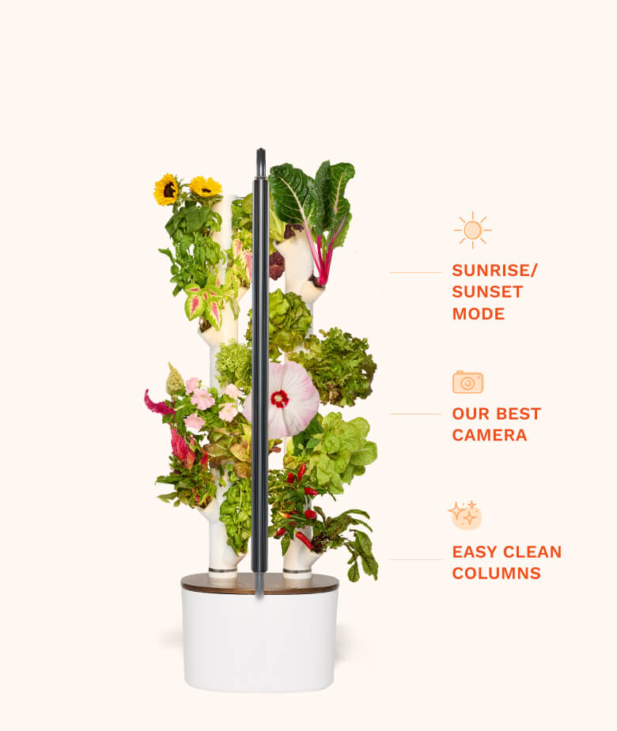
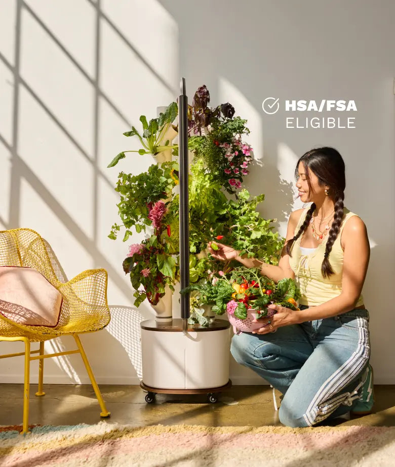
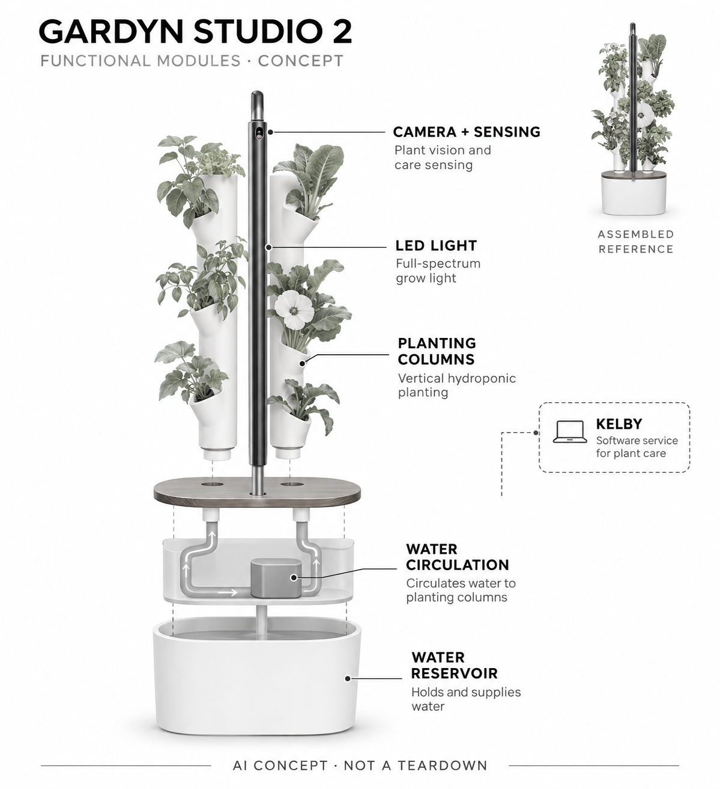

# Gardyn Studio 2

**Gardyn** · 庭院与自然 · 核查 2026-11-04

用植物影像和生长阶段指导家用水培

消费渠道：个人零售。

## 产品图片与结构参考

### 产品图

官方Studio 2整机与功能展示 · 来源：[Gardyn · 官方图片](<https://mygardyn.com/products/gardyn-studio-gen2>) · [原始图片](<https://cdn.shopify.com/s/files/1/0788/6576/0493/files/Studio_2_-_PDP_2_-_Mobile.jpg?v=1785856990>)

### 参考图

官方家庭种植场景（含原厂营销标注） · 来源：[Gardyn · 官方图片](<https://mygardyn.com/products/gardyn-studio-gen2>) · [原始图片](<https://cdn.shopify.com/s/files/1/0788/6576/0493/files/Studio_2_-_FSA_-_Mobile.webp?v=1785856905>)

### AI 生成爆炸示意

**AI 生成 · 非实物拆机。** 内部为概念推断，不能作为元件布局、BOM 或维修依据。[生成提示词](../../content/hardware/prompts/gardyn-studio-2.txt)

> 依据已核验官方外形与公开功能生成；未知内部仅为概念功能块，不代表原机电路板、芯片或实际布局。

> 原图按官方文件保存，未改色或语义编辑；图片中的营销文字不视为本研究独立验证。

> 分析为基于公开资料的案头研究与 AI 辅助判断，未经用户访谈、销量审计或实物拆机。需求、画像、竞争冷门度、审美及商业机会均为研究假设，不是投资结论。

## 销售与购买

- 状态：在售。官方商品页有加购与发货说明；本条只计Studio 2，不将颜色和更大Home同任务型号重复收录。

- 地区：美国

- 价格：US$549起；部分配色US$599。官方不同配色及套餐价格不同；Studio会员月付列US$25，基础灯光水路可无会员使用。

- 中国大陆：官方FAQ明确目前只向美国配送；未确认大陆授权销售、耗材和会员支持，不把转运视为国内可直接使用。

- [官方产品 / 商店](<https://mygardyn.com/products/gardyn-studio-gen2>)

## AI 的实际作用

相机图像经视觉模型识别发芽、收获、水根与虫害等状态，Kelby结合传感和生长阶段给出任务并调整部分浇水流程；Ask Kelby提供问答但不能直接改设备设置。

服务与联网依赖：基础定时灯光与浇水可无会员；视觉照护、聊天和部分自动功能依赖会员、网络与相机开启。

## 是否冷门

细分专业（研究判断）：家庭水培比通用家电更细分，视觉照护具差异但仍有成熟水培及盆栽替代，不能因冷门推定高增长。

## 需求与市场

需求假设：没有户外土地但希望持续收获香草和叶菜的家庭，可能需要降低观察和照护门槛。应记录实际收获、补水剪根与清洁劳动，不能把自动灯水或植物数量直接当作省钱、环保或完全不会养死的证明。

### 产品任务与边界 · 研究判断

需求假设：没有户外土地但希望持续收获香草和叶菜的家庭，可能需要降低观察和照护门槛。应记录实际收获、补水剪根与清洁劳动，不能把自动灯水或植物数量直接当作省钱、环保或完全不会养死的证明。

依据：[Gardyn Studio 2官方商店](<https://mygardyn.com/products/gardyn-studio-gen2>) · [Gardyn当前视觉与Kelby技术](<https://mygardyn.com/blogs/news/technology-behind-your-gardyn>)

### 需求判断 · 研究判断

家庭水培的难点不只是定时供水，还包括判断何时疏苗、补肥和处理异常，视觉提醒可能减少经验门槛。但用户仍需要操作，若只是想获得便宜蔬菜，设备、能源和会员未必合适，不能把种植成功与购买理由混成同一件事。

依据：[Gardyn Studio 2官方商店](<https://mygardyn.com/products/gardyn-studio-gen2>) · [Gardyn当前视觉与Kelby技术](<https://mygardyn.com/blogs/news/technology-behind-your-gardyn>)

### 需求验证 · 待验证

可跟踪一个完整作物周期，记录提醒、实际行动、收获和清洁，再与普通水培架比较。观察用户是否理解模型提示并及时执行，而不是只统计应用打开或植物存活，确认视觉是否减少具体错误和劳动。

依据：[Gardyn Studio 2官方商店](<https://mygardyn.com/products/gardyn-studio-gen2>) · [Gardyn当前视觉与Kelby技术](<https://mygardyn.com/blogs/news/technology-behind-your-gardyn>)

## 用户画像

画像推断：有稳定电源网络、能接受长期补光且愿意维护水培的城市家庭更适合。种植爱好者与只想便宜买菜的人动机不同，会员、耗材和日常照护需要有人负责，不能只用厨房空间小来推定购买价值。

### 适用行为与条件 · 研究判断

画像推断：有稳定电源网络、能接受长期补光且愿意维护水培的城市家庭更适合。种植爱好者与只想便宜买菜的人动机不同，会员、耗材和日常照护需要有人负责，不能只用厨房空间小来推定购买价值。

依据：[Gardyn Studio 2官方商店](<https://mygardyn.com/products/gardyn-studio-gen2>) · [Gardyn当前视觉与Kelby技术](<https://mygardyn.com/blogs/news/technology-behind-your-gardyn>)

### 人群取舍 · 研究判断

种植爱好者可能喜欢过程与室内绿景，厨房用户可能只关心稳定少量香草，两者对灯光和会员接受不同。实际维护者需要补水、剪根并处理收获，画像应包含家庭作息与空间，而不是仅用城市居民或科技兴趣概括。

依据：[Gardyn Studio 2官方商店](<https://mygardyn.com/products/gardyn-studio-gen2>) · [Gardyn当前视觉与Kelby技术](<https://mygardyn.com/blogs/news/technology-behind-your-gardyn>)

### 画像验证 · 待验证

画像验证应让家庭在实际位置运行补光和水路，并自行完成提示任务，记录谁持续负责。再比较种植与采购两种动机的复用情况，识别愿意承担完整周期的人，避免把开箱绿植景观的喜爱视为长期栽培需求。

依据：[Gardyn Studio 2官方商店](<https://mygardyn.com/products/gardyn-studio-gen2>) · [Gardyn当前视觉与Kelby技术](<https://mygardyn.com/blogs/news/technology-behind-your-gardyn>)

## 竞争与替代

竞争判断：与普通水培架、盆栽及购买蔬菜竞争，视觉照护和内容服务是差异。与更大Gardyn型号相比只是容量变化不再另计；应比较同一家庭的成功种植和维护，而非用更多种植位或AI名称判断优势。

### 比较对象与差异 · 研究判断

竞争判断：与普通水培架、盆栽及购买蔬菜竞争，视觉照护和内容服务是差异。与更大Gardyn型号相比只是容量变化不再另计；应比较同一家庭的成功种植和维护，而非用更多种植位或AI名称判断优势。

依据：[Gardyn Studio 2官方商店](<https://mygardyn.com/products/gardyn-studio-gen2>) · [Gardyn当前视觉与Kelby技术](<https://mygardyn.com/blogs/news/technology-behind-your-gardyn>)

### 竞争判断 · 研究判断

相较普通水培定时器，Studio 2 的区别在图像模型结合生长阶段，而不是单纯泵和灯自动工作。会员和作物供应也构成锁定条件，用户应能比较无会员基础控制与完整照护，不能把更大Home容量当作另一个创新需求。

依据：[Gardyn Studio 2官方商店](<https://mygardyn.com/products/gardyn-studio-gen2>) · [Gardyn当前视觉与Kelby技术](<https://mygardyn.com/blogs/news/technology-behind-your-gardyn>)

### 竞争验证 · 待验证

可让同一家庭使用相近植物比较普通水培和视觉照护的出错、干预及实际收获，明确会员成本。对长期植物遮挡和灯光不适也要记录，不能只展示最好的一株或按种植位数量推断所有家庭的经济与体验收益。

依据：[Gardyn Studio 2官方商店](<https://mygardyn.com/products/gardyn-studio-gen2>) · [Gardyn当前视觉与Kelby技术](<https://mygardyn.com/blogs/news/technology-behind-your-gardyn>)

## 供应链

供应链分析：水箱、种植柱、泵、LED、相机和传感器需要共同适应潮湿环境，具体工厂与BOM未披露。水路清洗、灯具寿命、耗材和种子供应都影响交付，不能只按计算模块和塑胶结构估计长期成本。

### 功能模块拆分 · 研究判断

功能可以拆为种植柱和水箱、循环水泵、补光、固定相机与环境传感、视觉照护和应用服务。软件问答与控制路径不同，Ask Kelby 不能直接修改设备设置，图像反馈也不能视为每个植物根区都有独立传感器。

依据：[Gardyn Studio 2官方商店](<https://mygardyn.com/products/gardyn-studio-gen2>) · [Gardyn当前视觉与Kelby技术](<https://mygardyn.com/blogs/news/technology-behind-your-gardyn>)

### 制造与供应约束 · 研究判断

供应链分析：水箱、种植柱、泵、LED、相机和传感器需要共同适应潮湿环境，具体工厂与BOM未披露。水路清洗、灯具寿命、耗材和种子供应都影响交付，不能只按计算模块和塑胶结构估计长期成本。

依据：[Gardyn Studio 2官方商店](<https://mygardyn.com/products/gardyn-studio-gen2>) · [Gardyn当前视觉与Kelby技术](<https://mygardyn.com/blogs/news/technology-behind-your-gardyn>)

### 候选与证据缺口 · 研究判断

Sensirion 的温湿度器件可作为环境采集候选，PCH 可协调种植结构、电子和新产品导入。没有 Studio 2 点名供货证据，湿环境安装、相机与作物模型需要专项验证，元件能力不能保证栽培结果或完整设备准确。水箱附近的安装位置还需实测。

依据：[Gardyn Studio 2官方商店](<https://mygardyn.com/products/gardyn-studio-gen2>) · [Gardyn当前视觉与Kelby技术](<https://mygardyn.com/blogs/news/technology-behind-your-gardyn>)

## 技术路径

技术判断：官方当前文章明确夜间视觉模型处理植物照片，并区分智能浇水和只能问答的Ask Kelby。识别生长阶段不等于了解全部植物问题，光照、遮挡和新物种需要验证，也不应把定时水泵本身算作AI。

### 已披露技术边界 · 研究判断

技术判断：官方当前文章明确夜间视觉模型处理植物照片，并区分智能浇水和只能问答的Ask Kelby。识别生长阶段不等于了解全部植物问题，光照、遮挡和新物种需要验证，也不应把定时水泵本身算作AI。

依据：[Gardyn Studio 2官方商店](<https://mygardyn.com/products/gardyn-studio-gen2>) · [Gardyn当前视觉与Kelby技术](<https://mygardyn.com/blogs/news/technology-behind-your-gardyn>)

### 系统难点判断 · 研究判断

视觉模型按夜间批次分析照片并结合生长阶段，和用户实时提问不是同一个决策过程。遮挡、相机脏污和不熟悉植物会改变输入，系统需要表达何时无法判断，不能因有全天监控宣传就推断所有异常会即时发现。

依据：[Gardyn Studio 2官方商店](<https://mygardyn.com/products/gardyn-studio-gen2>) · [Gardyn当前视觉与Kelby技术](<https://mygardyn.com/blogs/news/technology-behind-your-gardyn>)

### 技术验证 · 待验证

验证应记录照片、阶段判断和用户任务之间的对应，比较遮挡、灯光变化及相机关停后的行为。区分自动浇水、提醒和问答，不能把聊天回答正确当作控制有效，也不把阶段识别成功解释为保证收获或无须植物照护。

依据：[Gardyn Studio 2官方商店](<https://mygardyn.com/products/gardyn-studio-gen2>) · [Gardyn当前视觉与Kelby技术](<https://mygardyn.com/blogs/news/technology-behind-your-gardyn>)

## 产品审美

审美判断：竖向绿植与简洁灯架让设备接近室内景观，但补光时长、亮度和水箱占位会影响居住体验。长大后的植物、剪根和清洗状态应纳入评价，不能只看整齐新品照片或忽略夜间灯光对家庭的影响。

### 外观与交互语言 · 研究判断

审美判断：竖向绿植与简洁灯架让设备接近室内景观，但补光时长、亮度和水箱占位会影响居住体验。长大后的植物、剪根和清洗状态应纳入评价，不能只看整齐新品照片或忽略夜间灯光对家庭的影响。

依据：[Gardyn Studio 2官方商店](<https://mygardyn.com/products/gardyn-studio-gen2>) · [Gardyn当前视觉与Kelby技术](<https://mygardyn.com/blogs/news/technology-behind-your-gardyn>)

### 使用中审美判断 · 研究判断

灯杆和双种植柱成为长期室内物件，植物长大后可能遮住相机或改变整体比例。设计应考虑补光对家人、剪根与水箱清理，而不只是新种植时整齐的绿墙；维护后能否恢复整洁直接影响设备是否被继续留在生活区。

依据：[Gardyn Studio 2官方商店](<https://mygardyn.com/products/gardyn-studio-gen2>) · [Gardyn当前视觉与Kelby技术](<https://mygardyn.com/blogs/news/technology-behind-your-gardyn>)

### 设计验证 · 待验证

设计验证应在家庭真实作息中观察亮灯、补水、采收和清洗，记录是否为了拍摄好看而牺牲操作空间。还要检查用户能否理解相机朝向和状态，不从官方场景照或植物色彩推断所有居室都能接受长期补光。

依据：[Gardyn Studio 2官方商店](<https://mygardyn.com/products/gardyn-studio-gen2>) · [Gardyn当前视觉与Kelby技术](<https://mygardyn.com/blogs/news/technology-behind-your-gardyn>)

## 关键风险

风险判断：会员和美国耗材配送影响完整体验，关掉相机也会减少个性化指导。实际种植仍需人工操作，算法提醒不是收获保证；潮湿水路、植物病虫与隐私设置需要管理，不能把AI名称当作免维护承诺。

### 主要失效与依赖 · 研究判断

风险判断：会员和美国耗材配送影响完整体验，关掉相机也会减少个性化指导。实际种植仍需人工操作，算法提醒不是收获保证；潮湿水路、植物病虫与隐私设置需要管理，不能把AI名称当作免维护承诺。

依据：[Gardyn Studio 2官方商店](<https://mygardyn.com/products/gardyn-studio-gen2>) · [Gardyn官方FAQ与配送](<https://mygardyn.com/pages/faq>)

### 风险传播判断 · 研究判断

美国配送与作物耗材体系会影响跨境使用，相机关闭后也会改变个性化服务，硬件能运行不等于全部体验可用。模型错误可能导致照护延误，产品需要清楚边界和人工检查，不应把会员内容包装为植物永远健康的保障。

依据：[Gardyn Studio 2官方商店](<https://mygardyn.com/products/gardyn-studio-gen2>) · [Gardyn官方FAQ与配送](<https://mygardyn.com/pages/faq>)

### 风险验证 · 待验证

风险验证应演练网络、相机和会员变化，再观察基础灯水与指导分别保留什么，核对耗材和维修途径。所有种植结论需要绑定作物与环境，不将厂商节水或收获宣传写成本轮实测，也不由海外加购推断大陆适配。

依据：[Gardyn Studio 2官方商店](<https://mygardyn.com/products/gardyn-studio-gen2>) · [Gardyn官方FAQ与配送](<https://mygardyn.com/pages/faq>)

## 机会与验证

机会假设：围绕小空间种植的可理解提醒和低负担清洁验证价值，比较普通水培加人工记录。若用户主要需要浇水提醒，简单方案可能足够；应先记录一轮作物的收获和维护，再判断视觉与订阅是否值得。

### 可能的机会入口 · 研究判断

机会假设：围绕小空间种植的可理解提醒和低负担清洁验证价值，比较普通水培加人工记录。若用户主要需要浇水提醒，简单方案可能足够；应先记录一轮作物的收获和维护，再判断视觉与订阅是否值得。

依据：[Gardyn Studio 2官方商店](<https://mygardyn.com/products/gardyn-studio-gen2>) · [Gardyn当前视觉与Kelby技术](<https://mygardyn.com/blogs/news/technology-behind-your-gardyn>)

### 机会成立条件 · 研究判断

机会可以是更可解释的生长提示和简单清洁，让初学者知道下一步，而不是更多聊天或更大容量。若用户主要需求是少量新鲜香草，轻量方案可能更合适，新项目应先验证照护错误与动作，避免从室内种植热度直接扩张。

依据：[Gardyn Studio 2官方商店](<https://mygardyn.com/products/gardyn-studio-gen2>) · [Gardyn当前视觉与Kelby技术](<https://mygardyn.com/blogs/news/technology-behind-your-gardyn>)

### 下一步验证 · 待验证

下一步可比较普通提醒、视觉任务与问答的真实采纳率和收获，记录整个作物周期的人工时间与成本。根据哪一步减少失败决定传感、软件或服务投入，不能只用植物数量、AI标签或开箱分享预测持续需求。

依据：[Gardyn Studio 2官方商店](<https://mygardyn.com/products/gardyn-studio-gen2>) · [Gardyn当前视觉与Kelby技术](<https://mygardyn.com/blogs/news/technology-behind-your-gardyn>)

## 对应供应链公司

能力候选用于选型研究，不代表本产品实际采用；未公开的供货关系不作推断。

- [sensirion](../supply-chain/sensirion.md) — **能力候选 · 非已采用** / 种植环境温湿度采集候选：Sensirion公开SHT45等温湿度器件与评估工具可对应水培环境输入，但安装湿度、位置和整机校准需验证；没有Gardyn Studio 2点名采用证据，不能将元件规格写成该产品真实BOM或栽培准确度。

- [pch-international](../supply-chain/pch-international.md) — **能力候选 · 非已采用** / 家用水培机电系统与供应导入：PCH公开产品开发、采购和制造管理可协调水箱、灯具、相机及服务交付，但湿环境和作物模型需专项团队；没有Studio 2合作披露，此处仅是工程候选，不保证整机或收获结果。

[浏览供应链目录](../supply-chain.md)

## 功能分层示意

这是功能关系，不是实物拆机、真实空间结构或已核实 BOM。

1. **植物与水培结构**：种植位、水箱与循环供水支持家庭栽培。（官方披露）

2. **观察输入**：固定相机及水位、温湿度传感采集植物与设备状态。（官方披露）

3. **视觉与照护**：视觉模型结合植物生长阶段产生提醒和照护任务。（官方披露）

4. **灯水执行**：LED与水泵按计划或支持的智能流程运行。（官方披露）

5. **应用服务**：Kelby与会员权益连接记录、问答及远程设置。（官方披露）

## 来源

1. [Gardyn Studio 2官方商店](<https://mygardyn.com/products/gardyn-studio-gen2>) — 已打开，列加购、发货、基础与会员能力；厂商收获及节水宣传不作为独立测量。

2. [Gardyn当前视觉与Kelby技术](<https://mygardyn.com/blogs/news/technology-behind-your-gardyn>) — 2026-10-22官方文章，明确视觉流程、阶段约束及Ask Kelby不能改设置。

3. [Gardyn官方FAQ与配送](<https://mygardyn.com/pages/faq>) — 已打开，当前配送限美国，会员与非会员控制范围分开。

[返回目录](../hardware-market.md) · [网页分析](https://romanagent.github.io/Roman/#hardware/product/gardyn-studio-2)
