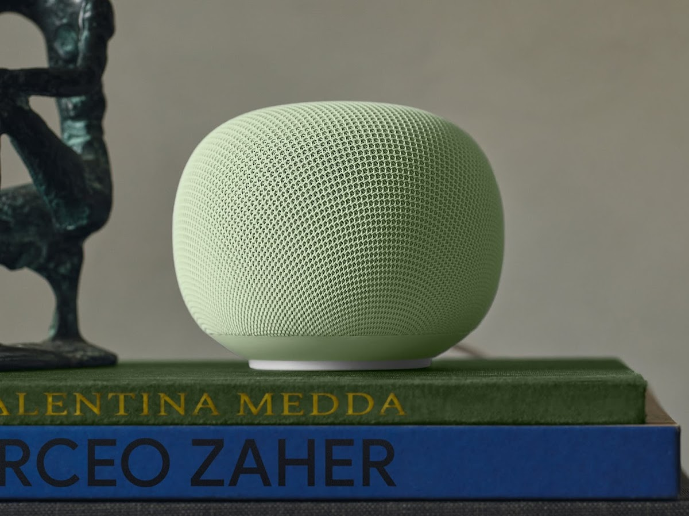
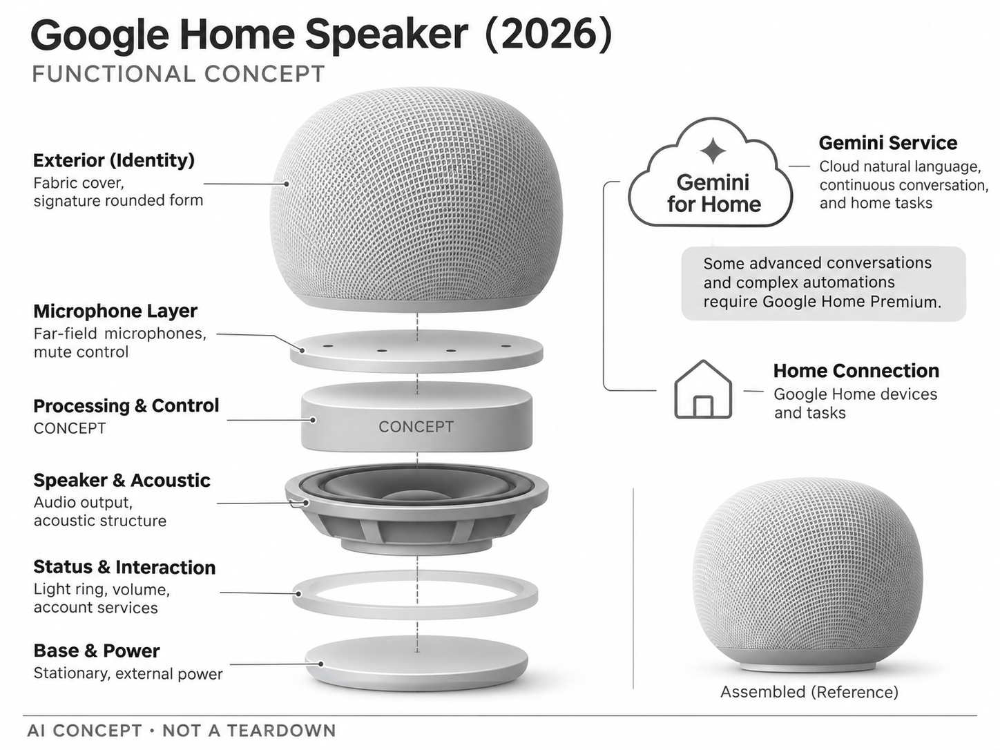

# Google Home Speaker（2026）

**Google** · 家庭助手 · 核查 2026-11-04

以Gemini自然对话连接家庭音频和设备控制

消费渠道：个人零售。

## 产品图片与结构参考

### 产品图

Google Home Speaker（2026） 官方产品图 · 来源：[Google · 官方图片](<https://store.google.com/us/product/google_home_speaker?hl=en-US>) · [原始图片](<https://lh3.googleusercontent.com/CkegE5yZ7JLFwjWCjPKsv27pgoT-q9Xy7AaigbpesZEonEUwei2rcJRDdq8z_Bt6n9XV1tTh9DBJzkTkcEr804LBiRCLFMeEQ8o=w1200>)

### 参考图

Google Home Speaker（2026） 官方外观、结构或使用参考 · 来源：[Google · 官方图片](<https://blog.google/products-and-platforms/devices/google-nest/google-home-speaker-gemini-features/>) · [原始图片](<https://storage.googleapis.com/gweb-uniblog-publish-prod/images/Google_Home_Speaker_with_Light_R.width-1200.format-webp_MC2V4fB.webp>)

### AI 生成爆炸示意

**AI 生成 · 非实物拆机。** 内部为概念推断，不能作为元件布局、BOM 或维修依据。[生成提示词](../../content/hardware/prompts/google-home-speaker-2026.txt)

> 依据官方外观参考与公开功能生成；未披露的内部布局只作概念模块，不构成BOM或真实结构证据。

> 保留官方图片原始内容和出处；画面宣传参数不是本轮独立实测。

> 分析为基于公开资料的案头研究与 AI 辅助判断，未经用户访谈、销量审计或实物拆机。需求、画像、竞争冷门度、审美及商业机会均为研究假设，不是投资结论。

## 销售与购买

- 状态：在售。美国Google Store显示Buy、US$79.99和活动结束提示；这是2026年Gemini新音箱，不是早期Google Home或Nest Audio改名。

- 地区：美国Google Store

- 价格：US$79.99（核查时活动价）。核查时官方地区参考价，保留原币种；订阅、税运、附件及优惠以结账为准，预订定金不等于整机价格。

- 中国大陆：本轮核实所列海外官方渠道；中国大陆同型号现货、保修及服务可用性未确认。进口前需核对供电、网络、配件和地区条款。

- [官方产品 / 商店](<https://store.google.com/us/product/google_home_speaker?hl=en-US>)

## AI 的实际作用

Gemini for Home理解自然语言请求、连续对话和家庭任务，部分高级对话及复杂自动化需要Google Home Premium。

服务与联网依赖：依赖Google账号、网络与地区语言支持；基础功能与Premium分层，页面试用时长文案存在30天和6个月并存，购买以结账权益为准。

## 是否冷门

竞争密集（研究判断）：智能音箱整体成熟且竞争激烈，生成式语音是升级方向；特定语言和家庭任务仍可形成细分。

## 需求与市场

需求假设：用户希望用自然说法控制家居、询问信息和处理轻任务，而不必记固定命令。应比较真实家庭的成功率、纠错次数与响应时间，聊天更流畅并不意味着执行动作更可靠。

## 用户画像

画像推断：使用Google Home生态、愿接受云语音处理的家庭，可能希望长辈或孩子也能操作设备。多人说话、不同口音和共享账号会影响效果，不能仅用单人安静环境演示代表家庭体验。

## 竞争与替代

竞争判断：与Amazon Echo、手机助手和开放本地语音系统竞争。Gemini与Google生态提供连接价值，但现有音箱的替换意愿取决于音乐、控制和订阅费用，单纯模型升级不保证硬件换新需求。

## 供应链

供应链分析：远场麦克风、扬声器、声学结构、无线和电源组成终端，具体工厂与BOM未披露。云推理成本、长期服务、软件更新和退换货也属于交付成本，不能只比较音频硬件价格。

## 技术路径

官方说明Gemini语义理解和实时对话。技术判断：嘈杂房间的语音前端、身份上下文与工具执行共同决定体验；回答可能不准确，控制设备时需明确可用状态，不能把生成文本当成已完成动作。

## 产品审美

审美判断：圆润织物外形与底部状态光减少屏幕存在感，适合书架和餐边柜。麦克风静音开关应容易找到，线材与音量交互需要日常可用，避免装饰光效在夜间造成额外干扰。

## 关键风险

风险判断：语音误触发、共享家庭资料和云端服务变化会影响信任。高级Gemini与自动化需要订阅且受地区限制；页面试用期表述不一致，不能宣传为所有购买者都能永久免费使用全部AI。

## 机会与验证

机会假设：挑选家庭高频的少数任务测试自然语言是否真正减少操作步骤，记录失败恢复与多人切换。若主要用途仍是音乐，隐私、音质和稳定性可能比更长的AI对话更能推动持续使用。

## 功能分层示意

这是功能关系，不是实物拆机、真实空间结构或已核实 BOM。

1. **声音输入**：远场麦克风与静音控制。（官方披露）

2. **Gemini服务**：云端自然语言和对话能力。（官方披露）

3. **家庭连接**：Google Home设备与任务。（官方披露）

4. **音频输出**：扬声器与声学结构。（官方披露）

5. **交互状态**：灯环、音量与账号服务。（官方披露）

## 来源

1. [Google Home Speaker（2026） 官方购买页](<https://store.google.com/us/product/google_home_speaker?hl=en-US>) — 实际打开核查当前购买或预订入口，未实际下单；价格与交付按具体地区。

2. [Google 官方Gemini音箱说明](<https://blog.google/products-and-platforms/devices/google-nest/google-home-speaker-gemini-features/>) — 实际打开的官方技术与使用资料，宣传效果并非本轮独立实测。

[返回目录](../hardware-market.md) · [网页分析](https://romanagent.github.io/Roman/#hardware/product/google-home-speaker-2026)
