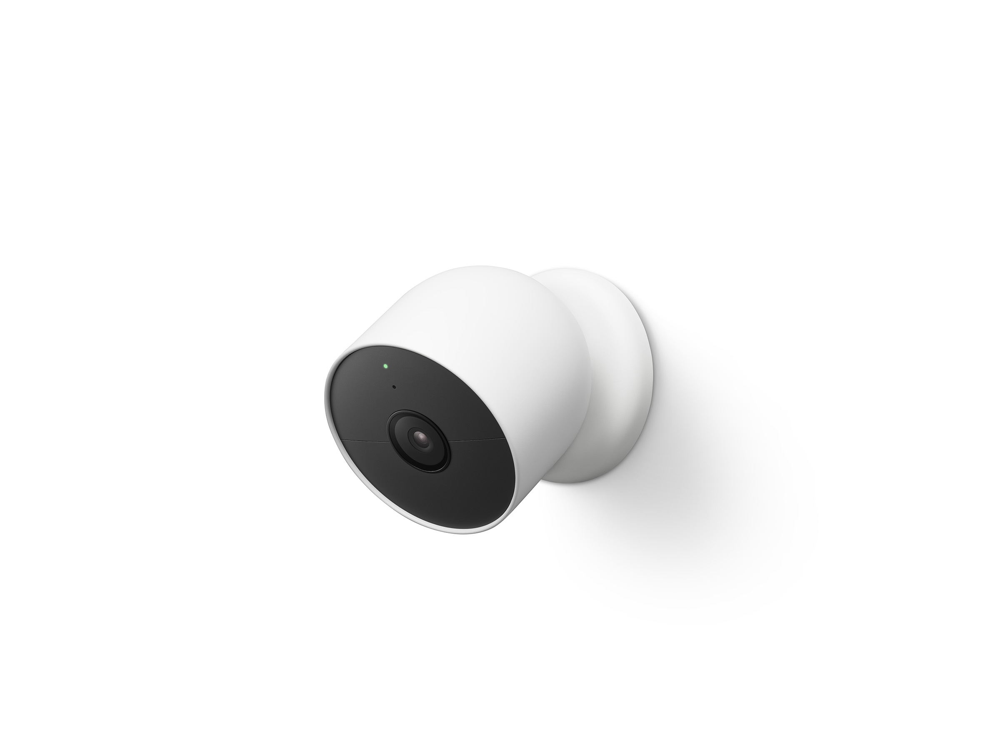
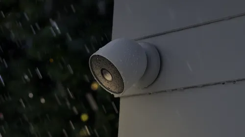
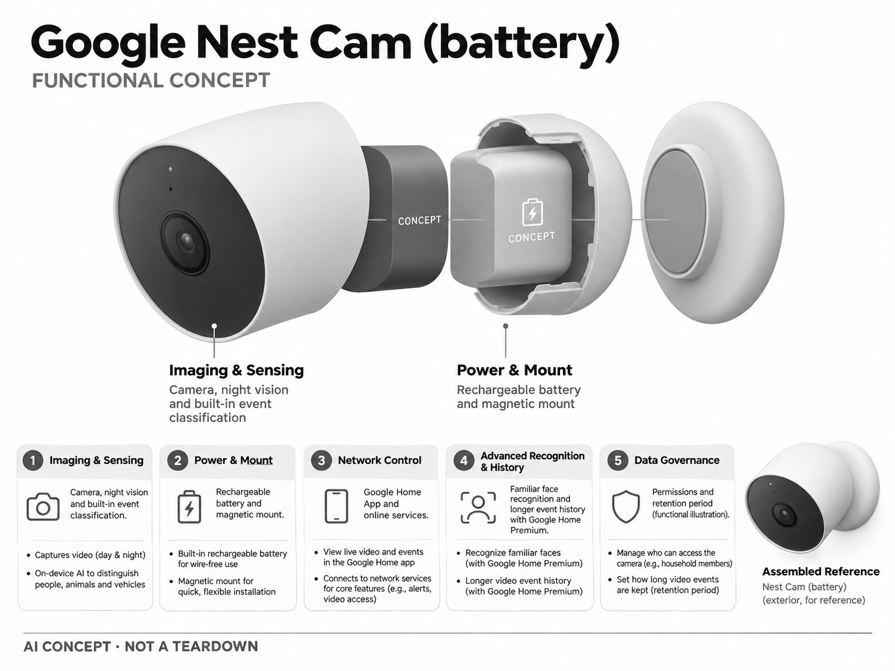

# Google Nest Cam（电池版）

**Google** · 家庭安防 · 核查 2026-11-04

用人物、车辆与动物分类减少家庭摄像头无效提醒

消费渠道：个人零售。

## 产品图片与结构参考

### 产品图

Google 官方历史发布图：Nest Cam 电池版外观 · 来源：[Google · 官方图片](<https://blog.google/products-and-platforms/devices/google-nest/11-things-love-about-new-nest-cam-and-doorbell/>) · [原始图片](<https://storage.googleapis.com/gweb-uniblog-publish-prod/original_images/Nest_Cam_battery_white_background.jpg>)

### 参考图

Google 官方历史场景图：Nest Cam 电池版室外雨天安装 · 来源：[Google · 官方图片](<https://blog.google/products-and-platforms/devices/google-nest/11-things-love-about-new-nest-cam-and-doorbell/>) · [原始图片](<https://storage.googleapis.com/gweb-uniblog-publish-prod/images/Nest_Cam_battery_Outdoor_rain_16x.width-500.format-webp.webp>)

### AI 生成爆炸示意

**AI 生成 · 非实物拆机。** 内部为概念推断，不能作为元件布局、BOM 或维修依据。[生成提示词](../../content/hardware/prompts/google-nest-cam-battery.txt)

> 依据官方外观参考与公开功能生成；未披露的内部布局只作概念模块，不构成BOM或真实结构证据。

> 图片版权归原权利人；用于产品研究并保留出处。未改变图片色彩或内容。

> 来自 Google 2021 年官方发布文章的同型号历史照片；图片本身不证明当前销售状态。

> 网页雨天参考图使用 Google 官方提供的 500px WebP 版本，未自行编辑图片；高分辨率原图保留为 AI 生成输入溯源。

> 分析为基于公开资料的案头研究与 AI 辅助判断，未经用户访谈、销量审计或实物拆机。需求、画像、竞争冷门度、审美及商业机会均为研究假设，不是投资结论。

## 销售与购买

- 状态：在售。美国 Google Store 显示 From US$199.99 与 Buy 按钮，并说明内置分类及 Google Home Premium 付费能力。

- 地区：美国

- 价格：US$199.99 起。美国单机页面快照；套装、支架、供电配件和 Google Home Premium 订阅另计。

- 中国大陆：未核实中国大陆官方销售与 Google Home 服务支持；跨境购买不代表网络、账号与订阅可用。

- [官方产品 / 商店](<https://store.google.com/product/nest_cam_battery?hl=en-US>)

## AI 的实际作用

内置智能区分人物、动物和车辆；熟悉面孔等能力需 Google Home Premium。

服务与联网依赖：安装和管理需要 Google Home App；云端事件历史和部分识别能力依赖网络与订阅。

## 是否冷门

竞争密集（研究判断）：家庭摄像头和电池安防已有成熟竞争，差异集中在生态、低功耗、订阅及隐私体验。

## 需求与市场

需求假设：需要看护门前或院内但不想布线的家庭，核心目标是减少误报并能快速核对事件。应测量电池充电频率、漏报和通知确认时间，不能将安装方便等同长期免维护。

### 产品任务与边界 · 研究判断

Nest Cam 电池版面向缺少插座或不希望布线的位置，利用人物、动物和车辆提醒帮助用户筛选事件。需求核心是方便部署后仍能可靠核对，而不是无线本身；充电、网络和录像历史会决定长期便利是否兑现。

依据：[Google Nest Cam 电池版官方商店](<https://store.google.com/product/nest_cam_battery?hl=en-US>) · [Google Nest Cam 电池版官方规格](<https://store.google.com/product/nest_cam_battery_specs?hl=en-US>)

### 需求判断 · 研究判断

电池形态降低首次安装障碍，也把部分工作转为定期维护。事件较多的位置可能与安静区域有不同使用负担，用户需要知道何时设备没有覆盖；不能把安装容易等同长期免维护或持续录像无需额外条件。

依据：[Google Nest Cam 电池版官方商店](<https://store.google.com/product/nest_cam_battery?hl=en-US>) · [Google Nest Cam 电池版官方规格](<https://store.google.com/product/nest_cam_battery_specs?hl=en-US>)

### 需求验证 · 待验证

可在实际位置记录事件量、通知确认、充电和取下后的视角变化，并比较用户原有查看方式。观察数周后是否仍及时维护，确认电池方案解决的是布线限制还是仅延后了维护成本，避免只依据开箱安装速度判断价值。

依据：[Google Nest Cam 电池版官方商店](<https://store.google.com/product/nest_cam_battery?hl=en-US>) · [Google Nest Cam 电池版官方规格](<https://store.google.com/product/nest_cam_battery_specs?hl=en-US>)

## 用户画像

画像假设：已使用 Google Home 生态、希望室内外统一管理的房主或租户。具备现成供电且需要全天录像的用户可能有不同选择；家庭成员权限与替换电池操作需分别评估。

### 适用行为与条件 · 研究判断

较匹配使用 Google Home、希望室内外统一管理且接受账户和云服务的家庭。已有固定电源并需要持续历史的人有不同条件，电池与有线使用不能混为一谈，租户也需考虑实际安装权限和离开时的拆卸。

依据：[Google Nest Cam 电池版官方商店](<https://store.google.com/product/nest_cam_battery?hl=en-US>) · [Google Nest Cam 电池版官方规格](<https://store.google.com/product/nest_cam_battery_specs?hl=en-US>)

### 人群取舍 · 研究判断

经常离家的用户可能重视电量预测和离线通知，能随时查看设备的人则更容易手动充电。磁吸安装带来调整自由，也要求用户理解牢固度和防取走需求，画像应按维护能力与位置条件划分，而非只按房主或租户。

依据：[Google Nest Cam 电池版官方商店](<https://store.google.com/product/nest_cam_battery?hl=en-US>) · [Google Nest Cam 电池版官方规格](<https://store.google.com/product/nest_cam_battery_specs?hl=en-US>)

### 画像验证 · 待验证

画像验证应让参与者自行选择拍摄位置、完成一次充电再复位，记录是否需要工具或帮助。再询问历史和熟人识别的实际需求，区分只要基础事件的人与愿意长期付费的人，避免把全部订阅能力默认纳入产品价值。

依据：[Google Nest Cam 电池版官方商店](<https://store.google.com/product/nest_cam_battery?hl=en-US>) · [Google Nest Cam 电池版官方规格](<https://store.google.com/product/nest_cam_battery_specs?hl=en-US>)

## 竞争与替代

竞争判断：电池摄像头与本地存储摄像头均有大量选择，生态整合与持续服务是主要竞争点。对新团队而言，独立硬件必须证明特定场景价值，不能仅靠人物识别与推送建立优势。

### 比较对象与差异 · 研究判断

Nest Cam 电池版与其他电池摄像头和本地存储方案竞争，Google Home 整合及持续服务是主要定位。人物分类已经普遍，新的硬件若没有明确场景差异，很难只靠推送和识别建立优势，比较应覆盖维护和数据保留。

依据：[Google Nest Cam 电池版官方商店](<https://store.google.com/product/nest_cam_battery?hl=en-US>) · [Google Nest Cam 电池版官方规格](<https://store.google.com/product/nest_cam_battery_specs?hl=en-US>)

### 竞争判断 · 研究判断

生态内统一管理可能减少学习成本，却增加迁移成本。若用户已有多台 Google 设备，这种便利可能重要；首次购买者则应比较完整拥有费用及本地选项，不能仅凭品牌统一就推定系统更可靠或更适合隐私需求。

依据：[Google Nest Cam 电池版官方商店](<https://store.google.com/product/nest_cam_battery?hl=en-US>) · [Google Nest Cam 电池版官方规格](<https://store.google.com/product/nest_cam_battery_specs?hl=en-US>)

### 竞争验证 · 待验证

可在同一安装位置比较电池与固定供电方案的有效录像、维护频次和历史查找，明确每项会员条件。连续录像需持续供电及对应计划，不能拿该模式宣传与纯电池状态直接比较，也不应仅按分辨率选型。

依据：[Google Nest Cam 电池版官方商店](<https://store.google.com/product/nest_cam_battery?hl=en-US>) · [Google Nest Cam 电池版官方规格](<https://store.google.com/product/nest_cam_battery_specs?hl=en-US>)

## 供应链

供应链推断：低功耗图像传感器、无线芯片、电池、红外组件及磁吸安装结构需要协同优化。具体芯片型号与代工厂未披露；低温、电池衰减、密封和安装牢固度是重要测试项。

### 功能模块拆分 · 研究判断

功能层包括相机与夜视、设备端事件感知、无线、电池及磁吸安装，再连接 Google Home 和高级历史服务。公开规格可支持这些模块，但未披露完整芯片与代工信息，功能架构不等于实物拆机清单。

依据：[Google Nest Cam 电池版官方商店](<https://store.google.com/product/nest_cam_battery?hl=en-US>) · [Google Nest Cam 电池版官方规格](<https://store.google.com/product/nest_cam_battery_specs?hl=en-US>)

### 制造与供应约束 · 研究判断

制造约束是低功耗采集、无线、电池、密封与固定结构之间的平衡。长期充电和取下复位可能影响视角与连接，低温和电池老化也需纳入验证；不能只比较图像模组成本而忽略安装与维护链路。充电取下与复位后的视野一致性也应检查。

依据：[Google Nest Cam 电池版官方商店](<https://store.google.com/product/nest_cam_battery?hl=en-US>) · [Google Nest Cam 电池版官方规格](<https://store.google.com/product/nest_cam_battery_specs?hl=en-US>)

### 候选与证据缺口 · 研究判断

USI 可作为无线及紧凑电子系统整合候选，SGS 可承担相应环境、电气和结构测试咨询。没有本型号点名合作证据，测试也不证明事件分类效果；实际选型应分别核实电池、户外和 Google 生态的责任与授权。

依据：[Google Nest Cam 电池版官方商店](<https://store.google.com/product/nest_cam_battery?hl=en-US>) · [Google Nest Cam 电池版官方规格](<https://store.google.com/product/nest_cam_battery_specs?hl=en-US>)

## 技术路径

官网披露内置人物、动物和车辆智能提醒。技术判断：端侧感知减少无关唤醒，长时回看仍涉及网络服务；必须区分基础检测、熟人识别和连续录像条件，不能把所有能力视为免费。

### 已披露技术边界 · 研究判断

本轮官方规格明确设备端机器学习，并要求 Google Home 应用和账户；基础事件历史与高级会员不同。连续录像还需要持续供电及对应计划，因此电池摄像头名称不能被理解为纯电池状态下也能获得所有历史能力。

依据：[Google Nest Cam 电池版官方商店](<https://store.google.com/product/nest_cam_battery?hl=en-US>) · [Google Nest Cam 电池版官方规格](<https://store.google.com/product/nest_cam_battery_specs?hl=en-US>)

### 系统难点判断 · 研究判断

技术难点是低功耗触发与完整事件之间的取舍，减少无关唤醒可能节能，却也需要检查短暂事件是否遗漏。分类、熟人识别和历史保留是不同层，用户应知道哪项在设备端、哪项受网络或服务影响。

依据：[Google Nest Cam 电池版官方商店](<https://store.google.com/product/nest_cam_battery?hl=en-US>) · [Google Nest Cam 电池版官方规格](<https://store.google.com/product/nest_cam_battery_specs?hl=en-US>)

### 技术验证 · 待验证

验证应记录不同事件速度和频率下的触发、通知及电量变化，并测试弱网和低电量状态。对纯电池与持续供电模式分别检查录像范围，不以一次本地检测成功推断远程通知和云历史在任何故障条件下都可用。

依据：[Google Nest Cam 电池版官方商店](<https://store.google.com/product/nest_cam_battery?hl=en-US>) · [Google Nest Cam 电池版官方规格](<https://store.google.com/product/nest_cam_battery_specs?hl=en-US>)

## 产品审美

审美判断：圆润浅色外壳更接近家居用品，弱化传统监控器材的压迫感；磁吸安装提高摆放自由度。镜头方向、充电取下动作和防盗需求可能相互冲突，需要完整场景评估。

### 外观与交互语言 · 研究判断

圆润浅色外壳弱化传统监控器材感，磁吸方式让角度调整更自由，也增加外观与功能位置的选择。镜头方向、充电取下动作和防取走考虑可能冲突，审美需要围绕完整安装场景而非只评价本体形状。

依据：[Google Nest Cam 电池版官方商店](<https://store.google.com/product/nest_cam_battery?hl=en-US>) · [Google Nest Cam 电池版官方规格](<https://store.google.com/product/nest_cam_battery_specs?hl=en-US>)

### 使用中审美判断 · 研究判断

简洁设计应帮助用户理解当前视野和运行状态，而不是让持续拍摄变得不可察觉。放在容易取下的位置便于维护，却可能改变覆盖与牢固度，设计需要给用户清楚的取舍，不能把灵活安装当作无条件优势。

依据：[Google Nest Cam 电池版官方商店](<https://store.google.com/product/nest_cam_battery?hl=en-US>) · [Google Nest Cam 电池版官方规格](<https://store.google.com/product/nest_cam_battery_specs?hl=en-US>)

### 设计验证 · 待验证

设计验证可让用户在墙面和室内不同位置调整角度，再完成充电复位，检查画面是否仍覆盖目标区域。记录线材、支架和状态灯的真实表现，避免用无杂物产品图推断所有家庭都能得到同样整洁的安装效果。

依据：[Google Nest Cam 电池版官方商店](<https://store.google.com/product/nest_cam_battery?hl=en-US>) · [Google Nest Cam 电池版官方规格](<https://store.google.com/product/nest_cam_battery_specs?hl=en-US>)

## 关键风险

风险判断：电池频繁充电、弱网和云服务不可达会影响覆盖；熟人识别涉及家庭成员及访客隐私。分类并不能证明事件性质，不能用于保证儿童、老人或宠物的安全。

### 主要失效与依赖 · 研究判断

风险包括频繁充电、弱网、云服务和账户问题造成覆盖变化，以及熟人识别涉及家庭与访客信息。分类只描述对象，不证明事件性质，也不能作为儿童、老人或宠物安全的保证，用户需要理解没有提醒不等于没有事件。

依据：[Google Nest Cam 电池版官方商店](<https://store.google.com/product/nest_cam_battery?hl=en-US>) · [Google Nest Cam 电池版官方规格](<https://store.google.com/product/nest_cam_battery_specs?hl=en-US>)

### 风险传播判断 · 研究判断

电池取下充电时会出现覆盖空窗，若设备状态不清，用户可能误以为系统仍在正常记录。服务变化又可能改变历史范围，因此产品应让电量、离线和权限信息容易理解，不能只在出现问题后要求用户寻找复杂说明。

依据：[Google Nest Cam 电池版官方商店](<https://store.google.com/product/nest_cam_battery?hl=en-US>) · [Google Nest Cam 电池版官方规格](<https://store.google.com/product/nest_cam_battery_specs?hl=en-US>)

### 风险验证 · 待验证

风险验证应演练低电量、充电、网络中断和计划到期，确认通知与历史各自如何变化。还需检查家庭共享和熟人资料管理，所有结论应对应实际配置，不能将某一会员或持续供电条件下的能力推广到所有用户。

依据：[Google Nest Cam 电池版官方商店](<https://store.google.com/product/nest_cam_battery?hl=en-US>) · [Google Nest Cam 电池版官方规格](<https://store.google.com/product/nest_cam_battery_specs?hl=en-US>)

## 机会与验证

可验证机会：为低频使用者优化可理解的电量与离线告警，或研究不依赖长期云订阅的场景。先验证真实家庭对回看、通知和数据保留的取舍，再设计新的商业方案。

### 可能的机会入口 · 研究判断

机会在于更清楚的电量、离线和覆盖提示，让低频查看用户仍能知道设备是否可用。新项目也可研究不依赖长期云订阅的特定场景，但需要先确认用户对回看、远程访问和数据保留的真实取舍。

依据：[Google Nest Cam 电池版官方商店](<https://store.google.com/product/nest_cam_battery?hl=en-US>) · [Google Nest Cam 电池版官方规格](<https://store.google.com/product/nest_cam_battery_specs?hl=en-US>)

### 机会成立条件 · 研究判断

机会成立需要减少维护遗忘和无效查看，而不是只增加电池容量或识别类别。如果用户最在意充电时失去覆盖，设计应针对恢复与备用流程；如果主要问题是历史费用，则透明服务方案可能比更多感知功能更有效。

依据：[Google Nest Cam 电池版官方商店](<https://store.google.com/product/nest_cam_battery?hl=en-US>) · [Google Nest Cam 电池版官方规格](<https://store.google.com/product/nest_cam_battery_specs?hl=en-US>)

### 下一步验证 · 待验证

下一步可追踪家庭一个完整充电周期的使用，记录离线发现、复位和查找事件的过程，再比较更明确状态提示的效果。根据这些具体摩擦设计方案，避免把无需布线这一首次便利当作长期市场优势的全部依据。

依据：[Google Nest Cam 电池版官方商店](<https://store.google.com/product/nest_cam_battery?hl=en-US>) · [Google Nest Cam 电池版官方规格](<https://store.google.com/product/nest_cam_battery_specs?hl=en-US>)

## 对应供应链公司

能力候选用于选型研究，不代表本产品实际采用；未公开的供货关系不作推断。

- [usi](../supply-chain/usi.md) — **能力候选 · 非已采用** / 低功耗无线摄像电子整合：USI 的无线和系统级电子整合能力可支持电池摄像头的计算、连接与存储评估，但 Google 生态、低功耗策略和户外密封需具体确认；没有 Nest Cam 电池版点名供货证据，保持候选。

- [sgs](../supply-chain/sgs.md) — **能力候选 · 非已采用** / 电池相机环境、电气与安装测试：SGS 公开环境、电气和机械测试可用于评估电池相机及固定结构的相关要求，但应核实具体实验室与方法；没有本型号测试披露，也不能借此证明人物分类或熟人识别准确。

[浏览供应链目录](../supply-chain.md)

## 功能分层示意

这是功能关系，不是实物拆机、真实空间结构或已核实 BOM。

1. **影像感知**：相机、夜视和内置事件分类。（官方披露）

2. **电源安装**：可充电电池与磁吸式安装。（官方披露）

3. **网络控制**：Google Home App 与联网服务。（官方披露）

4. **高级识别与历史**：熟人识别和更长事件历史按 Google Home Premium。（官方披露）

5. **数据治理**：权限及保留周期为功能示意层，未获得后台实现细节。（分析推断）

## 来源

1. [Google Nest Cam 电池版官方商店](<https://store.google.com/product/nest_cam_battery?hl=en-US>) — 已打开；Buy、内置识别与会员差异均列明。

[返回目录](../hardware-market.md) · [网页分析](https://romanagent.github.io/Roman/#hardware/product/google-nest-cam-battery)
