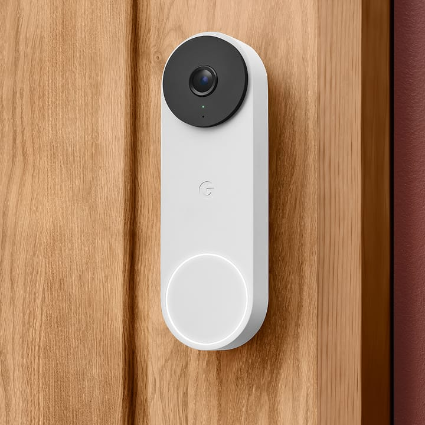
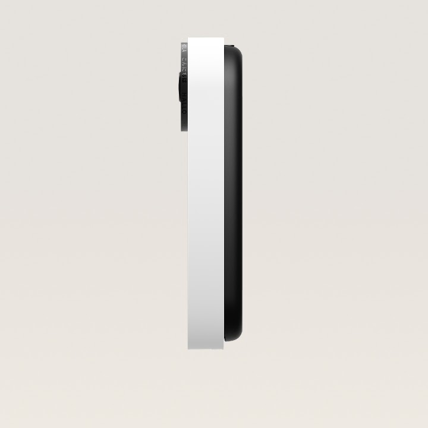
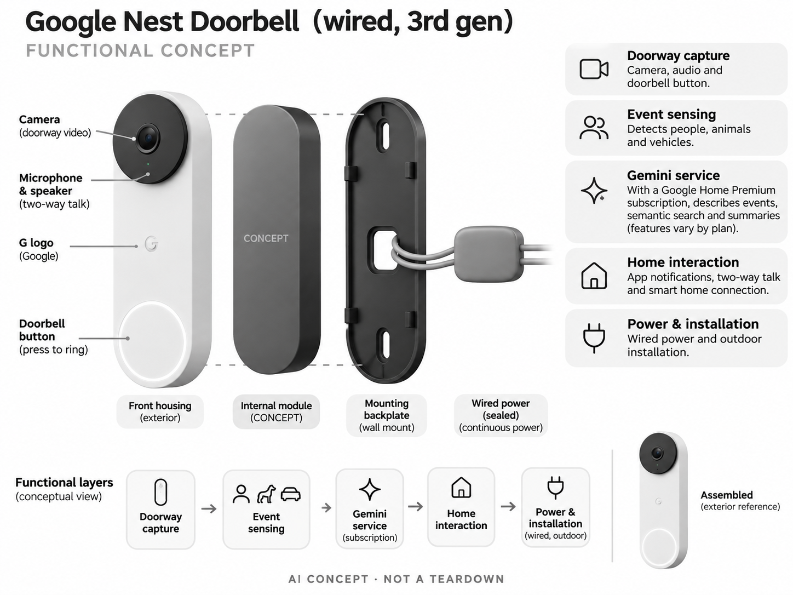

# Google Nest Doorbell（wired, 3rd gen）

**Google** · 家庭安防 · 核查 2026-11-04

用事件理解与语义检索整理门口录像

消费渠道：个人零售。

## 产品图片与结构参考

### 产品图

Google Nest Doorbell（wired, 3rd gen） 官方产品图 · 来源：[Google · 官方图片](<https://store.google.com/us/product/nest_doorbell_wired_3rd_gen?hl=en-US>) · [原始图片](<https://lh3.googleusercontent.com/wp3yMv-yweoFE2ftXtcwzMYMSrNfJ6fj21VqHz6vjO33KVYyHfPK8BvnT2C0CiXE6IQlSRH3Rmv8vKzo4sFFgkNBKyXARNbOGg=w1200>)

### 参考图

Google Nest Doorbell（wired, 3rd gen） 官方外观、结构或使用参考 · 来源：[Google · 官方图片](<https://store.google.com/us/product/nest_doorbell_wired_3rd_gen?hl=en-US>) · [原始图片](<https://lh3.googleusercontent.com/wsU8pdIQG2l26QZ43b2GWXZ-dqg5D2PC3V6Q-Ub1Nh0EvRpMMHyIlHMihqV7J1xWnX2P1aoPi9TE5kfCkhbcww83Gn8b0cfYkibM=s1200-w1200-e365-rw-v0-nu>)

### AI 生成爆炸示意

**AI 生成 · 非实物拆机。** 内部为概念推断，不能作为元件布局、BOM 或维修依据。[生成提示词](../../content/hardware/prompts/google-nest-doorbell-wired-3-assist-creative.txt)

> 已目视核对型号、外形、功能标签与非拆机声明；内部模块为概念，不代表实测结构。

> 保留官方图片原始内容和出处；画面宣传参数不是本轮独立实测。

> 分析为基于公开资料的案头研究与 AI 辅助判断，未经用户访谈、销量审计或实物拆机。需求、画像、竞争冷门度、审美及商业机会均为研究假设，不是投资结论。

## 销售与购买

- 状态：在售。美国Google Store明确第3代有线门铃、US$199.99与Buy入口；不与电池版或前代有线型号混用。

- 地区：美国Google Store

- 价格：US$199.99。核查时官方地区参考价，保留原币种；订阅、税运、附件及优惠以结账为准，预订定金不等于整机价格。

- 中国大陆：本轮核实所列海外官方渠道；中国大陆同型号现货、保修及服务可用性未确认。进口前需核对供电、网络、配件和地区条款。

- [官方产品 / 商店](<https://store.google.com/us/product/nest_doorbell_wired_3rd_gen?hl=en-US>)

## AI 的实际作用

基础事件感知识别人、动物和车辆；付费Google Home Premium的Gemini能力可描述事件、语义检索和摘要，具体功能随计划而变。

服务与联网依赖：需要兼容门铃供电、Google账号和网络；高级Gemini依赖订阅与地区支持，不能把基础事件预览等同完整长期云录像。

## 是否冷门

竞争密集（研究判断）：智能门铃市场成熟，生成式录像理解是服务升级；安装、隐私和订阅成本仍构成主要竞争维度。

## 需求与市场

需求假设：家庭想快速了解门口谁来过、做了什么，并避免从长录像中逐段查找。应验证文字描述和语义检索是否减少找事件的时间，描述更详细不必然更准确，也不能替代查看原片。

## 用户画像

画像推断：已有Google Home、具备兼容有线门铃供电且接受云服务的房主。租户、无固定供电或重视完全本地录像的用户需求不同，安装条件和现有生态比单纯AI兴趣更能决定购买。

## 竞争与替代

竞争判断：与Ring、Aqara和其他智能门铃竞争，Gemini事件描述与搜索是软件差异。用户还会比较延迟、机械门铃兼容、录像期限和订阅费用，模型能力不是门口安防的唯一体验来源。

## 供应链

供应链分析：相机、门铃按钮、音频、无线、供电与户外外壳构成硬件，具体供应商与BOM未知。变压器兼容、密封耐候、安装支持和云视频长期存储形成持续成本，不能只比较机身售价。

## 技术路径

官方说明对象事件检测及Gemini描述、搜索和摘要。技术判断：模糊、遮挡和同时发生的动作可能导致文字误解，检索应保留原始录像可复核；生成描述不能作为身份或意图的确定证据。

## 产品审美

审美判断：竖向圆角门铃形态克制，按钮应让访客容易识别，镜头存在感和提示灯也要明确。旧门铃孔位、转角支架与电线处理影响最终观感，不能仅凭产品正面图判断安装效果。

## 关键风险

风险判断：高级AI与云历史需要付费，地区和计划限制会影响购买后的实际能力。门口录像可能包含邻居和访客，描述错误、联网中断或电源不兼容都需要用户确认，AI不能保证防止盗窃。

## 机会与验证

机会假设：用真实收包裹和访客场景比较事件通知、文字摘要与原片回看，记录误导和省时效果。若核心困难是安装和长期费用，可优先提供透明套餐与本地化支持，而非只宣传模型名称。

## 功能分层示意

这是功能关系，不是实物拆机、真实空间结构或已核实 BOM。

1. **门口采集**：相机、音频与门铃按钮。（官方披露）

2. **事件感知**：人物、动物和车辆检测。（官方披露）

3. **Gemini服务**：按订阅提供描述与检索。（官方披露）

4. **家庭交互**：App通知、通话与家居连接。（官方披露）

5. **供电安装**：有线供电及户外安装。（官方披露）

## 来源

1. [Google Nest Doorbell（wired, 3rd gen） 官方购买页](<https://store.google.com/us/product/nest_doorbell_wired_3rd_gen?hl=en-US>) — 实际打开核查当前购买或预订入口，未实际下单；价格与交付按具体地区。

2. [Nest Doorbell 3代官方规格及安装](<https://store.google.com/us/product/nest_doorbell_wired_3rd_gen_specs?hl=en-US>) — 实际打开的官方技术与使用资料，宣传效果并非本轮独立实测。

[返回目录](../hardware-market.md) · [网页分析](https://romanagent.github.io/Roman/#hardware/product/google-nest-doorbell-wired-3)
