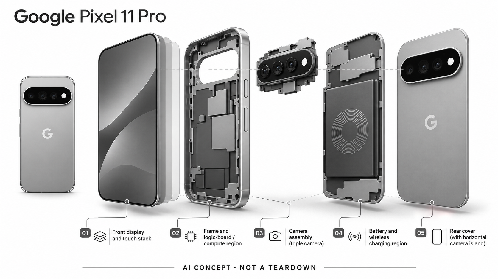

# Google Pixel 11 Pro

**Google** · 手机与 AI PC · 核查 2026-11-04

把 Gemini 与影像 AI 集成到随身手机，而非额外携带一件设备。

消费渠道：个人零售。

## 产品图片与结构参考

### 产品图

Pixel 11 Pro 官方产品背面图 · 来源：[Google](<https://store.google.com/product/pixel_11_pro?hl=en-US>) · [原始图片](<https://lh3.googleusercontent.com/3pMI8aPBk68eTXiu5pU2TexANdpvMtOJgi8UkXaYYHbHgoSvUF3qerABrExqUrZud6YalGDCCUbfp_a6SWmHoJfpN5tlmbSC62k%3Dw560-h700-rw-nu>)

### 参考图

Google Pixel 11 Pro 官方使用场景参考 · 来源：[Google](<https://store.google.com/product/pixel_11_pro?hl=en-US>) · [原始图片](<https://lh3.googleusercontent.com/w6ZLQp4YT4M8m23WVqBV3puDiXQudwvi4D0JS0yvUFYgR-0Pv9xLMfm1tW9Et9NCufoE5EJhYxtpfDCMobpstQoEPRYsUir7QA%3Dw1132-h1132-rw-nu>)

### AI 生成爆炸示意

**AI 生成 · 非实物拆机。** 内部为概念推断，不能作为元件布局、BOM 或维修依据。[生成提示词](../../content/hardware/prompts/google-pixel-11-pro.txt)

> 分析为基于公开资料的案头研究与 AI 辅助判断，未经用户访谈、销量审计或实物拆机。需求、画像、竞争冷门度、审美及商业机会均为研究假设，不是投资结论。

## 销售与购买

- 状态：在售。Google Store 美国产品页有 Buy 入口与正在进行的限定促销。优惠存在以旧换新和型号条件，本条不把最低促销展示价当无条件售价。

- 地区：美国官方商店、其他 Google Store 支持地区需分别确认

- 价格：美国参考标价 US$1,099。官网另显示折扣及合资格以旧换新后低价，不应直接用于价格横比。套餐、容量、税费和活动期限以结算页为准。

- 中国大陆：Google Store 地区选择器未列中国大陆。跨境购机不能保证当地的 Gemini、运营商功能、保修和Google服务正常可用；本轮未核实代购渠道。

- [官方产品 / 商店](<https://store.google.com/product/pixel_11_pro?hl=en-US>)

## AI 的实际作用

官方描述 Gemini Intelligence、影像AI与 Tensor G6 平台。AI能力可融入手机应用及任务流程，但不同功能有账户、地区和订阅条件。

服务与联网依赖：云端 Gemini 与设备侧能力并存，部分功能需要联网、订阅或特定语言地区。本目录未独立测试任务执行的可靠性或隐私行为。

## 是否冷门

竞争密集（研究判断）：旗舰手机市场高度成熟，AI是系统生态竞争的一部分，不能视作独立冷门新品类。

## 需求与市场

需求假设：用户希望在现有手机里完成搜索、翻译、影像处理和日常任务，不再携带额外AI终端。它既是AI产品，也是其他随身设备必须比较的默认替代方案。

## 用户画像

画像推断：深度使用Google服务、重视摄影与Android体验的用户，以及愿意尝试系统智能功能的早期采用者。中国大陆用户的网络和售后条件与美国用户显著不同，不能共用同一画像。

## 竞争与替代

市场判断：旗舰手机的竞争非常密集，AI增强只是其中一个维度。对手还包括旧手机加相同云应用；必须辨别硬件专属能力和软件可迁移能力，才能判断AI对购买决策的贡献。

## 供应链

公开产品资料披露 Tensor G6 和主要硬件规格，未核实完整供应商与组装工厂。分析关注芯片、摄像头模组、屏幕、内存及区域认证；厂商服务生态也是难以从BOM体现的交付要素。

## 技术路径

技术要区分端侧推理、云端模型、系统权限与多应用任务执行。官方的功能演示不代表所有应用和地区都支持，也不能用芯片名称直接推导实际成功率和耗电。

## 产品审美

设计观察：成熟的触屏和相机形态具有低学习成本，产品审美更多体现在机身、摄像头区域和系统界面一致性。相较单用途硬件，它的优势是日常随身，弱点是仍需屏幕注意力。

## 关键风险

关键风险包括服务地区限制、促销价误读、AI订阅权益到期和多步骤任务出错。对中国使用场景，应先验证服务与售后可达，再讨论硬件参数；不能把国外发布能力直接搬到国内市场。

## 机会与验证

值得验证的购买理由是AI功能是否在原有手机体验之外形成可感知增量。后续应比较同一任务的手动操作次数、结果质量和持续使用率，本轮没有用户留存或销量归因数据。

## 功能分层示意

这是功能关系，不是实物拆机、真实空间结构或已核实 BOM。

1. **系统与任务层**：Gemini及系统功能连接日常用户任务，支持范围有条件。（官方披露）

2. **交互与感知**：触屏、相机和音频输入构成多模态使用入口。（官方披露）

3. **计算平台**：官方列出 Tensor G6 平台与内存配置。（官方披露）

4. **能源与结构**：电池、屏幕及热设计影响高负载任务体验。（分析推断）

5. **账户与云服务**：云端功能受网络、账户、语言、地区与订阅条件影响。（官方披露）

## 来源

1. [Google Pixel 11 Pro 官方美国商店](<https://store.google.com/product/pixel_11_pro?hl=en-US>) — 有购买入口，低价含优惠及以旧换新条件。

2. [Google Store 官方地区选择](<https://store.google.com/regionpicker>) — 核查时地区列表没有中国大陆；不推定非官方进口渠道可用。

[返回目录](../hardware-market.md) · [网页分析](https://romanagent.github.io/Roman/#hardware/product/google-pixel-11-pro)
