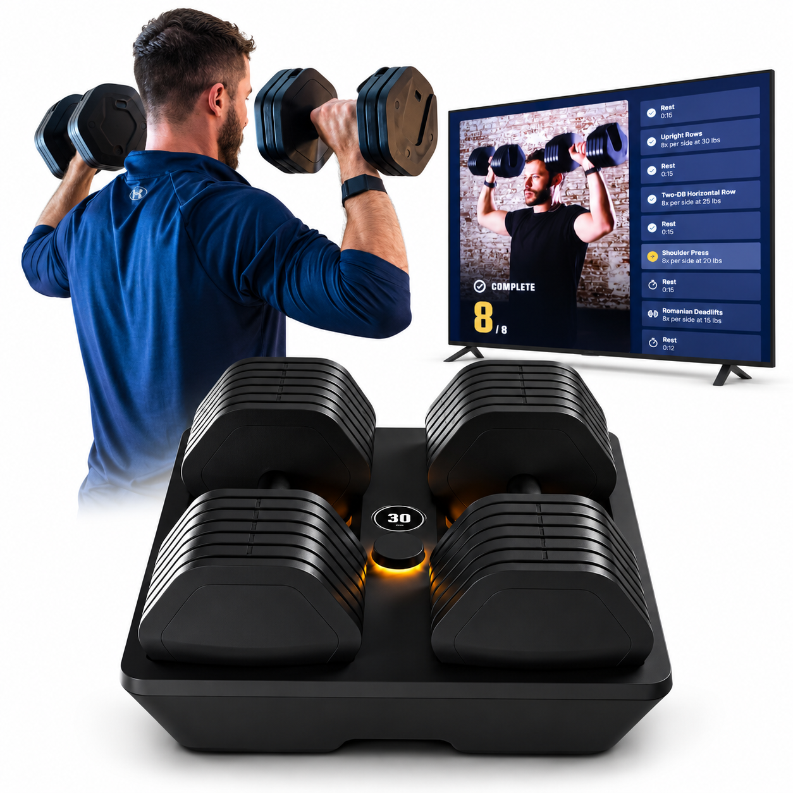
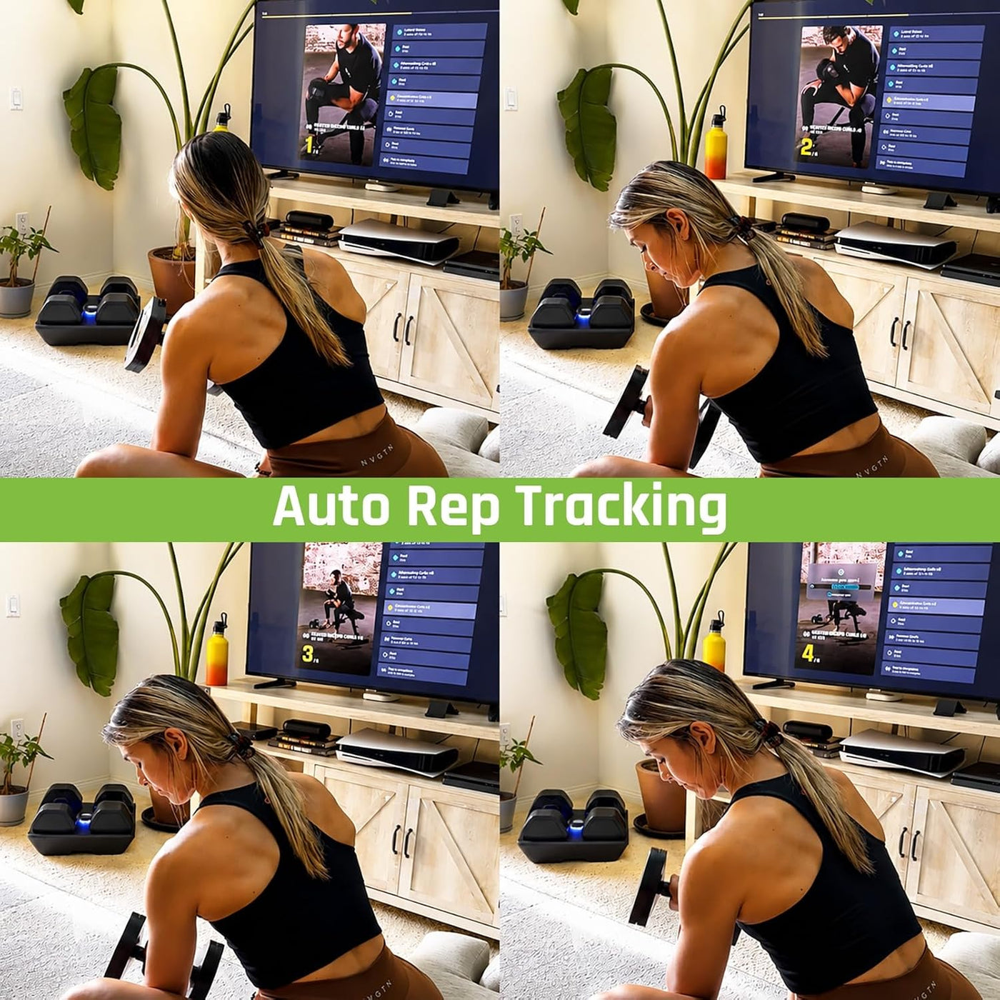
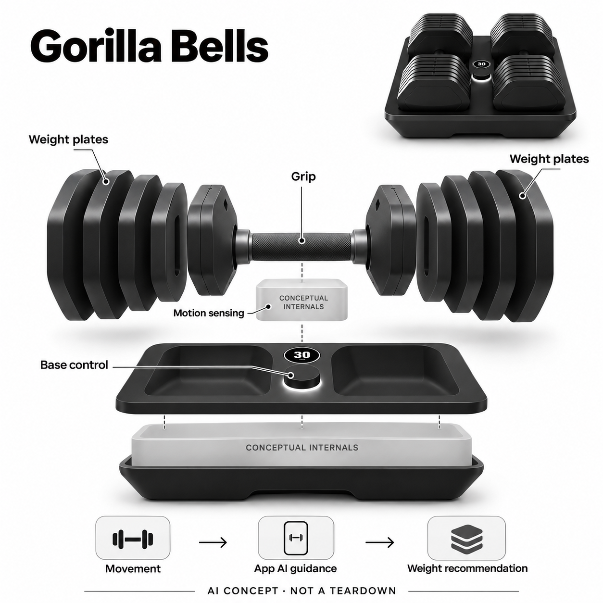

# Gorilla Bells

**Gorilla Bow / Gorilla Fitness** · 运动与训练 · 核查 2026-11-05

把自由哑铃运动数据与自动换重和AI指导连接的训练设备

消费渠道：个人零售。

## 产品图片与结构参考

### 产品图

Gorilla Bells 官方产品与训练示意（屏幕非标配，界面为厂商展示） · 来源：[Gorilla Bow / Gorilla Fitness · 官方资料](<https://www.gorillabow.com/products/gorilla-bells>) · [原始图片](<https://cdn.shopify.com/s/files/1/0236/0325/files/Gorilla_Bells_with_guided_shoulder_press.png?v=1791899642&width=1400>)

### 参考图

Gorilla Bells 官方动作计数场景参考（非本站效果实测） · 来源：[Gorilla Bow / Gorilla Fitness · 官方资料](<https://www.gorillabow.com/products/gorilla-bells>) · [原始图片](<https://cdn.shopify.com/s/files/1/0236/0325/files/WhatsAppImage2026-07-29at9.45.24PM_3.jpg?v=1785359605&width=1400>)

### AI 生成爆炸示意

**AI 生成 · 非实物拆机。** 内部为概念推断，不能作为元件布局、BOM 或维修依据。[生成提示词](../../content/hardware/prompts/gorilla-bells.txt)

> 以已目视核对的官方图片独立生成并完成目视QA；未知内部只作功能概念，不是实际PCB、拆机或供应商BOM。

> 保留官方图片原貌；其中宣传效果或数据不代表本站独立测量。

> 分析为基于公开资料的案头研究与 AI 辅助判断，未经用户访谈、销量审计或实物拆机。需求、画像、竞争冷门度、审美及商业机会均为研究假设，不是投资结论。

## 销售与购买

- 状态：在售。核查日官方Gorilla Bells商品页显示Add to Cart，公开变体45824599883949为available=true、US$959.20。Kabata旧官网购买入口指向本商品，本轮仅收当前品牌一条，不把相关旧品牌另计新需求。

- 地区：美国（已核官方美元商店）

- 价格：核查日官方US$959.20；Silverback US$14.99/月。商品页促销会变化；完整AI指导、深入分析与个性化计划属于会员。实际配送、退货与重量切换条件须按当前订单和手册核对。

- 中国大陆：未核中国大陆授权销售、重型设备运费及Silverback服务；站点可切币种或称全球支持不等于大陆可完整交付。

- [官方产品 / 商店](<https://www.gorillabow.com/products/gorilla-bells>)

## AI 的实际作用

官方将运动次数、组数、节奏和速度数据用于AI训练指导与重量建议，并提供自动换重。当前未披露具体模型结构或完整姿态推断方法，不把全部计数都自动归因于AI。

服务与联网依赖：自由配重硬件、底座控制与Silverback App结合；完整AI教练和个性化计划依赖会员。重量选取与锁止需遵循当前手册，不能理解为抬举中凭空改变质量。

## 是否冷门

新兴竞争（研究判断）：联网哑铃是家庭力量训练的一种实现，普通配重、视觉指导和拉索设备竞争成熟；不以小众外形推断蓝海。

## 需求与市场

案头需求是保留自由哑铃的训练方式，同时减少手动记组和切换重量的步骤。核心仍是家庭力量训练，与现有镜面或拉索系统同组；不同处是可拿起的真实配重与底座选择，而非新造场景数。

### 事实：任务边界 · 官方资料

当前Gorilla Bells官网把两只可调哑铃、底座控制、动作记录与App指导组成家庭训练系统，商品变体可购买。它与目录已有的联网力量设备共享核心需求，区别在自由配重和自动选择方式；本条不会因为更换外观或品牌入口就增加一个独立需求场景。

依据：[Gorilla Bells官方商店](<https://www.gorillabow.com/products/gorilla-bells>) · [Gorilla Bells官方系列说明](<https://www.gorillabow.com/collections/gorilla-bells>)

### 判断：真实需求 · 研究判断

需求判断是用户希望保留拿起真实哑铃的动作，同时少做记组、判断下一组重量和手动调节的工作。智能功能只有在训练中降低这些摩擦才有价值；如果用户已有固定计划且只用少数重量，普通配重或手动可调方案可能更容易维护。

依据：[Gorilla Bells官方商店](<https://www.gorillabow.com/products/gorilla-bells>) · [Gorilla Bells官方系列说明](<https://www.gorillabow.com/collections/gorilla-bells>)

### 验证：任务完成 · 待验证

验证可让已有哑铃习惯的人完成一组真实训练，记录每次归位、选重、确认、拿起及记组的动作。比较智能和普通可调哑铃的总准备时间、误计与人工更改建议，不只看换重宣传速度；询问用户愿意持续保留哪些步骤，避免用训练分数代替需求。

依据：[Gorilla Bells官方商店](<https://www.gorillabow.com/products/gorilla-bells>) · [Gorilla Bells官方系列说明](<https://www.gorillabow.com/collections/gorilla-bells>)

## 用户画像

潜在用户是已有哑铃习惯、空间有限并愿意看数据反馈的人。对只做固定重量简单练习的人，普通哑铃可能已足够；购买前要评估可用重量、换重节奏及会员价值，而不是按年龄或目标效果推荐。

### 事实：使用条件 · 官方资料

官方当前页面将设备费用与Silverback会员分开，完整AI指导和更深入的个性化分析属于持续服务。已核零售为美元商店，页面的全球支持或币种选择并不能证明大陆完整配送；家中还需要足够的操作区域，不能只按底座占地判断实际训练空间。

依据：[Gorilla Bells官方商店](<https://www.gorillabow.com/products/gorilla-bells>) · [Gorilla Bells官方系列说明](<https://www.gorillabow.com/collections/gorilla-bells>)

### 判断：人群筛选 · 研究判断

潜在人群是有自由重量训练习惯、希望减少器材数量并愿意跟踪数据的人。初次接触力量练习的人可能更需要理解动作，成熟用户则可能更看重重量范围与计划自由；这两类人的AI需求不一样，不能仅用想增肌或想减重来定义用户。

依据：[Gorilla Bells官方商店](<https://www.gorillabow.com/products/gorilla-bells>) · [Gorilla Bells官方系列说明](<https://www.gorillabow.com/collections/gorilla-bells>)

### 验证：参与者差异 · 待验证

访谈应先查看实际训练计划与使用重量，询问目前最麻烦的是换重、记录还是坚持练习。试用中记录是否接受系统建议、何时主动覆盖，以及停止会员后愿意留下什么功能；不要从厂商目标人群或健身模特照片推导真实付费意愿。

依据：[Gorilla Bells官方商店](<https://www.gorillabow.com/products/gorilla-bells>) · [Gorilla Bells官方系列说明](<https://www.gorillabow.com/collections/gorilla-bells>)

## 竞争与替代

替代包括普通可调哑铃、固定配重和联网力量训练机。自动换重与动作数据是实现差异，但不能证明比手动方案更安全；是否节省时间取决于归位、选择、确认与拿起的完整流程。

### 事实：方案范围 · 官方资料

已核官网描述自由哑铃的自动换重、次数与速度记录及AI指导，和拉索阻力机、视觉跟练或固定配重有不同硬件路径。Kabata旧站购买链接指向当前商品，仅能证明入口关联；没有资料支持把两个品牌和不同套餐当成互不相关的新需求来计数。

依据：[Gorilla Bells官方商店](<https://www.gorillabow.com/products/gorilla-bells>) · [Gorilla Bells官方系列说明](<https://www.gorillabow.com/collections/gorilla-bells>)

### 判断：替代关系 · 研究判断

竞争判断应在同一家庭力量任务中比较：自由重量无需持续拉索连接，但配重管理和锁止更重要；视觉方案可看身体，却依赖机位；普通哑铃简单可靠，但记录靠人工。不同方案的限制并不因AI而消失，不能简单按自动化程度排序。

依据：[Gorilla Bells官方商店](<https://www.gorillabow.com/products/gorilla-bells>) · [Gorilla Bells官方系列说明](<https://www.gorillabow.com/collections/gorilla-bells>)

### 验证：比较方法 · 待验证

可让参与者按自己熟悉计划使用普通可调哑铃、视觉记录方案和Gorilla，观察全流程而非只演示换重。对比有效记录、纠错和器材闲置的原因，再检查同一人在数周后选择哪套工具；不把占地宣传或配件数量直接转为市场优势。

依据：[Gorilla Bells官方商店](<https://www.gorillabow.com/products/gorilla-bells>) · [Gorilla Bells官方系列说明](<https://www.gorillabow.com/collections/gorilla-bells>)

## 供应链

配重片、握柄、固定选择结构、底座控制及传感连接共同构成产品，具体工厂未披露。官网旧品牌入口的跳转不是完整供应证据，不从外形猜电机或锁止机构，也不编造真实BOM。

### 事实：功能组成 · 官方资料

产品公开组成包含分层配重、握柄、共用底座、显示控制、运动记录与App连接，具体芯片、驱动、锁止机构和工厂未披露。当前品牌资料没有提供足够拆机细节，所以供应关联只表达候选能力，不由旧品牌页面或外观相似推断内部采购与材料。

依据：[Gorilla Bells官方商店](<https://www.gorillabow.com/products/gorilla-bells>) · [Gorilla Bells官方系列说明](<https://www.gorillabow.com/collections/gorilla-bells>)

### 判断：交付约束 · 研究判断

工程判断，机械配重选择的可靠性与传感连接同样关键，结构磨损、归位偏差和异常提示都会影响体验。算法建议再合理，也需要用户明确知道当前重量及锁止状态；生产验证不能只关注电子模块，还要覆盖反复拿取、配合公差和售后维修。

依据：[Gorilla Bells官方商店](<https://www.gorillabow.com/products/gorilla-bells>) · [Gorilla Bells官方系列说明](<https://www.gorillabow.com/collections/gorilla-bells>)

### 验证：选型缺口 · 待验证

候选选型前应取得实际操作说明，确认换重发生的允许状态、归位检测和故障处理，再制定结构测试。对供应公司只提出模块需求，不指定未经证实的真实型号或采购价格；量产交付还需核配重运输损伤、退运成本和维修时效。

依据：[Gorilla Bells官方商店](<https://www.gorillabow.com/products/gorilla-bells>) · [Gorilla Bells官方系列说明](<https://www.gorillabow.com/collections/gorilla-bells>)

## 技术路径

官方明确以速度训练数据支撑建议，AI教练与记录功能经App连接。算法细节未披露，运动推断不等于看见全身；计数、建议和自动选择配重应分开验证，不把宣传中的正确动作当保障。

### 事实：AI机制 · 官方资料

官方将次数、组数、节奏和速度等训练数据用于分析，并以AI教练和重量建议描述软件能力；具体模型结构和完整动作推断方法没有披露。本条只使用已公开的输入与输出，不把所有计数步骤都称为机器学习，也不把宣传图的全身连线当真实传感布局。

依据：[Gorilla Bells官方商店](<https://www.gorillabow.com/products/gorilla-bells>) · [Gorilla Bells官方系列说明](<https://www.gorillabow.com/collections/gorilla-bells>)

### 判断：系统边界 · 研究判断

分析上，哑铃运动与身体姿态存在关系，但二者不是同一测量对象。系统可能从轨迹和速度推断动作质量，仍无法由有限输入确定所有关节位置；重量建议也依赖训练目标和用户状态，不能当成无需理解、可以无条件执行的正确答案。

依据：[Gorilla Bells官方商店](<https://www.gorillabow.com/products/gorilla-bells>) · [Gorilla Bells官方系列说明](<https://www.gorillabow.com/collections/gorilla-bells>)

### 验证：算法与体验 · 待验证

技术验证可同步录像和人工计组，区分次数记录、动作判断与下一组建议的表现。测试需要包含停顿、半程、放回底座和不同握法，记录系统是否解释异常；没有实测前不发布准确率或“安全提升”结论，也不把自动换重直接等同于AI算法。

依据：[Gorilla Bells官方商店](<https://www.gorillabow.com/products/gorilla-bells>) · [Gorilla Bells官方系列说明](<https://www.gorillabow.com/collections/gorilla-bells>)

## 产品审美

黑色多片配重与中央控制底座保持健身器材观感，圆形显示让当前状态可见。分析上，拿取重心、归位空间、显示辨认和异常提示比装饰灯效更关键，产品图片不能替代真实试握。

### 事实：外观与交互 · 官方资料

真实官方图片呈现黑色圆角多片配重、金属握持区域和带中央旋钮显示的低底座，保持传统健身器材感。部分参考图包含人物、屏幕与姿态连线，这些是厂商展示效果；生成图只画功能概念，不补充未公开的齿轮、释放顺序或抬举中换重结构。

依据：[Gorilla Bells官方商店](<https://www.gorillabow.com/products/gorilla-bells>) · [Gorilla Bells官方系列说明](<https://www.gorillabow.com/collections/gorilla-bells>)

### 判断：使用中的形态 · 研究判断

外观判断要看把手能否自然握住、配重端部是否干涉动作，以及归位时是否容易对准。集中收纳让设备看起来整齐，但实际练习仍有拿取和落放空间；控制显示如果不容易辨认，简洁外观也可能增加确认成本，需观察而非看图推测。

依据：[Gorilla Bells官方商店](<https://www.gorillabow.com/products/gorilla-bells>) · [Gorilla Bells官方系列说明](<https://www.gorillabow.com/collections/gorilla-bells>)

### 验证：日常接受度 · 待验证

让试用者在正常光照下辨认当前重量与状态，记录拿起、放回和手动修改建议的次数。观察训练结束后是否愿意把设备留在常用位置，而不是藏回角落；再询问底座高度和搬动方式是否适配家中空间，不从材质渲染推断触感或耐久。

依据：[Gorilla Bells官方商店](<https://www.gorillabow.com/products/gorilla-bells>) · [Gorilla Bells官方系列说明](<https://www.gorillabow.com/collections/gorilla-bells>)

## 关键风险

风险包括配重锁止、数据误判、自动建议过度信任及会员停止后的功能边界。使用需遵循当前说明书，不能用AI标签替代个人训练判断；大陆售后和跨境退运仍是本轮未核条件。

### 事实：已知限制 · 官方资料

当前官网清楚列出会员服务，设备与AI指导不是完全一次性付款关系；本轮未核大陆重型配送和售后。官网披露自动换重，却未提供足够公开细节证明任意状态都能切换，本条因此要求以当前手册操作，不把自动化宣传扩展成空中改变质量。

依据：[Gorilla Bells官方商店](<https://www.gorillabow.com/products/gorilla-bells>) · [Gorilla Bells官方系列说明](<https://www.gorillabow.com/collections/gorilla-bells>)

### 判断：失效影响 · 研究判断

风险判断包括配重选择与锁止异常、动作数据误判、用户过度信任重量建议，以及跨境维修成本过高。软件能记录和推荐，不等于完整判断个人身体条件；如果退订后功能变化不清楚，用户还可能发现设备长期价值与购买预期不一致。

依据：[Gorilla Bells官方商店](<https://www.gorillabow.com/products/gorilla-bells>) · [Gorilla Bells官方系列说明](<https://www.gorillabow.com/collections/gorilla-bells>)

### 验证：风险处理 · 待验证

验证应首先核对当前说明书、重量确认和异常提示，再开展常规范围训练观察，避免通过危险操作测试极限。向品牌确认退订、离线、断电和维修后的功能，记录答复来源；这些是采购与使用前的核查计划，不代表本站完成结构安全认证。

依据：[Gorilla Bells官方商店](<https://www.gorillabow.com/products/gorilla-bells>) · [Gorilla Bells官方系列说明](<https://www.gorillabow.com/collections/gorilla-bells>)

## 机会与验证

可验证机会是减少已有自由重量用户的记录与换重摩擦。观察完整训练中实际操作、误计和人工改建议次数，比较普通可调哑铃与联网方案；复盘愿意保留哪些功能，不以模型评分预测增肌或销售。

### 判断：可尝试切口 · 研究判断

机会假设在降低已经使用自由重量的人进行记录与换重的摩擦，而不是再创造一类泛化的家庭健身需求。自动化如果能减少重复管理并保持用户对重量的理解，会形成具体价值；若只是多一个App和会员，传统哑铃的简单性仍是强替代。

依据：[Gorilla Bells官方商店](<https://www.gorillabow.com/products/gorilla-bells>) · [Gorilla Bells官方系列说明](<https://www.gorillabow.com/collections/gorilla-bells>)

### 判断：商业边界 · 研究判断

商业分析应把机器费用、持续会员、重量覆盖、搬运和维修纳入一个完整使用周期，不能仅比较省下多少组哑铃。不同用户对课程和数据的需求也许分离，收费组合需要验证；公开资料没有独立留存或盈利数字，不从宣传评价推断商业成功。

依据：[Gorilla Bells官方商店](<https://www.gorillabow.com/products/gorilla-bells>) · [Gorilla Bells官方系列说明](<https://www.gorillabow.com/collections/gorilla-bells>)

### 验证：下一步调研 · 待验证

建议跟踪用户连续数周的真实训练，记录自动建议被接受或修改的情况、误计纠正及设备闲置原因。结束访谈要求分别评价器材、记录和指导的价值，再和普通可调哑铃对照；依据行为决定下一轮优化，不使用模型评分预测训练效果或销量。

依据：[Gorilla Bells官方商店](<https://www.gorillabow.com/products/gorilla-bells>) · [Gorilla Bells官方系列说明](<https://www.gorillabow.com/collections/gorilla-bells>)

## 对应供应链公司

能力候选用于选型研究，不代表本产品实际采用；未公开的供货关系不作推断。

- [bosch-sensortec](../supply-chain/bosch-sensortec.md) — **能力候选 · 非已采用** / 自由重量动作采集候选：Bosch Sensortec具有运动感知和智能惯性器件能力，可作为哑铃轨迹与动作输入的开发候选，但握持变化、振动及算法训练需要专门验证。Gorilla未披露采用该品牌，本关联不等于现售设备的传感器型号或真实供货。

- [protolabs](../supply-chain/protolabs.md) — **能力候选 · 非已采用** / 配重与底座结构原型候选：Protolabs的加工与结构样件能力可帮助验证配重配合、握持和底座原型，锁止安全与长期疲劳仍须独立工程审查。官网没有披露它参与Gorilla制造，本项只表示可能适配的开发能力，不能当成量产结构证明。

- [sunwoda](../supply-chain/sunwoda.md) — **能力候选 · 非已采用** / 联网器材供电系统候选：欣旺达消费电池和系统能力可用于评估联网底座与传感控制的补能方案，具体功耗、机械空间及保护需求需品牌设计确认。Gorilla真实电池布局未公开，目录不以候选关联推断内部形状、容量或采用关系。

[浏览供应链目录](../supply-chain.md)

## 功能分层示意

这是功能关系，不是实物拆机、真实空间结构或已核实 BOM。

1. **自由配重**：两只可调哑铃以真实配重片和握柄完成自由重量动作。（官方披露）

2. **底座选择**：共享底座提供控制与自动换重；内部锁止和驱动未披露。（官方披露）

3. **运动采集**：记录次数、组数、节奏与速度等训练数据。（官方披露）

4. **App与AI指导**：Silverback提供连接、分析、训练建议和会员计划。（官方披露）

5. **工程推断**：感知、控制与结构只作功能拆分，不展示未经公开的真实锁止或PCB布局。（分析推断）

## 来源

1. [Gorilla Bells官方商店](<https://www.gorillabow.com/products/gorilla-bells>) — 实际打开并核公开商品变体；可加购、959.20美元、AI指导、速度训练与14.99美元会员。

2. [Gorilla Bells官方系列说明](<https://www.gorillabow.com/collections/gorilla-bells>) — 实际打开；当前品牌系列、自动换重、计组与训练指导。价格有促销缓存差异，以商品变体核查值为准。

3. [Kabata官网当前购买入口](<https://www.kabatafitness.com/>) — 实际打开，购买链接指向Gorilla Bells；只支持入口关联，不据此推断当前内部器件或全部旧功能仍相同。

[返回目录](../hardware-market.md) · [网页分析](https://romanagent.github.io/Roman/#hardware/product/gorilla-bells)
