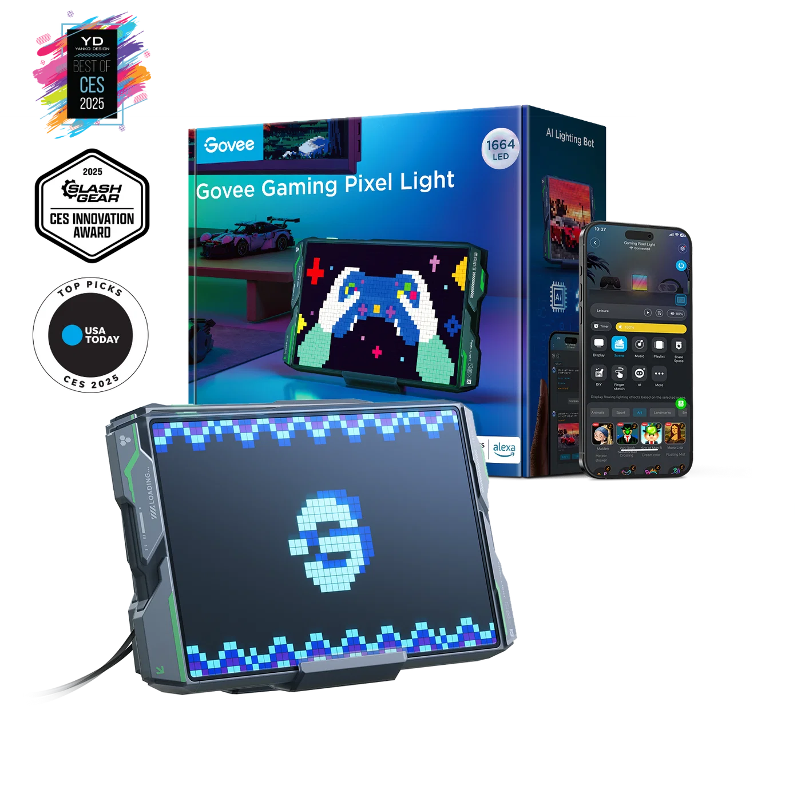
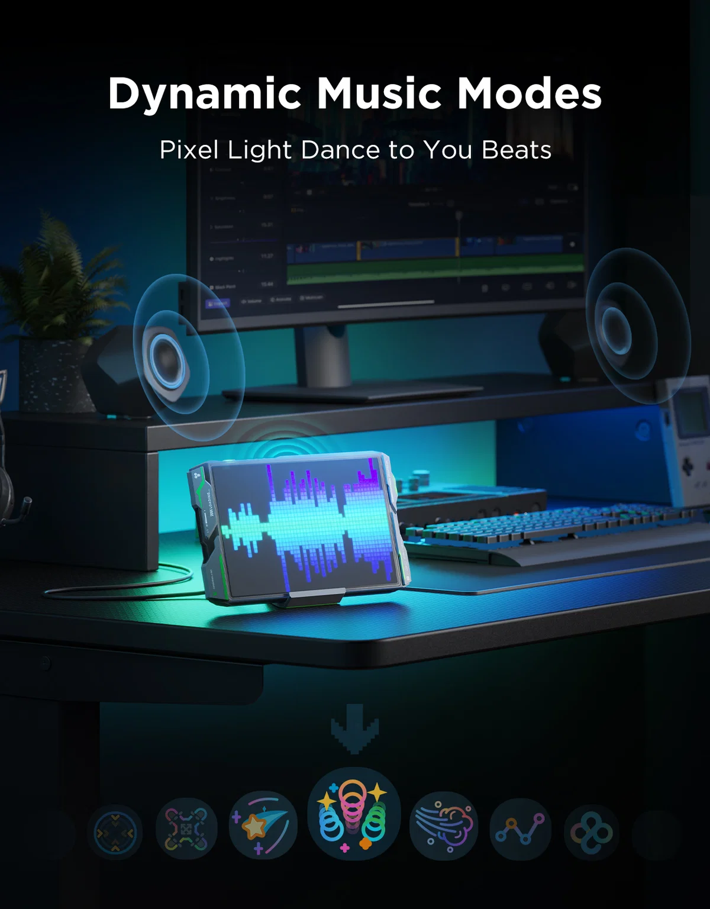
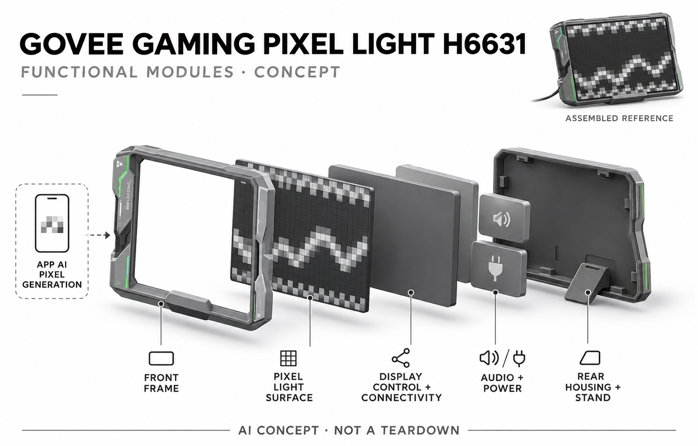

# Govee Gaming Pixel Light H6631

**Govee** · 灯光与环境表达 · 核查 2026-11-05

把文字想法生成像素图形和动画，再显示到桌面实体灯屏

消费渠道：个人零售。

## 产品图片与结构参考

### 产品图

官方H6631长方规格与包装展示 · 来源：[Govee · 官方图片](<https://us.govee.com/products/govee-gaming-pixel-light>) · [原始图片](<https://cdn.shopify.com/s/files/1/0512/3489/8105/files/ID_logo_1_5b8f258c-298b-420e-9ab5-88348463a9b6.png?v=1750840129&width=1400&height=1400&crop=center>)

### 参考图

官方同长方规格桌面场景 · 来源：[Govee · 官方图片](<https://us.govee.com/products/govee-gaming-pixel-light>) · [原始图片](<https://cdn.shopify.com/s/files/1/0512/3489/8105/files/2a309883d244b88b0cbfd360a82b46a9_d0562ecc-629f-4bd0-b0de-24c33aee7954.jpg?v=1758528885&width=1200&height=1536&crop=center>)

### AI 生成爆炸示意

**AI 生成 · 非实物拆机。** 内部为概念推断，不能作为元件布局、BOM 或维修依据。[生成提示词](../../content/hardware/prompts/govee-gaming-pixel-light-h6631.txt)

> 依据已核验官方外形与公开功能生成；未知内部仅为概念功能块，不代表原机电路板、芯片或实际布局。

> 目视核对当前型号与规格，官方网页原图未修改；配件、造景、广告效果及参数说明不代表基础包装或独立验证。

> 分析为基于公开资料的案头研究与 AI 辅助判断，未经用户访谈、销量审计或实物拆机。需求、画像、竞争冷门度、审美及商业机会均为研究假设，不是投资结论。

## 销售与购买

- 状态：在售。2026-11-05实际浏览美国官方商品页，当前H6631长方形规格US$99.99且Add to Cart/Buy Now可用；未选较小H6630或PAC-MAN联名包装。

- 地区：美国

- 价格：美国官方当前 US$99.99。页面对比价US$139.99，当前H6631规格；小尺寸H6630、联名外观和套装不重复收录，其他国家税费与价格另核。

- 中国大陆：美站官方配送政策明确只寄美国；未核实H6631当前中国大陆官方库存、直邮及账号AI功能。品牌来自中国不等于该海外型号已确认国内正式销售。

- [官方产品 / 商店](<https://us.govee.com/products/govee-gaming-pixel-light>)

## AI 的实际作用

AI Lighting Bot将用户描述生成像素内容并用于实体屏，用户也可导入和编辑图像动画。官方当前技术页区分图形灯的单轮GIF生成与线性灯的多轮对话，不能把所有灯型能力混用。

服务与联网依赖：生成、编辑与传输依赖Govee Home应用、网络及适用固件；屏体呈现内容，不应虚构机内大模型。部分同步功能需额外设备，普通语音开关灯不作为核心AI证据。

## 是否冷门

细分专业（研究判断）：家庭像素内容创作与实体呈现比普通语音灯控更具体，具有兴趣和装饰属性；长期内容质量、摆放和视觉接受度决定价值。

## 需求与市场

需求假设：喜欢布置桌面或游戏空间的人希望把自己的想法转成持续显示的像素内容，又不想从头学习绘图。AI生成可能降低第一次创作门槛，但价值要看作品是否愿意长期保留和修改，不能把短暂新奇等同持续需求。

### 产品任务与边界 · 研究判断

需求假设：喜欢布置桌面或游戏空间的人希望把自己的想法转成持续显示的像素内容，又不想从头学习绘图。AI生成可能降低第一次创作门槛，但价值要看作品是否愿意长期保留和修改，不能把短暂新奇等同持续需求。

依据：[Govee H6631当前官方商店](<https://us.govee.com/products/govee-gaming-pixel-light>) · [Govee当前官方技术分类](<https://us.govee.com/pages/govee-technology>)

### 需求判断 · 研究判断

判断：用户想在桌面持续展示自己想法时，通常要么接受现成动画，要么花时间制作适合低分辨率的图形。生成式入口能缩短从想法到第一幅画面的过程，但作品是否值得保留和继续修改，才决定它是否超越一次性的展示新鲜感。

依据：[Govee H6631当前官方商店](<https://us.govee.com/products/govee-gaming-pixel-light>) · [Govee当前官方技术分类](<https://us.govee.com/pages/govee-technology>)

### 需求验证 · 待验证

验证：邀请有实际桌面布置需求的人分别从预设、手工编辑和文字生成开始创作，记录到愿意展示作品所花时间。跟踪几周后保留或替换哪些内容，避免用第一次看见生成动画的兴奋程度或生成数量代替长期表达需求。

依据：[Govee H6631当前官方商店](<https://us.govee.com/products/govee-gaming-pixel-light>) · [Govee当前官方技术分类](<https://us.govee.com/pages/govee-technology>)

## 用户画像

画像推断：愿意使用应用、选择合适亮度并制作个人内容的兴趣用户较匹配，安静或多人共享空间则可能更重视关闭声音和减少动态刺激。不能仅按玩家身份推定需求，真实摆放位置与其他人接受程度同样重要。

### 适用行为与条件 · 研究判断

画像推断：愿意使用应用、选择合适亮度并制作个人内容的兴趣用户较匹配，安静或多人共享空间则可能更重视关闭声音和减少动态刺激。不能仅按玩家身份推定需求，真实摆放位置与其他人接受程度同样重要。

依据：[Govee H6631当前官方商店](<https://us.govee.com/products/govee-gaming-pixel-light>) · [Govee当前官方技术分类](<https://us.govee.com/pages/govee-technology>)

### 人群取舍 · 研究判断

判断：喜欢像素美术和轻量定制的人可能更匹配，而仅需要任务照明的人可能更适合普通灯具。共享卧室、办公桌与游戏房对声音和动态视觉的接受不同，个人偏好还需要与同住者协调，不能只用玩家身份或年龄判断购买意愿。

依据：[Govee H6631当前官方商店](<https://us.govee.com/products/govee-gaming-pixel-light>) · [Govee当前官方技术分类](<https://us.govee.com/pages/govee-technology>)

### 画像验证 · 待验证

验证：让潜在用户在自己常用位置选择亮度、内容和声音设置，观察旁人是否感到干扰。记录其是否愿意使用应用编辑生成结果，以及更偏好原创、预设还是实用信息，画像应由实际创作和摆放行为建立，而非品牌粉丝标签。

依据：[Govee H6631当前官方商店](<https://us.govee.com/products/govee-gaming-pixel-light>) · [Govee当前官方技术分类](<https://us.govee.com/pages/govee-technology>)

## 竞争与替代

竞争判断：与像素相框、普通屏幕、手工LED点阵和预设氛围灯竞争，差异在描述到生成内容并实际显示。不同灯形使用同一服务不自动形成新需求；应比较创作时间、可编辑性和画面适配，而不只比较灯珠数量。

### 比较对象与差异 · 研究判断

竞争判断：与像素相框、普通屏幕、手工LED点阵和预设氛围灯竞争，差异在描述到生成内容并实际显示。不同灯形使用同一服务不自动形成新需求；应比较创作时间、可编辑性和画面适配，而不只比较灯珠数量。

依据：[Govee H6631当前官方商店](<https://us.govee.com/products/govee-gaming-pixel-light>) · [Govee当前官方技术分类](<https://us.govee.com/pages/govee-technology>)

### 竞争判断 · 研究判断

判断：普通屏幕能显示更精细画面，LED像素屏则通过明显的颗粒与低分辨率形成独特风格，AI不是唯一差异。当前H6631和小尺寸、联名版仍属同一任务，灯幕与灯条即使共享AI服务，也不能只因外形不同就自动算新品类。

依据：[Govee H6631当前官方商店](<https://us.govee.com/products/govee-gaming-pixel-light>) · [Govee当前官方技术分类](<https://us.govee.com/pages/govee-technology>)

### 竞争验证 · 待验证

验证：比较用户在已有显示器、普通像素设备与H6631上展示同一主题时的操作和偏好。把生成、编辑、映射和持续播放分别测试，明确哪些改善来自AI，哪些来自硬件尺寸或预设库，不用灯珠或模式数量直接代替体验结论。

依据：[Govee H6631当前官方商店](<https://us.govee.com/products/govee-gaming-pixel-light>) · [Govee当前官方技术分类](<https://us.govee.com/pages/govee-technology>)

## 供应链

供应链分析：像素发光面、驱动控制、连接、音频、机壳与支架共同组成设备，完整供应商及BOM未披露。颜色一致性、低亮表现和内容映射影响观感，不能把公开AI模型宣传直接当作整机内置算力或芯片成本依据。

### 功能模块拆分 · 研究判断

模块拆分：前框与支架决定桌放壁装，像素发光面与显示控制负责呈现，音频和供电构成辅助功能，应用服务承担生成与传输。未知电路只用功能块表达，不把品牌模型参数画成机内芯片，也不增加源图中外部电脑音箱为标配。

依据：[Govee H6631当前官方商店](<https://us.govee.com/products/govee-gaming-pixel-light>) · [Govee当前官方技术分类](<https://us.govee.com/pages/govee-technology>)

### 制造与供应约束 · 研究判断

供应链分析：像素发光面、驱动控制、连接、音频、机壳与支架共同组成设备，完整供应商及BOM未披露。颜色一致性、低亮表现和内容映射影响观感，不能把公开AI模型宣传直接当作整机内置算力或芯片成本依据。

依据：[Govee H6631当前官方商店](<https://us.govee.com/products/govee-gaming-pixel-light>) · [Govee当前官方技术分类](<https://us.govee.com/pages/govee-technology>)

### 候选与证据缺口 · 研究判断

候选判断：环旭可评估消费无线与控制整合，PCH可评估显示外壳、支架和电子装配的产品化流程。未发现两者与Govee H6631的型号合作披露；像素发光器件来源、驱动与校准工艺仍未知，不能从这些候选推出实际供应链。

依据：[Govee H6631当前官方商店](<https://us.govee.com/products/govee-gaming-pixel-light>) · [Govee当前官方技术分类](<https://us.govee.com/pages/govee-technology>)

## 技术路径

技术判断：官方产品和技术页确认生成式像素内容，图形灯当前以单轮GIF生成为重点，线性灯的多轮交互不能直接套用。生成图像与LED呈现之间需要分辨率映射，预设播放、音乐响应及外部同步则属于不同功能路径。

### 已披露技术边界 · 研究判断

技术判断：官方产品和技术页确认生成式像素内容，图形灯当前以单轮GIF生成为重点，线性灯的多轮交互不能直接套用。生成图像与LED呈现之间需要分辨率映射，预设播放、音乐响应及外部同步则属于不同功能路径。

依据：[Govee H6631当前官方商店](<https://us.govee.com/products/govee-gaming-pixel-light>) · [Govee当前官方技术分类](<https://us.govee.com/pages/govee-technology>)

### 系统难点判断 · 研究判断

判断：当前技术说明将图形灯的单轮GIF生成与线性灯的多轮对话区别开来，产品页通用文案不能覆盖这一边界。生成结果还要映射到像素面，细节丢失、颜色和帧变化会改变表达，算法能生成不代表设备能够忠实呈现任意图像。

依据：[Govee H6631当前官方商店](<https://us.govee.com/products/govee-gaming-pixel-light>) · [Govee当前官方技术分类](<https://us.govee.com/pages/govee-technology>)

### 技术验证 · 待验证

验证：用不同复杂度但不含私人数据的描述测试生成和显示差异，检查是否能编辑、撤回及保存合适版本。将预设播放、音乐响应和额外同步硬件分开测试，核对断网后哪些功能保留，不假定大模型在本机运行或所有灯型能力相同。

依据：[Govee H6631当前官方商店](<https://us.govee.com/products/govee-gaming-pixel-light>) · [Govee当前官方技术分类](<https://us.govee.com/pages/govee-technology>)

## 产品审美

审美判断：灰黑外壳与绿线装饰偏向游戏桌面，像素面可创造复古表达，也会成为房间中强烈视觉焦点。设计评估应看关闭时的机身、侧面线缆与低亮状态，不能只看彩色营销场景或把所有动态画面当作舒适照明。

### 外观与交互语言 · 研究判断

审美判断：灰黑外壳与绿线装饰偏向游戏桌面，像素面可创造复古表达，也会成为房间中强烈视觉焦点。设计评估应看关闭时的机身、侧面线缆与低亮状态，不能只看彩色营销场景或把所有动态画面当作舒适照明。

依据：[Govee H6631当前官方商店](<https://us.govee.com/products/govee-gaming-pixel-light>) · [Govee当前官方技术分类](<https://us.govee.com/pages/govee-technology>)

### 使用中审美判断 · 研究判断

判断：机械式边框和绿线装饰强化游戏风格，可能适合某些桌面却不适合所有家居。像素内容、亮度和动态速度对观感的影响可能大于壳体颜色，关闭时的体积和电源线也应进入评价，不能只展示强烈彩色背景下的营销效果。

依据：[Govee H6631当前官方商店](<https://us.govee.com/products/govee-gaming-pixel-light>) · [Govee当前官方技术分类](<https://us.govee.com/pages/govee-technology>)

### 设计验证 · 待验证

验证：在白天、低光和关闭状态分别观察机身与画面，测试摆在视线正前方和侧面的阅读与干扰差异。邀请共用空间的人评价动态内容，确认低亮和静音容易设置；视觉舒适不能由单项厂商认证或统一宣传为所有用户保证。

依据：[Govee H6631当前官方商店](<https://us.govee.com/products/govee-gaming-pixel-light>) · [Govee当前官方技术分类](<https://us.govee.com/pages/govee-technology>)

## 关键风险

风险判断：生成内容可能不符合意图，低分辨率会丢失细节，服务或固件变化也会影响AI入口。用户需注意亮度、动态效果及共享空间的接受程度，外部同步设备和联名素材权限不应默认包含，更不能以厂商认证宣传保证人人无视觉不适。

### 主要失效与依赖 · 研究判断

风险判断：生成内容可能不符合意图，低分辨率会丢失细节，服务或固件变化也会影响AI入口。用户需注意亮度、动态效果及共享空间的接受程度，外部同步设备和联名素材权限不应默认包含，更不能以厂商认证宣传保证人人无视觉不适。

依据：[Govee H6631当前官方商店](<https://us.govee.com/products/govee-gaming-pixel-light>) · [Govee当前官方技术分类](<https://us.govee.com/pages/govee-technology>)

### 风险传播判断 · 研究判断

判断：生成内容不符合意图、服务调整和固件未更新都可能破坏创作流程，低分辨率也会让原本清楚的图形变得模糊。用户导入的图像与联名素材还各有使用边界，设备能够播放不等于取得公开再分发或商业使用的所有权利。

依据：[Govee H6631当前官方商店](<https://us.govee.com/products/govee-gaming-pixel-light>) · [Govee当前官方技术分类](<https://us.govee.com/pages/govee-technology>)

### 风险验证 · 待验证

验证：检查生成失败、网络中断和升级提示是否能被用户理解，并确认手动控制与关闭途径可用。测试过亮或过快内容的调整方法，阅读实际地区支持和售后范围；不因品牌中国背景就推断海外型号在大陆有同等AI服务与保修。

依据：[Govee H6631当前官方商店](<https://us.govee.com/products/govee-gaming-pixel-light>) · [Govee当前官方技术分类](<https://us.govee.com/pages/govee-technology>)

## 机会与验证

机会假设：可从个人小作品在桌面的持续展示与轻量修改验证，重点是让内容容易创作和适配实体像素。若用户最终只使用预设，AI的附加价值可能有限；机会应由实际创作复用与留存支持，而非同品牌灯具数量。

### 可能的机会入口 · 研究判断

机会假设：可从个人小作品在桌面的持续展示与轻量修改验证，重点是让内容容易创作和适配实体像素。若用户最终只使用预设，AI的附加价值可能有限；机会应由实际创作复用与留存支持，而非同品牌灯具数量。

依据：[Govee H6631当前官方商店](<https://us.govee.com/products/govee-gaming-pixel-light>) · [Govee当前官方技术分类](<https://us.govee.com/pages/govee-technology>)

### 机会成立条件 · 研究判断

判断：机会不在把所有照明接上同一个聊天入口，而在生成内容能否被用户轻松调整成适合实体像素的表达。若大部分人最终只选预设，产品仍可能有装饰价值，但AI附加价值必须降低预期，并把编辑和内容管理作为主要改进方向。

依据：[Govee H6631当前官方商店](<https://us.govee.com/products/govee-gaming-pixel-light>) · [Govee当前官方技术分类](<https://us.govee.com/pages/govee-technology>)

### 下一步验证 · 待验证

验证：跟踪作品从首次生成到修改、保存、展示和最终替换的过程，统计真正重复使用的内容而非提示词次数。对不同人群比较创作门槛与持续成本，只有明确用户愿意维护这个小型表达载体后，才讨论更多硬件形态扩展。

依据：[Govee H6631当前官方商店](<https://us.govee.com/products/govee-gaming-pixel-light>) · [Govee当前官方技术分类](<https://us.govee.com/pages/govee-technology>)

## 对应供应链公司

能力候选用于选型研究，不代表本产品实际采用；未公开的供货关系不作推断。

- [usi](../supply-chain/usi.md) — **能力候选 · 非已采用** / 像素设备无线控制与电子整合：环旭公开消费电子无线和系统整合能力可用于像素灯的连接、控制与生产测试候选评估。没有H6631实际供货证据，不能把其一般能力视为Govee采用；发光器件、色彩校准及应用AI服务仍需分别核验。

- [pch-international](../supply-chain/pch-international.md) — **能力候选 · 非已采用** / 像素屏结构及整机产品化：PCH公开产品开发到制造的服务可匹配桌面像素屏外壳、支架、电源与电子装配的产品化需求。未确认与Govee该型号合作，候选关系不证明实际ODM；显示一致性与生成内容体验还需要专项设计和测试。

[浏览供应链目录](../supply-chain.md)

## 功能分层示意

这是功能关系，不是实物拆机、真实空间结构或已核实 BOM。

1. **前框与显示面**：长方形灰黑机身、绿线装饰及前方像素显示。（官方披露）

2. **像素发光层**：LED像素内容呈现，不虚构内部线路与芯片型号。（官方披露）

3. **控制与连接**：图像播放、应用同步与设备控制。（分析推断）

4. **音频与电源**：内置声音体验及外接电源。（官方披露）

5. **支架与外部生成**：桌放或壁装，AI生成位于应用服务路径。（官方披露）

## 来源

1. [Govee H6631当前官方商店](<https://us.govee.com/products/govee-gaming-pixel-light>) — 实际浏览器核对US$99.99可购买及Specs H6631，照片选择长方规格，不混H6630和PAC-MAN包装。

2. [Govee当前官方技术分类](<https://us.govee.com/pages/govee-technology>) — 实际打开AI Lighting Bot 2.0：图形灯单轮GIF生成、线性灯多轮对话；未把全品牌宣传逐项当成本型号功能。

3. [Govee官方像素灯发布技术说明](<https://us.govee.com/blogs/news/govee-announces-new-lighting-technology-for-elevated-living-experiences-at-ces-2025>) — 实际打开像素艺术、AI生成与应用编辑路径；旧发布日和价格不作当前销售证据，参数宣传不作为独立验证。

4. [Govee美国官方配送政策](<https://us.govee.com/policies/shipping-policy>) — 实际打开只寄美国的配送范围；未推定大陆官方销售或跨境服务可用性。

[返回目录](../hardware-market.md) · [网页分析](https://romanagent.github.io/Roman/#hardware/product/govee-gaming-pixel-light-h6631)
