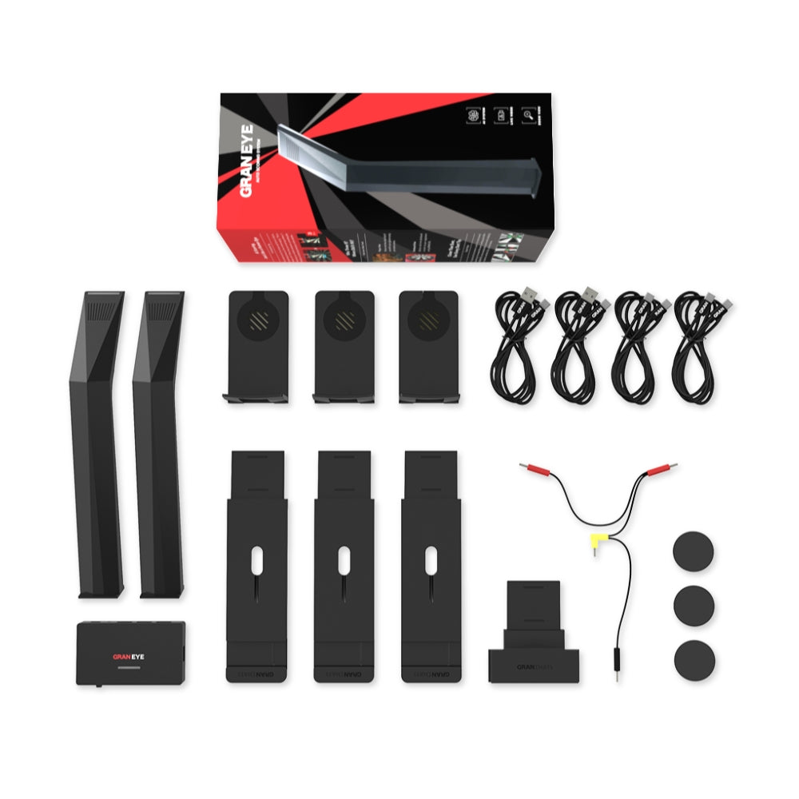
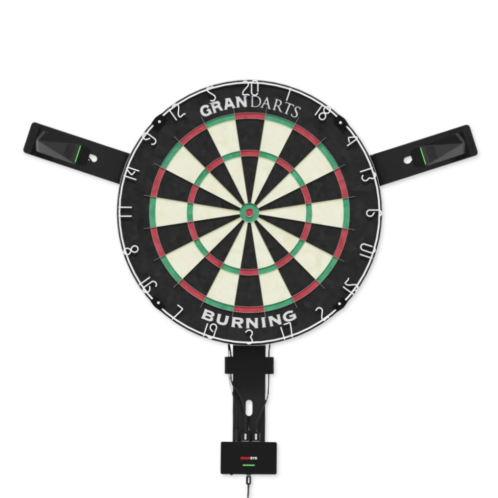
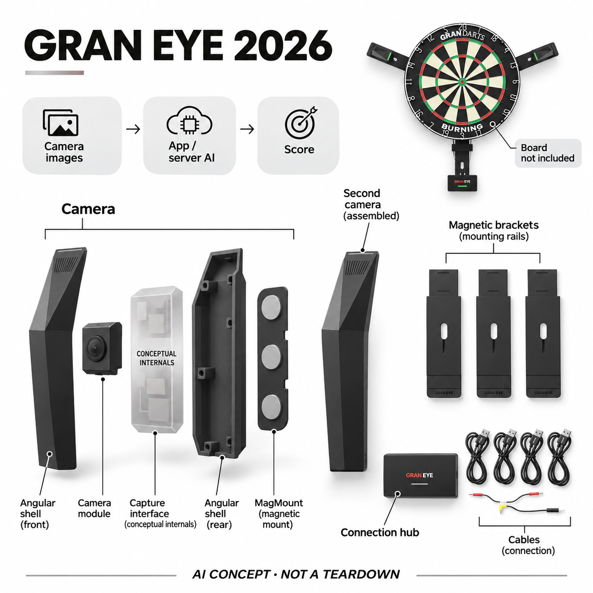

# GRAN EYE（2026安装套件版）

**GRAN DARTS** · 游戏与桌游 · 核查 2026-11-04

外挂到现有钢针靶上的AI视觉自动计分套件

消费渠道：个人零售。

## 产品图片与结构参考

### 产品图

GRAN EYE（2026安装套件版） 官方产品图 · 来源：[GRAN DARTS · 官方资料](<https://store.gran-darts.com/en/products/gran-eye-2026model>) · [原始图片](<https://cdn.shopify.com/s/files/1/0373/0967/7704/files/included_items.jpg?v=1771297462>)

### 参考图

GRAN EYE 2026 官方安装参考（靶盘、护圈非本套件标配） · 来源：[GRAN DARTS · 官方资料](<https://store.gran-darts.com/en/products/gran-eye-2026model>) · [原始图片](<https://cdn.shopify.com/s/files/1/0373/0967/7704/files/setup.jpg?v=1771297469>)

### AI 生成爆炸示意

**AI 生成 · 非实物拆机。** 内部为概念推断，不能作为元件布局、BOM 或维修依据。[生成提示词](../../content/hardware/prompts/gran-eye-2026.txt)

> 以已目视核对的官方图片独立生成，未知内部为功能概念，不代表真实PCB、拆机或已采用供应商。

> 保留官方图片原貌；图片中的宣传数字和效果不作为本站实测。

> 分析为基于公开资料的案头研究与 AI 辅助判断，未经用户访谈、销量审计或实物拆机。需求、画像、竞争冷门度、审美及商业机会均为研究假设，不是投资结论。

## 销售与购买

- 状态：在售。核查日日本官方商店列2026款¥39,380含税，公开商品数据默认变体available=true。部分英国渠道旧组合缺货未用作销售证据；2026版主要更新安装件，与2025版AI计分能力相同，不重复计两款。

- 地区：日本（已核官方商店）、欧洲、北美等品牌授权渠道（逐店库存另核）

- 价格：日本官方商店¥39,380日元（含税）。计分外挂套件；钢针靶、飞镖、护圈和USB PD电源适配器不应默认包含。基础记分官方称无订阅，可选App额外内容另计。

- 中国大陆：已核品牌全球经销商列表，但未确认中国大陆官方现货与售后；App、服务器处理和支付条件需按所在地另核。

- [官方产品 / 商店](<https://store.gran-darts.com/en/products/gran-eye-2026model>)

## AI 的实际作用

两个相机采集靶面，AI判断每支飞镖落点并计算分数。2026年9月App更新可将低性能手机的计算交由GRAN服务器，不能宣称所有识别都在套件本机或完全离线。

服务与联网依赖：需现有钢针靶、手机/平板、GranDarts App与供电；无线连接或服务器处理依赖相应网络。2026版磁吸安装件改进设置流程，计分模型未因安装年份自动升级。

## 是否冷门

细分专业（研究判断）：钢针飞镖自动计分服务于稳定兴趣人群，已有多家视觉方案；外挂便利和纠错体验需要实测，不能以冷门推断低竞争。

## 需求与市场

案头需求是让家中钢针飞镖游戏减少人工计分，又保留用户已有靶盘和投掷习惯。AI识别进入每次落点判分；实际价值在争议球、遮挡和误判时能否快速核对，不能只看厂家准确率。

### 事实：任务边界 · 官方资料

GRAN EYE把两个摄像单元装到既有钢针靶旁，由AI从靶面图像判断落点并在App里记分。购买的是外挂计分系统而非附带全部靶盘的电子游戏机，任务是保留玩家现有投掷设备的同时减少人工输入分数，让练习和对局更连续。

依据：[GRAN EYE 2026官方商店](<https://store.gran-darts.com/en/products/gran-eye-2026model>) · [GRAN EYE官方功能页](<https://www.gran-darts.com/graneye>)

### 判断：真实需求 · 研究判断

需求判断应关注玩家什么时候不愿计分：独自练习可能希望保留统计，朋友对局可能想减少中断，远程游戏则更在意双方看到可信结果。自动化节省的步骤如果被误判修正抵消，就未必有价值，不能只根据厂家公布的识别数字判断体验。

依据：[GRAN EYE 2026官方商店](<https://store.gran-darts.com/en/products/gran-eye-2026model>) · [GRAN EYE官方功能页](<https://www.gran-darts.com/graneye>)

### 验证：任务完成 · 待验证

可安排同一组玩家进行多轮正常对局，保留人工复核记录并标注每次分数争议、修正与等待。访谈问最想省掉的是计算还是手机输入，以及出现错误后是否仍信任统计；把玩家对游戏连续性的感受与实际修正次数一起分析。

依据：[GRAN EYE 2026官方商店](<https://store.gran-darts.com/en/products/gran-eye-2026model>) · [GRAN EYE官方功能页](<https://www.gran-darts.com/graneye>)

## 用户画像

适合已有钢针靶、经常练习或与朋友比赛，并愿意放置手机屏幕的人。只偶尔娱乐或偏好完全离线玩法的人未必需要联网记分；安装空间与供电也影响能否长期保留。

### 事实：使用条件 · 官方资料

官方要求搭配已有钢针靶、飞镖、手机或平板以及另购合适电源，网络和计算条件因连接及App模式而异。二〇二六安装套件采用磁吸方式，便于在保留原有设备的情况下布置，但并非拿出包装就能在没有靶盘的家庭开始游戏。

依据：[GRAN EYE 2026官方商店](<https://store.gran-darts.com/en/products/gran-eye-2026model>) · [GRAN EYE官方功能页](<https://www.gran-darts.com/graneye>)

### 判断：人群筛选 · 研究判断

潜在用户是已有固定飞镖兴趣、经常在家练习或对局的人，而非所有愿意尝试一次小游戏的人。玩家是否愿意常放一块手机屏幕、接受布线和账号管理，会影响保留意愿；偏爱纯离线、无屏玩法的人可能并不需要这个外挂系统。

依据：[GRAN EYE 2026官方商店](<https://store.gran-darts.com/en/products/gran-eye-2026model>) · [GRAN EYE官方功能页](<https://www.gran-darts.com/graneye>)

### 验证：参与者差异 · 待验证

招募应记录现有靶盘、灯光、手机性能与安装位置，让用户自行完成连接和一次重新安装。访谈包括是否介意靶盘周围增加相机、朋友是否容易理解分数界面，以及临时把系统带到另一处时愿意花多久重新设置，避免只研究固定场地熟手。

依据：[GRAN EYE 2026官方商店](<https://store.gran-darts.com/en/products/gran-eye-2026model>) · [GRAN EYE官方功能页](<https://www.gran-darts.com/graneye>)

## 竞争与替代

替代包括人工算分、电子软针靶和其他摄像自动计分。该套件的差异是保留现有钢针设备，目录只收当前安装版；不同年份或灯光附件并不形成独立需求。

### 事实：方案范围 · 官方资料

替代包括人工算分、电子软针靶及其它相机自动计分套件，GRAN EYE的路线是保留钢针靶并外挂视觉。品牌明确二〇二五与二〇二六版的计分能力相同，主要改变安装及附件，因此目录只收当前套件，不把安装更新或灯光选件再计成新需求。

依据：[GRAN EYE官方功能页](<https://www.gran-darts.com/graneye>) · [GRAN EYE年份对比官方说明](<https://www.gran-darts.com/ja/topics/which-gran-eye-should-you-choose-2025-vs-2026-model-comparison-guide>)

### 判断：替代关系 · 研究判断

与电子触点读数相比，视觉方案能适配原有钢针体验，但必须处理遮挡、靶面变化和落点判断；与人工输入相比，它可能减少操作却也增加需要纠错的技术环节。哪种更合适取决于玩家要保留的玩法和可接受维护，不是相机数量越少越好。

依据：[GRAN EYE官方功能页](<https://www.gran-darts.com/graneye>) · [GRAN EYE年份对比官方说明](<https://www.gran-darts.com/ja/topics/which-gran-eye-should-you-choose-2025-vs-2026-model-comparison-guide>)

### 验证：比较方法 · 待验证

对照可使用同一靶和同一组投掷记录，比较人工输入、自动判分及修正后的总时间。若换电子靶，也要记录投掷感觉改变是否可接受；不要只将硬件价格相除，或把某种免费基础服务与另一种包含额外对局功能的套餐混为一谈。

依据：[GRAN EYE官方功能页](<https://www.gran-darts.com/graneye>) · [GRAN EYE年份对比官方说明](<https://www.gran-darts.com/ja/topics/which-gran-eye-should-you-choose-2025-vs-2026-model-comparison-guide>)

## 供应链

实物包含两个摄像单元、连接中枢、线缆和磁吸安装件，AI计算可在手机或服务器。图像芯片与代工未披露，候选相机和结构厂仅是能力匹配，不能推断品牌实际采购名单。

### 事实：功能组成 · 官方资料

官方套件照片能辨认两个摄像单元、下方连接中枢、线缆和磁吸安装件，靶盘与护圈另属使用环境。AI计算可由手机或服务器承担，具体相机芯片、板级设计及代工厂没有点名，不能把中枢外壳误解释为一台独立离线AI计算机。

依据：[GRAN EYE 2026官方商店](<https://store.gran-darts.com/en/products/gran-eye-2026model>) · [GRAN EYE官方功能页](<https://www.gran-darts.com/graneye>) · [GRAN EYE服务器计算更新](<https://www.gran-darts.com/topics/gran-eye-works-on-older-phones-and-tablets>)

### 判断：交付约束 · 研究判断

工程判断需要把摄像角度、固定稳定性、图像传输和落点模型共同标定。磁吸减少安装步骤，但拿下再放回的位置一致性也需要验证；用户已有的靶盘磨损和灯光可能改变输入条件，制造一致性与首次设置流程同样影响实际判分。

依据：[GRAN EYE 2026官方商店](<https://store.gran-darts.com/en/products/gran-eye-2026model>) · [GRAN EYE官方功能页](<https://www.gran-darts.com/graneye>) · [GRAN EYE服务器计算更新](<https://www.gran-darts.com/topics/gran-eye-works-on-older-phones-and-tablets>)

### 验证：选型缺口 · 待验证

Arducam可作为靶面采集模组的能力候选，Protolabs可作为磁吸安装件和外壳原型候选。前者需核对视角、曝光和传输，后者需验证固定与重复安装；它们均未被品牌证实采用，也不能因此推算这套产品的制造成本或交期。

依据：[GRAN EYE 2026官方商店](<https://store.gran-darts.com/en/products/gran-eye-2026model>) · [GRAN EYE官方功能页](<https://www.gran-darts.com/graneye>) · [GRAN EYE服务器计算更新](<https://www.gran-darts.com/topics/gran-eye-works-on-older-phones-and-tablets>)

## 技术路径

官方说明AI从靶面照片判断落点，新App允许服务器承担低性能终端的计算。识别不同于直接读取电子靶开关；光线、飞镖堆叠和网络延迟都应测试，不能承诺任何条件都零误判。

### 事实：AI机制 · 官方资料

官方说明AI分析靶面照片来识别飞镖落点，而二〇二六年九月的App更新把低性能终端的重计算移到GRAN服务器。因而同一套硬件可能有不同计算路径，识别结果不全来自相机本机；本条明确保留手机能力、网络和服务器服务之间的依赖。

依据：[GRAN EYE官方功能页](<https://www.gran-darts.com/graneye>) · [GRAN EYE服务器计算更新](<https://www.gran-darts.com/topics/gran-eye-works-on-older-phones-and-tablets>)

### 判断：系统边界 · 研究判断

视觉推断与直接触点测量不同，飞镖彼此遮挡、落点靠近分区边界或背景变化都值得单独测试。公开资料没有为用户每种靶盘条件给出可独立核对的误差分布，不能把厂商总体指标转化成对所有投掷都正确，更不能宣称完全没有等待。

依据：[GRAN EYE官方功能页](<https://www.gran-darts.com/graneye>) · [GRAN EYE服务器计算更新](<https://www.gran-darts.com/topics/gran-eye-works-on-older-phones-and-tablets>)

### 验证：算法与体验 · 待验证

验证可以按边界球、密集落点、弹出和取镖等事件分类记录结果，再比较手机本地与服务器路径的等待及失败提示。应让用户实际执行纠错，检查统计是否同步恢复；本轮没有这些实测，不给出超越人工判分的准确性结论。

依据：[GRAN EYE官方功能页](<https://www.gran-darts.com/graneye>) · [GRAN EYE服务器计算更新](<https://www.gran-darts.com/topics/gran-eye-works-on-older-phones-and-tablets>)

## 产品审美

两个细长黑色相机分列靶盘两侧，底部中枢和磁吸挂件尽量保留原有布置。主图采用实际套件内容，参考图说明安装位置；靶盘与护圈只是使用场景，避免让人误以为随盒附送。

### 事实：外观与交互 · 官方资料

当前套件为两条细长黑色摄像单元和小型中枢，磁吸挂件沿靶盘周围布置，保留了原有钢针靶的视觉中心。主图使用套件实物清单，参考图展示安装，概念图也注明靶盘不包含，避免把厂商搭配图误读成整套硬件随包装交付。

依据：[GRAN EYE 2026官方商店](<https://store.gran-darts.com/en/products/gran-eye-2026model>) · [GRAN EYE官方功能页](<https://www.gran-darts.com/graneye>) · [GRAN EYE年份对比官方说明](<https://www.gran-darts.com/ja/topics/which-gran-eye-should-you-choose-2025-vs-2026-model-comparison-guide>)

### 判断：使用中的形态 · 研究判断

这种外挂形态可能比大环形装置低调，但线缆、手机位置和相机支出范围仍会改变使用空间。磁吸连接的便利也取决于放置后是否稳固，玩家取镖时是否容易碰到；审美应包括实际动作和房间布置，而非只比较黑色壳体线条。

依据：[GRAN EYE 2026官方商店](<https://store.gran-darts.com/en/products/gran-eye-2026model>) · [GRAN EYE官方功能页](<https://www.gran-darts.com/graneye>) · [GRAN EYE年份对比官方说明](<https://www.gran-darts.com/ja/topics/which-gran-eye-should-you-choose-2025-vs-2026-model-comparison-guide>)

### 验证：日常接受度 · 待验证

可以让参与者按自己原有风格保留灯和护圈，观察安装后取镖、清理以及拆下携带的动作。访谈问相机是否破坏原本体验、哪些线缆最碍眼，以及是否愿意为了自动记分持续把系统留在墙上，将具体使用摩擦与外观喜好一起记录。

依据：[GRAN EYE 2026官方商店](<https://store.gran-darts.com/en/products/gran-eye-2026model>) · [GRAN EYE官方功能页](<https://www.gran-darts.com/graneye>) · [GRAN EYE年份对比官方说明](<https://www.gran-darts.com/ja/topics/which-gran-eye-should-you-choose-2025-vs-2026-model-comparison-guide>)

## 关键风险

主要风险是误计分影响比赛、旧手机转服务器后产生网络依赖，以及把不同年份安装配件混用。官方基础计分无订阅不等于所有App扩展免费，跨境硬件也不保证本地支持。

### 事实：已知限制 · 官方资料

官方商城明确电源适配器另购，基础计分服务宣称不需订阅，但可选App内容与网络条件仍需分开确认。部分授权经销商旧组合当前缺货，本条以日本官方二〇二六款的实际可购数据为依据，没有把有配件库存或经销商名单当作整机现货。

依据：[GRAN EYE 2026官方商店](<https://store.gran-darts.com/en/products/gran-eye-2026model>) · [GRAN EYE服务器计算更新](<https://www.gran-darts.com/topics/gran-eye-works-on-older-phones-and-tablets>) · [GRAN DARTS授权经销商](<https://www.gran-darts.com/dealers>)

### 判断：失效影响 · 研究判断

主要风险是误计分影响对局信任，以及手机性能不足后转用服务器让用户意外依赖网络。相机图像被发送处理的路径也值得清楚说明，不能笼统声称一切只在本地；跨境购买的售后与App条件不能由日本商店有货直接外推到中国大陆。

依据：[GRAN EYE 2026官方商店](<https://store.gran-darts.com/en/products/gran-eye-2026model>) · [GRAN EYE服务器计算更新](<https://www.gran-darts.com/topics/gran-eye-works-on-older-phones-and-tablets>) · [GRAN DARTS授权经销商](<https://www.gran-darts.com/dealers>)

### 验证：风险处理 · 待验证

试用时应安排网络不稳、重新安装和分区边界球，记录错误提示与人工纠正是否容易理解。购买前核对套件、供电和手机条件，并确认目标地区服务；对比赛统计保留复核方式，不将AI判分作为无需任何人确认的唯一依据。

依据：[GRAN EYE 2026官方商店](<https://store.gran-darts.com/en/products/gran-eye-2026model>) · [GRAN EYE服务器计算更新](<https://www.gran-darts.com/topics/gran-eye-works-on-older-phones-and-tablets>) · [GRAN DARTS授权经销商](<https://www.gran-darts.com/dealers>)

## 机会与验证

可验证机会在日常训练和熟人对局的计分减负。让玩家同时人工复核多轮投掷，记录争议与修正时间、重新校准次数和联网失败处理，再判断它是否真的让游戏更连续。

### 判断：可尝试切口 · 研究判断

可以研究的切口是让玩家的原有钢针装备顺利进入自动记录与线上互动，尤其减少第一次安装和争议落点确认的摩擦。若长期问题集中在纠错而不是识别速度，提供更透明的判分图像与修改流程可能比继续强调总体准确率更有价值。

依据：[GRAN EYE 2026官方商店](<https://store.gran-darts.com/en/products/gran-eye-2026model>) · [GRAN EYE官方功能页](<https://www.gran-darts.com/graneye>) · [GRAN EYE服务器计算更新](<https://www.gran-darts.com/topics/gran-eye-works-on-older-phones-and-tablets>)

### 判断：商业边界 · 研究判断

商业边界在于飞镖是稳定但小众的兴趣，拥有靶盘的人也不一定想用联网统计。基础计分免费可能降低持续费用，但服务器维护与可选内容仍是系统的一部分；本轮没有玩家访谈、销量或续用数据，不能由小众直接推导蓝海和高付费意愿。

依据：[GRAN EYE 2026官方商店](<https://store.gran-darts.com/en/products/gran-eye-2026model>) · [GRAN EYE官方功能页](<https://www.gran-darts.com/graneye>) · [GRAN EYE服务器计算更新](<https://www.gran-darts.com/topics/gran-eye-works-on-older-phones-and-tablets>)

### 验证：下一步调研 · 待验证

下一步可借给有固定练习习惯的玩家使用数周，记录投掷次数之外的开机、修正、移机和停用原因。访谈应问最希望保留哪项功能、没有自动记分时是否少玩，再用真实行为决定研究方向，不以模型评分预测这一套件的市场成功。

依据：[GRAN EYE 2026官方商店](<https://store.gran-darts.com/en/products/gran-eye-2026model>) · [GRAN EYE官方功能页](<https://www.gran-darts.com/graneye>) · [GRAN EYE服务器计算更新](<https://www.gran-darts.com/topics/gran-eye-works-on-older-phones-and-tablets>)

## 对应供应链公司

能力候选用于选型研究，不代表本产品实际采用；未公开的供货关系不作推断。

- [arducam](../supply-chain/arducam.md) — **能力候选 · 非已采用** / 靶面视觉采集模组候选：GRAN EYE用双摄像单元提供靶面图像，Arducam公开相机模组与定制视觉集成能力，可作为采集子系统候选。视角、曝光、接口、机身形状和落点模型需共同验证，本轮没有其向GRAN DARTS供货的公开证据。

- [protolabs](../supply-chain/protolabs.md) — **能力候选 · 非已采用** / 磁吸安装件与摄像外壳原型候选：GRAN EYE当前套件依赖可重复安装的磁吸结构，Protolabs公开多种结构原型与加工能力，可用于同类挂件、外壳和连接件验证。固定力、取镖碰撞和安装一致性仍需实际测试，没有点名采用关系，也不代表其提供整套计分算法。

[浏览供应链目录](../supply-chain.md)

## 功能分层示意

这是功能关系，不是实物拆机、真实空间结构或已核实 BOM。

1. **双视角采集**：两个外置摄像单元观察已有钢针靶。（官方披露）

2. **安装与连接**：磁吸挂件、线缆和下方中枢完成布置与连接。（官方披露）

3. **AI判分**：手机或服务器从靶面图像推断飞镖落点，非电子靶触点读数。（官方披露）

4. **游戏反馈**：GranDarts App显示分数、对局和统计。（官方披露）

5. **外部配套**：需要靶盘、飞镖和合适USB PD电源，套件不等于整套靶盘系统。（官方披露）

## 来源

1. [GRAN EYE 2026官方商店](<https://store.gran-darts.com/en/products/gran-eye-2026model>) — 实际打开并读公开商品数据；39380日元含税、默认款有货、适配器另购及年份区别。

2. [GRAN EYE官方功能页](<https://www.gran-darts.com/graneye>) — 实际打开；双摄像外挂、磁吸安装、Wi-Fi/USB与基础计分服务。

3. [GRAN EYE服务器计算更新](<https://www.gran-darts.com/topics/gran-eye-works-on-older-phones-and-tablets>) — 实际打开；2026年9月App3.0可把低性能手机的AI计算交给服务器。

4. [GRAN EYE年份对比官方说明](<https://www.gran-darts.com/ja/topics/which-gran-eye-should-you-choose-2025-vs-2026-model-comparison-guide>) — 实际打开；两代计分性能相同，主要改变安装和附件，不重复计数。

5. [GRAN DARTS授权经销商](<https://www.gran-darts.com/dealers>) — 实际打开；用于渠道范围，不把名单存在当成所有店都有现货。

[返回目录](../hardware-market.md) · [网页分析](https://romanagent.github.io/Roman/#hardware/product/gran-eye-2026)
