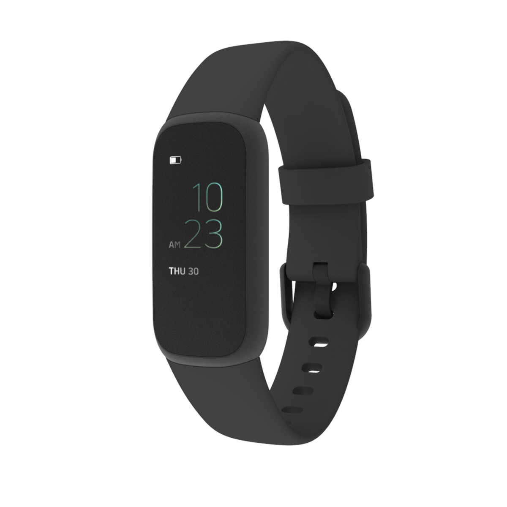
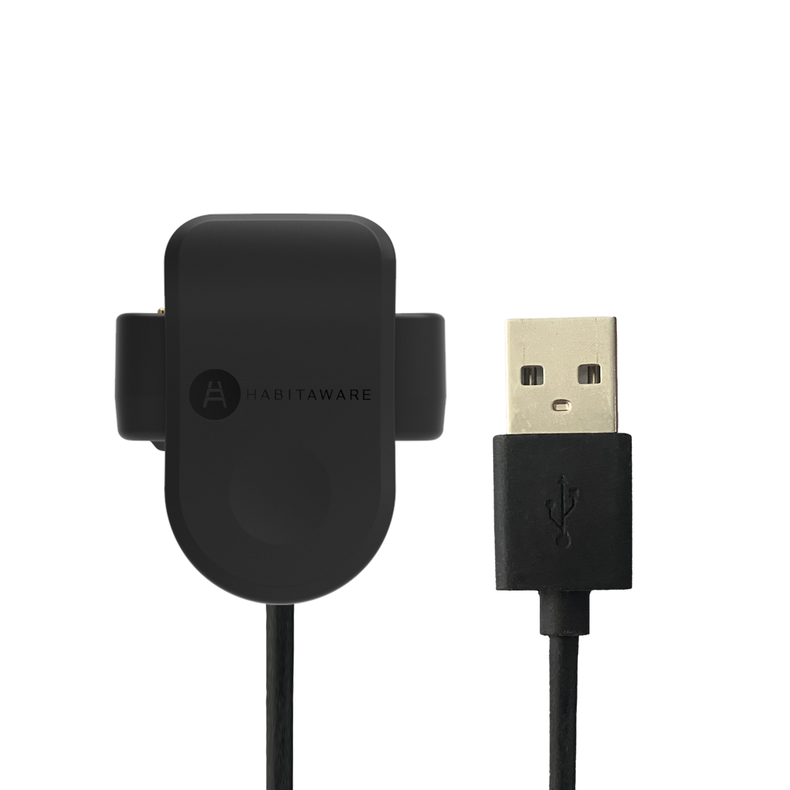
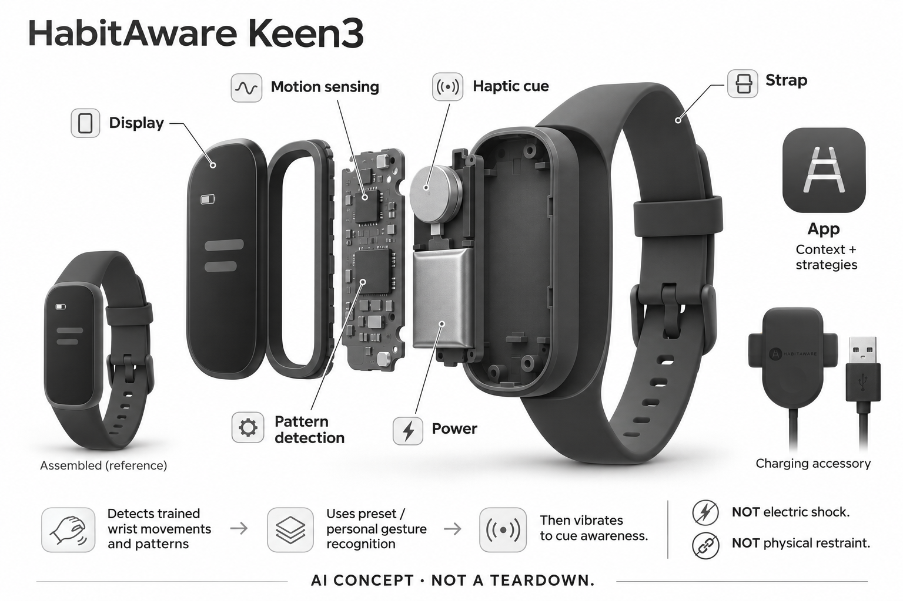

# HabitAware Keen3

**HabitAware** · 健康与穿戴 · 核查 2026-11-05

识别个人重复手部动作，以振动和日志帮助建立觉察

消费渠道：消费预订。

## 产品图片与结构参考

### 产品图

Keen3 Raven官方整机外形 · 来源：[HabitAware · 官方产品图片](<https://habitaware.com/products/keen3-bracelet>) · [原始图片](<https://cdn.shopify.com/s/files/1/3005/3494/files/Keen3-RavenBlack-Productphoto.png?v=1791317445&width=1200>)

### 参考图

Keen3官方另一配色佩戴参考，非独立型号 · 来源：[HabitAware · 官方产品图片](<https://habitaware.com/products/keen3-bracelet>) · [原始图片](<https://cdn.shopify.com/s/files/1/3005/3494/files/Keen3fortrichotillomaniadermatillomaniasmartbraceletwatchforBFRBs.png?v=1792598179&width=1200>)

### 参考图

Keen3官方充电附件参考 · 来源：[HabitAware · 官方产品图片](<https://habitaware.com/products/keen3-bracelet>) · [原始图片](<https://cdn.shopify.com/s/files/1/3005/3494/files/Keen3_-_Charger.png?v=1791383316&width=1200>)

### AI 生成爆炸示意

**AI 生成 · 非实物拆机。** 内部为概念推断，不能作为元件布局、BOM 或维修依据。[生成提示词](../../content/hardware/prompts/habitaware-keen3.txt)

> 已视觉检查外形、灰阶、文本和数据路径；未知内部为概念模块，不代表实际拆机、完整BOM或医疗效果。

> 实际逐张查看并核对具体型号，保留厂家原图；参考场景和人物不能证明效果，历史图像与当前购买条件分别核查。

> 分析为基于公开资料的案头研究与 AI 辅助判断，未经用户访谈、销量审计或实物拆机。需求、画像、竞争冷门度、审美及商业机会均为研究假设，不是投资结论。

## 销售与购买

- 状态：预售 / 接受延期订单。具体整机预售价US$199，公开商品JSON两色available=true；实际浏览器Raven加入购物车成功，预计2027年1月发货。网页静态Sold out为模板，非仅邮箱候补。

- 地区：官方国际商店预售；具体地址与交付须结算确认

- 价格：US$199（整机预售，含1年Pro）。预计2027年1月发货非保证日期；Pro从首次连接起算，之后所列US$99/年，基本觉察振动和课程可继续使用，不把配色或赠带另计产品。

- 中国大陆：浏览器可显示香港币种，但未核到中国大陆地址交付与本地服务；国家币种列表不作为大陆正式购买证明。

- [官方产品 / 商店](<https://habitaware.com/products/keen3-bracelet>)

## AI 的实际作用

基于预训练和个人动作模型识别腕部运动与朝向模式，再触发振动；Pro根据用户记录的背景学习模式并提供策略提示，不推定为生成式聊天。

服务与联网依赖：需要App设置动作并持续修正和记录；CoreBFRB技术延续在当前商品FAQ明确，但首日检测与已升级Keen2相近，后续提升仍属预期。

## 是否冷门

细分专业（研究判断）：针对用户希望觉察的身体相关重复手部行为，区别于计步和一般习惯打卡；误报、记录投入与自愿使用关键，无本研究疗效或销量结论。

## 需求与市场

需求假设是使用者有自己希望注意的重复动作，却常在发生后才意识到。振动可能提供一个主动选择的时点，但只有用户愿意回应、且提醒不过度干扰日常活动才有价值；不能把触发次数减少直接解释为行为改善，更不能从腕部动作推断某种情绪或诊断。

### 官方｜识别动作后给出觉察提示 · 官方资料

Keen3通过腕部动作模型识别用户设定的重复行为，检测后以振动提示，并允许在屏幕和App确认事件及补充背景。这里的任务是帮助用户意识到动作发生，不是物理阻止手部活动；Pro进一步依据日志提供策略提示，但公开资料没有把它描述成理解任意心理状态的生成式助手。

依据：[Keen3当前具体预售商品与展开FAQ](<https://habitaware.com/products/keen3-bracelet>) · [Keen3动作记录与策略工作流](<https://habitaware.com/pages/how-keen3-works>) · [HabitAware当前Keen3 FAQ](<https://habitaware.com/pages/faq-v1>)

### 判断｜提醒是否及时且愿意回应是核心 · 研究判断

需求假设是使用者有自己希望注意的重复动作，却常在发生后才意识到。振动可能提供一个主动选择的时点，但只有用户愿意回应、且提醒不过度干扰日常活动才有价值；不能把触发次数减少直接解释为行为改善，更不能从腕部动作推断某种情绪或诊断。

依据：[Keen3动作记录与策略工作流](<https://habitaware.com/pages/how-keen3-works>) · [HabitAware当前Keen3 FAQ](<https://habitaware.com/pages/faq-v1>)

### 验证｜区分目标动作与普通生活动作 · 待验证

可以在本人自愿并理解用途的情况下记录目标动作、日常抬手和误报，观察用户是否知道如何确认与修正。需要覆盖整理头发、通话或其他容易混淆的动作，而非只演示预先训练的一次动作；本目录没有行为效果试验，不提供治疗结论或强制改变习惯的建议。

依据：[HabitAware当前Keen3 FAQ](<https://habitaware.com/pages/faq-v1>) · [CoreBFRB官方技术说明](<https://habitaware.com/blogs/research/corebfrb>)

## 用户画像

这类设备围绕个人觉察和自我记录展开，是否愿意佩戴和如何解释提示应尊重本人意愿。为家人购买并不自动形成有效使用，支持者也可能误把提醒数量当成评价依据；用户画像需要围绕自选目标、反馈接受度和支持条件，而不是仅凭行为名称作适配判断。

### 官方｜个人训练与预设库共同存在 · 官方资料

当前FAQ说明用户可选择预设行为或记录自己的动作，主要面向手腕接近头部和面部的相关行为，其他位置更易与日常动作重叠。设备也不会电击或制止用户；目录不把产品适用范围扩展到所有重复行为，更不因腕带形态普通就把它等同通用运动健康手环。

依据：[Keen3当前具体预售商品与展开FAQ](<https://habitaware.com/products/keen3-bracelet>) · [HabitAware当前Keen3 FAQ](<https://habitaware.com/pages/faq-v1>)

### 判断｜本人选择比他人监督更重要 · 研究判断

这类设备围绕个人觉察和自我记录展开，是否愿意佩戴和如何解释提示应尊重本人意愿。为家人购买并不自动形成有效使用，支持者也可能误把提醒数量当成评价依据；用户画像需要围绕自选目标、反馈接受度和支持条件，而不是仅凭行为名称作适配判断。

依据：[Keen3动作记录与策略工作流](<https://habitaware.com/pages/how-keen3-works>) · [HabitAware当前Keen3 FAQ](<https://habitaware.com/pages/faq-v1>)

### 验证｜确认记录负担和支持方式 · 待验证

试用前可核对设置动作、调整灵敏度、确认事件和查看策略的步骤，并明确需要帮助时的支持渠道。Pro所用背景由用户补充，遗漏和误记都可能影响后续提示；本研究没有个人访谈，不预设每个使用者都愿意长期记录，也不把设备当作专业照护的替代品。

依据：[Keen3动作记录与策略工作流](<https://habitaware.com/pages/how-keen3-works>) · [HabitAware当前Keen3 FAQ](<https://habitaware.com/pages/faq-v1>)

## 竞争与替代

固定闹钟按照时间出现，手动打卡依赖已经意识到行为，而模型识别试图在动作发生时给出提示。它可能减少完全依靠回忆的步骤，也会引入误报和漏报；比较应围绕何时提醒、是否能理解及如何恢复，而不是以多一个屏幕或更新型号自动判断更有效。

### 官方｜Keen3首日检测不承诺超越已升级Keen2 · 官方资料

当前商品展开FAQ明确没有新增传感器，Keen3首日检测与使用CoreBFRB的已升级Keen2相近，差异更多在界面和后续专属更新。技术说明原本点名Keen2及KeenLite，向本款延续以当前FAQ为依据；不能把未来改进写成现在已验证的更高准确率，也不将两代重复收录。

依据：[Keen3当前具体预售商品与展开FAQ](<https://habitaware.com/products/keen3-bracelet>) · [CoreBFRB官方技术说明](<https://habitaware.com/blogs/research/corebfrb>)

### 判断｜与固定提醒和普通打卡比较触发方式 · 研究判断

固定闹钟按照时间出现，手动打卡依赖已经意识到行为，而模型识别试图在动作发生时给出提示。它可能减少完全依靠回忆的步骤，也会引入误报和漏报；比较应围绕何时提醒、是否能理解及如何恢复，而不是以多一个屏幕或更新型号自动判断更有效。

依据：[Keen3动作记录与策略工作流](<https://habitaware.com/pages/how-keen3-works>) · [HabitAware当前Keen3 FAQ](<https://habitaware.com/pages/faq-v1>)

### 验证｜把课程和会员成本纳入比较 · 待验证

当前整机预售包含一年Pro，之后的策略功能与基本觉察振动并非同一权益。评估时应同时考虑App记录、课程、会员和支持投入，不仅比较腕带价格；本目录没有销量、市场份额或独立使用效果数据，不能由品牌用户故事推定普遍需求和长期收益。

依据：[Keen3当前具体预售商品与展开FAQ](<https://habitaware.com/products/keen3-bracelet>) · [Keen3动作记录与策略工作流](<https://habitaware.com/pages/how-keen3-works>)

## 供应链

同类新设计既需要稳定采集腕部运动，也要处理佩戴方向、日常抬手与目标微动作的相似性。仅增加传感器采样或振动强度不能解决分类问题，训练界面和参数理解同样重要；供应研究应覆盖输入质量与反馈体验，而不是只列处理器是否具有机器学习功能。

### 官方｜动作感知与触觉执行是主要硬件层 · 官方资料

官方公开运动和朝向识别、嵌入式模型验证及振动反馈，当前FAQ明确有计步但没有心率监测。具体惯性器件、振动执行器、主控和制造厂未点名，不能给腕带增加光学脉搏阵列；概念图按功能拆分，电路和电池外形不代表实际BOM或维修布局。

依据：[Keen3当前具体预售商品与展开FAQ](<https://habitaware.com/products/keen3-bracelet>) · [CoreBFRB官方技术说明](<https://habitaware.com/blogs/research/corebfrb>)

### 判断｜误报可能来自结构与模型共同作用 · 研究判断

同类新设计既需要稳定采集腕部运动，也要处理佩戴方向、日常抬手与目标微动作的相似性。仅增加传感器采样或振动强度不能解决分类问题，训练界面和参数理解同样重要；供应研究应覆盖输入质量与反馈体验，而不是只列处理器是否具有机器学习功能。

依据：[HabitAware当前Keen3 FAQ](<https://habitaware.com/pages/faq-v1>) · [CoreBFRB官方技术说明](<https://habitaware.com/blogs/research/corebfrb>)

### 验证｜候选必须以真实动作数据评估 · 待验证

惯性候选可以研究朝向和运动特征，触觉候选则核对提醒是否清楚且不造成持续干扰，但都需结合实际结构与功耗验证。所列公司没有HabitAware点名采用证据，也不包含CoreBFRB模型；不能把普通运动分类开发板直接视作已完成个人行为识别产品。

依据：[HabitAware当前Keen3 FAQ](<https://habitaware.com/pages/faq-v1>) · [CoreBFRB官方技术说明](<https://habitaware.com/blogs/research/corebfrb>)

## 技术路径

Pro依据用户填写的事件背景学习模式，提示适合当时情境的策略；腕带本身并不能直接知道行为原因。日志不完整或情境改变时，预测可能不合适，因此需要把用户陈述、算法推断和实际动作分开显示；“为何发生”的界面措辞不能当作已证明心理因果分析。

### 官方｜模型利用动作和朝向特征 · 官方资料

CoreBFRB技术页描述以带标签的动作数据构建预训练识别模式，结合较大的接近运动和细微朝向变化，并保留个人调整。它并非只有一个固定倾斜阈值，但具体完整算法和本款版本未完全公开；目录不擅加神经网络名称，也不把群体训练数据推定为对每个人准确。

依据：[Keen3当前具体预售商品与展开FAQ](<https://habitaware.com/products/keen3-bracelet>) · [CoreBFRB官方技术说明](<https://habitaware.com/blogs/research/corebfrb>)

### 判断｜策略提示需要用户背景而非读心 · 研究判断

Pro依据用户填写的事件背景学习模式，提示适合当时情境的策略；腕带本身并不能直接知道行为原因。日志不完整或情境改变时，预测可能不合适，因此需要把用户陈述、算法推断和实际动作分开显示；“为何发生”的界面措辞不能当作已证明心理因果分析。

依据：[Keen3动作记录与策略工作流](<https://habitaware.com/pages/how-keen3-works>) · [HabitAware当前Keen3 FAQ](<https://habitaware.com/pages/faq-v1>)

### 验证｜观察重训和调整后的变化 · 待验证

可记录重新佩戴、调整灵敏度和更换目标动作后，误报与漏报如何变化，并确认用户能撤销不合适设置。测试需保留非目标时段，避免只统计成功检测；本研究没有运行真机或个人动作数据，无法证明当前模型优于旧代，也不把后续更新承诺当成既有性能。

依据：[Keen3当前具体预售商品与展开FAQ](<https://habitaware.com/products/keen3-bracelet>) · [HabitAware当前Keen3 FAQ](<https://habitaware.com/pages/faq-v1>) · [CoreBFRB官方技术说明](<https://habitaware.com/blogs/research/corebfrb>)

## 产品审美

普通腕带样式可能让用户更容易在日常佩戴，但是否愿意戴上还受尺寸、衣袖、屏幕和振动可察觉程度影响。过于隐蔽的提示可能被忽略，过于频繁又可能让人烦躁；审美和交互应一起观察，不能从外观低调推断对所有个人场景都没有干扰。

### 官方｜窄长屏幕和可更换腕带 · 官方资料

官方图片显示圆角窄长表体、屏幕、扣带和专用充电附件，佩戴场景中也有其他配色。颜色不构成不同型号，人物照片不能证明行为效果；生成图保留外形并明确动作与触觉模块，没有添加心率镜头、医疗电极或真实芯片编号，未知内部结构仅用于解释功能。

依据：[Keen3当前具体预售商品与展开FAQ](<https://habitaware.com/products/keen3-bracelet>)

### 判断｜低打扰外观与提醒感受需要平衡 · 研究判断

普通腕带样式可能让用户更容易在日常佩戴，但是否愿意戴上还受尺寸、衣袖、屏幕和振动可察觉程度影响。过于隐蔽的提示可能被忽略，过于频繁又可能让人烦躁；审美和交互应一起观察，不能从外观低调推断对所有个人场景都没有干扰。

依据：[Keen3当前具体预售商品与展开FAQ](<https://habitaware.com/products/keen3-bracelet>) · [HabitAware当前Keen3 FAQ](<https://habitaware.com/pages/faq-v1>)

### 验证｜在日常动作中检查佩戴和充电 · 待验证

试用可记录摘戴、通话、写字和衣袖接触时的误触及舒适度，同时检查充电附件是否容易对准。把外观喜欢、振动感受和检测表现分别记录，避免一项优点掩盖另一项负担；本轮没有真实触感、皮肤或耐久测试，不能凭官方照片承诺长期舒适。

依据：[Keen3当前具体预售商品与展开FAQ](<https://habitaware.com/products/keen3-bracelet>) · [HabitAware当前Keen3 FAQ](<https://habitaware.com/pages/faq-v1>)

## 关键风险

振动次数受佩戴时间、设置和识别误差影响，单个数字不能评价个人努力或健康状态。如果他人据此监督和责备，可能与建立自主觉察的任务相冲突；产品研究应关注本人是否获得可接受的反馈和选择，而不是把记录数量当成行为改善的唯一标准。

### 官方｜现有研究不是Keen3独立疗效证明 · 官方资料

商品页链接的近期论文实际研究Keen2与策略App的小型开放试验，不能被改写成Keen3独立随机试验或所有行为都有效。当前产品也明确误报可能发生，提醒不会物理阻止动作；目录只将研究作为开发背景，保留设备代次、研究设计和厂家参与的证据边界。

依据：[Keen3当前具体预售商品与展开FAQ](<https://habitaware.com/products/keen3-bracelet>) · [Keen2系统开放试验，2026](<https://www.sciencedirect.com/science/article/abs/pii/S2211364926000564>)

### 判断｜过度关注提醒数可能偏离使用目标 · 研究判断

振动次数受佩戴时间、设置和识别误差影响，单个数字不能评价个人努力或健康状态。如果他人据此监督和责备，可能与建立自主觉察的任务相冲突；产品研究应关注本人是否获得可接受的反馈和选择，而不是把记录数量当成行为改善的唯一标准。

依据：[Keen3动作记录与策略工作流](<https://habitaware.com/pages/how-keen3-works>) · [HabitAware当前Keen3 FAQ](<https://habitaware.com/pages/faq-v1>)

### 验证｜核对隐私、暂停和会员边界 · 待验证

正式使用前应了解日志中会记录哪些背景、谁可访问，以及如何暂停提醒、删除或修改事件。预售交期和Pro续费方式也须在实际订单确认，不把预计一月发货写成保证；本研究没有提交个人行为数据，也不建议根据设备提示自行改变专业照护安排。

依据：[Keen3当前具体预售商品与展开FAQ](<https://habitaware.com/products/keen3-bracelet>) · [Keen3动作记录与策略工作流](<https://habitaware.com/pages/how-keen3-works>) · [HabitAware当前Keen3 FAQ](<https://habitaware.com/pages/faq-v1>)

## 机会与验证

后续研究可以观察用户在提示后是否知道下一步如何处理，以及哪些情境愿意继续佩戴。更频繁提醒不一定更有价值，合适的暂停和支持也可能决定持续使用；这些问题需要本人反馈，不能仅依赖模型训练量、宣传推荐比例或研究中的有限结果推断市场规模。

### 官方｜重复手部行为觉察只保留一个需求 · 官方资料

本条以Keen3代表通过动作识别建立重复手部行为觉察的工作流，不另收Keen2、配色或赠送腕带来增加场景数量。CoreBFRB延续和策略App解释了功能来源，但设备更新本身不是新的独立需求；收录重点是从运动输入到本人可回应提示的过程。

依据：[Keen3当前具体预售商品与展开FAQ](<https://habitaware.com/products/keen3-bracelet>) · [Keen3动作记录与策略工作流](<https://habitaware.com/pages/how-keen3-works>) · [CoreBFRB官方技术说明](<https://habitaware.com/blogs/research/corebfrb>)

### 判断｜优先看提醒是否帮助作出选择 · 研究判断

后续研究可以观察用户在提示后是否知道下一步如何处理，以及哪些情境愿意继续佩戴。更频繁提醒不一定更有价值，合适的暂停和支持也可能决定持续使用；这些问题需要本人反馈，不能仅依赖模型训练量、宣传推荐比例或研究中的有限结果推断市场规模。

依据：[Keen3动作记录与策略工作流](<https://habitaware.com/pages/how-keen3-works>) · [HabitAware当前Keen3 FAQ](<https://habitaware.com/pages/faq-v1>)

### 验证｜跟踪误报、记录和停用原因 · 待验证

在合适同意与支持下，可记录一段时间内的有效提醒、错误检测、日志负担和停用原因，并把课程、服务和更新变化纳入。当前为公开资料案头研究，没有用户访谈或疗效测量；应允许不适配和不继续使用的结果，不把完成预售订单等同验证产品价值。

依据：[Keen3当前具体预售商品与展开FAQ](<https://habitaware.com/products/keen3-bracelet>) · [Keen3动作记录与策略工作流](<https://habitaware.com/pages/how-keen3-works>) · [HabitAware当前Keen3 FAQ](<https://habitaware.com/pages/faq-v1>)

## 对应供应链公司

能力候选用于选型研究，不代表本产品实际采用；未公开的供货关系不作推断。

- [stmicroelectronics](../supply-chain/stmicroelectronics.md) — **能力候选 · 非已采用** / 同类动作觉察腕带的惯性输入候选：ST的LSM6DSOX公开惯性测量与嵌入式分类能力，可研究相近腕带的运动、朝向和功耗，但并不包含CoreBFRB行为模型。佩戴方向、目标动作数据和误报都须验证；未发现Keen3点名采用证据，不能据候选推定现机芯片或直接获得对个人重复行为的可靠识别。

- [precision-microdrives](../supply-chain/precision-microdrives.md) — **能力候选 · 非已采用** / 同类个人觉察腕带的触觉提醒执行器候选：Precision Microdrives公开消费应用中的微型振动与触觉工程能力，可研究同类腕带的提醒强度、安装和能耗，但实际体感与结构耦合需验证。没有HabitAware点名采用来源，也不提供动作模型和行为策略；执行器能振动不等于提醒有效，更不构成治疗效果证明。

[浏览供应链目录](../supply-chain.md)

## 功能分层示意

这是功能关系，不是实物拆机、真实空间结构或已核实 BOM。

1. **腕部运动输入**：动作传感记录腕部运动与朝向，没有心率监测功能。（官方披露）

2. **动作模型**：预设或个人训练的识别模式，当前FAQ说明CoreBFRB延续。（官方披露）

3. **觉察输出**：检测后振动提示，用户决定是否回应，不会物理制止动作。（官方披露）

4. **记录与确认**：屏幕和App用于确认事件并补充背景。（官方披露）

5. **可选Pro策略**：根据日志模式提供个性化提示，具体模型版本与处理位置未完整公开。（官方披露）

## 来源

1. [Keen3当前具体预售商品与展开FAQ](<https://habitaware.com/products/keen3-bracelet>) — 已打开并实际加购核查；US$199、2027年1月预计发货。展开FAQ明确CoreBFRB延续、无新传感器、首日检测类似升级Keen2；计步有、心率无。

2. [Keen3动作记录与策略工作流](<https://habitaware.com/pages/how-keen3-works>) — 已打开训练动作、确认事件、补充背景及Pro策略；不将“为何发生”的宣传当已验证心理因果判断。

3. [HabitAware当前Keen3 FAQ](<https://habitaware.com/pages/faq-v1>) — 已打开个人动作训练、预设库、主要适用手头面部动作及误报边界；振动不等于制止，不能替代医疗建议。

4. [CoreBFRB官方技术说明](<https://habitaware.com/blogs/research/corebfrb>) — 已打开预训练动作模型、运动与朝向特征、数据和嵌入式验证；原文点名Keen2/KeenLite，向Keen3延续的证据取当前商品展开FAQ。

5. [Keen2系统开放试验，2026](<https://www.sciencedirect.com/science/article/abs/pii/S2211364926000564>) — 已打开论文摘要及方法：研究实际Keen2和App、小型开放试验，并非Keen3独立随机试验。作者含厂家人员，不转述效果数字为保证。

[返回目录](../hardware-market.md) · [网页分析](https://romanagent.github.io/Roman/#hardware/product/habitaware-keen3)
