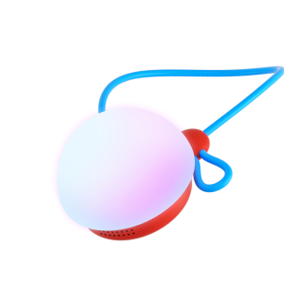
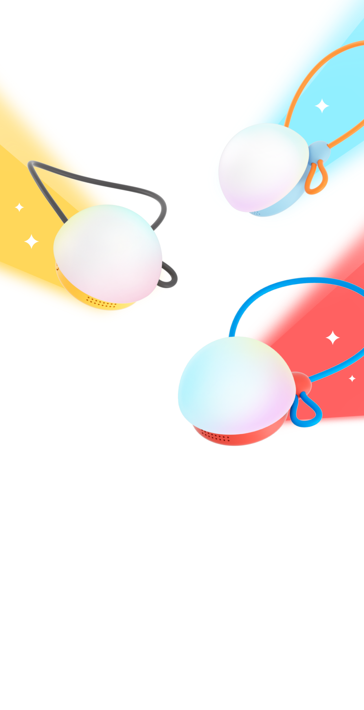
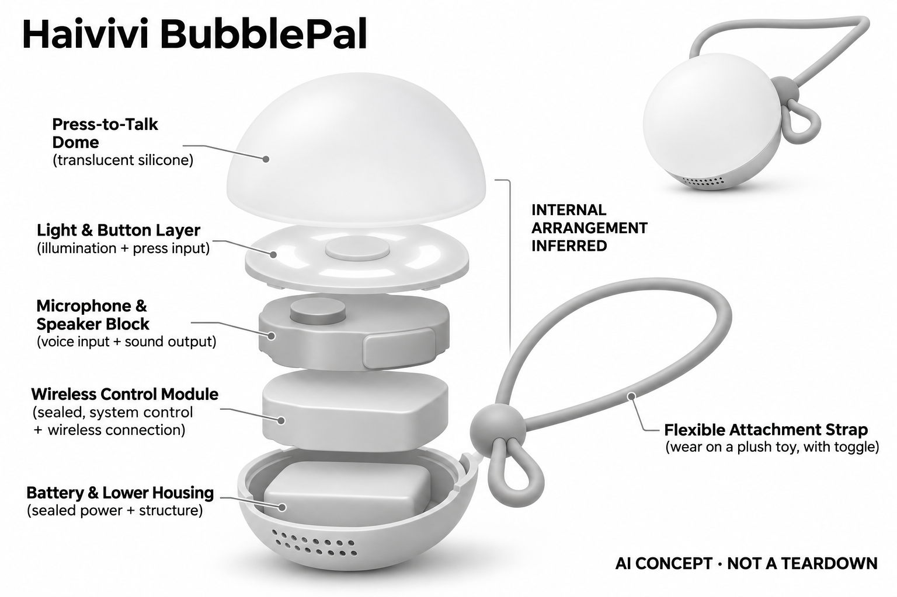

# Haivivi BubblePal

**Haivivi** · 陪伴与宠物 · 核查 2026-11-04

让已有毛绒玩具成为语音角色

消费渠道：个人零售。

## 产品图片与结构参考

### 产品图

Haivivi BubblePal · 官方产品图 · 来源：[Haivivi · 官方图片](<https://www.haivivi.com/>) · [原始图片](<https://www.haivivi.cn/assets/product-icon/bubble-pal.png?w=256&q=75>)

### 参考图

Haivivi BubblePal · 官方参考图 · 来源：[Haivivi · 官方图片](<https://www.haivivi.cn/product/bubblepal>) · [原始图片](<https://www.haivivi.cn/assets/product-hero-mobile.png>)

### AI 生成爆炸示意

**AI 生成 · 非实物拆机。** 内部为概念推断，不能作为元件布局、BOM 或维修依据。[生成提示词](../../content/hardware/prompts/haivivi-bubblepal.txt)

> 已目视核对外形、标签与非拆机声明；不代表内部结构经实测验证。

> 不同颜色仅用于官方外观参考，不重复计数。

> 分析为基于公开资料的案头研究与 AI 辅助判断，未经用户访谈、销量审计或实物拆机。需求、画像、竞争冷门度、审美及商业机会均为研究假设，不是投资结论。

## 销售与购买

- 状态：在售。Haivivi官网Shop BubblePal直接链接Amazon商品；已打开该链接，页面卖家为Haivivi、Amazon发货且有Add to cart。毛绒套装和核心模块不重复计数。

- 地区：美国

- 价格：以官网直达商店当前报价为准。核查日页面快照；运费、税费、会员和配送区域按官方结算确认，不视为中国到手价。

- 中国大陆：本轮核实所列区域官方商店；未确认中国大陆官方现货、账户及完整服务，不把境外可购等同大陆可用。

- [官方产品 / 商店](<https://www.haivivi.com/>)

## AI 的实际作用

官方明确采用语音识别、自然语言处理和AIGC，按住气泡按钮讲话后生成角色回答，可共创故事；不是仅播放预录音的毛绒挂件。

服务与联网依赖：家长使用Haivivi Pal应用和2.4GHz Wi-Fi设置；标准版含阶段性会员，后续完整权益可能收费，不能沿用Founder版终身权益。

## 是否冷门

新兴竞争（研究判断）：电子模块与毛绒载体可分离形成具体使用场景；本轮没有销量与市场份额证据。

## 需求与市场

需求假设：孩子已依恋某只毛绒时，家长可能愿意让原有玩具开口回应，而不再引入一个新角色。应验证挂载后是否仍愿意抱持，以及按钮操作是否帮助孩子理解什么时候在收听。

## 用户画像

画像推断：有喜爱毛绒、能在成人陪同下使用按键并有稳定家庭网络的儿童家庭较匹配。家长需要负责角色设置和会员管理，已有玩具的尺寸与佩戴位置也会影响声音和触感。

## 竞争与替代

竞争判断：它与整只AI毛绒、故事播放器和手机语音模式竞争，复用原有玩具是明确差异。模块便宜或可转移并不自动降低持续服务成本，角色内容、隐私与退款规则仍会影响选择。

## 供应链

供应链推断：硅胶按钮、固定带、扬声器与电池需承受儿童反复按压和拉扯，电子模块不能随毛绒直接清洗。官方未公开完整工厂和物料表，挂载兼容性与售后指引需要细致验证。

## 技术路径

官方披露语音识别和生成式角色回复，按住再松开形成明确话轮。技术判断应测试儿童短句、混合语言与网络等待，不能将角色数量或故事生成能力当作事实正确性和教育效果证明。

## 产品审美

审美判断：透明气泡按钮提供直观的发光交互，但挂在熟悉玩具上也可能显得突兀。不同毛绒比例、固定带长度和按钮位置会改变整体角色感，官方套装图片不能代表所有旧玩具。

## 关键风险

风险判断：标准会员与Founder权益不同，购买渠道和地区保修也有限制；云端儿童会话需家长了解数据处理。生成回答可能不适合当下情境，不能把厂商安全措辞解读为绝对无风险。

## 机会与验证

市场观察：重点是复用已有情感载体能否减少新鲜感衰退，而非仅降低硬件数量。可比较原毛绒与新套装的主动互动、拆卸频次和家长纠错时间，识别模块形态的真实优势与代价。

## 功能分层示意

这是功能关系，不是实物拆机、真实空间结构或已核实 BOM。

1. **挂载载体**：电子模块固定在用户毛绒玩具上。（官方披露）

2. **按键语音**：气泡按钮控制收听话轮。（官方披露）

3. **角色生成**：联网语音识别与AIGC回应。（官方披露）

4. **声音反馈**：扬声器与气泡灯反馈状态。（官方披露）

## 来源

1. [Haivivi官网购买入口](<https://www.haivivi.com/>) — 已实际打开官方页面；功能说明不等于独立性能测量。

2. [官网直达Haivivi卖家商品](<https://www.amazon.com/dp/B0GS9ZN8D8>) — 官网明确直达；已核对卖家Haivivi、Amazon发货和加购入口。

3. [Haivivi官方帮助中心](<https://haivivi.gorgias.help/en-US>) — 已实际打开官方页面；功能说明不等于独立性能测量。

[返回目录](../hardware-market.md) · [网页分析](https://romanagent.github.io/Roman/#hardware/product/haivivi-bubblepal)
