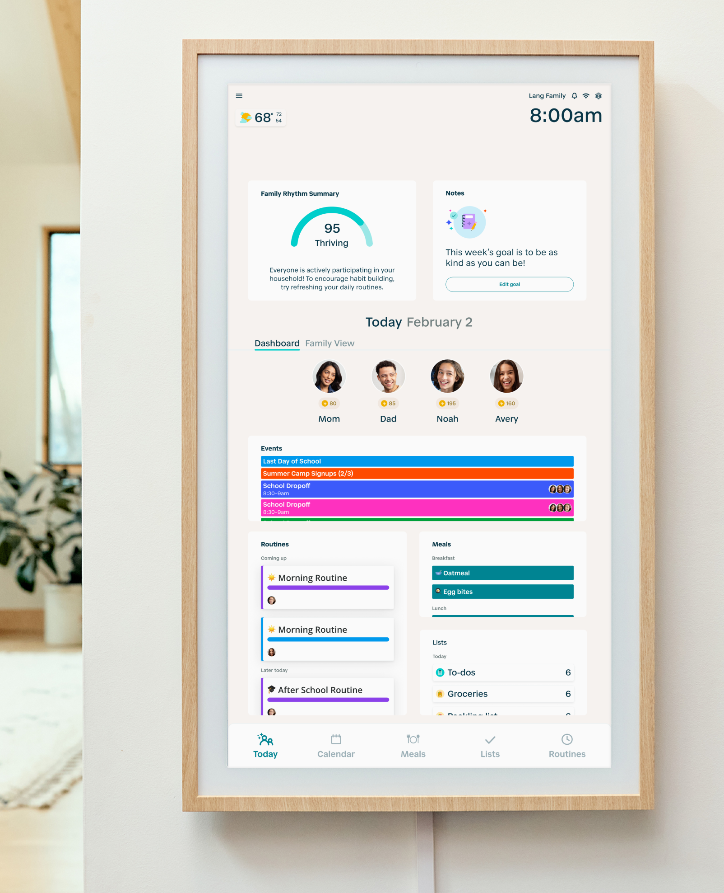
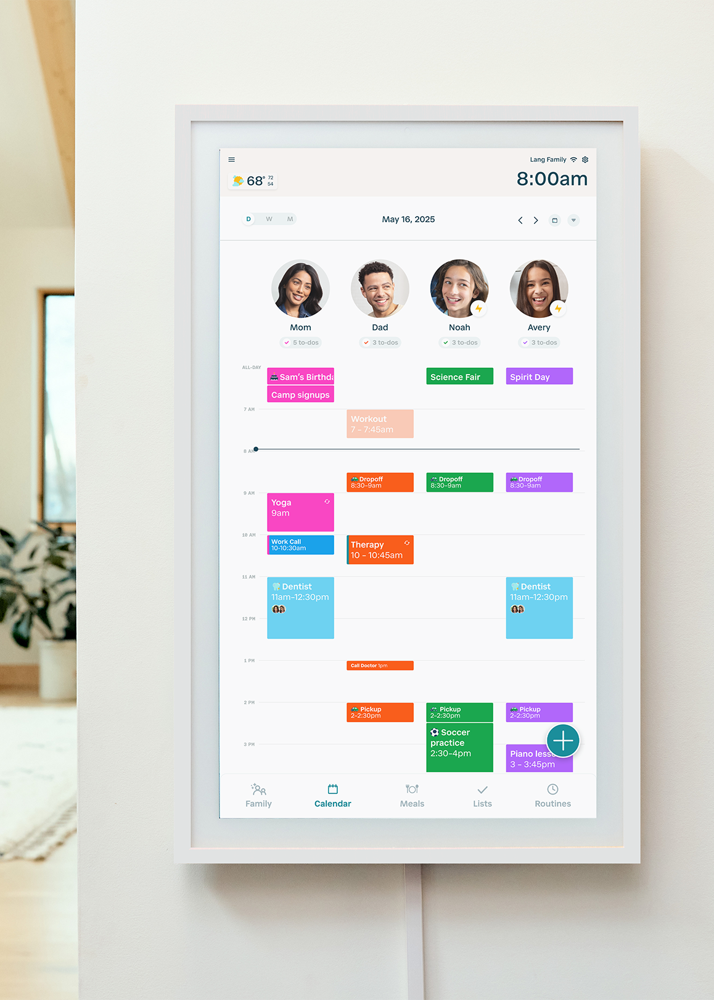
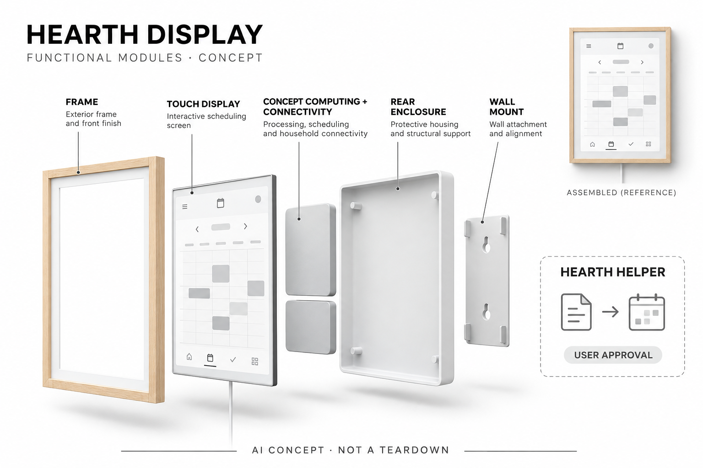

# Hearth Display

**Hearth** · 家庭助手 · 核查 2026-11-04

把学校通知与家庭安排转成可共同查看日程的墙面终端

消费渠道：个人零售。

## 产品图片与结构参考

### 产品图

官方家庭面板界面与木色边框 · 来源：[Hearth · 官方图片](<https://hearthdisplay.com/products/hearth-display>) · [原始图片](<https://cdn.shopify.com/s/files/1/0554/9126/4661/files/family_dashboard_70a26343-741b-47d8-8415-1fd8df19e1a7.png?v=1775833231>)

### 参考图

官方同型号白色边框日历参考 · 来源：[Hearth · 官方图片](<https://hearthdisplay.com/products/hearth-display>) · [原始图片](<https://cdn.shopify.com/s/files/1/0554/9126/4661/files/hearth-display-on-hall-wall-color-matte-white.png?v=1775833231>)

### AI 生成爆炸示意

**AI 生成 · 非实物拆机。** 内部为概念推断，不能作为元件布局、BOM 或维修依据。[生成提示词](../../content/hardware/prompts/hearth-family-display.txt)

> 依据已核验官方外形与公开功能生成；未知内部仅为概念功能块，不代表原机电路板、芯片或实际布局。

> 实际查看并核对对应型号，原图未经改色或语义编辑；厂商标注不等同本研究实测。

> 分析为基于公开资料的案头研究与 AI 辅助判断，未经用户访谈、销量审计或实物拆机。需求、画像、竞争冷门度、审美及商业机会均为研究假设，不是投资结论。

## 销售与购买

- 状态：在售。官方商品页 Ready to Ship、Add to cart，预计1–2工作日发货；公开商品数据三种边框的Ready to Ship变体available=true。颜色不另算产品。

- 地区：美国官网销售

- 价格：硬件标价 US$699；页面促销 US$629.10。促销依赖页面优惠条件；激活需要Family Membership，首月免费，月付US$9，取消后仅保留基础日历等功能；属于硬件零售而非返还式租赁。

- 中国大陆：已核实美国官网的硬件零售入口，未确认中国大陆配送、应用与官方售后；美元报价不代表国际配送承诺。

- [官方产品 / 商店](<https://hearthdisplay.com/products/hearth-display>)

## AI 的实际作用

Hearth Helper用AI将用户提交的文字、照片或纸质日程整理为数字事件及餐食安排，需用户批准后纳入家庭计划。

服务与联网依赖：AI Helper属于Family Membership，依赖联网应用服务；同步日历、打卡和任务列表本身不都属于AI。

## 是否冷门

新兴竞争（研究判断）：家庭协调已有成熟软件和白板替代，公共实体终端加AI通知整理形成细分工作流；是否冷门且可持续取决于真实多人使用。

## 需求与市场

需求假设：家庭安排分散在学校纸张、群消息和个人日历中，反复录入与口头提醒造成协调劳动。公共墙屏与AI整理可能降低遗漏，但应分别验证录入和共同查看的价值，不能把任务打卡或家庭评分视为关系改善的证明。

### 产品任务与边界 · 研究判断

需求假设：家庭安排分散在学校纸张、群消息和个人日历中，反复录入与口头提醒造成协调劳动。公共墙屏与AI整理可能降低遗漏，但应分别验证录入和共同查看的价值，不能把任务打卡或家庭评分视为关系改善的证明。

依据：[Hearth Display官方商品页](<https://hearthdisplay.com/products/hearth-display>) · [Hearth官方功能说明](<https://hearthdisplay.com/pages/features>)

### 需求判断 · 研究判断

家庭协调的隐形劳动往往发生在把通知拆成日期、人物、物品与接送责任时，墙屏只是让结果共享。Helper若减少重复录入有实际意义，但错误纠正可能抵消节省；需求研究应区分谁负责输入、谁主动查看，不能只从家庭成员数量推定价值。

依据：[Hearth Display官方商品页](<https://hearthdisplay.com/products/hearth-display>) · [Hearth官方功能说明](<https://hearthdisplay.com/pages/features>)

### 需求验证 · 待验证

验证可收集自愿提供的脱敏学校通知与活动安排，测量人工录入、AI整理及审核各自时间，再观察真实家庭是否持续查看。不要上传用户私密材料到未经授权的服务，本研究仅提出方案，也不把任务打卡、积分或屏幕开启时间当成家庭关系改善。

依据：[Hearth Display官方商品页](<https://hearthdisplay.com/products/hearth-display>) · [Hearth官方功能说明](<https://hearthdisplay.com/pages/features>)

## 用户画像

画像推断：多成员有不同日程且愿意共同维护安排的家庭更匹配，购买者可能是主要协调者。儿童可读性、照护者权限和墙面位置都会影响采用，不能只按有孩子或忙碌划分用户，也不能默认大屏就能让全家主动参与。

### 适用行为与条件 · 研究判断

画像推断：多成员有不同日程且愿意共同维护安排的家庭更匹配，购买者可能是主要协调者。儿童可读性、照护者权限和墙面位置都会影响采用，不能只按有孩子或忙碌划分用户，也不能默认大屏就能让全家主动参与。

依据：[Hearth Display官方商品页](<https://hearthdisplay.com/products/hearth-display>) · [Hearth官方功能说明](<https://hearthdisplay.com/pages/features>)

### 人群取舍 · 研究判断

主要协调者可能承担购买和维护，其他成员只是偶尔查看，这会让表面共享实际上仍集中劳动。儿童读图能力、照护者权限和墙面可达高度都影响采用，画像应包括实际角色和设备位置，而不是把所有有孩子家庭当作相同的目标客户。

依据：[Hearth Display官方商品页](<https://hearthdisplay.com/products/hearth-display>) · [Hearth官方功能说明](<https://hearthdisplay.com/pages/features>)

### 画像验证 · 待验证

画像验证应让不同成员分别理解今天的活动、修改一次安排和确认变更，观察谁仍需要口头提醒。外部照护者只获必要信息，私人计划不必全放公共屏幕；如果家庭已有满意手机流程，应保留无需专用硬件的结论而不是强行扩大受众。

依据：[Hearth Display官方商品页](<https://hearthdisplay.com/products/hearth-display>) · [Hearth官方功能说明](<https://hearthdisplay.com/pages/features>)

## 竞争与替代

竞争判断：与纸质白板、共享手机日历和普通平板竞争，区别在实体公共入口与AI通知整理结合。硬件颜色不另算创新，普通日历同步也不作为AI；应比较持续录入、批准与查看，而非仅比较屏幕尺寸或功能列表。

### 比较对象与差异 · 研究判断

竞争判断：与纸质白板、共享手机日历和普通平板竞争，区别在实体公共入口与AI通知整理结合。硬件颜色不另算创新，普通日历同步也不作为AI；应比较持续录入、批准与查看，而非仅比较屏幕尺寸或功能列表。

依据：[Hearth Display官方商品页](<https://hearthdisplay.com/products/hearth-display>) · [Hearth官方功能说明](<https://hearthdisplay.com/pages/features>)

### 竞争判断 · 研究判断

与共享手机日历相比，公共屏幕降低拿出手机的步骤，却增加安装、供电和常亮维护；与纸质白板相比，识别输入和远程同步是明确增量。AI并非每项功能的前提，竞争分析应把通知整理、公共展示和任务激励拆开对照实际收益。

依据：[Hearth Display官方商品页](<https://hearthdisplay.com/products/hearth-display>) · [Hearth官方功能说明](<https://hearthdisplay.com/pages/features>)

### 竞争验证 · 待验证

竞争验证可让同一家庭分别使用白板、已有平板和专用终端完成相同安排，记录录入、确认及漏看。把会员取消后的基础能力也纳入成本比较，不能以更大屏幕、更多头像或更高家庭评分推定成员更独立，更不能将边框颜色增加为新场景。

依据：[Hearth Display官方商品页](<https://hearthdisplay.com/products/hearth-display>) · [Hearth官方功能说明](<https://hearthdisplay.com/pages/features>)

## 供应链

供应链分析：显示触控、边框支架、电源、联网计算与持续软件服务构成产品，实际制造厂和BOM未公开。长期显示、墙装安全和家庭账号恢复影响体验，不能把一块平板成本直接等同整套家庭协调服务的交付成本。

### 功能模块拆分 · 研究判断

功能模块包括墙挂结构、触控显示、电源与联网计算、家庭账号和日程同步，以及Helper的图文理解服务。公开资料没有芯片或主板设计，因此结构图仅用抽象功能块；长期屏幕运行、挂墙固定和账号恢复同样属于产品交付而非纯软件细节。

依据：[Hearth Display官方商品页](<https://hearthdisplay.com/products/hearth-display>) · [Hearth官方功能说明](<https://hearthdisplay.com/pages/features>)

### 制造与供应约束 · 研究判断

供应链分析：显示触控、边框支架、电源、联网计算与持续软件服务构成产品，实际制造厂和BOM未公开。长期显示、墙装安全和家庭账号恢复影响体验，不能把一块平板成本直接等同整套家庭协调服务的交付成本。

依据：[Hearth Display官方商品页](<https://hearthdisplay.com/products/hearth-display>) · [Hearth官方功能说明](<https://hearthdisplay.com/pages/features>)

### 候选与证据缺口 · 研究判断

华勤可作为带屏联网终端工程候选，京东方可提供显示模组能力参考，两者均未被Hearth点名采用。屏幕触控匹配、长期显示和家居挂装要另行验证，通用面板或终端能力不能直接推定实际代工关系，更不能替代家庭协作软件的设计责任。

依据：[Hearth Display官方商品页](<https://hearthdisplay.com/products/hearth-display>) · [Hearth官方功能说明](<https://hearthdisplay.com/pages/features>)

## 技术路径

技术判断：官网明确Helper把文字和纸质安排整理成待批准的计划，识别和语义理解可能出错。日期、重复活动、成员归属和时区是关键边界，用户批准不能省略；底层模型和设备本地与云端分工未完整披露。

### 已披露技术边界 · 研究判断

技术判断：官网明确Helper把文字和纸质安排整理成待批准的计划，识别和语义理解可能出错。日期、重复活动、成员归属和时区是关键边界，用户批准不能省略；底层模型和设备本地与云端分工未完整披露。

依据：[Hearth Display官方商品页](<https://hearthdisplay.com/products/hearth-display>) · [Hearth官方功能说明](<https://hearthdisplay.com/pages/features>)

### 系统难点判断 · 研究判断

从纸张到计划需要识别日期、事件边界和参与者，还要处理重复安排、变更与取消；只识别文字并不足以保证日程正确。官方要求用户批准是重要边界，未披露模型位置和精度时不能声称全本地或完全自动，日历同步也不应被混称AI推理。

依据：[Hearth Display官方商品页](<https://hearthdisplay.com/products/hearth-display>) · [Hearth官方功能说明](<https://hearthdisplay.com/pages/features>)

### 技术验证 · 待验证

技术验证应使用脱敏且有人工真值的通知，覆盖手写、模糊日期、跨月活动和多成员安排，记录审核时是否能找到原文。检查重复导入与修改后的行为，而非只测一次清晰海报；不能在无授权情况下向家庭真实日历发布测试事件。

依据：[Hearth Display官方商品页](<https://hearthdisplay.com/products/hearth-display>) · [Hearth官方功能说明](<https://hearthdisplay.com/pages/features>)

## 产品审美

审美判断：窄边框竖屏接近家中公告栏，木色或中性色可适配墙面，但屏幕持续亮起和电源线仍影响居住空间。彩色成员日程有助区分，却可能信息过载，不能只看整洁场景图就认定老人儿童都容易理解。

### 外观与交互语言 · 研究判断

审美判断：窄边框竖屏接近家中公告栏，木色或中性色可适配墙面，但屏幕持续亮起和电源线仍影响居住空间。彩色成员日程有助区分，却可能信息过载，不能只看整洁场景图就认定老人儿童都容易理解。

依据：[Hearth Display官方商品页](<https://hearthdisplay.com/products/hearth-display>) · [Hearth官方功能说明](<https://hearthdisplay.com/pages/features>)

### 使用中审美判断 · 研究判断

竖屏和中性色边框接近公告栏，颜色帮助区分成员，但在拥挤日程下也可能形成视觉负担。真正简洁应让下一步行动可见，而不是把所有信息藏掉；电源线、墙面高度、夜间亮度与隐私显示需要和界面一起评价。

依据：[Hearth Display官方商品页](<https://hearthdisplay.com/products/hearth-display>) · [Hearth官方功能说明](<https://hearthdisplay.com/pages/features>)

### 设计验证 · 待验证

设计验证可观察儿童、成年人及访客在不同距离看到什么，检查错误日期或成员归属是否容易察觉。让用户实际完成审核与撤回，再评价界面是否清楚；不能只用漂亮家庭照片证明墙屏适合所有空间，也不以动画奖励推断形成稳定习惯。

依据：[Hearth Display官方商品页](<https://hearthdisplay.com/products/hearth-display>) · [Hearth官方功能说明](<https://hearthdisplay.com/pages/features>)

## 关键风险

风险判断：错误日期或成员映射会传播到家庭安排，公共屏幕也可能暴露私人行程。激活与高级功能依赖会员，取消后权限不同，用户应知道人工核对与恢复路径；AI助手不能替代真实照护、接送和紧急情况确认。

### 主要失效与依赖 · 研究判断

风险判断：错误日期或成员映射会传播到家庭安排，公共屏幕也可能暴露私人行程。激活与高级功能依赖会员，取消后权限不同，用户应知道人工核对与恢复路径；AI助手不能替代真实照护、接送和紧急情况确认。

依据：[Hearth Display官方商品页](<https://hearthdisplay.com/products/hearth-display>) · [Hearth官方功能说明](<https://hearthdisplay.com/pages/features>)

### 风险传播判断 · 研究判断

错误解析可能变成全家相信的共享安排，权限错误又可能让私人行程暴露给照护者或访客。会员取消、云服务中断和账号管理会改变可用功能，用户需能理解哪些资料仍在、哪些能力停止；终端不能替代实际接送、照护或紧急确认。

依据：[Hearth Display官方商品页](<https://hearthdisplay.com/products/hearth-display>) · [Hearth官方功能说明](<https://hearthdisplay.com/pages/features>)

### 风险验证 · 待验证

风险验证应演练取消会员、失网、成员离开和错误日程撤回，检查是否有清楚的恢复与审计路径。测试数据保持脱敏，不在真实家庭日历留下误导事件；大陆购买及服务未确认时保留不确定，不从美元网站可访问推定跨境可完整使用。

依据：[Hearth Display官方商品页](<https://hearthdisplay.com/products/hearth-display>) · [Hearth官方功能说明](<https://hearthdisplay.com/pages/features>)

## 机会与验证

机会假设：从学校通知到可靠家庭日程的录入流程，比泛化聊天更容易验证。可先测整理准确、确认劳动和共享查看频次，如果家人仍只看各自手机，专用墙屏未必有增量；不以家庭评分或生成事件数推算市场需求。

### 可能的机会入口 · 研究判断

机会假设：从学校通知到可靠家庭日程的录入流程，比泛化聊天更容易验证。可先测整理准确、确认劳动和共享查看频次，如果家人仍只看各自手机，专用墙屏未必有增量；不以家庭评分或生成事件数推算市场需求。

依据：[Hearth Display官方商品页](<https://hearthdisplay.com/products/hearth-display>) · [Hearth官方功能说明](<https://hearthdisplay.com/pages/features>)

### 机会成立条件 · 研究判断

机会最可能来自通知录入这一明确环节，把已有内容转成可审核安排，减少协调者反复复制。若多人查看率低，软件服务可能比固定墙屏更合适；若公共入口确有价值，应围绕可读性和角色协作改进，而非扩展泛化聊天或更多家庭评分。

依据：[Hearth Display官方商品页](<https://hearthdisplay.com/products/hearth-display>) · [Hearth官方功能说明](<https://hearthdisplay.com/pages/features>)

### 下一步验证 · 待验证

下一步可对比通知整理前后人工劳动及成员主动查看的变化，记录错误审核和临时变更成本。根据真实收益决定专用终端、会员与手机应用的分工，不用屏幕活跃、生成事件数量或家长焦虑直接推断潜在市场规模与长期付费。

依据：[Hearth Display官方商品页](<https://hearthdisplay.com/products/hearth-display>) · [Hearth官方功能说明](<https://hearthdisplay.com/pages/features>)

## 对应供应链公司

能力候选用于选型研究，不代表本产品实际采用；未公开的供货关系不作推断。

- [huaqin](../supply-chain/huaqin.md) — **能力候选 · 非已采用** / 家庭竖屏联网终端工程整合：华勤公开带屏智能终端能力可匹配显示、触控和联网计算的整机工程，但墙装稳定、长期显示及家庭账号功能需独立验证；未见Hearth Display点名合作证据，不能标作实际ODM。

- [boe](../supply-chain/boe.md) — **能力候选 · 非已采用** / 长期家庭公共显示的面板能力候选：京东方公开显示产品能力可用于家庭公共终端的面板选型参考，但准确尺寸、触控贴合、可视角和长期显示条件需询证；没有Hearth型号点名采用资料，候选不代表本机实际面板厂。

[浏览供应链目录](../supply-chain.md)

## 功能分层示意

这是功能关系，不是实物拆机、真实空间结构或已核实 BOM。

1. **触控屏与边框**：实体墙面显示与触控入口。（官方披露）

2. **支架与供电**：配套墙挂和电源线，需考虑安装与走线。（官方披露）

3. **计算与连接**：支持终端应用和联网同步的功能层，具体芯片未披露。（分析推断）

4. **家庭账号与日程**：共享日历、任务、餐食和成员资料。（官方披露）

5. **Hearth Helper服务**：将用户提供的文本和图像日程转为待确认内容。（官方披露）

## 来源

1. [Hearth Display官方商品页](<https://hearthdisplay.com/products/hearth-display>) — 实际打开Ready to Ship与加入购物车，公开商品数据可售；优惠和会员费用分别标注。

2. [Hearth官方功能说明](<https://hearthdisplay.com/pages/features>) — 实际打开Helper文字与纸质日程整理、用户批准，未把普通任务列表视作AI。

3. [Hearth Family Membership](<https://hearthdisplay.com/pages/membership>) — 实际打开，激活需会员、取消后保留基础日历而失去高级功能。

[返回目录](../hardware-market.md) · [网页分析](https://romanagent.github.io/Roman/#hardware/product/hearth-family-display)
