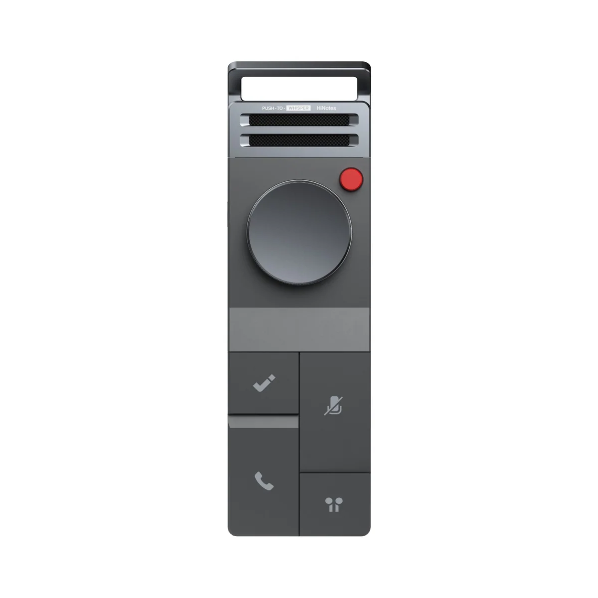
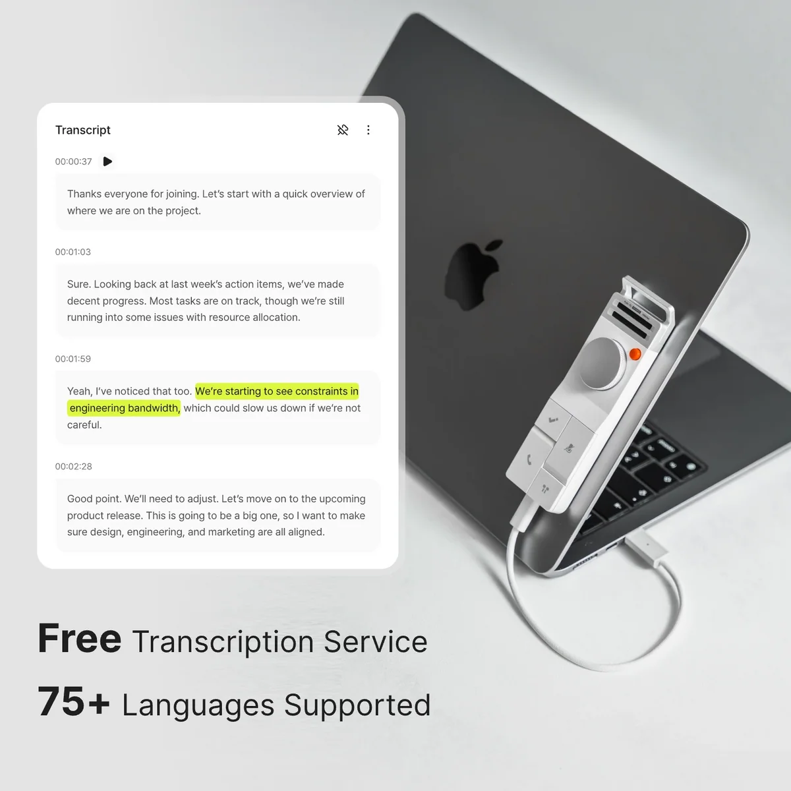
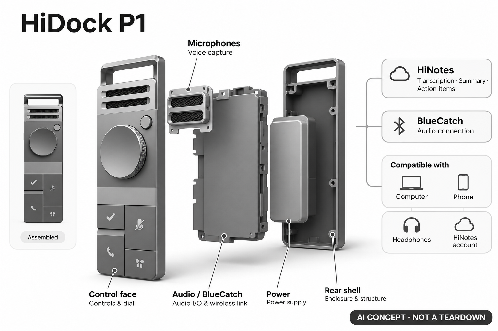

# HiDock P1

**HiDock** · 录音与记忆 · 核查 2026-11-04

个人音频采集硬件与HiNotes会议整理

消费渠道：个人零售。

## 产品图片与结构参考

### 产品图

HiDock P1官方产品外形图 · 来源：[HiDock · 官方产品图片](<https://www.hidock.com/products/hidock-p1-ai-voice-recorder>) · [原始图片](<https://www.hidock.com/cdn/shop/files/P1-Space_Gray-1.jpg?v=1775545272&width=1200>)

### 参考图

HiDock P1官方另一角度或使用场景参考 · 来源：[HiDock · 官方产品图片](<https://www.hidock.com/products/hidock-p1-ai-voice-recorder>) · [原始图片](<https://www.hidock.com/cdn/shop/files/P1_SKU-2.webp?v=1780422445&width=1200>)

### AI 生成爆炸示意

**AI 生成 · 非实物拆机。** 内部为概念推断，不能作为元件布局、BOM 或维修依据。[生成提示词](../../content/hardware/prompts/hidock-p1.txt)

> 外形依据核验参考图；内部位置、模块形状与装配关系仅作AI概念展示。

> 已逐张查看并核对型号。源图未改色/裁切；场景、界面、附件、优惠及效果文案仅为厂商示意，不作为本目录性能或现价依据。

> 分析为基于公开资料的案头研究与 AI 辅助判断，未经用户访谈、销量审计或实物拆机。需求、画像、竞争冷门度、审美及商业机会均为研究假设，不是投资结论。

## 销售与购买

- 状态：在售。已打开官方具体型号商品页，价格、数量和Add to cart可见；H1E、颜色及套装未重复计数。

- 地区：所列官方区域或授权零售渠道；配送地址与服务支持需结算确认

- 价格：所见US$199；自动优惠按结算。核查日所见单机或基本配置价；币种、促销、税费、镜片、附件及服务依地区结算，不把颜色或套装重复计数。

- 中国大陆：本次未核实该具体型号在中国大陆的官方销售和完整服务支持；海外在售不等于国内可直接启用全部功能。

- [官方产品 / 商店](<https://www.hidock.com/products/hidock-p1-ai-voice-recorder>)

## AI 的实际作用

HiNotes将双向通话或房间录音转成文本、摘要与行动项；BlueCatch负责音频连接，不单独作为AI证据

服务与联网依赖：需兼容电脑/手机、耳机蓝牙链路与HiNotes账号；USB-C和蓝牙的具体接法影响是否采集双向声音，高级摘要按服务权限

## 是否冷门

新兴竞争（研究判断）：按任务与形态作案头分类，无访谈、销量或市场份额证据。

## 需求与市场

需求假设：用自己的蓝牙耳机通话时希望保留双向音频，而不是换成特定品牌耳机。价值应由实际使用频率、任务完成与操作负担验证，不能把AI功能存在或演示流畅当作需求已得到满足。

## 用户画像

画像推断：经常远程交流、采访或自用记录的个人工作者，愿意复核转录并配置音频输入输出。个人的语言、操作习惯、环境和预算会改变适配结果，本次只有案头研究，没有用户访谈或长期使用观察。

## 竞争与替代

案头判断：与系统录音、手机软件、专用录音器和扩展坞竞争；音频链路与记录服务整合是差异，普通降噪并非收录AI理由。这只是用途与替代品比较，不是市场份额或销量结论；专业细分和较少曝光也不代表没有成熟竞争者。

## 供应链

公开资料可核对便携金属录音主机、双麦克风、USB-C与蓝牙音频桥接，具体整机工厂、关键模块供应商与BOM本次未确认。制造重点可从形态推断，但不能把品牌所在地、外观相似或营销合作等同代工关系。

## 技术路径

HiNotes将双向通话或房间录音转成文本、摘要与行动项；BlueCatch负责音频连接，不单独作为AI证据。这是厂商披露的功能机制；模型版本、准确率及内部结构未完整公开。架构只表示输入、处理和输出关系，不作为真实拆机或性能实测。

## 产品审美

图示观察：扁平金属机身和显著录音控制适合随电脑携带，形态不同于桌面扩展坞。宣传图片只能帮助理解外观和摆放方式，不能证明每个人的舒适度、长时使用体验或实际材料触感。

## 关键风险

通话与会议记录需要处理在场者知情、权限和敏感内容；说话人归属和摘要可能错误，不能自动把行动项当成对方承诺。还需核对地区功能、软件更新与售后边界；本目录未进行实机、医学或可靠性测试，不把厂商演示当作结果保证。

## 机会与验证

市场差异主要在于个人音频采集硬件与HiNotes会议整理。值得进一步验证的购买理由是它能否减少既有任务中的具体步骤，以及硬件、服务与维护的总成本是否符合个人使用频率。

## 功能分层示意

这是功能关系，不是实物拆机、真实空间结构或已核实 BOM。

1. **实体输入**：便携金属录音主机、双麦克风、USB-C与蓝牙音频桥接；仅功能层示意，非拆机。（官方披露）

2. **采集与控制**：设备把输入转为可处理的信息并接收用户操作；具体内部布局未知。（分析推断）

3. **AI功能**：HiNotes将双向通话或房间录音转成文本、摘要与行动项；BlueCatch负责音频连接，不单独作为AI证据（官方披露）

4. **服务依赖**：需兼容电脑/手机、耳机蓝牙链路与HiNotes账号；USB-C和蓝牙的具体接法影响是否采集双向声音，高级摘要按服务权限（官方披露）

5. **用户反馈**：用户通过声音、屏幕或配套应用接收结果，并对重要信息复核。（分析推断）

## 来源

1. [HiDock P1官方购买页](<https://www.hidock.com/products/hidock-p1-ai-voice-recorder>) — 已打开一手页面；产品能力为厂商披露，未进行实机或效果验证。

2. [HiNotes官方功能与服务](<https://www.hidock.com/pages/hinotes>) — 已打开一手页面；产品能力为厂商披露，未进行实机或效果验证。

3. [HiDock当前促销规则](<https://www.hidock.com/pages/hot-deals>) — 已打开，价格按商品和购物车适用活动变化；不以未实际应用的优惠当作成交价。

[返回目录](../hardware-market.md) · [网页分析](https://romanagent.github.io/Roman/#hardware/product/hidock-p1)
