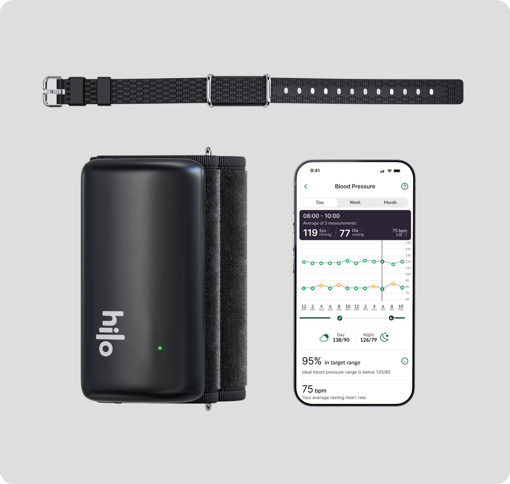
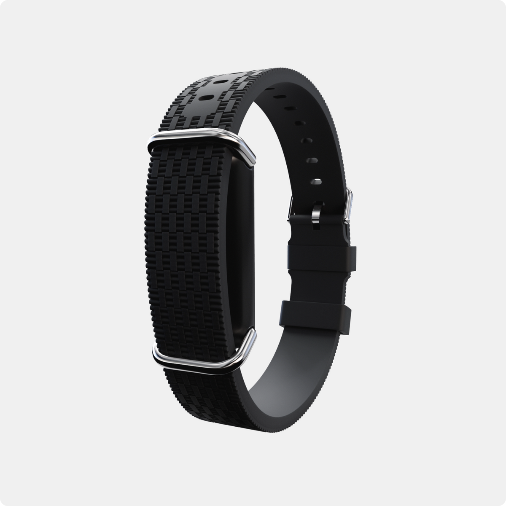
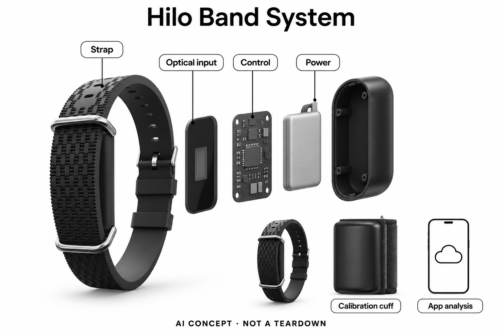

# Hilo Band 血压监测系统（英国版）

**Hilo / Aktiia** · 居家健康 · 核查 2026-11-04

袖带校准后的腕部光学估计与长期血压趋势

消费渠道：个人零售。

## 产品图片与结构参考

### 产品图

Hilo英国官网腕带、校准袖带与应用系统图 · 来源：[Hilo · 官方产品图片](<https://hilo.com/en-gb/products/blood-pressure-monitor>) · [原始图片](<https://cdn.shopify.com/s/files/1/0990/8073/3009/files/Whats_included.png?v=1779288410&width=1200>)

### 参考图

Hilo英国版本腕带外形参考；无腕上显示屏 · 来源：[Hilo · 官方产品图片](<https://hilo.com/en-gb/products/blood-pressure-monitor>) · [原始图片](<https://cdn.shopify.com/s/files/1/0990/8073/3009/files/Band_2x_160d75fe-c925-43d6-95c1-02c5a2a8abee.png?v=1776086499&width=1200>)

### AI 生成爆炸示意

**AI 生成 · 非实物拆机。** 内部为概念推断，不能作为元件布局、BOM 或维修依据。[生成提示词](../../content/hardware/prompts/hilo-band-system.txt)

> 已视觉检查外形、灰阶、文字及无虚构参数；内部模块形状、板卡和布置仅为概念，不代表完整BOM。

> 源图逐张实际查看，按当前具体型号核对；未改色或裁切，宣传界面与效果文案不作为实测。

> 分析为基于公开资料的案头研究与 AI 辅助判断，未经用户访谈、销量审计或实物拆机。需求、画像、竞争冷门度、审美及商业机会均为研究假设，不是投资结论。

## 销售与购买

- 状态：在售。英国官方商品页显示Band、校准Cuff与首年会员合计£199.98及Add to cart，公开商品数据available=true；不借美国Hilo Core或纯手机App的状态。

- 地区：英国（本次具体商品与服务核实）

- 价格：£199.98（腕带+校准袖带+首年会员）。所见页面后续£119.99/年续费；不是仅购买腕带£79.99即可获得全部长期服务，地区套餐需分别核对。

- 中国大陆：未核实英国版Hilo系统在中国大陆的正式销售、注册与账号服务；不把海外官网或其他地区许可视为国内购买支持。

- [官方产品 / 商店](<https://hilo.com/en-gb/products/blood-pressure-monitor>)

## AI 的实际作用

官方将腕部光学波形分析与机器学习建模关联；当前系统把PPG传到云端估计血压。具体模型版本未披露，不借纯手机拍摄或未来LLM条款作为本款依据。

服务与联网依赖：需上臂Cuff初始化及定期校准、兼容App、账号与云服务；通常在静止且信号合格时采样，连续佩戴不等于每秒测量。

## 是否冷门

细分专业（研究判断）：独立任务是袖带校准后的日常血压趋势，不是普通手表小升级；已有成熟血压工具，差异与效果仍需个体和专业验证。

## 需求与市场

需求假设是用户希望了解日夜记录的变化，减少每次主动拿出袖带的操作，并准备一份较完整的时间资料。更密集的估计可能提供新线索，也可能增加解释负担；价值应由记录是否帮助理解和沟通具体问题衡量，不能从采样次数更多直接推定改善血压或治疗效果。

### 官方｜腕带和袖带共同形成记录 · 官方资料

英国版Hilo系统包含腕带、上臂校准袖带和应用会员，腕部光学信号经处理形成血压记录与趋势。它将参考测量和日常采集分开，不能把无袖带佩戴理解为永远不需袖带；官方所说长期连续使用，也不是每秒都有一个血压结果，而是在合适条件下多次获得记录。

依据：[Hilo英国版当前商品与会员配置](<https://hilo.com/en-gb/products/blood-pressure-monitor>) · [Hilo英国版光学采集、校准与云计算说明](<https://hilo.com/en-gb/pages/how-it-works>)

### 判断｜看见常规单次测量之间的模式 · 研究判断

需求假设是用户希望了解日夜记录的变化，减少每次主动拿出袖带的操作，并准备一份较完整的时间资料。更密集的估计可能提供新线索，也可能增加解释负担；价值应由记录是否帮助理解和沟通具体问题衡量，不能从采样次数更多直接推定改善血压或治疗效果。

依据：[Hilo英国版光学采集、校准与云计算说明](<https://hilo.com/en-gb/pages/how-it-works>)

### 验证｜先检查数据覆盖与缺口 · 待验证

试用可记录什么时候有数据、什么时候因活动或信号质量没有记录，以及校准和同步是否完成。将覆盖不足与数值变化分开，避免把空缺当作稳定或正常；健康解释应进入合适专业流程，本目录不根据设备分数制定个人用药、运动或血压管理方案。

依据：[Hilo英国版光学采集、校准与云计算说明](<https://hilo.com/en-gb/pages/how-it-works>)

## 用户画像

真正的使用前提不仅是愿意戴腕带，还包括能完成定期参考测量、保持连接并理解记录并非全天无缺口。若用户忽略袖带或会员状态，便捷的腕部入口可能让其误以为系统一直有效；家庭协助应支持流程，但最终仍需尊重本人对佩戴和健康数据分享的偏好。

### 官方｜有地区与使用条件的个人系统 · 官方资料

该英国商品通过直接零售提供个人使用，官方说明需要兼容终端、校准和应用服务，并将其作为当地医疗器械版本介绍。目录没有把美国Hilo Core的wellness定位、纯手机测量或其他版本许可混入；是否适合具体个人仍需依据当地说明和适当专业意见确认。

依据：[Hilo英国版当前商品与会员配置](<https://hilo.com/en-gb/products/blood-pressure-monitor>) · [Hilo英国版光学采集、校准与云计算说明](<https://hilo.com/en-gb/pages/how-it-works>)

### 判断｜能维护参考流程的使用者 · 研究判断

真正的使用前提不仅是愿意戴腕带，还包括能完成定期参考测量、保持连接并理解记录并非全天无缺口。若用户忽略袖带或会员状态，便捷的腕部入口可能让其误以为系统一直有效；家庭协助应支持流程，但最终仍需尊重本人对佩戴和健康数据分享的偏好。

依据：[Hilo英国版光学采集、校准与云计算说明](<https://hilo.com/en-gb/pages/how-it-works>)

### 验证｜把校准与日常回看分开观察 · 待验证

可检查本人是否知道哪条数据来自袖带、哪条来自腕部估计，以及校准提醒出现时如何处理。另行记录手机设置、腕带维护和报告分享是否需要帮助，避免用戴上很轻松概括整套操作；本研究没有个人试戴和访谈，不能以年龄或健康意识推定适配程度。

依据：[Hilo英国版当前商品与会员配置](<https://hilo.com/en-gb/products/blood-pressure-monitor>) · [Hilo英国版光学采集、校准与云计算说明](<https://hilo.com/en-gb/pages/how-it-works>)

## 竞争与替代

普通上臂袖带提供用户主动发起的参考记录，常规健康手表未必提供相同血压任务，Hilo则增加依赖校准的长期腕部估计。比较应看操作负担、数据缺口与专业沟通用途，不能把佩戴更轻等同对所有人更准确，也不能因采用机器学习就认为能够替代所有专业监测。

### 官方｜首年套餐不是裸腕带价 · 官方资料

英国商品页把腕带及校准袖带和首年订阅分项列出，当前合计一百九十九点九八英镑，后续按年度续费。目录采用整套可用系统价格，不将其中硬件分项当完整售价；会员、其他国家和额外配件需分别核对，也不将同一系统不同付款方式重复计成新硬件。

依据：[Hilo英国版当前商品与会员配置](<https://hilo.com/en-gb/products/blood-pressure-monitor>)

### 判断｜与主动袖带和其他穿戴分开比较 · 研究判断

普通上臂袖带提供用户主动发起的参考记录，常规健康手表未必提供相同血压任务，Hilo则增加依赖校准的长期腕部估计。比较应看操作负担、数据缺口与专业沟通用途，不能把佩戴更轻等同对所有人更准确，也不能因采用机器学习就认为能够替代所有专业监测。

依据：[Hilo英国版当前商品与会员配置](<https://hilo.com/en-gb/products/blood-pressure-monitor>) · [Hilo英国版光学采集、校准与云计算说明](<https://hilo.com/en-gb/pages/how-it-works>)

### 验证｜以同一信息需求比较总成本 · 待验证

可以先明确希望记录的时间范围与需要的报告，再比较设备、会员、校准、充电和支持投入。不同版本的标价、监管身份和服务功能要保持同一地区口径；本目录没有销量、临床对照或长期采用数据，不能依据订阅形式和新颖感知方式推定市场规模或性价比。

依据：[Hilo英国版当前商品与会员配置](<https://hilo.com/en-gb/products/blood-pressure-monitor>) · [Hilo英国版光学采集、校准与云计算说明](<https://hilo.com/en-gb/pages/how-it-works>)

## 供应链

同类新设计不仅要选择光学器件，还要处理皮肤接触、动作判断、参考校准及个体波形差异。参考流程如果不一致，后续大量记录也不自动更可靠；供应链研究应把腕带、袖带和软件作为系统验收，不能只比较单个光电传感器的分辨率或无线芯片功耗。

### 官方｜光学与云端链路有据可查 · 官方资料

官方说明腕带使用PPG光学输入，通过应用将数据送到云端算法估计血压，并引用CSEM相关专利。这个软件知识产权信息不等于公开了光学前端、无线主控或装配工厂；目录只确认已有证据的功能关系，不从瑞士研发背景或常见穿戴方案猜测完整BOM。

依据：[Hilo英国版光学采集、校准与云计算说明](<https://hilo.com/en-gb/pages/how-it-works>)

### 判断｜接触和参考误差会传递 · 研究判断

同类新设计不仅要选择光学器件，还要处理皮肤接触、动作判断、参考校准及个体波形差异。参考流程如果不一致，后续大量记录也不自动更可靠；供应链研究应把腕带、袖带和软件作为系统验收，不能只比较单个光电传感器的分辨率或无线芯片功耗。

依据：[Hilo英国版光学采集、校准与云计算说明](<https://hilo.com/en-gb/pages/how-it-works>)

### 验证｜候选器件不提供血压模型 · 待验证

光学生理前端与低功耗无线平台可以作为相近新架构候选，但需要重新验证光路、信号质量、时间记录和校准接口。器件不会附带Hilo的血压模型或当地许可，也不是原机换件建议；只有品牌或供应方点名才可标为现用，本次仍把具体芯片和工厂保留为未知。

依据：[Hilo英国版光学采集、校准与云计算说明](<https://hilo.com/en-gb/pages/how-it-works>) · [Hilo官方保留的Aktiia机器学习技术公告](<https://hilo.com/en-eu/blogs/pre/aktiia-secures-chf-27-million-usd-30m-in-funding>)

## 技术路径

腕带检测到适合的静止状态才进行采样，活动较多时数据数量和时间分布会变化。因此趋势可能更完整地覆盖某些时间段，却仍有选择性的缺口；技术评价应保留这些采样条件，不把全天佩戴宣传写成每次活动、每秒变化或所有异常都能被设备捕获。

### 官方｜机器学习路线与当前波形流程 · 官方资料

官方技术公告明确其腕部血压技术涉及AI和机器学习建模，当前英国说明则给出PPG、波形分析与云计算流程。两类证据共同支持感知分析路线，但没有公开当前模型内部结构与版本；目录不借手机相机App的AI功能，也不把服务条款中的潜在语言模型功能当成本款已交付机制。

依据：[Hilo英国版光学采集、校准与云计算说明](<https://hilo.com/en-gb/pages/how-it-works>) · [Hilo官方保留的Aktiia机器学习技术公告](<https://hilo.com/en-eu/blogs/pre/aktiia-secures-chf-27-million-usd-30m-in-funding>)

### 判断｜连续佩戴与连续测量不同 · 研究判断

腕带检测到适合的静止状态才进行采样，活动较多时数据数量和时间分布会变化。因此趋势可能更完整地覆盖某些时间段，却仍有选择性的缺口；技术评价应保留这些采样条件，不把全天佩戴宣传写成每次活动、每秒变化或所有异常都能被设备捕获。

依据：[Hilo英国版光学采集、校准与云计算说明](<https://hilo.com/en-gb/pages/how-it-works>)

### 验证｜均值、原始记录和校准对应 · 待验证

可以核对应用里的平均值、个别记录、时间戳和参考校准是否能清楚区分，观察活动增加或同步延迟后数据如何显示。对无法解释的变化应保留背景交由合适专业讨论，不自行据此调整医疗安排；本研究没有复现测量精度，也不将厂家验证标准转换成个人保证。

依据：[Hilo英国版光学采集、校准与云计算说明](<https://hilo.com/en-gb/pages/how-it-works>)

## 产品审美

没有显示屏可以减少日常查看和打断，却也使用户更依赖应用确认充电、校准与数据同步状态。设计不能只强调戴上后忘记，应该让必要维护容易被理解；若用户不知道某段时间没有记录，外观越安静也可能越容易形成一直在有效监测的错误印象。

### 官方｜无屏腕带与独立参考袖带 · 官方资料

当前英国素材显示窄型纹理腕带、内部传感主体和独立上臂袖带，信息呈现在手机而非腕部大屏。外形让长期佩戴与主动参考测量采用不同交互，但图片不能证明所有腕围、皮肤和服饰都舒适；商品图中的血压数字也只是示意，不是本目录实测结果。

依据：[Hilo英国版当前商品与会员配置](<https://hilo.com/en-gb/products/blood-pressure-monitor>) · [Hilo英国版光学采集、校准与云计算说明](<https://hilo.com/en-gb/pages/how-it-works>)

### 判断｜低存在感需要清楚状态管理 · 研究判断

没有显示屏可以减少日常查看和打断，却也使用户更依赖应用确认充电、校准与数据同步状态。设计不能只强调戴上后忘记，应该让必要维护容易被理解；若用户不知道某段时间没有记录，外观越安静也可能越容易形成一直在有效监测的错误印象。

依据：[Hilo英国版光学采集、校准与云计算说明](<https://hilo.com/en-gb/pages/how-it-works>)

### 验证｜观察佩戴与校准切换 · 待验证

试用应记录腕带戴取、充电以及转到上臂袖带参考测量的流程，检查两件设备是否容易被混淆。再观察手机中的数据来源和状态提示是否清楚，避免只评价腕带外观；长时舒适、材料触感和维护便利都需要本人反馈，本轮没有对应实机证据。

依据：[Hilo英国版当前商品与会员配置](<https://hilo.com/en-gb/products/blood-pressure-monitor>) · [Hilo英国版光学采集、校准与云计算说明](<https://hilo.com/en-gb/pages/how-it-works>)

## 关键风险

如果用户把腕部估计当作任何时刻的即时确切值，或把缺测时段理解为没有问题，就可能过度信任数据。AI与较多记录也不能替代专业诊断和对个人情况的评估；本目录分析系统如何提供信息，不据其结果为任何人决定用药、治疗或改变既有医疗安排。

### 官方｜英国版边界不能套用到全球 · 官方资料

本条核实英国直接购买与服务说明，不将美国Core、其他国家或纯手机应用的身份合并。核心流程需要校准、合格信号和云端分析，具体个人使用限制仍应查看当地说明；中国大陆正式销售与完整服务未被本次证实，海外医疗器械标注不能自动解释为国内适用。

依据：[Hilo英国版当前商品与会员配置](<https://hilo.com/en-gb/products/blood-pressure-monitor>) · [Hilo英国版光学采集、校准与云计算说明](<https://hilo.com/en-gb/pages/how-it-works>)

### 判断｜趋势可能被误当实时结论 · 研究判断

如果用户把腕部估计当作任何时刻的即时确切值，或把缺测时段理解为没有问题，就可能过度信任数据。AI与较多记录也不能替代专业诊断和对个人情况的评估；本目录分析系统如何提供信息，不据其结果为任何人决定用药、治疗或改变既有医疗安排。

依据：[Hilo英国版光学采集、校准与云计算说明](<https://hilo.com/en-gb/pages/how-it-works>)

### 验证｜确认服务中断与复核路径 · 待验证

购买前应核对会员停止、账号更换、手机兼容和校准失败时保留哪些功能，试用中记录需要支持的具体问题。报告应能区分参考和估计，重要疑问保留给合适专业人员复核；这些验证针对产品流程与数据完整性，不构成个人健康效果或适用性保证。

依据：[Hilo英国版当前商品与会员配置](<https://hilo.com/en-gb/products/blood-pressure-monitor>) · [Hilo英国版光学采集、校准与云计算说明](<https://hilo.com/en-gb/pages/how-it-works>)

## 机会与验证

值得研究的是用户能否用较少主动操作形成更清楚的日夜资料，同时理解哪些时间没有数据、哪些变化需要进一步讨论。如果维护和解释负担超过减少的袖带操作，便利未必转成持续使用；市场判断应允许不同人继续选择更简单工具，而不预设无袖带就必然更好。

### 官方｜针对血压趋势的独立任务 · 官方资料

Hilo将袖带参考与腕部光学估计连接，服务于长期血压记录，区别于只统计活动和睡眠的普通腕表。它并非每种颜色、地区套餐或软件标签各一个需求，目录只选英国版完整系统；实际差异来自采样与校准工作流，而不是在常见穿戴外壳中增加一个AI标识。

依据：[Hilo英国版当前商品与会员配置](<https://hilo.com/en-gb/products/blood-pressure-monitor>) · [Hilo英国版光学采集、校准与云计算说明](<https://hilo.com/en-gb/pages/how-it-works>)

### 判断｜更易形成可解释的时间资料 · 研究判断

值得研究的是用户能否用较少主动操作形成更清楚的日夜资料，同时理解哪些时间没有数据、哪些变化需要进一步讨论。如果维护和解释负担超过减少的袖带操作，便利未必转成持续使用；市场判断应允许不同人继续选择更简单工具，而不预设无袖带就必然更好。

依据：[Hilo英国版光学采集、校准与云计算说明](<https://hilo.com/en-gb/pages/how-it-works>)

### 验证｜跨越校准与会员周期观察 · 待验证

后续可记录数个校准周期里的有效覆盖、充电、漏同步、报告分享和停止使用原因，比较信息是否真正用于沟通。将操作、数据质量和健康结果分开评价，避免用短期变化代替产品研究；当前仅有公开资料，没有独立长期试验、用户访谈或商业规模证据。

依据：[Hilo英国版当前商品与会员配置](<https://hilo.com/en-gb/products/blood-pressure-monitor>) · [Hilo英国版光学采集、校准与云计算说明](<https://hilo.com/en-gb/pages/how-it-works>) · [Hilo官方保留的Aktiia机器学习技术公告](<https://hilo.com/en-eu/blogs/pre/aktiia-secures-chf-27-million-usd-30m-in-funding>)

## 对应供应链公司

能力候选用于选型研究，不代表本产品实际采用；未公开的供货关系不作推断。

- [analog-devices](../supply-chain/analog-devices.md) — **能力候选 · 非已采用** / 同类腕部PPG输入的光学生理前端候选：ADI的MAX86176等光学生理前端可用于研究腕部PPG采集，但需要针对光路、接触、动作和功耗重新验证，不能把其附加电生理能力自动加入Hilo。器件不提供血压模型或参考校准流程，也未被该品牌点名采用；此候选只对应相近新设计的输入层。

- [nordic-semiconductor](../supply-chain/nordic-semiconductor.md) — **能力候选 · 非已采用** / 同类腕带与应用的数据连接候选：Nordic低功耗蓝牙平台可对应Hilo公开的腕带到手机传输方向，需确认缓存、采样时序、同步和续航目标。无线平台本身不产生血压估计、医疗许可或云端服务，也没有本款采用证据；重新设计时应与光学和校准链路联合验证，不能视为原机直接替换方案。

[浏览供应链目录](../supply-chain.md)

## 功能分层示意

这是功能关系，不是实物拆机、真实空间结构或已核实 BOM。

1. **参考校准**：独立上臂Cuff提供初始化与定期参考，腕带不是充气袖带。（官方披露）

2. **腕部采集**：PPG光学信号在合适静止条件下被采集，腕带先保存记录。（官方披露）

3. **无线同步**：BLE向兼容应用传输，手机与账号构成使用链路。（官方披露）

4. **云端波形估计**：官方说明云算法进行波形分析，并公开机器学习建模路线；当前架构版本未知。（官方披露）

5. **趋势与复核**：应用展示均值、个别记录和报告，医疗解释应与专业流程结合。（官方披露）

## 来源

1. [Hilo英国版当前商品与会员配置](<https://hilo.com/en-gb/products/blood-pressure-monitor>) — 本轮已打开£199.98、Band+Cuff+首年计划、Add to cart；公开product.js available=true。仅核英国版，不套美国Core标注。

2. [Hilo英国版光学采集、校准与云计算说明](<https://hilo.com/en-gb/pages/how-it-works>) — 本轮已打开：PPG、PWA、每30天Cuff校准、静止时采样、BLE与云算法，不写成逐秒连续测量。

3. [Hilo官方保留的Aktiia机器学习技术公告](<https://hilo.com/en-eu/blogs/pre/aktiia-secures-chf-27-million-usd-30m-in-funding>) — 本轮已打开2024-02-27历史技术公告，现官网明确腕部系统AI-driven与machine learning modeling；只作技术路线证据，不用历史用户数、当前版本或疗效推断。

[返回目录](../hardware-market.md) · [网页分析](https://romanagent.github.io/Roman/#hardware/product/hilo-band-system)
