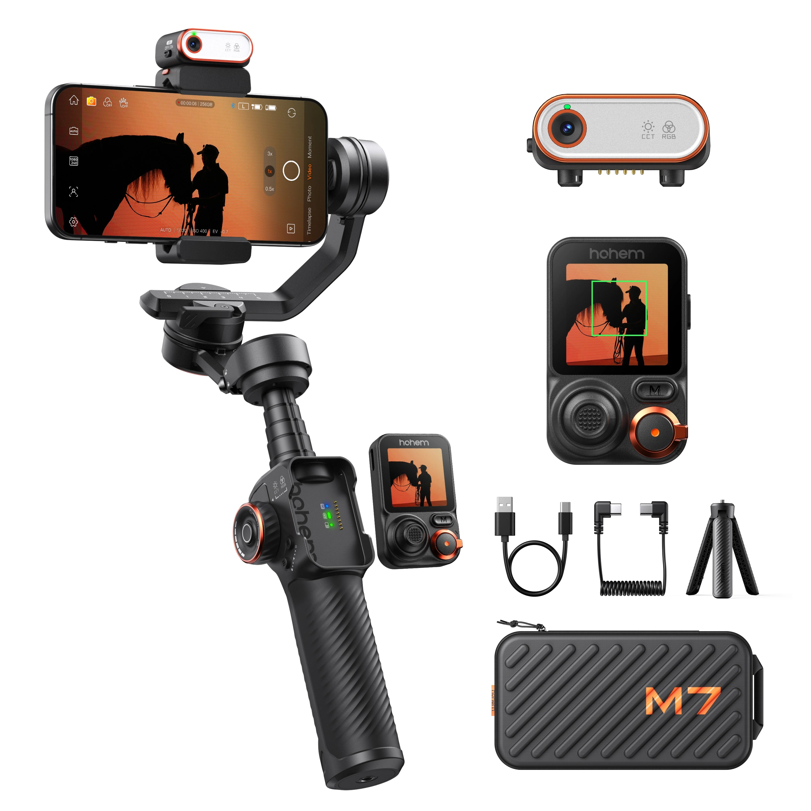
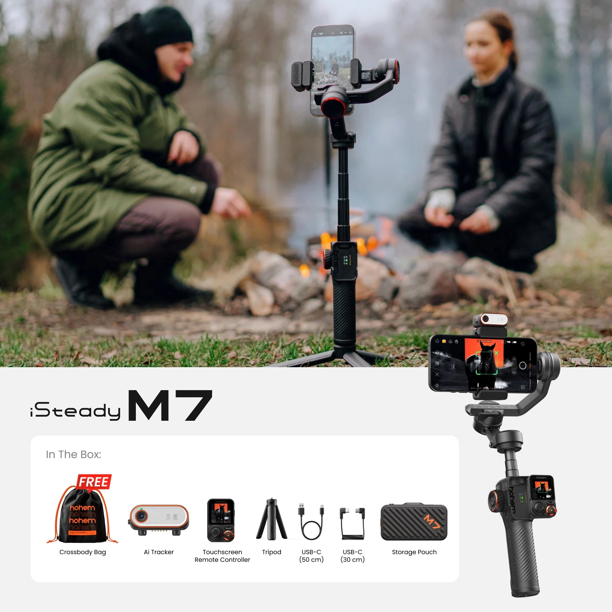
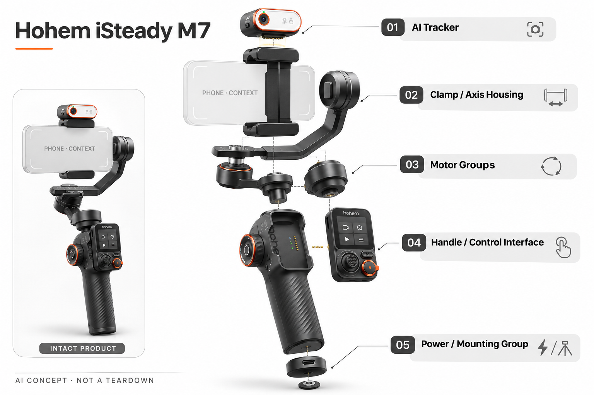

# Hohem iSteady M7

**Hohem** · 智能云台 · 核查 2026-11-04

通过独立AI追踪器和可拆触屏，让一个人完成手机跟拍。

消费渠道：个人零售。

## 产品图片与结构参考

### 产品图

Hohem iSteady M7 官方产品图（相机/手机用于展示，非默认随附） · 来源：[Hohem](<https://store.hohem.com/products/hohem-isteady-m7-big-phone-gimbal>) · [原始图片](<https://cdn.shopify.com/s/files/1/0232/8182/7918/files/M7_-_7.webp?v=1780045650>)

### 参考图

Hohem iSteady M7 官方外观 / 使用参考图（相机/手机用于展示，非默认随附） · 来源：[Hohem](<https://store.hohem.com/products/hohem-isteady-m7-big-phone-gimbal>) · [原始图片](<https://cdn.shopify.com/s/files/1/0232/8182/7918/files/M7_-_1.webp?v=1780045606>)

### AI 生成爆炸示意

**AI 生成 · 非实物拆机。** 内部为概念推断，不能作为元件布局、BOM 或维修依据。[生成提示词](../../content/hardware/prompts/hohem-isteady-m7.txt)

> 分析为基于公开资料的案头研究与 AI 辅助判断，未经用户访谈、销量审计或实物拆机。需求、画像、竞争冷门度、审美及商业机会均为研究假设，不是投资结论。

## 销售与购买

- 状态：在售。官方可见加购入口，公开商品数据M7 Standalone为available=true。不同灯光、麦克风套装合并为同一产品。

- 地区：美国官方店、其它配送地区以结算为准

- 价格：US$249.99（M7单机）。为所标地区和配置的核查参考；活动、税费、物流及可选服务以实际结算为准，不进行汇率换算或保证最低价。

- 中国大陆：2026-11-05 核实浩瀚中国官网 M7 型号页及其明确链接的天猫、京东旗舰店。确认品牌国内官方渠道，未登录店铺核实 M7 当前库存、套装组成与价格；不要把海外组合配置直接套用国内套餐。

- [官方产品 / 商店](<https://store.hohem.com/products/hohem-isteady-m7-big-phone-gimbal>)

## AI 的实际作用

官方描述端侧AI追踪器可识别人、宠物、车辆和物体，配合三轴云台与可拆触屏选择目标。

服务与联网依赖：独立追踪模块支持手机原生相机和第三方App，具体手机兼容、磁吸安装及固件功能要单独确认。

## 是否冷门

竞争密集（研究判断）：手机跟拍工具已有成熟竞争；单人创作是明确细分任务，但不能把AI追踪本身视为新蓝海。

## 需求与市场

需求假设：独自拍摄、演示或运动记录的人希望减少反复调整手机和重拍的时间。远端可视取景是比普通防抖更具体的购买理由，但要在真实拍摄任务中证明它减少了多少准备与纠错。

### 真正需要解决的任务 · 研究判断

M7最值得检验的需求发生在拍摄者必须离开手机、同时又要进入画面的时候，例如独自讲解产品、录制动作教学或追拍宠物。此时普通三脚架解决了支撑，却没有解决目标移动后的构图；单纯防抖也不能告诉站在镜头前的人自己是否仍在画面里。因此，需求单位应是一次可以独立完成的拍摄任务，而不是泛称所有手机用户。

依据：[Hohem M7 技术介绍与条件说明](<https://www.hohem.com/product/isteady-m7>)

### 硬件增加的步骤是否值得 · 研究判断

官方提供独立追踪器和可拆触屏，但这同时增加了携带、装夹、配平、选目标和收纳等步骤。对于频繁单人出镜者，减少来回查看和重拍可能抵消这些成本；对偶尔拍旅行短片的人，手机现有裁切和手持方式可能已经足够。需要分别计算准备时间与拍摄中节省的时间，不能只展示成功跟随的一小段视频。

依据：[Hohem M7 技术介绍与条件说明](<https://www.hohem.com/product/isteady-m7>) · [Hohem M7 官方商店、规格与套装](<https://store.hohem.com/products/hohem-isteady-m7-big-phone-gimbal>)

### 需求验证应怎样做 · 待验证

建议以同一用户、同一手机和同一任务比较三脚架、另一款云台与M7，分别记录首次上手和熟练后的表现。观察完整成片率、走出画面次数、重设目标次数、准备与收纳时间，并访谈为什么愿意再次带出门。这里列的是待执行实验，没有实际样本、转化率或销量数据；若只改善演示效果而不改善完整流程，购买理由仍然不成立。

依据：[Hohem M7 技术介绍与条件说明](<https://www.hohem.com/product/isteady-m7>) · [Hohem M7 官方商店、规格与套装](<https://store.hohem.com/products/hohem-isteady-m7-big-phone-gimbal>)

## 用户画像

画像推断：个人短视频作者、直播讲解者和需要录制家庭活动的人，已有性能足够的手机。愿不愿额外携带和配平云台，与拍摄频率相关，不能把所有手机用户都当成潜在付费客户。

### 优先画像与使用频率 · 研究判断

第一类待验证用户是经常独立拍摄的个人创作者和直播讲解者：已经拥有满足画质需求的手机，主要瓶颈是缺少第二个人构图或控制，而不是缺少摄像设备。识别这类用户应询问过去一个月具体的独自拍摄次数、重拍原因和现有支架，不用年龄或职业标签直接推断需求。可拆屏幕是否经常被拿下使用，是区分核心用户的观察点。

依据：[Hohem M7 技术介绍与条件说明](<https://www.hohem.com/product/isteady-m7>) · [Hohem M7 官方商店、规格与套装](<https://store.hohem.com/products/hohem-isteady-m7-big-phone-gimbal>)

### 次级画像与使用边界 · 研究判断

第二类是需要拍摄宠物、家庭活动或运动过程的个人消费者。官方的多目标追踪说明为这些场景提供了可能性，但追踪目标的移动方式、遮挡和环境差异很大。家庭用户可能更重视启动简单与收纳体积，而非扩展麦克风和灯光；应把长期固定机位用户与外出手持用户分开研究，避免为每个人默认配置完整附件包。

依据：[Hohem M7 技术介绍与条件说明](<https://www.hohem.com/product/isteady-m7>) · [Hohem M7 官方商店、规格与套装](<https://store.hohem.com/products/hohem-isteady-m7-big-phone-gimbal>)

### 不适合的人也要记录 · 待验证

不经常出镜、主要近距离手持、必须极轻出行，或现有手机尺寸与附件组合不满足兼容要求的人，可能不会从M7获得足够增益。建议在访谈中保留不购买者与退货者，询问是重量、学习步骤、手机适配还是跟踪结果造成放弃。尚未核实的大陆购买与服务情况也会影响决策，不能因为品牌来自中国就把跨地区保障视为已确认。

依据：[Hohem M7 技术介绍与条件说明](<https://www.hohem.com/product/isteady-m7>) · [Hohem M7 官方商店、规格与套装](<https://store.hohem.com/products/hohem-isteady-m7-big-phone-gimbal>)

## 竞争与替代

竞争判断：手机云台、桌面追踪支架和手机内置裁切都有替代作用。M7的差异在独立追踪和远端预览组合；如果用户始终手持近距离拍摄，复杂配件可能反而增加使用负担。

### 按完成任务比较替代方案 · 研究判断

M7面对的替代不仅是另一台手机云台，还包括固定三脚架、带追踪的桌面支架、手机应用自动裁切，以及让同伴协助拍摄。固定机位的成本与学习负担较低，却无法主动保持移动目标；桌面设备可能适合直播但不适合边走边拍。比较应先固定场景和已有设备，再讨论哪种方案能完成同一段拍摄，而不是把所有追踪功能放在一张参数表上排名。

依据：[Hohem M7 技术介绍与条件说明](<https://www.hohem.com/product/isteady-m7>)

### M7的差异需要联合验证 · 研究判断

官方的独立AI追踪、可拆触屏和手机应用兼容构成一个组合，单独比较防抖或电机负载不足以解释它的价值。如果用户需要原生相机的某个模式，独立追踪可能降低特定应用依赖；如果始终站在手机后面，远端预览的增益就有限。所谓差异化应落到使用者是否更少中断拍摄，不能由配件数量直接推导出更好的体验。

依据：[Hohem M7 技术介绍与条件说明](<https://www.hohem.com/product/isteady-m7>) · [Hohem M7 官方商店、规格与套装](<https://store.hohem.com/products/hohem-isteady-m7-big-phone-gimbal>)

### 竞争强度与证据缺口 · 待验证

云台属于已有成熟品牌和替代方案的消费工具，加入AI跟踪不自动形成冷门赛道。建议以目标选择、遮挡恢复、横竖屏切换、开拍速度与售后配件作为比较维度，并统一手机、拍摄距离与光照条件。当前没有同条件竞品实测和市场份额数据，因此这里只提出竞争问题；也不把厂商评价、媒体短评或宣传片当作长期优越性的证明。

依据：[Hohem M7 技术介绍与条件说明](<https://www.hohem.com/product/isteady-m7>) · [Hohem M7 官方商店、规格与套装](<https://store.hohem.com/products/hohem-isteady-m7-big-phone-gimbal>)

## 供应链

公开信息包含视觉追踪器、触屏、电机与夹具，未披露全部芯片和代工厂。分析重点是电机一致性、机械间隙、磁吸可靠性、传输和电池；不能从售价反推可信的零件采购成本。

### 从功能拆到采购模块 · 官方资料

公开资料能确认M7包含独立视觉追踪器、可拆触屏遥控器、三轴执行结构、手机夹具、伸缩结构与供电系统。采购拆分应进一步区分成像与算法平台、驱动控制、电机及机械公差、无线预览、显示交互、电池包和整机测试。这里是重新开发同类产品的功能分解，资料没有公开完整芯片型号、全部元件或代工厂，不能写成真实拆机BOM。

依据：[Hohem M7 技术介绍与条件说明](<https://www.hohem.com/product/isteady-m7>) · [Hohem M7 官方商店、规格与套装](<https://store.hohem.com/products/hohem-isteady-m7-big-phone-gimbal>)

### 量产约束不只在主芯片 · 研究判断

分析上，三轴跟拍的稳定性会同时受电机响应、夹具刚性、机械间隙、负载重心和控制调校影响；追踪器的装配位置还会影响识别视角与校准。新供应方案即使模块参数接近，也需要在完整手机组合下重新验证噪声、发热、掉落、磁吸锁定与寿命。不得把单个样机成功运行直接当作批量一致性，也不宜用零售价倒推可靠采购成本。

依据：[Hohem M7 技术介绍与条件说明](<https://www.hohem.com/product/isteady-m7>) · [Hohem M7 官方商店、规格与套装](<https://store.hohem.com/products/hohem-isteady-m7-big-phone-gimbal>)

### 候选供应商如何对应 · 待验证

下方公司链接是基于公开能力建立的选型入口：视觉模组、电机、驱动芯片和电池方案分别对应不同功能。应带目标手机范围、尺寸重量、功耗预算、接口、测试要求和预计阶段询问，而不是直接索要一份M7同款报价。候选公司并非已确认的Hohem供应商；价格、起订量、交期、知识产权和可替换性都需要供应商书面答复及样件验证。

依据：[Hohem M7 技术介绍与条件说明](<https://www.hohem.com/product/isteady-m7>) · [Hohem M7 官方商店、规格与套装](<https://store.hohem.com/products/hohem-isteady-m7-big-phone-gimbal>)

## 技术路径

技术由目标识别、轨迹估计、构图和三轴控制组成。端侧追踪减少对特定手机App的依赖，但遮挡、低光和快速运动仍需实测；厂家极限指标不等于每个手机组合都能达到。

### 识别、构图与执行的链路 · 研究判断

官方说明独立追踪器能够选择和跟随目标，并把选择入口放到可拆触屏上。可用于理解的功能链路是图像输入、目标识别与跟踪、构图误差计算、三轴运动控制及用户反馈。它与单纯防抖是不同任务：防抖面对手部或机身运动，跟踪面对目标在画面里的位置变化。具体模型、训练数据、芯片与控制环路参数未披露，不由功能描述反推。

依据：[Hohem M7 技术介绍与条件说明](<https://www.hohem.com/product/isteady-m7>)

### 预览、控制与成片要分开 · 官方资料

商店规格分别列出遥控距离和视频传输距离，技术介绍又说明标称控制距离的开放环境条件，因此不应把所有无线能力统一写成同一个有效范围。远端画面、用户按键响应和最终手机录像也应分别核验，尤其要确认追踪器视角与手机不同镜头的构图差异。宣传中的实时预览不能代替对延迟、丢帧、干扰和校准偏差的实际测量。

依据：[Hohem M7 技术介绍与条件说明](<https://www.hohem.com/product/isteady-m7>) · [Hohem M7 官方商店、规格与套装](<https://store.hohem.com/products/hohem-isteady-m7-big-phone-gimbal>)

### 建立可复现的技术测试 · 待验证

建议覆盖静止讲话、缓慢横移、突然转向、遮挡后再出现、多目标交叉和逆光低光等情形，并在每项中记录目标丢失、误跟随和恢复方式。再切换不同重量手机与镜头模式，分别测准备时间、画面稳定和电量消耗。官方已区分静止、启用追踪及叠加补光的续航条件；测试报告也应按配置分列，不能使用单一最佳续航代表所有拍摄任务。

依据：[Hohem M7 技术介绍与条件说明](<https://www.hohem.com/product/isteady-m7>) · [Hohem M7 官方商店、规格与套装](<https://store.hohem.com/products/hohem-isteady-m7-big-phone-gimbal>)

## 产品审美

设计观察：可拆屏幕增强单人拍摄的操作可见性，较大的支架也更像拍摄工具。便携性、单手持握和夹具安装成本决定它是否能进入日常包中，而不是只在开箱时觉得专业。

### 产品形态如何表达用途 · 研究判断

M7的支架、伸缩杆、可拆屏幕与控制部件让它呈现为一件明确的拍摄工具。外观上的专业感可以帮助用户理解可扩展性，但也可能提高初次接触时的学习预期。审美分析应同时看展开拍摄、手持移动和收纳携带三个状态；如果产品只在桌面展示时显得整齐，实际展开和整理过程却繁琐，视觉吸引力就难以转化成长期使用。

依据：[Hohem M7 技术介绍与条件说明](<https://www.hohem.com/product/isteady-m7>) · [Hohem M7 官方商店、规格与套装](<https://store.hohem.com/products/hohem-isteady-m7-big-phone-gimbal>)

### 交互层级与身体负担 · 研究判断

触屏、侧轮、扳机和实体按键提供了不同控制入口，是否清楚取决于常用操作能否在拍摄时自然完成。需要观察左右手使用、单手切换、屏幕可读性、拆下遥控器后的持握以及长时间举持，而非只评价材质或配色。官方外形与功能资料能说明设计意图，但手部疲劳、误触和学习曲线属于尚待真实使用者验证的体验问题。

依据：[Hohem M7 技术介绍与条件说明](<https://www.hohem.com/product/isteady-m7>) · [Hohem M7 官方商店、规格与套装](<https://store.hohem.com/products/hohem-isteady-m7-big-phone-gimbal>)

### 长期审美与维护体验 · 待验证

建议将夹具接触面、磁吸与锁定部位、伸缩连接、轴锁以及收纳包作为长期体验的一部分检查，记录磨损、污渍和反复装卸后是否仍容易理解。配件从何处拿出、用完放回哪里，也影响产品是否看起来有秩序。当前没有耐久和清洁实测，不对具体材料寿命下结论；可以先用连续多次开拍与收纳的行为观察检验设计是否真正降低负担。

依据：[Hohem M7 技术介绍与条件说明](<https://www.hohem.com/product/isteady-m7>) · [Hohem M7 官方商店、规格与套装](<https://store.hohem.com/products/hohem-isteady-m7-big-phone-gimbal>)

## 关键风险

风险包括重手机兼容、画面传输延迟、追踪丢失和配件漏购。不同套装不应混同为全部功能标配，长期云台闲置常与携带、配平和开机步骤有关，仍需实际用户研究。

### 兼容与性能边界 · 研究判断

手机重量、宽度、厚度与外接镜头、麦克风等附件共同影响整机适配，不能只用最大负载一个数字判断能否稳定拍摄。官方列有兼容范围和额外说明，购买或研发时都应按最终组合核对；低光、遮挡和快速运动也需要不同测试。若追踪目标失去后用户无法立即发现并恢复，最终损失可能是一整段素材，而不是某次识别错误本身。

依据：[Hohem M7 技术介绍与条件说明](<https://www.hohem.com/product/isteady-m7>) · [Hohem M7 官方商店、规格与套装](<https://store.hohem.com/products/hohem-isteady-m7-big-phone-gimbal>)

### 套装、续航与服务成本 · 官方资料

官网把基础配置和灯光、麦克风、手柄等组合分开列出，研究时需要明确哪些随附、哪些另购。启用追踪和补光会改变续航条件，实际拍摄还可能需要备用供电与支撑配件。对跨地区消费者，配送、固件、保修和配件补购仍是独立问题；当前未核验的环节应保留待确认，不能把促销价或某地区购买入口当作完整使用成本。

依据：[Hohem M7 技术介绍与条件说明](<https://www.hohem.com/product/isteady-m7>) · [Hohem M7 官方商店、规格与套装](<https://store.hohem.com/products/hohem-isteady-m7-big-phone-gimbal>)

### 风险验证与放弃条件 · 待验证

可在试用前设定清晰的放弃条件，例如核心手机组合无法顺畅安装、常用场景频繁误跟随、准备时间超过用户容忍程度，或遥控预览不能帮助判断最终构图。测试也要记录失败后的恢复步骤和需要人工介入的次数。这里不设虚构的行业合格率；阈值应由用户任务和拍摄损失决定，并让不支持购买的结果与成功案例同时进入研究档案。

依据：[Hohem M7 技术介绍与条件说明](<https://www.hohem.com/product/isteady-m7>) · [Hohem M7 官方商店、规格与套装](<https://store.hohem.com/products/hohem-isteady-m7-big-phone-gimbal>)

## 机会与验证

可验证市场差异是个人创作时远端取景与自动跟拍的完整流程。应比较普通三脚架、另一款云台及M7的成片率和准备时间，本轮没有访谈、独立跟踪准确率或销量证据。

### 更窄但可检验的机会 · 研究判断

相较继续叠加跟踪对象数量，更值得研究的机会是让特定人群少做一次准备或确认。例如独自拍产品的创作者可能需要更容易复现的机位，动作教学者可能需要在固定区域稳定保持全身，而家庭用户可能更需要快速启动。它们共享部分硬件，却有不同的成功标准；应先选一个任务闭环，再决定是否需要新的结构、遥控方式或软件能力。

依据：[Hohem M7 技术介绍与条件说明](<https://www.hohem.com/product/isteady-m7>) · [Hohem M7 官方商店、规格与套装](<https://store.hohem.com/products/hohem-isteady-m7-big-phone-gimbal>)

### 差异化不能只写AI · 研究判断

若创业团队研究同类方向，应把差异写成用户可观察的流程改进，例如减少配平步骤、明确丢失目标后的反馈、让小屏更容易确认构图，或改善现有手机附件组合的安装方式。是否能够形成商业优势，还取决于制造一致性、渠道演示和售后支持。当前没有成本、毛利或获客数据，不能仅凭功能组合计算市场规模或成功概率。

依据：[Hohem M7 技术介绍与条件说明](<https://www.hohem.com/product/isteady-m7>) · [Hohem M7 官方商店、规格与套装](<https://store.hohem.com/products/hohem-isteady-m7-big-phone-gimbal>)

### 下一阶段的最小验证 · 待验证

建议先招募能够描述近期真实拍摄任务的人，观察现有流程，再用可调整的样机或交互原型测试最关键改动。记录任务完成、准备时间、重拍原因、主动复用和愿意放弃的现有工具；确认体验增益后再进入供应商样件与制造验证。若主要痛点其实是内容策划、照明或收音，应允许研究结论指向软件或服务，而不是预设再造一台云台。

依据：[Hohem M7 技术介绍与条件说明](<https://www.hohem.com/product/isteady-m7>) · [Hohem M7 官方商店、规格与套装](<https://store.hohem.com/products/hohem-isteady-m7-big-phone-gimbal>)

## 对应供应链公司

能力候选用于选型研究，不代表本产品实际采用；未公开的供货关系不作推断。

- [arducam](../supply-chain/arducam.md) — **能力候选 · 非已采用** / 视觉输入与成像模组选型：M7公开具备独立视觉追踪器；Arducam的相机模组能力可作为重新开发时的样机选型入口。仍需验证尺寸、接口、视场、功耗、低光与算法平台兼容；不能据此认定其是M7的实际摄像头供应商。

- [texas-instruments](../supply-chain/texas-instruments.md) — **能力候选 · 非已采用** / 电机驱动与嵌入式控制器件：M7需要三轴执行与控制，TI公开器件可用于研究驱动与控制方案。具体电机类型、噪声、功耗、板面积和闭环接口必须从目标设计出发重选；现有资料没有点名M7采用TI芯片，也不能视为可直接替换的零件清单。

- [maxon](../supply-chain/maxon.md) — **能力候选 · 非已采用** / 精密运动系统的能力参考：三轴稳定与追踪需要执行机构，maxon可作为精密驱动能力和工程评估的研究入口。其标准产品未必满足手机云台的尺寸、重量及消费成本，需先验证适配再询样；这是一条存在明显筛选条件的候选关系，并非M7已采用的电机。

- [grepow](../supply-chain/grepow.md) — **能力候选 · 非已采用** / 电池包与供电验证候选：官网区分云台和遥控器的供电及不同使用条件，说明电池选型需要按各子系统预算分别评估。Grepow可作为定制电池方案的询问入口，但电芯形态、保护、充放电策略、运输与整机适配都待验证；不代表M7现有电池来自该公司。

[浏览供应链目录](../supply-chain.md)

## 功能分层示意

这是功能关系，不是实物拆机、真实空间结构或已核实 BOM。

1. **视觉输入**：AI跟踪模块或应用视觉输入识别目标。（官方披露）

2. **跟踪计算**：将目标位置转换为构图和运动决策。（官方披露）

3. **三轴执行**：电机和关节保持拍摄方向，实际表现需测试。（官方披露）

4. **控制与连接**：屏幕、按键或App提供个人操作入口。（官方披露）

5. **电池与结构**：供电、夹具与配重影响持续拍摄。（分析推断）

## 来源

1. [Hohem M7 官方商品页](<https://store.hohem.com/products/hohem-isteady-m7-big-phone-gimbal>) — 单机和附件套装区分，商品数据确认可售。

2. [Hohem M7 官方技术介绍](<https://www.hohem.com/product/isteady-m7>) — 描述端侧多目标追踪及可拆触屏。

3. [浩瀚 M7 中国官网及官方购买渠道](<https://www.hohem.com/cn/product/isteady-m7>) — 2026-11-05 核实浩瀚中国官网 M7 型号页及其明确链接的天猫、京东旗舰店。确认品牌国内官方渠道，未登录店铺核实 M7 当前库存、套装组成与价格；不要把海外组合配置直接套用国内套餐。

[返回目录](../hardware-market.md) · [网页分析](https://romanagent.github.io/Roman/#hardware/product/hohem-isteady-m7)
