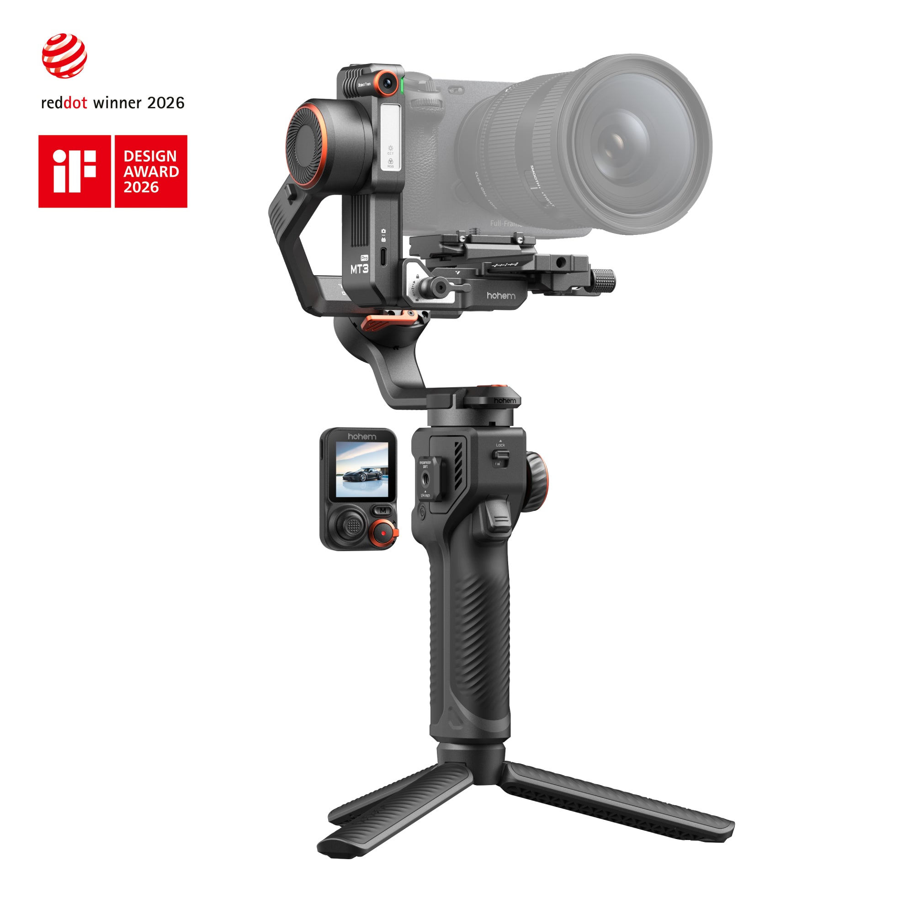
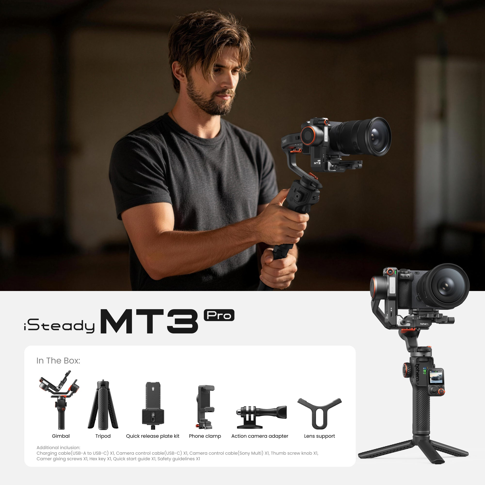
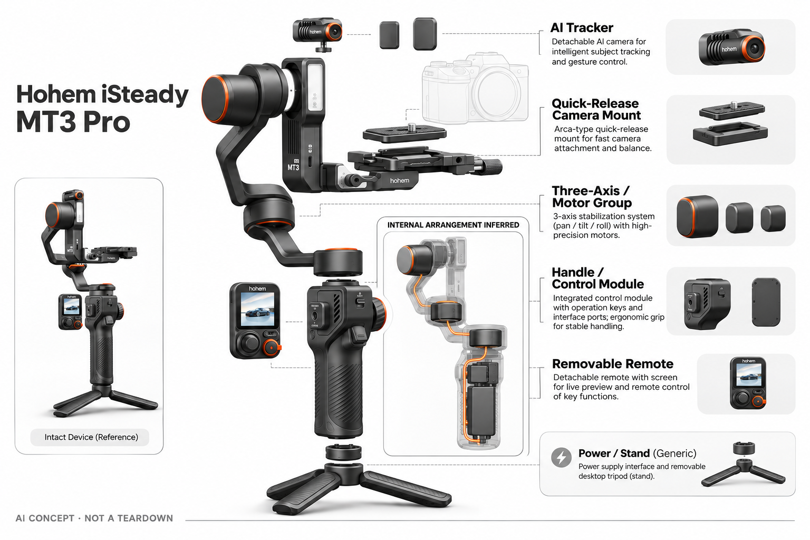

# Hohem iSteady MT3 Pro

**Hohem** · 智能云台 · 核查 2026-11-04

面向个人相机创作者的AI目标跟踪与远程取景组合。

消费渠道：个人零售。

## 产品图片与结构参考

### 产品图

Hohem iSteady MT3 Pro 官方产品图（相机/手机用于展示，非默认随附） · 来源：[Hohem](<https://store.hohem.com/products/hohem-isteady-mt3-pro-camera-gimbal-stabilizer>) · [原始图片](<https://store.hohem.com/cdn/shop/files/MT3_Pro_-_3_6a66d4b7-ec38-45c3-81d5-19801514b422.jpg?v=1776335510&width=2000>)

### 参考图

Hohem iSteady MT3 Pro 官方外观 / 使用参考图（相机/手机用于展示，非默认随附） · 来源：[Hohem](<https://store.hohem.com/products/hohem-isteady-mt3-pro-camera-gimbal-stabilizer>) · [原始图片](<https://store.hohem.com/cdn/shop/files/MT3_Pro_-_1.jpg?v=1777275305&width=2000>)

### AI 生成爆炸示意

**AI 生成 · 非实物拆机。** 内部为概念推断，不能作为元件布局、BOM 或维修依据。[生成提示词](../../content/hardware/prompts/hohem-isteady-mt3-pro.txt)

> 分析为基于公开资料的案头研究与 AI 辅助判断，未经用户访谈、销量审计或实物拆机。需求、画像、竞争冷门度、审美及商业机会均为研究假设，不是投资结论。

## 销售与购买

- 状态：在售。当前官方Pro Kit页面有Add to Cart与明确套装清单。普通MT3、Pro及不同附件不拆成重复条目，本条按Pro配置分析。

- 地区：美国官方店、其他可配送市场

- 价格：Pro Kit参考US$359.99。为所标地区和配置的核查参考；活动、税费、物流及可选服务以实际结算为准，不进行汇率换算或保证最低价。

- 中国大陆：本轮核查海外官方消费渠道，未验证中国大陆结算、型号、保修与全部AI服务可用性；不因品牌来源或支持中文推定国内可购。

- [官方产品 / 商店](<https://store.hohem.com/products/hohem-isteady-mt3-pro-camera-gimbal-stabilizer>)

## AI 的实际作用

官方称Pro内置视觉AI模型可跟踪人、宠物、车辆和物体；可拆屏幕与套装对焦电机服务单人相机拍摄。

服务与联网依赖：相机、镜头、线缆控制和载荷组合需按兼容表核验，AI构图不代表相机自动对焦与所有功能都受支持。

## 是否冷门

细分专业（研究判断）：个人相机跟拍是专业兴趣细分场景，市场已有多类替代，价值依赖实际工作流。

## 需求与市场

需求假设：已经使用微单相机的个人创作者，希望一个人完成跟随构图、远程预览和部分镜头控制。用户真正需要的是减少拍摄协助，而非单纯追求更高承载或更多模式。

### 需求假设：单人相机拍摄兼顾跟随与远程查看 · 研究判断

MT3 Pro把多目标视觉跟踪、可拆控制屏和部分镜头控制组合，针对个人作者想减少协助却仍要管理相机的任务。需求应验证实际少了哪一种操作，不是承载或模式越多越好，也不能将自动构图解释为相机所有设置都被解决。

依据：[Hohem MT3 Pro 官方商品页](<https://store.hohem.com/products/hohem-isteady-mt3-pro-camera-gimbal-stabilizer>) · [Hohem AI追踪系列官方店](<https://store.hohem.com/collections/hohem-ai-tracker>)

### 价值判断：控制集中仍可能增加准备 · 研究判断

可拆屏与对焦组件可以提供远距离操作，但同时需要安装、连接与熟悉状态，用户未必每次都使用全部功能。研究应记录组合的实际使用，不把附件越多当作完整体验，也不认为一人能做更多操作就等于整段拍摄更省时。

依据：[Hohem MT3 Pro 官方商品页](<https://store.hohem.com/products/hohem-isteady-mt3-pro-camera-gimbal-stabilizer>)

### 验证方案：用真实相机脚本逐项比较 · 待验证

让作者用实际相机镜头完成一段人物或支持对象的拍摄，分别记录跟随、远程预览与对焦控制的准备和结果。与原有云台或固定机位保持脚本一致，不只展示多个对象都被框住，也不以一次成功演示推断所有组合兼容。

依据：[Hohem MT3 Pro 官方商品页](<https://store.hohem.com/products/hohem-isteady-mt3-pro-camera-gimbal-stabilizer>)

## 用户画像

画像推断：个人影像作者、独立讲解者和轻量活动记录者，拥有相机和基础配平经验。它的学习成本高于手机支架，应按拍摄频率和镜头组合区分使用者，不把专业外观当成需求证据。

### 画像假设：已有相机基础的独立创作者 · 研究判断

较匹配者有一定配平与镜头控制经验，经常单独拍讲解、活动或其他明确内容，愿意管理控制屏和线缆。普通手机随手拍用户可能不需要这套学习与携带成本，画像应围绕实际任务和器材，不把专业工具形态当作用户需求证据。

依据：[Hohem MT3 Pro 官方商品页](<https://store.hohem.com/products/hohem-isteady-mt3-pro-camera-gimbal-stabilizer>)

### 使用约束：Pro与普通系列能力需区分 · 研究判断

本条依据Pro视觉模型与所选套装分析，不能把普通MT3的配置或基础价格混入，也不能默认所有对焦配件随任何组合提供。用户实际镜头、相机控制与载荷需要一起核对，研究应了解完整系统，不只看云台单独参数。

依据：[Hohem MT3 Pro 官方商品页](<https://store.hohem.com/products/hohem-isteady-mt3-pro-camera-gimbal-stabilizer>) · [Hohem AI追踪系列官方店](<https://store.hohem.com/collections/hohem-ai-tracker>)

### 访谈重点：远程预览解决了哪个盲点 · 待验证

请用户展示独自拍摄时何时看不到构图或需要走回相机，说明可拆屏是否减少往返，再问对焦控制是否真正用到。这样能区分跟踪、预览与镜头控制的价值，不能把所有功能归成一个智能分数，也不将未来拍摄想象当作重复需求。

依据：[Hohem MT3 Pro 官方商品页](<https://store.hohem.com/products/hohem-isteady-mt3-pro-camera-gimbal-stabilizer>)

## 竞争与替代

竞争判断：相机云台、自动追踪云台头、相机内置识别以及人工协作均是替代。Pro的多目标跟踪与控制组合值得比较，但和普通MT3的能力边界必须明确，不能只看同一系列名称。

### 替代方案：相机云台、追踪头与人工协作 · 研究判断

MT3 Pro面对其他云台、自动追踪云台头、相机内识别以及助手协作，不同方案承担的控制任务不同。比较应按镜头与脚本，不仅按目标种类或承载排序，也不将更多识别对象理解为覆盖所有体育、宠物和活动拍摄。

依据：[Hohem MT3 Pro 官方商品页](<https://store.hohem.com/products/hohem-isteady-mt3-pro-camera-gimbal-stabilizer>)

### 差异判断：多目标识别与控制屏共同取舍 · 研究判断

官方描述人、宠物、车辆和物体跟踪，配合远程控制形成可比较差异，但用户是否频繁跨对象需要验证。研究应观察实际场景与恢复负担，不把Pro宣传扩展到所有同系列型号，也不把目标识别等同对拍摄主题与叙事意图的理解。

依据：[Hohem MT3 Pro 官方商品页](<https://store.hohem.com/products/hohem-isteady-mt3-pro-camera-gimbal-stabilizer>)

### 比较方法：按有效片段和准备成本对照 · 待验证

用相同相机组合完成同一任务，记录装配、配平、目标选择、远程操作和最终采用镜头，检查哪些附件真正减少往返。不要只计算跟踪时间，也不将相机失焦或曝光变化归为云台算法，分层比较才能识别控制组合的实际收益。

依据：[Hohem MT3 Pro 官方商品页](<https://store.hohem.com/products/hohem-isteady-mt3-pro-camera-gimbal-stabilizer>)

## 供应链

公开信息涉及视觉模块、可拆控制器、电机与可选对焦组件，供应商和完整BOM未知。分析重点是结构刚度、快装精度、马达调校、接口与线缆可靠性，以及个人购买后的维修成本。

### 功能拆分：视觉、三轴与镜头控制分层 · 研究判断

公开系统涉及视觉模块、三轴执行、可拆控制器和按套装配置的对焦组件，电源与快装支持使用。目标识别、机械构图、相机对焦和镜头电机是不同层，具体主控、模块供应商与工厂未披露，不能由外形或功能猜真实BOM。

依据：[Hohem MT3 Pro 官方商品页](<https://store.hohem.com/products/hohem-isteady-mt3-pro-camera-gimbal-stabilizer>)

### 制造判断：附件增加连接与装配一致性要求 · 研究判断

控制屏、快装、相机线缆和镜头组件需要在不同组合中保持可用，结构刚度和马达调校影响最终取景。供应评估应关注完整装配和维护，本轮没有配平、寿命或接口测试，不能从功能多推断制造成熟，也不估算实际采购合同与成本。

依据：[Hohem MT3 Pro 官方商品页](<https://store.hohem.com/products/hohem-isteady-mt3-pro-camera-gimbal-stabilizer>)

### 候选选型：光学驱动与视觉输入分别询证 · 研究判断

FAULHABER可讨论三轴或镜头执行工程，Chicony可作为视觉输入候选，Raystar可研究可拆屏显示。实际体积、负载、通信与控制权限须专项确认，三家无Hohem点名供货证据，标准组件不能直接替换原机，也不提供完整视觉模型。

依据：[Hohem MT3 Pro 官方商品页](<https://store.hohem.com/products/hohem-isteady-mt3-pro-camera-gimbal-stabilizer>)

## 技术路径

技术要把目标识别、机械构图、相机对焦和镜头电机分开。内置AI可以减少对手机App的依赖，但相机型号与镜头能力依然影响结果，不能从一套演示画面推断所有组合兼容。

### 已披露能力：Pro视觉跟踪覆盖多类目标 · 官方资料

官方Pro页面描述内置视觉AI跟踪人、宠物、车辆与物体，并结合可拆控制和套装功能，普通稳定不是全部AI证据。具体对象与运行条件仍以当前版本为准，不能将跟踪能力解释为自动完成相机对焦，也不推断未知芯片或模型架构。

依据：[Hohem MT3 Pro 官方商品页](<https://store.hohem.com/products/hohem-isteady-mt3-pro-camera-gimbal-stabilizer>)

### 技术判断：多个控制层需要明确状态 · 研究判断

用户可能以为目标被锁定后镜头也会持续清晰，但云台方向、相机对焦和外部镜头控制有不同兼容路径。研究应检查状态是否可理解，以及某层失败时如何接管，不能把一次演示画面顺畅概括为所有相机镜头组合都可用。

依据：[Hohem MT3 Pro 官方商品页](<https://store.hohem.com/products/hohem-isteady-mt3-pro-camera-gimbal-stabilizer>)

### 验证方案：逐项启用跟随、预览与镜头功能 · 待验证

先确认实际器材的基本稳定，再分别测试支持对象、可拆屏和所选对焦组件，记录每层条件与最终画面。保持版本和连接可追溯，不把全部功能同时打开后笼统评价AI，本轮没有识别成功率、对焦或实拍可靠性测量。

依据：[Hohem MT3 Pro 官方商品页](<https://store.hohem.com/products/hohem-isteady-mt3-pro-camera-gimbal-stabilizer>)

## 产品审美

设计观察：相机承载平台与可拆屏幕有明确工具属性，快装和手柄会影响使用的流畅感。消费者实际感受到的品质包括摆放稳定、线缆走向和收纳便利，而不仅是外壳材质。

### 外形判断：工具密度来自相机和控制附件 · 研究判断

承载平台、手柄与可拆屏有明确拍摄工具属性，装上相机、线缆和镜头组件后才形成完整外观。设计评价应关注摆放、持握和收纳，不只看裸机材质，照片无法说明长时操作疲劳，也不证明全部附件能轻松放入原有背包。

依据：[Hohem MT3 Pro 官方商品页](<https://store.hohem.com/products/hohem-isteady-mt3-pro-camera-gimbal-stabilizer>)

### 交互判断：可拆屏应减少往返而非增加状态负担 · 研究判断

远程查看和控制有意义的前提是用户知道屏幕控制哪个功能、相机是否录制以及跟踪是否工作。研究应观察界面与物理动作如何对应，不把可拆本身当作便捷，也不将更多按钮和模式视为更专业，拍摄中的注意力仍有限。

依据：[Hohem MT3 Pro 官方商品页](<https://store.hohem.com/products/hohem-isteady-mt3-pro-camera-gimbal-stabilizer>)

### 体验验证：从器材包到单人内容拍摄 · 待验证

让用户带自己的相机和配件完成安装、配平、远程出镜、镜头调整与收纳，记录需要帮助或反复确认的步骤。用真实脚本而不是预设演示，才能判断控制组合是否减少协作，也避免把装好后的短时手感当作长期设计体验。

依据：[Hohem MT3 Pro 官方商品页](<https://store.hohem.com/products/hohem-isteady-mt3-pro-camera-gimbal-stabilizer>)

## 关键风险

主要风险是套装差异、相机兼容、配平失败与追踪遮挡。设备并不会替代所有拍摄判断，也不保证自动对焦；采购应把镜头、电机和控制线的真实组合放在一起核对。

### 兼容风险：镜头、电机和控制线需整套核对 · 研究判断

Pro套装与不同相机镜头可能有不同控制范围，云台承载和视觉跟踪不能保证自动对焦或所有操作。用户应按实际组合确认，本轮没有全机型实拍，也不将普通MT3或其他套装的条件混入，配置误读可能比算法性能更影响使用。

依据：[Hohem MT3 Pro 官方商品页](<https://store.hohem.com/products/hohem-isteady-mt3-pro-camera-gimbal-stabilizer>) · [Hohem AI追踪系列官方店](<https://store.hohem.com/collections/hohem-ai-tracker>)

### 使用风险：目标遮挡与配平影响最终片段 · 研究判断

多类目标识别仍有场景边界，机械配平和线缆也可能改变动作，设备不会承担全部拍摄判断。目录不将厂商演示与响应宣传作为可靠性保证，也不提供任何复杂场景的成功率，重要内容仍需可理解的接管与复核流程。

依据：[Hohem MT3 Pro 官方商品页](<https://store.hohem.com/products/hohem-isteady-mt3-pro-camera-gimbal-stabilizer>)

### 验证安排：记录关闭附件与回退行为 · 待验证

试用应保留用户不用可拆屏、关闭跟踪、改用手动对焦或重新配平的原因，区分偏好、兼容与识别问题。不要只统计全部功能同时成功的片段，也不把未使用附件理解为浪费，真实选择能说明哪些组合产生持续价值。

依据：[Hohem MT3 Pro 官方商品页](<https://store.hohem.com/products/hohem-isteady-mt3-pro-camera-gimbal-stabilizer>)

## 机会与验证

值得验证的购买理由是降低独立拍摄中的协作需求。可比较同一拍摄脚本下的准备时间、追踪重置次数和有效片段，本轮未进行实拍或用户研究，也不以功能数量预测销量。

### 研究方向：降低独立相机拍摄的协作需求 · 研究判断

MT3 Pro可用于研究远程查看、目标跟随和镜头控制如何配合，机会可能在状态解释与兼容，而不是更多识别对象。应先找出用户需要助手的具体环节，再判断设备是否减少，不把控制集中在一套产品里当作需求已经验证。

依据：[Hohem MT3 Pro 官方商品页](<https://store.hohem.com/products/hohem-isteady-mt3-pro-camera-gimbal-stabilizer>)

### 执行计划：按器材与脚本追踪组合使用 · 待验证

连续记录准备、重设、可拆屏和镜头控制使用，访谈一次明确弃用附件或改用其他方案的任务，保留实际器材信息。将跟踪、预览和对焦收益分开，不用模式数量、产品外观或一次演示推断长期使用，也不冒充已做调研。

依据：[Hohem MT3 Pro 官方商品页](<https://store.hohem.com/products/hohem-isteady-mt3-pro-camera-gimbal-stabilizer>) · [Hohem AI追踪系列官方店](<https://store.hohem.com/collections/hohem-ai-tracker>)

### 决策边界：控制组合是共享相机任务的差异 · 研究判断

本款与其他云台共享单人稳定和构图需求，多对象与可拆屏形成实质取舍，不能按Pro名称制造独立市场。当前没有访谈、销量和供应报价，不以目标种类、承载或模型评分预测创业成功，应看重复拍摄中的实际协作减少。

依据：[Hohem MT3 Pro 官方商品页](<https://store.hohem.com/products/hohem-isteady-mt3-pro-camera-gimbal-stabilizer>) · [Hohem AI追踪系列官方店](<https://store.hohem.com/collections/hohem-ai-tracker>)

## 对应供应链公司

能力候选用于选型研究，不代表本产品实际采用；未公开的供货关系不作推断。

- [faulhaber](../supply-chain/faulhaber.md) — **能力候选 · 非已采用** / 三轴及镜头运动工程候选：FAULHABER公开相机运动和光学定位驱动，可作为MT3 Pro三轴或镜头执行候选，但两类负载、速度、回差和接口不同，需分别验证。当前无Hohem点名采用证据，不能把专业光学标准件直接视为消费云台或对焦附件替换件。

- [chicony](../supply-chain/chicony.md) — **能力候选 · 非已采用** / 内置多目标视觉输入候选：Chicony公开摄像模组与视觉工程，可用于MT3 Pro感知输入候选研究，但视场、功耗和目标模型配合需专项确认，摄像模组本身不提供人宠物车辆完整跟踪能力。当前没有原机采用或传感器型号证据，也不涵盖相机本体对焦。

- [raystar](../supply-chain/raystar.md) — **能力候选 · 非已采用** / 可拆控制屏显示子系统候选：Raystar公开小型显示与界面集成，可作为MT3 Pro可拆屏的候选，但无线控制、触控、功耗和远距离可读性需核对，标准屏不等于完整遥控器。当前无实际供货证据，也不表示已有模块兼容Hohem固件和相机控制。

[浏览供应链目录](../supply-chain.md)

## 功能分层示意

这是功能关系，不是实物拆机、真实空间结构或已核实 BOM。

1. **视觉输入**：AI跟踪模块或应用视觉输入识别目标。（官方披露）

2. **跟踪计算**：将目标位置转换为构图和运动决策。（官方披露）

3. **三轴执行**：电机和关节保持拍摄方向，实际表现需测试。（官方披露）

4. **控制与连接**：屏幕、按键或App提供个人操作入口。（官方披露）

5. **电池与结构**：供电、夹具与配重影响持续拍摄。（分析推断）

## 来源

1. [Hohem MT3 Pro 官方商品页](<https://store.hohem.com/products/hohem-isteady-mt3-pro-camera-gimbal-stabilizer>) — 当前加购入口、Pro Kit组成和AI视觉模块。

2. [Hohem AI追踪系列官方店](<https://store.hohem.com/collections/hohem-ai-tracker>) — 区分手机与相机设备，不能将附件另作完整产品。

[返回目录](../hardware-market.md) · [网页分析](https://romanagent.github.io/Roman/#hardware/product/hohem-isteady-mt3-pro)
