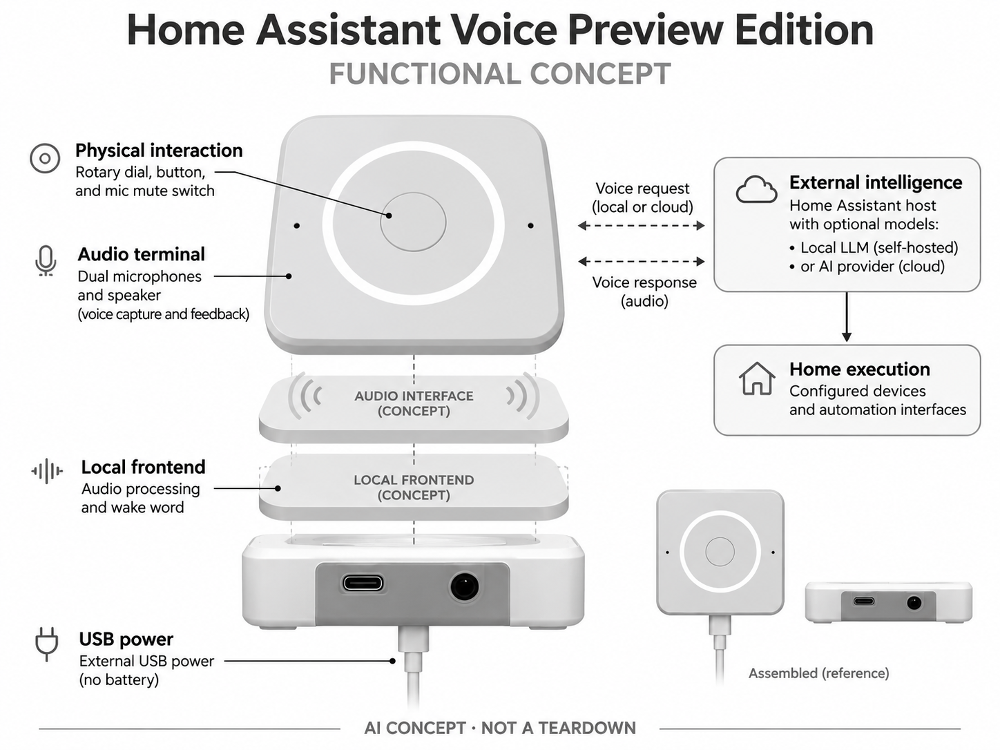

# Home Assistant Voice Preview Edition

**Nabu Casa** · 家庭助手 · 核查 2026-11-04

面向家庭爱好者的开放可配置语音终端

消费渠道：个人零售。

## 产品图片与结构参考

### 产品图

Home Assistant Voice Preview Edition 官方产品图 · 来源：[Nabu Casa · 官方图片](<https://www.home-assistant.io/voice-pe/>) · [原始图片](<https://www.home-assistant.io/images/voice-pe/vpe-top.webp>)

### 参考图

Home Assistant Voice Preview Edition 官方外观、结构或使用参考 · 来源：[Nabu Casa · 官方图片](<https://www.home-assistant.io/voice-pe/>) · [原始图片](<https://www.home-assistant.io/images/voice-pe/specs/side1.webp>)

### AI 生成爆炸示意

**AI 生成 · 非实物拆机。** 内部为概念推断，不能作为元件布局、BOM 或维修依据。[生成提示词](../../content/hardware/prompts/home-assistant-voice-pe.txt)

> 依据官方外观参考与公开功能生成；未披露的内部布局只作概念模块，不构成BOM或真实结构证据。

> 保留官方图片原始内容和出处；画面宣传参数不是本轮独立实测。

> 分析为基于公开资料的案头研究与 AI 辅助判断，未经用户访谈、销量审计或实物拆机。需求、画像、竞争冷门度、审美及商业机会均为研究假设，不是投资结论。

## 销售与购买

- 状态：在售。官方硬件页提供购买入口；实际打开Seeed商品页显示In stock和US$59。它是可购买的完整语音终端，Preview为产品名称而非未开放预订。

- 地区：Seeed全球渠道（配送地以结账为准）

- 价格：US$59（所查Seeed渠道）。核查时官方地区参考价，保留原币种；订阅、税运、附件及优惠以结账为准，预订定金不等于整机价格。

- 中国大陆：本轮核实所列海外官方渠道；中国大陆同型号现货、保修及服务可用性未确认。进口前需核对供电、网络、配件和地区条款。

- [官方产品 / 商店](<https://www.home-assistant.io/voice-pe/>)

## AI 的实际作用

通过本地或云端语音模型识别请求，可连接本地大模型或AI供应商处理自然语言家居任务；机身主要承担音频采集和反馈。

服务与联网依赖：必须配合Home Assistant主机；本地大模型及通用语音识别需要额外算力，不应宣称小终端独立运行全部大模型。

## 是否冷门

细分专业（研究判断）：开放家庭语音终端是较窄爱好者市场，具有差异但需要配置服务；不是普通联网音箱换标签。

## 需求与市场

需求假设：一部分家庭希望语音控制可自主管理，减少对单一平台和云服务的依赖。应验证实际配置时间、语言识别成功率和家人是否愿意使用，开源本身不等于普通家庭无需学习。

## 用户画像

画像推断：已经使用Home Assistant的家庭爱好者或愿意维护本地主机的用户，属于消费级进阶人群。它不是企业开发板，但也不是独立即用音箱；家中其他成员可能更在意稳定而非可定制。

## 竞争与替代

竞争判断：与Echo、Google音箱及DIY语音卫星竞争，开放协议、可选本地处理和实体隐私开关提供差异。较窄用户群不代表低成本获客，文档、社区和售后能力常是产品可用性的组成部分。

## 供应链

供应链分析：音频处理、麦克风、扬声器、旋钮、无线和外壳构成成品，官方公开部分设计但具体BOM价格未知。跨地区渠道、固件支持与用户主机性能差异会增加服务和兼容测试成本。

## 技术路径

官方支持本地语音模型以及连接大模型服务。技术判断：语音前端、语音转写、意图处理和执行在不同设备或服务完成，必须明确部署边界；局部离线能力不能被描述为所有语言的完整离线助手。

## 产品审美

审美判断：低矮方形机身、旋钮和物理断麦开关适合桌面，刻意减少屏幕与装饰。状态灯和按键反馈需要让非技术家人也理解，透明可维修设计与家居融入之间可以保持平衡。

## 关键风险

风险判断：系统维护、模型服务费用和兼容性由用户部分承担，本地模式也可能受语言和算力限制。云模型连接会改变数据路径，配置错误或更新可能影响家居执行，不宜把Preview宣传成所有家庭成熟即用。

## 机会与验证

机会假设：围绕特定语言、无障碍操作或隐私偏好提供配置完善的家庭套餐，测试安装和故障恢复时间。若只服务爱好者，应以透明边界和长期维护建立信任，而不是夸大通用智能水平。

## 功能分层示意

这是功能关系，不是实物拆机、真实空间结构或已核实 BOM。

1. **音频终端**：双麦克风与扬声器。（官方披露）

2. **本地前端**：音频处理和唤醒功能。（官方披露）

3. **实体交互**：旋钮、按钮和断麦开关。（官方披露）

4. **外部智能**：Home Assistant主机与可选模型。（官方披露）

5. **家庭执行**：已配置设备和自动化接口。（官方披露）

## 来源

1. [Home Assistant Voice Preview Edition 官方购买页](<https://www.home-assistant.io/voice-pe/>) — 实际打开核查当前购买或预订入口，未实际下单；价格与交付按具体地区。

2. [Home Assistant 官方Assist说明](<https://www.home-assistant.io/voice_control/>) — 实际打开的官方技术与使用资料，宣传效果并非本轮独立实测。

3. [Seeed渠道商品与库存](<https://www.seeedstudio.com/Home-Assistant-Voice-p-6998.html>) — 实际打开的零售商一手库存页，显示In stock；渠道价与品牌建议价可能不同。

[返回目录](../hardware-market.md) · [网页分析](https://romanagent.github.io/Roman/#hardware/product/home-assistant-voice-pe)
