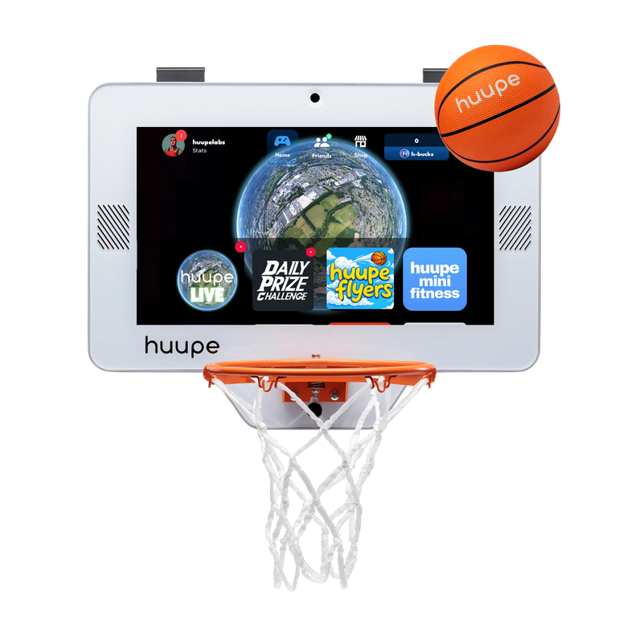
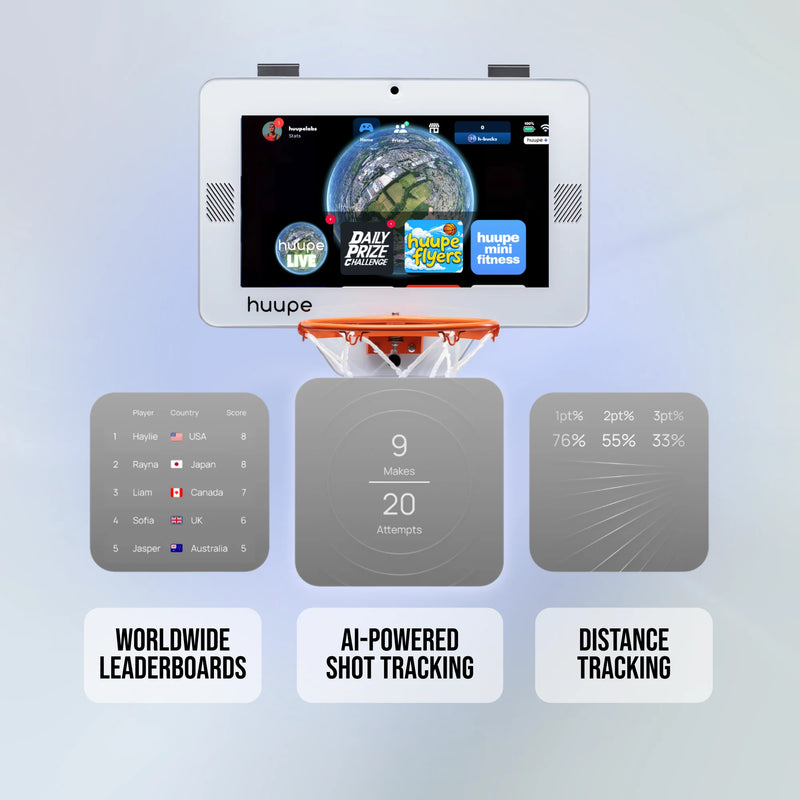
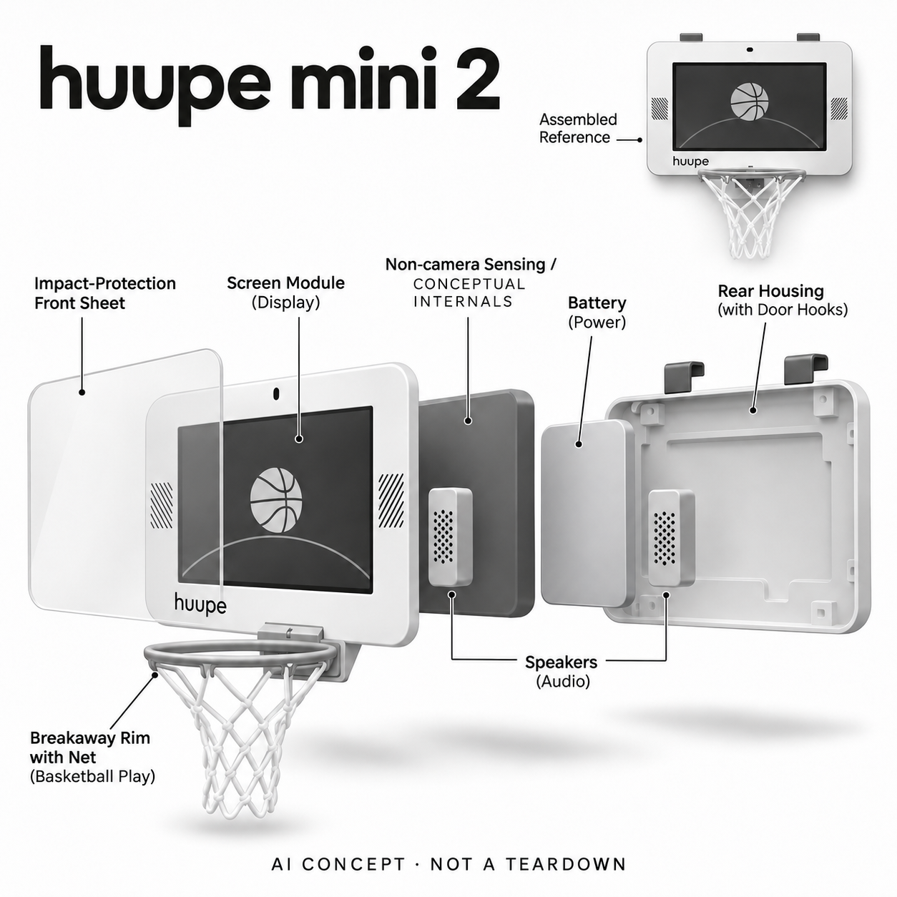

# huupe mini 2

**huupe** · 游戏与桌游 · 核查 2026-11-04

用非摄像感知把室内小篮筐变成投篮游戏终端

消费渠道：个人零售。

## 产品图片与结构参考

### 产品图

huupe mini 2 官方产品图 · 来源：[huupe · 官方资料](<https://huupe.com/products/huupe-mini-2>) · [原始图片](<https://huupe.com/cdn/shop/files/Mini_2_Banner_01_f906dab0-25bb-4b16-8c69-f2dd72509434_800x.webp?v=1793642491>)

### 参考图

huupe mini 2 官方投篮反馈功能示意（非本站实测数据） · 来源：[huupe · 官方资料](<https://huupe.com/products/huupe-mini-2>) · [原始图片](<https://huupe.com/cdn/shop/files/Mini_2_Banner_04_800x.webp?v=1793640643>)

### AI 生成爆炸示意

**AI 生成 · 非实物拆机。** 内部为概念推断，不能作为元件布局、BOM 或维修依据。[生成提示词](../../content/hardware/prompts/huupe-mini-2.txt)

> 以已目视核对的官方图片独立生成，未知内部为功能概念，不代表真实PCB、拆机或已采用供应商。

> 目视QA后定点移除未经厂商确认的触控屏标注。初稿仅作修图溯源参考。

> 保留官方图片原貌；图片中的宣传数字和效果不作为本站实测。

> 分析为基于公开资料的案头研究与 AI 辅助判断，未经用户访谈、销量审计或实物拆机。需求、画像、竞争冷门度、审美及商业机会均为研究假设，不是投资结论。

## 销售与购买

- 状态：在售。核查日官方商店浏览器显示mini 2、US$499及启用的Buy Now；不选择含回弹架的arcade 2套装，也不将mini 1重复计入该需求。

- 地区：美国（本轮核实官方美元店）

- 价格：官方mini 2 US$499促销价（参考US$799）。标准篮筐终端，回弹架另购；免费游戏与huupe+、特定挑战或第三方流媒体费用分开，不承诺所有内容永久免费。

- 中国大陆：本轮未核中国大陆官方店、跨境配送及在线游戏服务。实体门挂安装条件、App账号与内容服务需按目的地确认。

- [官方产品 / 商店](<https://huupe.com/products/huupe-mini-2>)

## AI 的实际作用

厂商明确用非摄像AI感知识别投篮及投篮距离，将实际投球映射为游戏输入。传感器种类和模型结构未披露，不据外观猜摄像头、雷达或激光测距。

服务与联网依赖：依赖特定安装、官方推荐球、供电和本机系统；在线对战与流媒体需网络。屏幕受保护但禁止悬挂在篮圈上，不能把轻扣篮描述扩写成承受人体重量。

## 是否冷门

新兴竞争（研究判断）：实体投篮与游戏屏幕形成新互动方式，但家庭空间、内容更新和长期复玩仍待验证；普通篮筐是强低成本替代。

## 需求与市场

案头需求是让室内投小球从单纯投篮变为有计分、距离与互动反馈的游戏。它与屏幕前身体体感的输入不同；能否长期使用取决于空间、噪声和家人参与，而不是厂家宣传的投篮识别率。

### 事实：任务边界 · 官方资料

huupe mini 2把真实迷你球、篮圈和带屏篮板组成室内游戏终端，厂商明确使用非摄像AI感知投篮及投篮位置。其任务是让投球本身成为游戏输入并反馈分数和距离，不是一般电视体感追踪，也不是把普通视频播放屏简单装在篮筐旁。

依据：[huupe mini 2官方商店](<https://huupe.com/products/huupe-mini-2>) · [huupe官方当前产品目录](<https://huupe.com/>)

### 判断：真实需求 · 研究判断

需求判断要看家庭为何想在室内投球：短时放松、亲友竞争和重复挑战可能是不同动机，不能直接当作严肃篮球训练。电子反馈如果促成更多共同参与可能有价值，但若空间、声音或收球负担让人不愿开始，游戏功能再多也无法解决。

依据：[huupe mini 2官方商店](<https://huupe.com/products/huupe-mini-2>) · [huupe官方当前产品目录](<https://huupe.com/>)

### 验证：任务完成 · 待验证

调研可让家庭从自己选的安装位置开始，完成开机、选玩法、轮流投篮和收拾，记录谁发起、谁中途退出。访谈问最喜欢的是投球、计分还是远程互动，并观察没有奖品或新玩法时是否仍愿意玩，避免只凭第一次兴奋判断持续需求。

依据：[huupe mini 2官方商店](<https://huupe.com/products/huupe-mini-2>) · [huupe官方当前产品目录](<https://huupe.com/>)

## 用户画像

适合有合适门或墙面、足够投篮区域且愿意接受室内小球活动的家庭。租住环境、家具和邻里声音都影响适配；它不是标准球场训练器，不能把游戏表现直接等同真实比赛技能。

### 事实：使用条件 · 官方资料

官网提供门挂安装及另购墙装方式，标准mini 2与含回弹系统的arcade套装分开销售。厂商推荐使用随附迷你球以获得更好识别，明确禁止挂在篮圈上；因此使用条件包括合适固定位置和活动空间，不能把所有住宅都看作相同场地。

依据：[huupe mini 2官方商店](<https://huupe.com/products/huupe-mini-2>) · [huupe官方用户手册入口](<https://huupe.com/pages/user-manuals>)

### 判断：人群筛选 · 研究判断

潜在画像是有可用门墙和投篮区域、愿意容忍室内球声的家庭或同住朋友。喜欢标准篮球比赛的人可能只把它当小游戏，而希望安静娱乐或不能长时间占用门面的用户未必适配；购买者、安装者和实际投球者也可能不是同一个人。

依据：[huupe mini 2官方商店](<https://huupe.com/products/huupe-mini-2>) · [huupe官方用户手册入口](<https://huupe.com/pages/user-manuals>)

### 验证：参与者差异 · 待验证

招募应了解门墙材质、邻里声音限制、房间家具和参与者身高，再让家庭自行决定何时玩和放在哪里。访谈包括谁负责收球、是否影响门的正常使用，以及不玩时愿不愿长期挂着；保留不适配家庭的反馈，避免只选择宽敞展示房。

依据：[huupe mini 2官方商店](<https://huupe.com/products/huupe-mini-2>) · [huupe官方用户手册入口](<https://huupe.com/pages/user-manuals>)

## 竞争与替代

替代包括普通迷你篮筐、简单计数玩具和电视体感游戏。AI感知的差异在实际投篮与位置反馈结合，目录只保留mini 2代表，不将回弹框套装和旧mini型号重复当作创新。

### 事实：方案范围 · 官方资料

替代包括普通迷你篮筐、简单命中计数玩具、电视体感游戏和传统球场活动。mini 2的具体区别是将真实投篮和位置感知映射到带屏游戏反馈，本轮仅收这一代表，不把上一代、回弹架套餐或其它尺寸篮筐重复解释成不同创新场景。

依据：[huupe mini 2官方商店](<https://huupe.com/products/huupe-mini-2>) · [huupe官方当前产品目录](<https://huupe.com/>)

### 判断：替代关系 · 研究判断

与普通篮筐相比，它可能增加独自玩的目标和对局记录，也带来电源、内容系统和维护；与全身体感游戏相比，输入集中在球与篮圈，身体不必完整进入摄像头。真正的选择应围绕家庭想玩的动作和可用空间，而不是屏幕尺寸或游戏数量。

依据：[huupe mini 2官方商店](<https://huupe.com/products/huupe-mini-2>) · [huupe官方当前产品目录](<https://huupe.com/>)

### 验证：比较方法 · 待验证

比较可让家庭在相同时间段分别玩普通迷你篮筐与电子玩法，记录自发持续时间、轮流公平感和设置负担。对已经有电视主机的家庭，再比较他们实际选择哪一种；不能把户外正规球场的训练效果直接拿来证明室内小游戏的价值。

依据：[huupe mini 2官方商店](<https://huupe.com/products/huupe-mini-2>) · [huupe官方当前产品目录](<https://huupe.com/>)

## 供应链

硬件包含受保护显示屏、非摄像感知、控制、电源、扬声器、篮圈和安装件。具体感知器件及制造来源未披露；撞击隔离、安装与识别要一起验证，不能只按一块平板屏估算成本。

### 事实：功能组成 · 官方资料

官方披露屏幕保护层、扬声器、电池与供电、篮圈和门挂结构，并确认识别不使用摄像头；具体传感器类别、主控和代工厂未公开。此条不根据屏幕上方的黑色开口猜测雷达、激光或相机，也不把一个未知器件图画成拆机事实。

依据：[huupe mini 2官方商店](<https://huupe.com/products/huupe-mini-2>) · [huupe官方用户手册入口](<https://huupe.com/pages/user-manuals>)

### 判断：交付约束 · 研究判断

工程判断需要让结构受球撞击时不影响显示和感知，同时保持门挂稳定及游戏反馈及时。屏幕耐冲击、篮圈连接、声学与电池不只是独立物料，冲击振动可能传到多个系统；因此复制一块显示屏加普通篮筐不能证明获得相同交互体验。

依据：[huupe mini 2官方商店](<https://huupe.com/products/huupe-mini-2>) · [huupe官方用户手册入口](<https://huupe.com/pages/user-manuals>)

### 验证：选型缺口 · 待验证

Merry可作为扬声器和声学整合能力候选，Protolabs可作为保护结构与安装件原型候选。它们没有公开采用关系，仍需验证实际冲击、固定、声音与空间要求；未知传感技术应保留缺口，不为了填满供应链栏杜撰一家传感器或算法供应商。

依据：[huupe mini 2官方商店](<https://huupe.com/products/huupe-mini-2>) · [huupe官方用户手册入口](<https://huupe.com/pages/user-manuals>)

## 技术路径

官方确认不用摄像头追踪投篮，但没有披露雷达、红外或模型架构，本条只陈述已知的感知输出。命中、未中和距离反馈应分别测试，不将一个笼统准确率推广到所有球与房间。

### 事实：AI机制 · 官方资料

厂商在当前mini 2页面说明AI感知识别投篮和投篮位置，并反复明确没有摄像头，模型和感知器件类型却没有公开。收录依据是具体的非视觉感知任务，而非宣传准确率；AI输出进入本机玩法，普通流媒体播放和扬声器本身不另算AI能力。

依据：[huupe mini 2官方商店](<https://huupe.com/products/huupe-mini-2>) · [huupe官方当前产品目录](<https://huupe.com/>)

### 判断：系统边界 · 研究判断

命中、未中和距离是不同输出，应分别观察错误情形；球的材质、投掷方向和房间摆放也可能影响结果。没有公开完整测试分布时，不能把一个总体百分比解释为任何球、任何安装方式都可靠，更不能把游戏估计当专业运动测量。

依据：[huupe mini 2官方商店](<https://huupe.com/products/huupe-mini-2>) · [huupe官方当前产品目录](<https://huupe.com/>)

### 验证：算法与体验 · 待验证

验证可以使用官方推荐球完成不同距离的重复投篮，逐次人工记录命中和位置，再测试厂家允许的其它使用条件。还应观察连续多人投球或快速换人时的表现，并让参与者纠正错误；本轮没有这样的对照数据，不报告识别精度或训练收益。

依据：[huupe mini 2官方商店](<https://huupe.com/products/huupe-mini-2>) · [huupe官方当前产品目录](<https://huupe.com/>)

## 产品审美

屏幕作为篮板、侧边扬声器和可见篮圈使其明显区别于普通游戏主机。真正的外观体验还包括门后挂钩、线缆和不玩时占位；概念图不添加未证实的触控屏或摄像模块。

### 事实：外观与交互 · 官方资料

真实外观是白色矩形屏幕篮板、两侧扬声器开孔、上方门挂与下方篮圈网，主体明显是可投球的游戏设备。参考图展示厂商的统计界面示意，不作为本站测试；概念图在目视检查后已删除未经确认的触控能力，只保留显示与非摄像感知。

依据：[huupe mini 2官方商店](<https://huupe.com/products/huupe-mini-2>) · [huupe官方用户手册入口](<https://huupe.com/pages/user-manuals>)

### 判断：使用中的形态 · 研究判断

带屏篮板可能吸引注意，也会成为房间里无法隐藏的大物件。安装在门上时要考虑门的日常开合和观看角度，墙装又改变空间占用；产品的外观接受度与家庭是否愿意为它保留一片投球区域密切相关，不能只看白底正面照。

依据：[huupe mini 2官方商店](<https://huupe.com/products/huupe-mini-2>) · [huupe官方用户手册入口](<https://huupe.com/pages/user-manuals>)

### 验证：日常接受度 · 待验证

可以观察用户自行选位置、整理线缆并在不玩时恢复日常房间的过程，记录是否需要搬动家具或把门保持特定状态。访谈问屏幕和灯光会不会打扰别人、篮圈是否妨碍通行，以及是否愿意在来客时展示，评价应回到家庭实际空间。

依据：[huupe mini 2官方商店](<https://huupe.com/products/huupe-mini-2>) · [huupe官方用户手册入口](<https://huupe.com/pages/user-manuals>)

## 关键风险

风险包括不合适安装、投球碰到家具、错误识别以及游戏服务收费变化。官方允许轻扣但禁止挂圈，不能由带屏保护层推断任意强度都安全；推荐球之外的识别表现仍需确认。

### 事实：已知限制 · 官方资料

官方允许轻度扣篮但明确禁止挂圈，推荐随附球用于识别；免费游戏与huupe+、特定挑战和第三方流媒体费用也需分开。当前两代及arcade包装在网站上同时出现，所以本条依据mini 2实际购买界面，未将所有套装功能算作标准机标配。

依据：[huupe mini 2官方商店](<https://huupe.com/products/huupe-mini-2>) · [huupe官方当前产品目录](<https://huupe.com/>)

### 判断：失效影响 · 研究判断

风险主要来自不合适固定、投球与家具或旁人发生干扰，以及玩家过度信任自动计分。长久内容和地区服务也可能影响复玩，尤其跨境买到硬件不代表在线对战都可用；本轮没有故障、退货或长期用户记录，不能据宣传中的耐用描述消除疑问。

依据：[huupe mini 2官方商店](<https://huupe.com/products/huupe-mini-2>) · [huupe官方当前产品目录](<https://huupe.com/>)

### 验证：风险处理 · 待验证

试用应先确认厂家允许的安装和动作条件，观察挂件、正常开门与收球过程是否容易理解，再记录识别错误后的处理。购买前核对目标地区网络内容和收费范围；若家庭只是偶尔玩，不应假设更复杂的电子玩法必然比普通篮筐更合适。

依据：[huupe mini 2官方商店](<https://huupe.com/products/huupe-mini-2>) · [huupe官方当前产品目录](<https://huupe.com/>)

## 机会与验证

可验证机会是家庭短时共同娱乐。记录首次安装、选游戏、漏计与争议修正，以及两周内谁主动发起投篮；再问为何某天没玩，用实际复用而不是销量宣传判断需求。

### 判断：可尝试切口 · 研究判断

可尝试的切口是把室内短时投篮变成容易共同开始、容易轮换和能清楚理解分数的家庭活动。若主要摩擦来自收球或门面占用，改进收纳与安装可能比再增加屏幕应用更有价值；这一机会需要真实家庭使用日志，而不是依据厂家投篮宣传判断。

依据：[huupe mini 2官方商店](<https://huupe.com/products/huupe-mini-2>) · [huupe官方当前产品目录](<https://huupe.com/>)

### 判断：商业边界 · 研究判断

商业边界在于日常娱乐时间有限，孩子和成人的内容偏好、噪声容忍和参与时段可能不同。订阅需要持续提供被实际选择的玩法，硬件屏幕也可能闲置，本轮没有续费或活跃用户数据，不能把厂商销量或明星演示当作长期留存证据。

依据：[huupe mini 2官方商店](<https://huupe.com/products/huupe-mini-2>) · [huupe官方当前产品目录](<https://huupe.com/>)

### 验证：下一步调研 · 待验证

下一步可做三周家庭借用，记录每次谁提议、玩了什么、多少人参与、为何结束及有没有争议分数，再访谈未使用的日子。把免费基础游戏与额外服务的价值分别测试，不用模型创新评分预测成功，也不把小游戏分数提高等同正规篮球能力提升。

依据：[huupe mini 2官方商店](<https://huupe.com/products/huupe-mini-2>) · [huupe官方当前产品目录](<https://huupe.com/>)

## 对应供应链公司

能力候选用于选型研究，不代表本产品实际采用；未公开的供货关系不作推断。

- [merry-electronics](../supply-chain/merry-electronics.md) — **能力候选 · 非已采用** / 篮板游戏音频整合候选：mini 2公开包含扬声器并承受投球环境，Merry具备扬声器、声学仿真及结构协同能力，可作为声音模块候选。还需验证冲击振动、响度、安装空间和室内噪声体验，没有品牌点名供货证据，不把其声学能力扩写为AI投篮识别。

- [protolabs](../supply-chain/protolabs.md) — **能力候选 · 非已采用** / 屏幕防护与门挂结构原型候选：带屏篮板需要保护、篮圈连接和门挂结构共同承受重复动作，Protolabs公开注塑、机加工和样件能力，可作为结构验证候选。具体冲击、疲劳与安装安全须独立测试，制造服务不等于已通过本产品要求或被huupe实际采用。

[浏览供应链目录](../supply-chain.md)

## 功能分层示意

这是功能关系，不是实物拆机、真实空间结构或已核实 BOM。

1. **实体输入**：篮圈、篮板和迷你球构成真实投篮交互。（官方披露）

2. **非摄像AI感知**：识别投篮与位置，具体传感类型及内部布局未披露。（官方披露）

3. **显示与音频**：受保护屏幕和扬声器提供本机游戏反馈。（官方披露）

4. **供电与联网**：电池、USB-C供电、无线连接配合游戏与服务。（官方披露）

5. **安装结构**：门挂或另购墙装件固定设备，回弹架不是标准mini 2标配。（官方披露）

## 来源

1. [huupe mini 2官方商店](<https://huupe.com/products/huupe-mini-2>) — 实际web和浏览器打开；499美元、启用购买、无摄像AI投篮、安装、推荐球及挂圈限制。

2. [huupe官方当前产品目录](<https://huupe.com/>) — 实际打开；当前mini 2与ARENA、arcade分别销售，不跨型号拼功能。

3. [huupe官方用户手册入口](<https://huupe.com/pages/user-manuals>) — 实际打开；型号选择式安装与手册入口，不把未展开资料当成已验证内部传感器。

[返回目录](../hardware-market.md) · [网页分析](https://romanagent.github.io/Roman/#hardware/product/huupe-mini-2)
