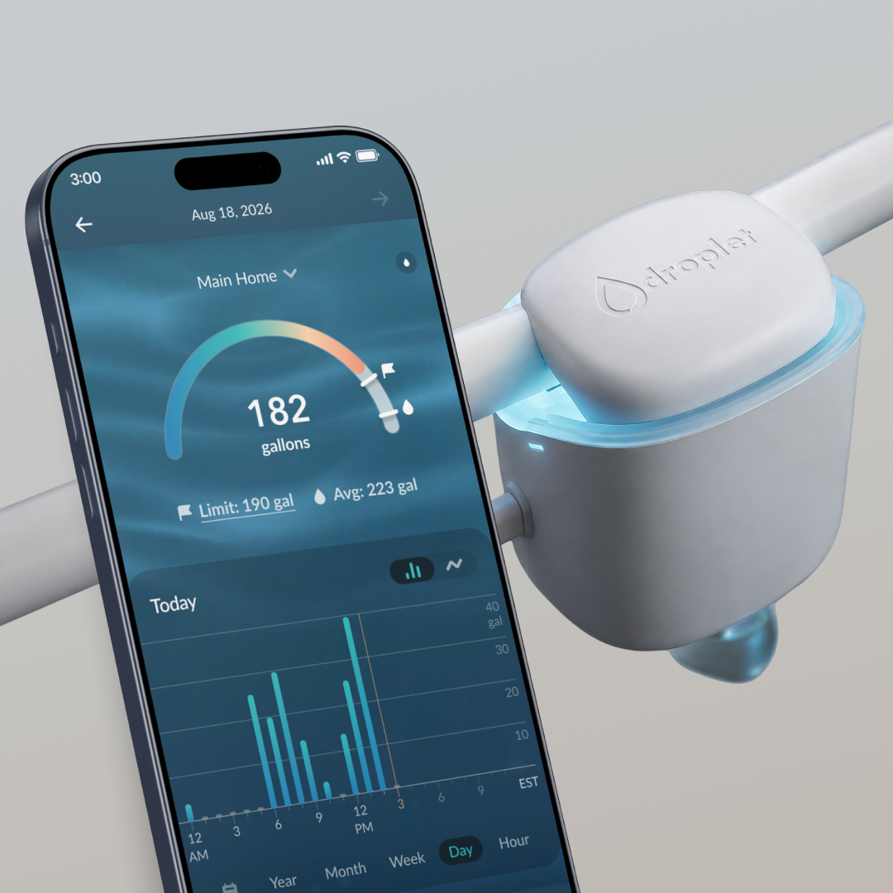
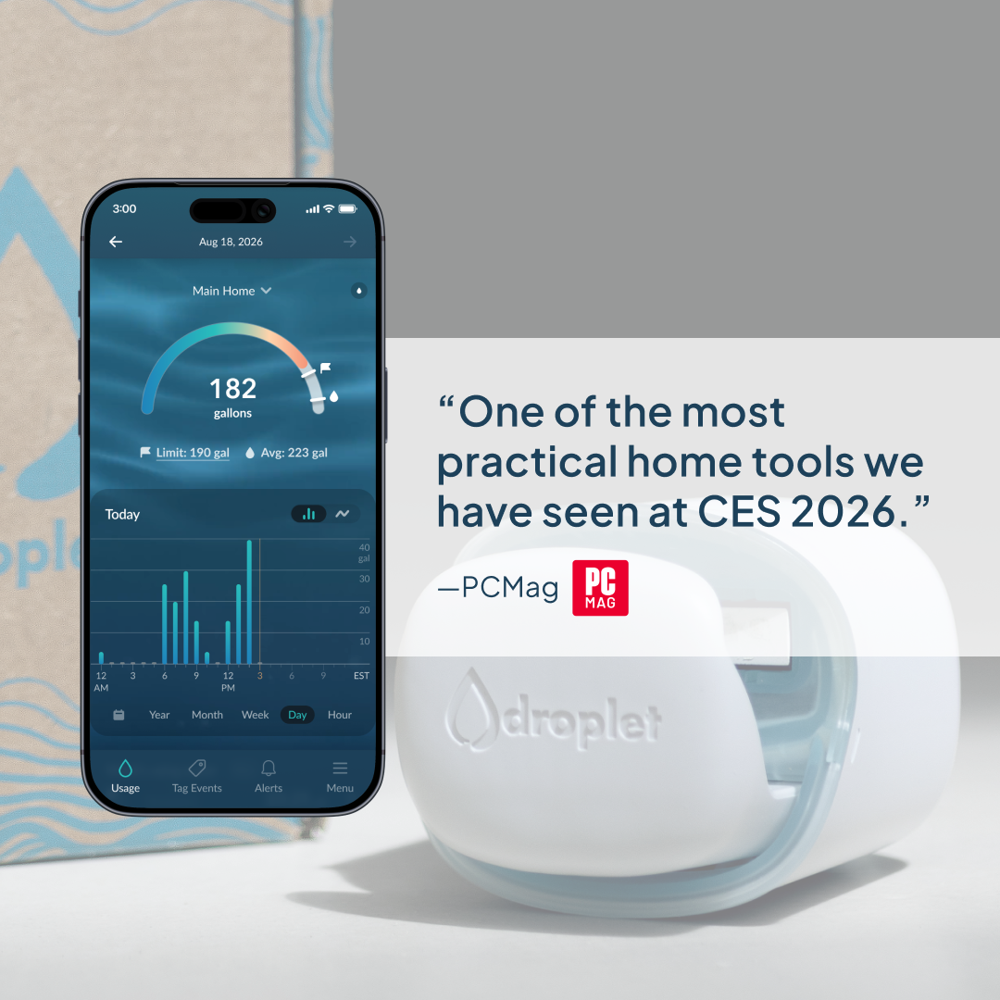
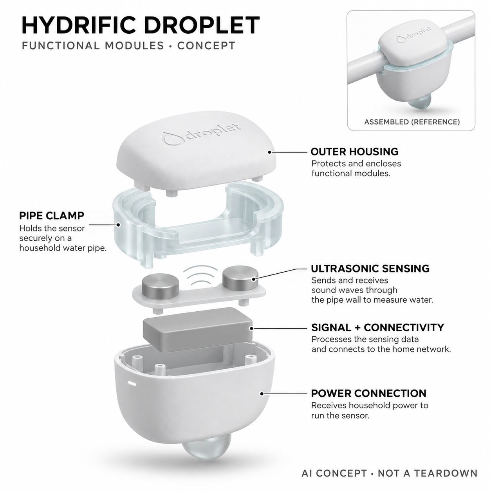

# Hydrific Droplet Smart Water Monitor

**Hydrific / LIXIL** · 家居安全 · 核查 2026-11-04

夹在总水管上识别家庭用水事件

消费渠道：个人零售。

## 产品图片与结构参考

### 产品图

官方夹装设备与应用展示 · 来源：[Hydrific / LIXIL · 官方图片](<https://hydrificwater.com/products/droplet>) · [原始图片](<https://cdn.shopify.com/s/files/1/0627/1015/3260/files/Carousel_2-new.png?v=1791063192>)

### 参考图

官方设备夹具视角（含原厂媒体引述） · 来源：[Hydrific / LIXIL · 官方图片](<https://hydrificwater.com/products/droplet>) · [原始图片](<https://cdn.shopify.com/s/files/1/0627/1015/3260/files/Carousel_8-new.png?v=1791064384>)

### AI 生成爆炸示意

**AI 生成 · 非实物拆机。** 内部为概念推断，不能作为元件布局、BOM 或维修依据。[生成提示词](../../content/hardware/prompts/hydrific-droplet.txt)

> 依据已核验官方外形与公开功能生成；未知内部仅为概念功能块，不代表原机电路板、芯片或实际布局。

> 原图按官方文件保存，未改色或语义编辑；图片中的营销文字不视为本研究独立验证。

> 分析为基于公开资料的案头研究与 AI 辅助判断，未经用户访谈、销量审计或实物拆机。需求、画像、竞争冷门度、审美及商业机会均为研究假设，不是投资结论。

## 销售与购买

- 状态：在售。官方商品页可加购，列美国发货与加拿大配送；双超声和机器学习来源明确，不是单纯浸水报警器。

- 地区：美国、加拿大（魁北克除外）

- 价格：US$229（页面主报价）。同页局部仍有US$219文案，报价以实际订单为准；官网称无需订阅，不含任何未核安装费用。

- 中国大陆：已核官网只列美国和加拿大配送，未确认大陆官方购买及管材适配；不把海外可购等同国内可直接安装。

- [官方产品 / 商店](<https://hydrificwater.com/products/droplet>)

## AI 的实际作用

双超声采集总管流量，AI与机器学习从用水模式区分淋浴、水龙头、马桶等事件，并提示持续流量或可能泄漏；不是直接看到每个用水器具。

服务与联网依赖：需适配管材尺寸、分支前总管位置、电源及Wi-Fi；分类是推断，完整器具明细范围按当前支持，不声称能自动关水。

## 是否冷门

细分专业（研究判断）：总管夹装加事件分解比普通漏水开关更专门，但需满足住宅管路条件，市场应按可安装家庭评估。

## 需求与市场

需求假设：房主希望知道水用在哪里并及时发现持续异常，而不愿切管或每处安装传感器。应比较可行动提醒、误分类与安装劳动，不能把高采样或机器学习标签直接当作节水和避免全部漏水损失的保证。

### 产品任务与边界 · 研究判断

需求假设：房主希望知道水用在哪里并及时发现持续异常，而不愿切管或每处安装传感器。应比较可行动提醒、误分类与安装劳动，不能把高采样或机器学习标签直接当作节水和避免全部漏水损失的保证。

依据：[Droplet官方商品与配送](<https://hydrificwater.com/products/droplet>) · [Droplet官方超声与机器学习说明](<https://help.hydrificwater.com/en/articles/11461682-how-does-droplet-work>)

### 需求判断 · 研究判断

夹装降低切管施工，但前提是存在可触达且适配的总管，住宅结构会显著影响可用性。识别用水模式与自动阻止漏水也不是同一任务，若用户最需要自动关阀，应比较完整处置方案，而不是只被低安装负担吸引。

依据：[Droplet官方商品与配送](<https://hydrificwater.com/products/droplet>) · [Droplet官方超声与机器学习说明](<https://help.hydrificwater.com/en/articles/11461682-how-does-droplet-work>)

### 需求验证 · 待验证

可在真实住宅记录安装、事件分类、提醒和后续行动，比较普通流量记录或浸水报警。保留并发用水及人工标注，确认设备是否帮助更快理解异常，不能从高采样频率或无订阅直接推断一定节水和避免损失。

依据：[Droplet官方商品与配送](<https://hydrificwater.com/products/droplet>) · [Droplet官方超声与机器学习说明](<https://help.hydrificwater.com/en/articles/11461682-how-does-droplet-work>)

## 用户画像

画像推断：能接触分支前总管、现场有电源网络且管材尺寸适配的家庭更合适。公寓共用总管或隐蔽管路不一定能安装，购买者也需理解分类推断，不能用所有有自来水的家庭数量估算可达市场。

### 适用行为与条件 · 研究判断

画像推断：能接触分支前总管、现场有电源网络且管材尺寸适配的家庭更合适。公寓共用总管或隐蔽管路不一定能安装，购买者也需理解分类推断，不能用所有有自来水的家庭数量估算可达市场。

依据：[Droplet官方商品与配送](<https://hydrificwater.com/products/droplet>) · [Droplet官方超声与机器学习说明](<https://help.hydrificwater.com/en/articles/11461682-how-does-droplet-work>)

### 人群取舍 · 研究判断

分支前管路的位置、电源及无线条件会决定是否能安装，多户住宅和共用水路可能不适用。实际使用者也需愿意核对异常和修正理解，画像应按可安装与可行动条件划分，不能把所有房主或账单较高的人都当作目标。

依据：[Droplet官方商品与配送](<https://hydrificwater.com/products/droplet>) · [Droplet官方超声与机器学习说明](<https://help.hydrificwater.com/en/articles/11461682-how-does-droplet-work>)

### 画像验证 · 待验证

画像验证应从现场管材和位置筛查开始，记录安装成功及失败原因，再观察用户如何处理一条可疑持续流量。区分只想看账单趋势、想定位器具和需要自动处置的人，避免将这些不同需求合并为一个漏水市场。

依据：[Droplet官方商品与配送](<https://hydrificwater.com/products/droplet>) · [Droplet官方超声与机器学习说明](<https://help.hydrificwater.com/en/articles/11461682-how-does-droplet-work>)

## 竞争与替代

竞争判断：与普通水表、浸水报警器、切管式流量及自动关水系统竞争。非侵入夹装降低施工是差异，但没有关水执行不能混同防损闭环；用户需按观察、定位和自动处置的真实任务比较。

### 比较对象与差异 · 研究判断

竞争判断：与普通水表、浸水报警器、切管式流量及自动关水系统竞争。非侵入夹装降低施工是差异，但没有关水执行不能混同防损闭环；用户需按观察、定位和自动处置的真实任务比较。

依据：[Droplet官方商品与配送](<https://hydrificwater.com/products/droplet>) · [Droplet官方超声与机器学习说明](<https://help.hydrificwater.com/en/articles/11461682-how-does-droplet-work>)

### 竞争判断 · 研究判断

单点分解与多个浸水开关提供的信息不同，前者观察总管模式，后者在具体位置感知水。没有关水执行是明确边界，竞争分析应覆盖安装、误报和响应流程，不能将产品与带阀系统仅按价格或AI名称直接排序。

依据：[Droplet官方商品与配送](<https://hydrificwater.com/products/droplet>) · [Droplet官方超声与机器学习说明](<https://help.hydrificwater.com/en/articles/11461682-how-does-droplet-work>)

### 竞争验证 · 待验证

可比较同一住宅的用水账单、普通传感与Droplet事件，记录确认异常所需步骤和无法解释的情境。对不同器具并发要单独测试，不把单一淋浴识别成功外推为全屋每处独立精确计量，也不将提醒存在等同处置完成。

依据：[Droplet官方商品与配送](<https://hydrificwater.com/products/droplet>) · [Droplet官方超声与机器学习说明](<https://help.hydrificwater.com/en/articles/11461682-how-does-droplet-work>)

## 供应链

供应链分析：超声换能、管路耦合夹具、计算电源和无线共同工作，实际芯片与工厂未披露。不同管材、安装压力、温漂和湿环境影响输入质量，夹装稳定与售后适配比单个流量参数更决定长期体验。

### 功能模块拆分 · 研究判断

功能层包括总管夹具与耦合、双超声采集、信号与事件推断、电源无线、应用趋势和通知。设备从外部测量而不切入管道，本体没有自动关水阀，公开资料也未提供具体换能器、芯片和内部布局清单。

依据：[Droplet官方商品与配送](<https://hydrificwater.com/products/droplet>) · [Droplet官方超声与机器学习说明](<https://help.hydrificwater.com/en/articles/11461682-how-does-droplet-work>)

### 制造与供应约束 · 研究判断

供应链分析：超声换能、管路耦合夹具、计算电源和无线共同工作，实际芯片与工厂未披露。不同管材、安装压力、温漂和湿环境影响输入质量，夹装稳定与售后适配比单个流量参数更决定长期体验。

依据：[Droplet官方商品与配送](<https://hydrificwater.com/products/droplet>) · [Droplet官方超声与机器学习说明](<https://help.hydrificwater.com/en/articles/11461682-how-does-droplet-work>)

### 候选与证据缺口 · 研究判断

USI可作为无线与电子整合候选，RapidDirect可支持夹具和不同管路适配原型。没有Droplet点名供货证据，超声耦合、管材和并发分类需专项验证，通用电子或机械能力不能保证全屋计量准确及漏水识别效果。

依据：[Droplet官方商品与配送](<https://hydrificwater.com/products/droplet>) · [Droplet官方超声与机器学习说明](<https://help.hydrificwater.com/en/articles/11461682-how-does-droplet-work>)

## 技术路径

技术判断：官方明确用超声和AI学习水流模式，当前详细分项主要为淋浴、水龙头和马桶。并发用水及不同器具可能混淆，记录需要允许人工复核，不能把总流量估计直接当作每个器具都有独立准确计量。

### 已披露技术边界 · 研究判断

技术判断：官方明确用超声和AI学习水流模式，当前详细分项主要为淋浴、水龙头和马桶。并发用水及不同器具可能混淆，记录需要允许人工复核，不能把总流量估计直接当作每个器具都有独立准确计量。

依据：[Droplet官方商品与配送](<https://hydrificwater.com/products/droplet>) · [Droplet官方超声与机器学习说明](<https://help.hydrificwater.com/en/articles/11461682-how-does-droplet-work>)

### 系统难点判断 · 研究判断

总流量变化包含器具叠加、压力和使用习惯，模型区分事件需要处理模糊和并发。官方当前明确的细分类别有限，系统应让用户知道其他流量仍可能只计入总量，不能把全屋覆盖宣传理解为每台设备都被单独识别。

依据：[Droplet官方商品与配送](<https://hydrificwater.com/products/droplet>) · [Droplet官方超声与机器学习说明](<https://help.hydrificwater.com/en/articles/11461682-how-does-droplet-work>)

### 技术验证 · 待验证

验证应以人工记录或合适参考计量对照单独与并发用水，分别检查总量、分类和持续异常提示。管材与安装状态需固定记录，不以一次正确标签或高频采样当作普遍准确，也不由无告警推断所有隐蔽泄漏已排除。

依据：[Droplet官方商品与配送](<https://hydrificwater.com/products/droplet>) · [Droplet官方超声与机器学习说明](<https://help.hydrificwater.com/en/articles/11461682-how-does-droplet-work>)

## 产品审美

审美判断：设备位于总管附近，清楚状态、夹具牢固和线材整理比装饰性外观更重要。安装空间和可触达性影响维护，产品图的裸露管道不能代表所有住宅，也不应为了隐藏设备牺牲正确安装条件。

### 外观与交互语言 · 研究判断

审美判断：设备位于总管附近，清楚状态、夹具牢固和线材整理比装饰性外观更重要。安装空间和可触达性影响维护，产品图的裸露管道不能代表所有住宅，也不应为了隐藏设备牺牲正确安装条件。

依据：[Droplet官方商品与配送](<https://hydrificwater.com/products/droplet>) · [Droplet官方超声与机器学习说明](<https://help.hydrificwater.com/en/articles/11461682-how-does-droplet-work>)

### 使用中审美判断 · 研究判断

总管附近通常不是展示空间，状态可见、夹具稳定和维护可达比装饰更重要。电源线和周边管件需要保持清楚，产品图中裸露直管不能代表所有住宅，设计应帮助用户判断安装适配而不是只让设备看起来小巧。

依据：[Droplet官方商品与配送](<https://hydrificwater.com/products/droplet>) · [Droplet官方超声与机器学习说明](<https://help.hydrificwater.com/en/articles/11461682-how-does-droplet-work>)

### 设计验证 · 待验证

设计验证应观察用户安装、查看状态和重新夹装，记录狭窄空间、线材和定位是否造成困难。还需检查维护后读数是否需要重新确认，不从商品图的整洁推断普通家庭都能在短时间内完成可靠安装。

依据：[Droplet官方商品与配送](<https://hydrificwater.com/products/droplet>) · [Droplet官方超声与机器学习说明](<https://help.hydrificwater.com/en/articles/11461682-how-does-droplet-work>)

## 关键风险

风险判断：误报、漏报、网络与供电会影响提醒，设备不自动关水也不能替代现场排查。国内管材和服务尚未核实，海外转运不能保证适配；用户需要理解无异常提示不等于已排除所有泄漏。

### 主要失效与依赖 · 研究判断

风险判断：误报、漏报、网络与供电会影响提醒，设备不自动关水也不能替代现场排查。国内管材和服务尚未核实，海外转运不能保证适配；用户需要理解无异常提示不等于已排除所有泄漏。

依据：[Droplet官方商品与配送](<https://hydrificwater.com/products/droplet>) · [Droplet官方超声与机器学习说明](<https://help.hydrificwater.com/en/articles/11461682-how-does-droplet-work>)

### 风险传播判断 · 研究判断

异常提醒如果不易解释，可能造成反复排查或被关闭；没有提醒也可能来自网络与供电问题。设备应区分正常、未知和离线，不能让用户以为水管持续被可靠看护，跨境管材和服务更需单独验证。

依据：[Droplet官方商品与配送](<https://hydrificwater.com/products/droplet>) · [Droplet官方超声与机器学习说明](<https://help.hydrificwater.com/en/articles/11461682-how-does-droplet-work>)

### 风险验证 · 待验证

风险验证应演练断网、断电、重新夹装和并发事件，检查通知与数据缺口是否清楚。核对当前配送和支持，不将海外可购买或宣传兼容比例外推到大陆所有管材，也不把机器学习推断当作现场维修结论。

依据：[Droplet官方商品与配送](<https://hydrificwater.com/products/droplet>) · [Droplet官方超声与机器学习说明](<https://help.hydrificwater.com/en/articles/11461682-how-does-droplet-work>)

## 机会与验证

机会假设：围绕安装筛查和可解释用水事件验证价值，记录用户收到提醒后的实际行动。若主要问题是隐蔽安装或误分类，适配服务和清楚置信信息可能比增加更多器具标签更有用，应先量化真实减负。

### 可能的机会入口 · 研究判断

机会假设：围绕安装筛查和可解释用水事件验证价值，记录用户收到提醒后的实际行动。若主要问题是隐蔽安装或误分类，适配服务和清楚置信信息可能比增加更多器具标签更有用，应先量化真实减负。

依据：[Droplet官方商品与配送](<https://hydrificwater.com/products/droplet>) · [Droplet官方超声与机器学习说明](<https://help.hydrificwater.com/en/articles/11461682-how-does-droplet-work>)

### 机会成立条件 · 研究判断

机会在于可安装筛查、可解释用水分类和提醒后的行动指导，不必一开始增加更多器具标签。若用户难以找到适配总管，安装服务比模型扩展更重要；若需要自动关阀，应另做明确系统，不能在观察设备上暗示执行能力。

依据：[Droplet官方商品与配送](<https://hydrificwater.com/products/droplet>) · [Droplet官方超声与机器学习说明](<https://help.hydrificwater.com/en/articles/11461682-how-does-droplet-work>)

### 下一步验证 · 待验证

下一步可建立不同住宅的安装与事件日志，比较分类、提醒和实际修复行动，再测试更清楚的不确定提示。用真实可行动信息和维护成本决定产品方向，避免从无切管、AI和高采样的组合直接预测广泛市场。

依据：[Droplet官方商品与配送](<https://hydrificwater.com/products/droplet>) · [Droplet官方超声与机器学习说明](<https://help.hydrificwater.com/en/articles/11461682-how-does-droplet-work>)

## 对应供应链公司

能力候选用于选型研究，不代表本产品实际采用；未公开的供货关系不作推断。

- [usi](../supply-chain/usi.md) — **能力候选 · 非已采用** / 超声用水终端的无线与控制电子整合：USI公开无线和系统级电子能力可支持数据采集后的控制、连接及终端整合，但超声耦合和事件算法需专项验证；没有Droplet点名供货证据，候选不能推定实际模组或计量准确度。

- [rapiddirect](../supply-chain/rapiddirect.md) — **能力候选 · 非已采用** / 总管夹具与设备外壳适配原型：RapidDirect机械原型及模塑服务可用于比较不同管材夹装、壳体和维护接口，但耦合压力与长期环境需测试；未见Droplet合作披露，候选不代表实际夹具设计或全部住宅适配。

[浏览供应链目录](../supply-chain.md)

## 功能分层示意

这是功能关系，不是实物拆机、真实空间结构或已核实 BOM。

1. **管路耦合**：夹具将设备固定到支持的总水管。（官方披露）

2. **超声流量**：双超声信号读取管内水流变化。（官方披露）

3. **事件判断**：机器学习分析模式并归类部分器具用水。（官方披露）

4. **电源网络**：插电与Wi-Fi连接应用和通知。（官方披露）

5. **家庭记录**：显示总量、趋势和异常；本设备不包含自动关水阀。（官方披露）

## 来源

1. [Droplet官方商品与配送](<https://hydrificwater.com/products/droplet>) — 实际打开，购买按钮、发货、管材条件及无订阅说明明确，页面局部价格不一致已标注。

2. [Droplet官方超声与机器学习说明](<https://help.hydrificwater.com/en/articles/11461682-how-does-droplet-work>) — 已打开，明确超声、AI水事件及当前器具分项范围，不作为独立漏检测试。

[返回目录](../hardware-market.md) · [网页分析](https://romanagent.github.io/Roman/#hardware/product/hydrific-droplet)
