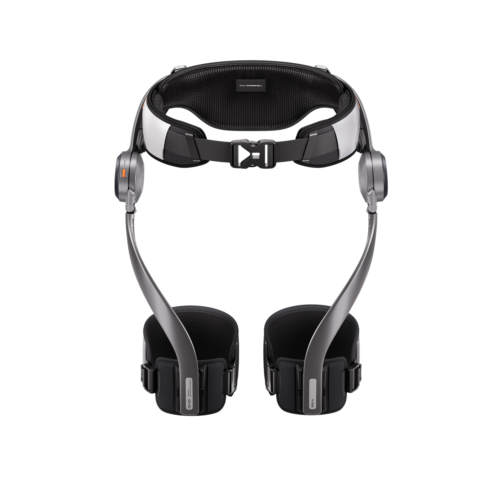
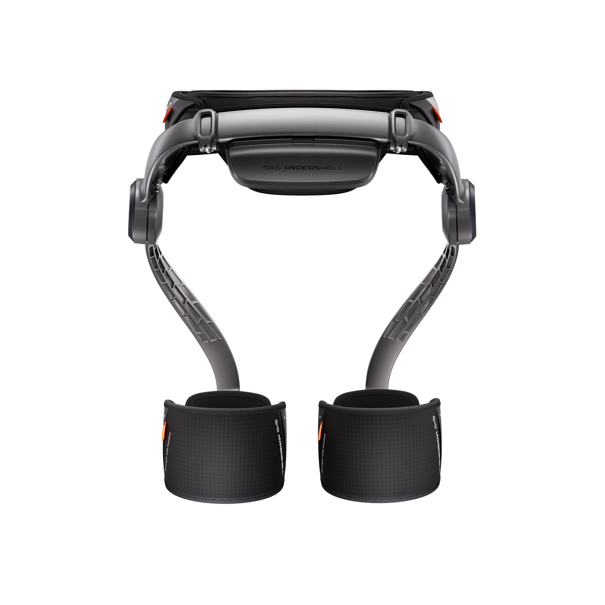
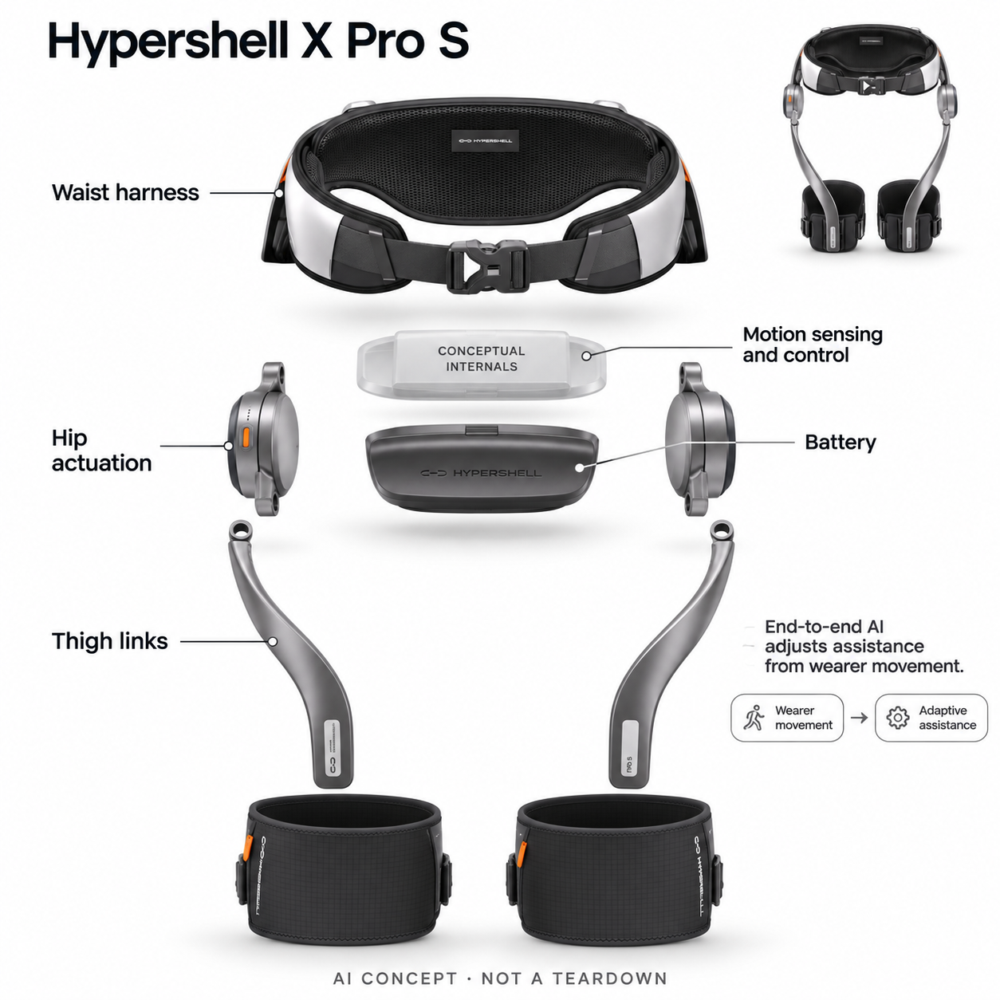

# Hypershell X Pro S

**Hypershell 极壳** · 个人移动与助力 · 核查 2026-11-04

根据连续步态调整髋部助力的消费外骨骼

消费渠道：个人零售。

## 产品图片与结构参考

### 产品图

Hypershell X Pro S 官方产品图 · 来源：[Hypershell 极壳 · 官方资料](<https://hypershell.tech/products/new-hypershell-x-series?variant=47628563939564>) · [原始图片](<https://cdn.shopify.com/s/files/1/0746/6326/4492/files/Pro_3_a21c5052-0ac4-4388-a0aa-8b73e849bdaf.png?v=1779875820&width=1600>)

### 参考图

Hypershell X Pro S 官方外观与使用参考图 · 来源：[Hypershell 极壳 · 官方资料](<https://hypershell.tech/products/new-hypershell-x-series?variant=47628563939564>) · [原始图片](<https://cdn.shopify.com/s/files/1/0746/6326/4492/files/Pro_4_257d993f-8ff1-494c-933f-a484b6c0fc9e.png?v=1779875836&width=1600>)

### AI 生成爆炸示意

**AI 生成 · 非实物拆机。** 内部为概念推断，不能作为元件布局、BOM 或维修依据。[生成提示词](../../content/hardware/prompts/hypershell-x-pro-s.txt)

> 以官方外观图为参照，已目视核对型号、外形、未提供参数与非拆机标记；内部位置仅为功能概念。

> 图片保留官方原貌；其中的宣传数字和效果不作为本站实测结论。

> 分析为基于公开资料的案头研究与 AI 辅助判断，未经用户访谈、销量审计或实物拆机。需求、画像、竞争冷门度、审美及商业机会均为研究假设，不是投资结论。

## 销售与购买

- 状态：在售。核查日全球官网X Pro S变体显示US$999、Add to Cart、现货发出；公开商品数据该变体available=true。中国官网对应X Pro S显示¥6,999及官方商城、京东自营入口。仅收这一髋部系列代表。

- 地区：中国大陆、美国等全球站支持地区（按地址确认）

- 价格：中国官网¥6,999；全球站US$999。核查日X Pro S选定变体价格；税费、地区运费及后续促销另计，不使用Ultra/Max价格。

- 中国大陆：中国官网X Pro S有官方商城及极壳京东自营入口；价格和售后按国内版本核对。

- [官方产品 / 商店](<https://hypershell.tech/products/new-hypershell-x-series?variant=47628563939564>)

## AI 的实际作用

HyperIntuition端到端运动控制读取连续动作、姿态与节奏，直接调整助力输出；不是只按固定运动标签切换预设规则。

服务与联网依赖：依赖可穿戴驱动、运动感知和电池形成闭环；具体芯片及模型结构未披露。使用者须能独立行走和保持平衡，非医疗康复设备。

## 是否冷门

新兴竞争（研究判断）：消费外骨骼已有多个品牌进入，实际穿戴和售后仍是重要门槛；不能由关注度低推断蓝海。

## 需求与市场

案头判断：核心需求是在徒步、旅行和步行通勤中降低使用者主动抬腿的负担。动力输出必须与个人节奏同步；是否值得多穿一件有重量的装置，应通过同路线试穿和长时舒适度验证。

### 事实：任务边界 · 官方资料

全球和中国商品页都把这款装置放在日常步行、徒步与旅行的消费用途内，动力作用于腰髋和大腿之间。官方同时要求使用者原本就能够独立行走并保持平衡，因此其核心任务是跟随主动迈步提供辅助，不能改写为让行动失能者恢复行走。

依据：[Hypershell X Pro S全球商品页](<https://hypershell.tech/products/new-hypershell-x-series?variant=47628563939564>) · [Hypershell X Pro S中国商品页](<https://hypershell.cn/products/new-hypershell-x-series?variant=48991306121443>)

### 判断：真实需求 · 研究判断

需求判断应从具体路线开始：一个经常背包爬坡的人，可能愿意接受额外穿戴；一个只偶尔走短距离的人，则未必愿意处理腰带、绑腿和充电。真正待验证的是完成原有行程时是否更愿意出门，而不是第一次试穿时感到动力明显。

依据：[Hypershell X Pro S全球商品页](<https://hypershell.tech/products/new-hypershell-x-series?variant=47628563939564>) · [Hypershell X Pro S中国商品页](<https://hypershell.cn/products/new-hypershell-x-series?variant=48991306121443>)

### 验证：任务完成 · 待验证

调研可安排相同参与者在熟悉、安全且可随时退出的步道上分次使用与不使用设备，记录穿戴准备时间、停步调整次数和结束后的携带意愿。询问最想在哪一段打开助力、哪一段希望拿掉装置，并保留不喜欢它的具体原因。

依据：[Hypershell X Pro S全球商品页](<https://hypershell.tech/products/new-hypershell-x-series?variant=47628563939564>) · [Hypershell X Pro S中国商品页](<https://hypershell.cn/products/new-hypershell-x-series?variant=48991306121443>)

## 用户画像

更适合能独立行走、已有稳定户外习惯且愿意携带充电设备的人。不是为需要医疗康复或不能保持平衡的人设计；腰围、大腿接触、背包腰带冲突比泛化的年龄标签更影响适配。

### 事实：使用条件 · 官方资料

产品有腰部固定和大腿接触结构，官方提供尺寸适配指引与试穿入口；它与人体的关系不只是佩戴一个传感器，而是要通过软接触部位传递驱动力。年龄不能替代适配条件，独立行走、平衡能力和身体尺寸才是明确的使用前提。

依据：[Hypershell X Pro S全球商品页](<https://hypershell.tech/products/new-hypershell-x-series?variant=47628563939564>) · [Hypershell X Pro S中国商品页](<https://hypershell.cn/products/new-hypershell-x-series?variant=48991306121443>)

### 判断：人群筛选 · 研究判断

画像应进一步区分旅行摄影者、固定路线徒步者和日常通勤者：前者可能同时背器材，后者频繁坐下或搭交通工具，面对的冲突并不相同。以上是案头分群假设，本轮没有访谈证据，也不能由国内有官方店推断这些人已愿意付费。

依据：[Hypershell X Pro S全球商品页](<https://hypershell.tech/products/new-hypershell-x-series?variant=47628563939564>) · [Hypershell X Pro S中国商品页](<https://hypershell.cn/products/new-hypershell-x-series?variant=48991306121443>)

### 验证：参与者差异 · 待验证

招募时可分别邀请有背包腰带、不同裤装和不同步幅习惯的参与者，让他们独立穿戴、调整、坐下再站起。访谈应问哪处接触最先分散注意力、是否愿意在朋友面前穿戴，以及旅行打包时会优先留下它还是其他常用装备。

依据：[Hypershell X Pro S全球商品页](<https://hypershell.tech/products/new-hypershell-x-series?variant=47628563939564>) · [Hypershell X Pro S中国商品页](<https://hypershell.cn/products/new-hypershell-x-series?variant=48991306121443>)

## 竞争与替代

竞争包括其他髋部外骨骼，也包括登山杖、减轻背包和调整路线等低成本方案。本目录不把同系列不同功率或材料型号重复当成创新，重点比较连续助力是否比额外负重更有用。

### 事实：方案范围 · 官方资料

本轮仅将现售的X Pro S作为该品牌髋部助力代表，没有把Max S、Ultra S或旧Carbon X再计为独立需求。型号功率、材料和电池配置可影响选购，但它们仍围绕同一种腰髋传力路径，不能据此把目录场景数量成倍扩大。

依据：[Hypershell X Pro S全球商品页](<https://hypershell.tech/products/new-hypershell-x-series?variant=47628563939564>) · [Hypershell X Pro S中国商品页](<https://hypershell.cn/products/new-hypershell-x-series?variant=48991306121443>)

### 判断：替代关系 · 研究判断

主要替代不只有外骨骼，还包括调整路线、减轻背包、登山杖和途中休息。相比这些办法，电动助力需要额外重量、补能和维护，但可能保持双手自由并随动作调节；各项得失依赖任务，不存在从算法名称即可得出的普遍胜负。

依据：[Hypershell X Pro S全球商品页](<https://hypershell.tech/products/new-hypershell-x-series?variant=47628563939564>) · [Hypershell X Pro S中国商品页](<https://hypershell.cn/products/new-hypershell-x-series?variant=48991306121443>)

### 验证：比较方法 · 待验证

比较时应统一路段、携带物和参与者原有目标，分别记录助力效果的主观描述与装备负担，避免把两者合成无法解释的总分。若加入膝部装置，应单独观察关节位置与绑缚差别，不让品牌宣传的最大输出参数代替实地体验。

依据：[Hypershell X Pro S全球商品页](<https://hypershell.tech/products/new-hypershell-x-series?variant=47628563939564>) · [Hypershell X Pro S中国商品页](<https://hypershell.cn/products/new-hypershell-x-series?variant=48991306121443>)

## 供应链

功能链包含腰带软性接触、髋部驱动、腿部连杆、运动感知、电池与控制。上游工厂和具体电机供应商未披露；候选选型要同时验证噪声、热量、传力和跌倒时的机械脱离条件。

### 事实：功能组成 · 官方资料

公开产品结构可拆成腰带和大腿绑带、左右髋部驱动、连接腿杆、可更换电池，以及运动感知控制系统。官方给出自有功能和算法名称，但没有公开本型号的完整物料清单或上游代工厂，因此外形图无法支持具体电机或芯片采购结论。

依据：[Hypershell X Pro S全球商品页](<https://hypershell.tech/products/new-hypershell-x-series?variant=47628563939564>) · [HyperIntuition与传统控制算法的区别](<https://support.hypershell.tech/en-US/what-is-the-difference-between-classic-motion-control-algorithm-and-hyperintuition-9112881>)

### 判断：交付约束 · 研究判断

工程判断是机电件和软性接触必须共同设计：更强的电机如果增加髋侧体积、热量或噪声，可能抵消步行收益；绑带压力与连杆对位又会改变实际传力。供应端需要解决整机一致性、长期松动及维修便利，不能仅完成单件扭矩选型。

依据：[Hypershell X Pro S全球商品页](<https://hypershell.tech/products/new-hypershell-x-series?variant=47628563939564>) · [HyperIntuition与传统控制算法的区别](<https://support.hypershell.tech/en-US/what-is-the-difference-between-classic-motion-control-algorithm-and-hyperintuition-9112881>)

### 验证：选型缺口 · 待验证

可把maxon列为驱动系统能力候选，把Grepow列为电池形态与功率供给候选，但均不代表公开采用。询样前应提供占用空间、工作循环、峰值与持续负载、温升和快拆需求，并要求整机测试；缺少品牌工程接口时不推算成本或交期。

依据：[Hypershell X Pro S全球商品页](<https://hypershell.tech/products/new-hypershell-x-series?variant=47628563939564>) · [HyperIntuition与传统控制算法的区别](<https://support.hypershell.tech/en-US/what-is-the-difference-between-classic-motion-control-algorithm-and-hyperintuition-9112881>)

## 技术路径

官方明确HyperIntuition以端到端数据驱动替代分步识别加规则输出。模型名称不等于所有地形都被验证；从静止到迈步、突然转向与上下坡的助力过渡需要实测，而非引用单一响应数字。

### 事实：AI机制 · 官方资料

官方支持文明确区分传统分步控制与HyperIntuition：后者从连续动作、姿态和节奏形成端到端助力输出，不只是先识别几个运动标签再套固定规则。这个机制是本条收录为AI硬件的依据，普通电机控制和电池管理本身不被泛称为AI。

依据：[HyperIntuition与传统控制算法的区别](<https://support.hypershell.tech/en-US/what-is-the-difference-between-classic-motion-control-algorithm-and-hyperintuition-9112881>) · [HyperIntuition官方技术介绍](<https://hypershell.tech/en-us/blogs/news/how-the-new-hypershell-x-series-redefines-outdoor-exploration-with-hyperintuition>)

### 判断：系统边界 · 研究判断

端到端路线的价值假设在于动作过渡更连续，但同时更难只用一个状态标签解释异常。模型训练覆盖、失效检测和控制限幅的具体实现未披露；不能据营销描述假定所有体型、非典型步态或复杂地形都已经被充分验证。

依据：[HyperIntuition与传统控制算法的区别](<https://support.hypershell.tech/en-US/what-is-the-difference-between-classic-motion-control-algorithm-and-hyperintuition-9112881>) · [HyperIntuition官方技术介绍](<https://hypershell.tech/en-us/blogs/news/how-the-new-hypershell-x-series-redefines-outdoor-exploration-with-hyperintuition>)

### 验证：算法与体验 · 待验证

验证应围绕使用者能感知的过渡：起步、停止、改换步速、短步和转身，并在品牌允许条件内记录助力是否符合预期。需要把传感输入、指令与实际输出的工程数据和用户描述对照；本轮没有这样的实测，不报告响应准确率。

依据：[HyperIntuition与传统控制算法的区别](<https://support.hypershell.tech/en-US/what-is-the-difference-between-classic-motion-control-algorithm-and-hyperintuition-9112881>) · [HyperIntuition官方技术介绍](<https://hypershell.tech/en-us/blogs/news/how-the-new-hypershell-x-series-redefines-outdoor-exploration-with-hyperintuition>)

## 产品审美

腰带与短腿杆的外形比全腿机甲更接近户外装备，银黑结构清楚暴露关节。分析上，服装搭配之外还要看坐下、穿脱和收进包里的便利，展示图无法证明长时皮肤接触舒适。

### 事实：外观与交互 · 官方资料

官方图片显示宽腰带、圆形髋侧驱动和延伸至大腿的弧形腿杆，结构终止于大腿而不是脚部。银黑外壳、软垫和少量操作色共同形成户外装备外观；真实主图保留这些配色，概念爆炸图只解释模块分层并明确不是拆机。

依据：[Hypershell X Pro S全球商品页](<https://hypershell.tech/products/new-hypershell-x-series?variant=47628563939564>) · [Hypershell X Pro S中国商品页](<https://hypershell.cn/products/new-hypershell-x-series?variant=48991306121443>)

### 判断：使用中的形态 · 研究判断

相较完整腿部支架，这种形态可能减少小腿处的包覆，但腰髋附近也更容易与背包腰带和外套重叠。好看的静态照片看不出坐姿、蹲下和转身时的干涉，审美评估应包括穿着动作是否自然，以及使用者是否愿意公开穿戴。

依据：[Hypershell X Pro S全球商品页](<https://hypershell.tech/products/new-hypershell-x-series?variant=47628563939564>) · [Hypershell X Pro S中国商品页](<https://hypershell.cn/products/new-hypershell-x-series?variant=48991306121443>)

### 验证：日常接受度 · 待验证

可拍摄经参与者同意的穿脱和收纳过程，检查扣具是否容易辨认、左右是否容易装错、摘下后是否有方便拿取的位置。用实际背包测试打包体积，并询问哪些裸露机械部分带来信任、哪些部分让人担心碰撞或夹到衣物。

依据：[Hypershell X Pro S全球商品页](<https://hypershell.tech/products/new-hypershell-x-series?variant=47628563939564>) · [Hypershell X Pro S中国商品页](<https://hypershell.cn/products/new-hypershell-x-series?variant=48991306121443>)

## 关键风险

消费定位不代表无使用限制。关键风险是尺寸不合、异常助力或没电后的负重感，以及用户把厂家体能宣传当成自身保证。产品明确不是医疗辅助，不应据此给疾病或伤后训练建议。

### 事实：已知限制 · 官方资料

厂商将产品明确定位为生活助力而非医疗设备，并要求原有独立行走和平衡能力。国内与全球商品页还包含多个型号混排的性能区块，因此本条只引用选定X Pro S的销售身份，不将旗舰款续航、电池数量或体能宣传移植到它上面。

依据：[Hypershell X Pro S全球商品页](<https://hypershell.tech/products/new-hypershell-x-series?variant=47628563939564>) · [Hypershell X Pro S中国商品页](<https://hypershell.cn/products/new-hypershell-x-series?variant=48991306121443>)

### 判断：失效影响 · 研究判断

需要关注的失效体验包括突然停止时输出不合预期、绑带滑动、关节位置偏移和电量不足后的额外负担。对这些可能性作提醒不等于已经发现产品故障；其影响必须结合允许使用条件测试，也不能用厂商降低心率比例推断健康疗效。

依据：[Hypershell X Pro S全球商品页](<https://hypershell.tech/products/new-hypershell-x-series?variant=47628563939564>) · [Hypershell X Pro S中国商品页](<https://hypershell.cn/products/new-hypershell-x-series?variant=48991306121443>)

### 验证：风险处理 · 待验证

在试穿研究中建立随时停止和协助脱下流程，记录让参与者失去信任的具体动作，而非让人挑战陡坡来证明能力。售后验证则应询问电池、绑带与驱动组件的替换渠道及返修流程，确认跨地区购买时实际适用的服务条款。

依据：[Hypershell X Pro S全球商品页](<https://hypershell.tech/products/new-hypershell-x-series?variant=47628563939564>) · [Hypershell X Pro S中国商品页](<https://hypershell.cn/products/new-hypershell-x-series?variant=48991306121443>)

## 机会与验证

机会假设在租前试穿、路线适配和本地维护服务，而不只是继续增加峰值动力。可比较一段固定步道的穿脱时间、主观舒适、停用原因和再次携带意愿，再判断是否形成持续需求。

### 判断：可尝试切口 · 研究判断

可尝试的切口是让用户在购买前完成与自身路线有关的试穿，并形成可复用的适配记录。若主要摩擦来自穿脱和背包冲突，优先改进附件与指引可能比继续提高峰值输出更有价值；这只是待检验的产品机会，尚无付费转化数据支持。

依据：[Hypershell X Pro S全球商品页](<https://hypershell.tech/products/new-hypershell-x-series?variant=47628563939564>) · [Hypershell X Pro S中国商品页](<https://hypershell.cn/products/new-hypershell-x-series?variant=48991306121443>)

### 判断：商业边界 · 研究判断

商业边界在于使用频次和维护责任：旅行时一年用几次的人，与每周徒步的人，对购买、短期体验和本地保养的需求不同。国内已有官方入口可减少找货困难，却不能证明试穿服务、配件库存和维修响应都已经覆盖潜在用户所在城市。

依据：[Hypershell X Pro S全球商品页](<https://hypershell.tech/products/new-hypershell-x-series?variant=47628563939564>) · [Hypershell X Pro S中国商品页](<https://hypershell.cn/products/new-hypershell-x-series?variant=48991306121443>)

### 验证：下一步调研 · 待验证

下一步可做两周借用研究，先问用户原本因何放弃某些路线，再记录实际携带次数、途中停用原因和最后愿意支付的服务项目。结论按行为与访谈原话整理，不把AI模型给出的需求分数或样本中的个别积极反馈外推为市场成功率。

依据：[Hypershell X Pro S全球商品页](<https://hypershell.tech/products/new-hypershell-x-series?variant=47628563939564>) · [Hypershell X Pro S中国商品页](<https://hypershell.cn/products/new-hypershell-x-series?variant=48991306121443>)

## 对应供应链公司

能力候选用于选型研究，不代表本产品实际采用；未公开的供货关系不作推断。

- [maxon](../supply-chain/maxon.md) — **能力候选 · 非已采用** / 髋部机电驱动能力候选：产品需要髋部电机与控制配合，maxon公开提供电机、传动、反馈与电子控制的系统工程。候选匹配在功能层，尚须验证输出范围、体积、噪声和穿戴安全条件，未找到其为Hypershell供货的点名证据。

- [grepow](../supply-chain/grepow.md) — **能力候选 · 非已采用** / 可更换电池工程候选：Grepow公开具备异形及机器人电池路线，可作为腰部空间受限且有动力负载的电池工程候选。具体电压、保护、连接器和寿命仍须按整机要求验证，不能因同为户外设备认定现有电池已经兼容或被采用。

[浏览供应链目录](../supply-chain.md)

## 功能分层示意

这是功能关系，不是实物拆机、真实空间结构或已核实 BOM。

1. **身体接触**：宽腰带与大腿绑带固定设备并传递力。（官方披露）

2. **髋部驱动**：左右髋部执行机构与短腿杆形成助力路径。（官方披露）

3. **感知与控制**：HyperIntuition根据连续动作调整助力；具体传感器和芯片未披露。（官方披露）

4. **电源**：可更换智能电池为驱动及控制供电。（官方披露）

5. **工程概念边界**：内部布置只作功能推断，不代表拆机、真实PCB或供应商BOM。（分析推断）

## 来源

1. [Hypershell X Pro S全球商品页](<https://hypershell.tech/products/new-hypershell-x-series?variant=47628563939564>) — 实际打开选定Pro S变体；核查购买按钮、现货、价格、消费用途与独立行走限制。

2. [HyperIntuition与传统控制算法的区别](<https://support.hypershell.tech/en-US/what-is-the-difference-between-classic-motion-control-algorithm-and-hyperintuition-9112881>) — 实际打开官方支持；连续动作输入与端到端输出机制。

3. [Hypershell X Pro S中国商品页](<https://hypershell.cn/products/new-hypershell-x-series?variant=48991306121443>) — 实际打开国内Pro S价格及官方商城、京东自营入口；不挪用Ultra参数。

4. [HyperIntuition官方技术介绍](<https://hypershell.tech/en-us/blogs/news/how-the-new-hypershell-x-series-redefines-outdoor-exploration-with-hyperintuition>) — 实际打开；仅用于算法流程，不将旧文型号命名或宣传改善比例当实测。

[返回目录](../hardware-market.md) · [网页分析](https://romanagent.github.io/Roman/#hardware/product/hypershell-x-pro-s)
