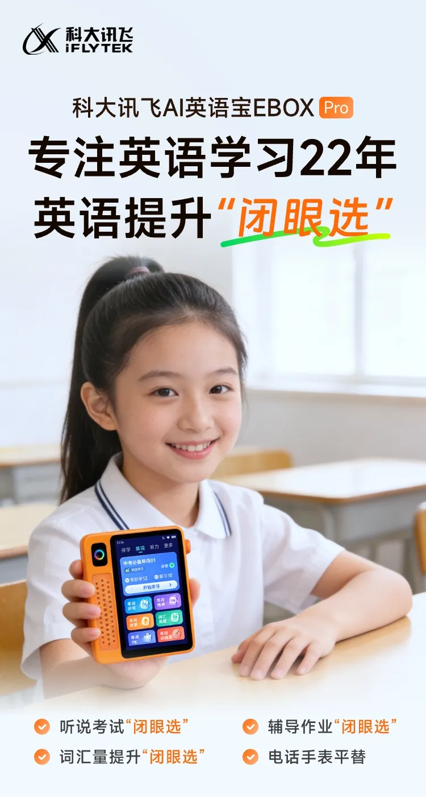
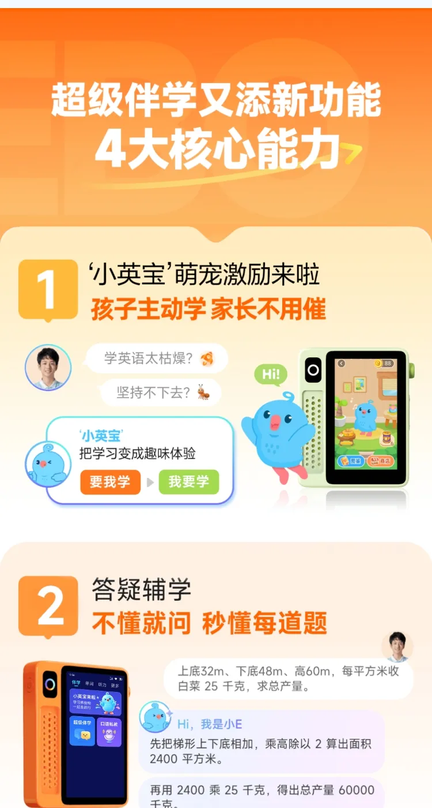
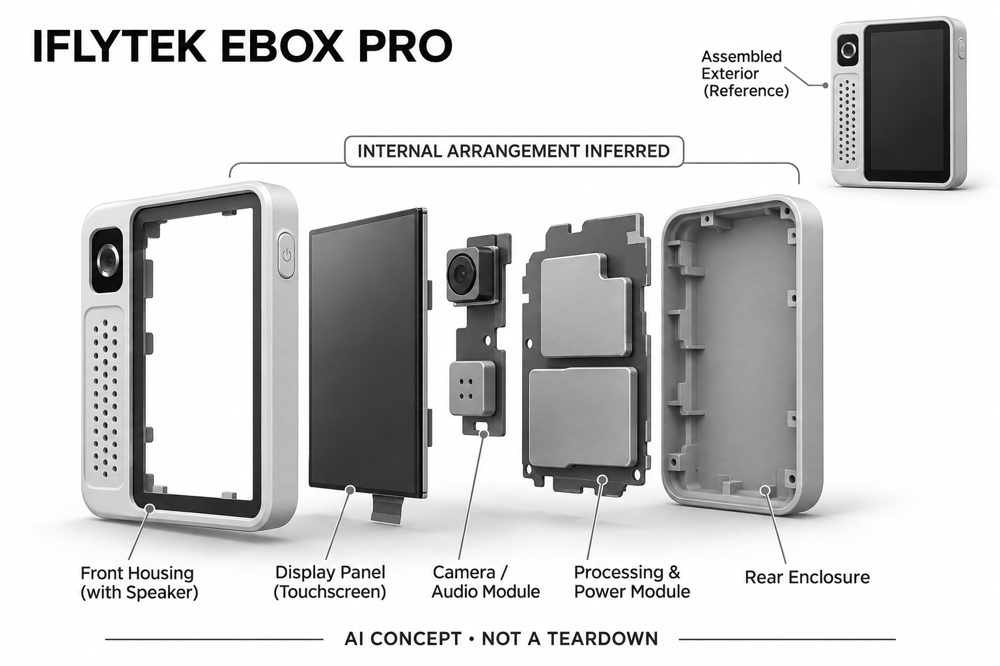

# 讯飞AI英语宝 EBOX Pro

**科大讯飞** · 教育与学习 · 核查 2026-11-04

围绕英语听说训练扩展答疑与对话

消费渠道：个人零售。

## 产品图片与结构参考

### 产品图

讯飞 EBOX Pro 官方产品宣传图 · 来源：[科大讯飞 · 官方图片](<https://www.xunfei.cn/goods?goodsId=2345>) · [原始图片](<https://img.xunfei.cn/mall/iflytek-mall/detalls/2026-10-13/Pro01.jpg?q=80&c=1&f=webp>)

### 参考图

讯飞 EBOX Pro 官方界面与使用参考 · 来源：[科大讯飞 · 官方图片](<https://www.xunfei.cn/goods?goodsId=2345>) · [原始图片](<https://img.xunfei.cn/mall/iflytek-mall/detalls/2026-10-13/Pro02.jpg?q=80&c=1&f=webp>)

### AI 生成爆炸示意

**AI 生成 · 非实物拆机。** 内部为概念推断，不能作为元件布局、BOM 或维修依据。[生成提示词](../../content/hardware/prompts/iflytek-ebox-pro.txt)

> 已目视核对产品外形与AI标识；verified不代表内部布局经实物拆机验证。

> 官方原图为含人物和文案的宣传图，未裁造独立实拍；营销描述不作为独立效果证据。

> 分析为基于公开资料的案头研究与 AI 辅助判断，未经用户访谈、销量审计或实物拆机。需求、画像、竞争冷门度、审美及商业机会均为研究假设，不是投资结论。

## 销售与购买

- 状态：在售。讯飞官方商城当前陈列EBOX Pro 128G橙色款及¥999标价，并链接商品页和小程序购买。已核实官方商品说明图中的答疑与百科问答；未登录小程序核验即时库存。

- 地区：中国大陆

- 价格：官方目录：128G款 ¥999。来自官方商城目录，不采用详情页未载入的0元模板；不同容量、颜色及优惠以官方小程序结算为准。

- 中国大陆：品牌官方商城陈列并提供小程序购买，按所选容量、颜色和小程序实时库存交付；网页详情的¥0.00为未载入模板，不是售价。

- [官方产品 / 商店](<https://www.xunfei.cn/goods?goodsId=2345>)

## AI 的实际作用

官方说明图展示英语听说、口语相关练习与AI伴学，并新增分步答疑、百科问答和日常对话；未公开完整模型与端云分工。

服务与联网依赖：基础内容和AI服务的离线边界、账户及订阅权益需按当前版本核对；本记录不假设所有对话都在设备本地完成。

## 是否冷门

细分专业（研究判断）：专门英语听说设备比通用学习机更聚焦，但已有多种软硬件替代。

## 需求与市场

需求假设：家庭希望用专门设备完成英语听说练习，避免每次都借用手机或打开大平板。研究应区分听力素材播放、跟读练习和自由问答的使用频率，不能仅因新增对话就推断学习有效。

## 用户画像

用户画像推断：有固定英语练习任务、希望设备便携且家长愿意选内容的学生家庭较匹配。对成人商务翻译或全科长时间课堂学习的需求，这种小型听说设备未必是同等合适的选择。

## 竞争与替代

竞争判断：英语听力机、词典笔、手机口语应用和学习机都能覆盖部分需求，竞争已较密集。EBOX的比较重点应是听说流程是否连续、素材是否适配，以及额外AI功能会否分散主要任务。

## 供应链

供应链推断：屏幕、扬声器、输入部件和便携外壳需支持频繁儿童使用，内容维护也是交付成本。官方未披露制造工厂；容量和颜色SKU以及小程序渠道需要一致的权益与售后说明。

## 技术路径

已查看官方说明图，新增能力包括答疑、百科问答和对话，但未公布完整模型部署。推断应分别核验发音反馈、听力内容及生成回答的准确性，不能把营销中的“秒懂”作为实测结论。

## 产品审美

审美判断：橙色机身和便携屏幕更接近学习播放器，降低大平板的存在感，角色动画则强化儿童兴趣。色彩与图标密度可能影响不同年龄接受度，不能把活泼外观直接当作学习动力。

## 关键风险

风险判断：官方目录可购买不代表所有容量和地区立即有货，最终由小程序确认。生成答疑可能出现错误，情绪化对话也不应替代家长沟通；本目录不承诺提分或心理改善效果。

## 机会与验证

市场观察：此条补充了大屏学习机之外的专用听说设备。比较时应同时列出基础素材、口语反馈、生成问答及联网权益，避免把单科工具与全科平板仅按价格放在同一排名中。

## 功能分层示意

这是功能关系，不是实物拆机、真实空间结构或已核实 BOM。

1. **学习输入**：通过界面进入听力、单词及口语相关任务。（官方披露）

2. **练习与反馈**：听说训练与练习反馈构成基础学习路径。（官方披露）

3. **AI答疑**：官方图展示分步讲题、百科问答与对话。（官方披露）

4. **内容与权限**：题目、素材、账户和网络服务的功能分层示意。（分析推断）

## 来源

1. [讯飞官方商城目录](<https://www.xunfei.cn/>) — 当前列EBOX Pro 128G款及¥999，并导向官方商品页。

2. [EBOX Pro官方商品页](<https://www.xunfei.cn/goods?goodsId=2345>) — 官方页面采用小程序购买；正文图片已逐张查看，未将0元模板当售价。

3. [EBOX Pro官方功能图：答疑](<https://img.xunfei.cn/mall/iflytek-mall/detalls/2026-10-13/Pro02.jpg>) — 从官方商品页打开并查看图像，展示新增答疑伴学。

4. [EBOX Pro官方功能图：问答与对话](<https://img.xunfei.cn/mall/iflytek-mall/detalls/2026-10-13/Pro03.jpg>) — 已查看图像；营销效果描述未作为独立验证结果。

[返回目录](../hardware-market.md) · [网页分析](https://romanagent.github.io/Roman/#hardware/product/iflytek-ebox-pro)
