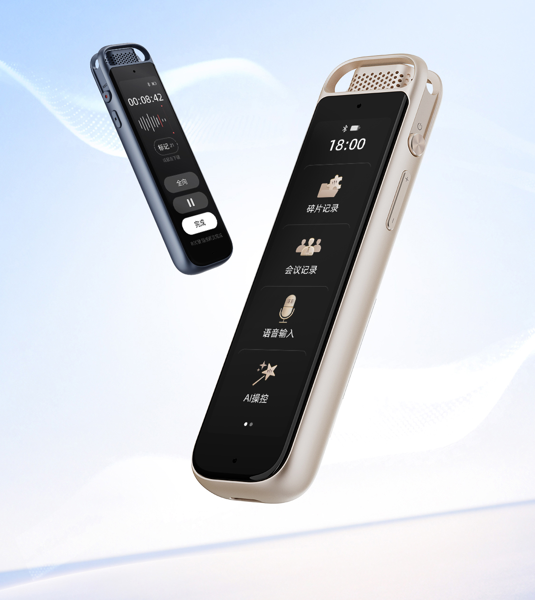
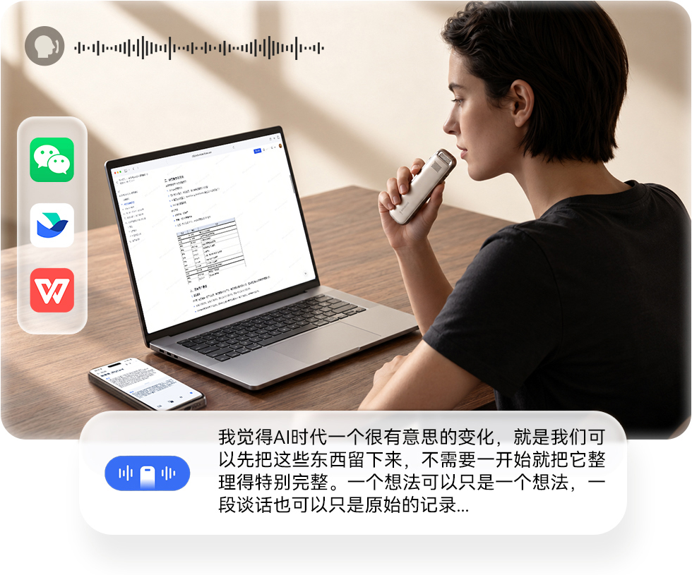
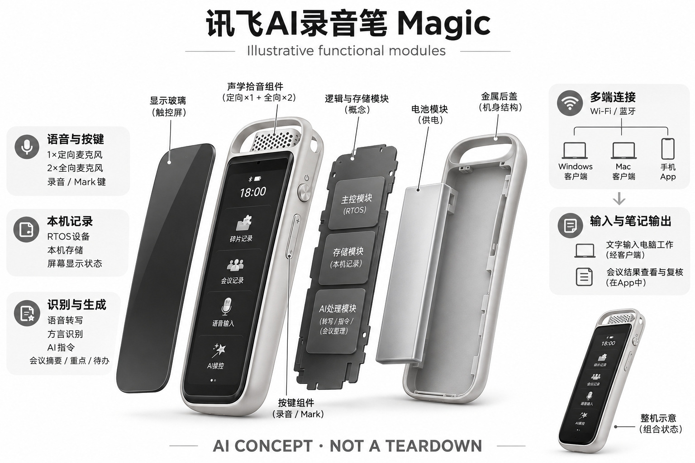

# 讯飞AI录音笔 Magic

**科大讯飞** · 录音与记忆 · 核查 2026-11-04

把语音输入、随身记录与电脑工作连接起来

## 产品图片与结构参考

### 产品图

讯飞官方 Magic 两款配色与外形展示 · 来源：[科大讯飞 · 官方产品图片](<https://www.iflyrecorder.com/magic>) · [原始图片](<https://www.iflyrecorder.com/assets/magic-product/hero.png>)

### 参考图

讯飞官方 Magic 电脑语音输入场景示意 · 来源：[科大讯飞 · 官方产品图片](<https://www.iflyrecorder.com/magic>) · [原始图片](<https://www.iflyrecorder.com/assets/magic-product/office.png>)

### AI 生成爆炸示意

**AI 生成 · 非实物拆机。** 内部为概念推断，不能作为元件布局、BOM 或维修依据。[生成提示词](../../content/hardware/prompts/iflytek-magic-recorder.txt)

> 外形依据核验参考图；内部位置、模块形状与装配关系仅作AI概念展示。

> 图片按源站提供格式保存，未裁切或改色；厂商渲染/场景示意不代表实机测试。

> 分析为基于公开资料的案头研究与 AI 辅助判断，未经用户访谈、销量审计或实物拆机。需求、画像、竞争冷门度、审美及商业机会均为研究假设，不是投资结论。

## 销售与购买

- 状态：在售。讯飞录音笔官方产品目录和参数页均列Magic为¥899，产品页提供京东立即购买，并提供Windows和Mac客户端。属于当前官方列售，未核验具体收货地区实时库存。

- 地区：中国大陆

- 价格：¥899（官网标价）。官方目录与参数页一致；实际平台促销、套装及软件权益可能不同，不推断所有AI服务永久免费。

- 中国大陆：已打开讯飞录音笔官网商品与参数页，并访问其京东购买链接。国内零售价、促销及批次配置以最终SKU为准。

- [官方产品 / 商店](<https://www.iflyrecorder.com/magic>)

## AI 的实际作用

语音转写、方言识别和AI指令，结合会议摘要、重点与待办整理。

服务与联网依赖：电脑语音输入依赖Windows/Mac客户端，手机查看依赖讯飞录音笔App；具体在线、离线能力和服务额度应按功能核实。

## 是否冷门

竞争密集（研究判断）：录音与电脑听写均有成熟软件/硬件替代，跨端整合属于差异线索而非市场空白。

## 需求与市场

需求假设：用户既要会后整理，也要在电脑前更快输入想法。把录音笔与语音输入连接能覆盖更多时刻，但需要验证语音修订、环境噪声和电脑软件兼容是否比键盘或普通麦克风方便。

## 用户画像

画像推断：经常写文档、回消息、参加访谈并愿意用语音组织思路的人更匹配。安静共享办公区或习惯精确键盘编辑的人可能不愿出声，不能把识别准确率直接等同输入效率提升。

## 竞争与替代

案头判断：与手机录音、电脑听写、USB麦克风和AI会议工具都存在重叠，竞争较拥挤。跨场景是待验证卖点；没有销量、使用留存或访谈数据，不能据多功能判断用户愿意多带设备。

## 供应链

官方披露OLED、三麦克风、RTOS和无线连接，但主控、屏幕厂商、整机工厂及良率不明。推断语音入口产品还需要稳定的客户端维护和跨系统支持，不能只按录音硬件估算成本。

## 技术路径

可核实的能力包括语音输入、转写、说话人区分与摘要；硬件有本地存储和无线连接。端云任务边界与底层模型未完整披露，不能因为设备能录音就认为生成式功能无需电脑或网络。

## 产品审美

图示观察：细长机身、窄屏与实体按键延续录音工具的可识别性，也便于看见状态。它不像隐藏式吊坠那样弱化用途；屏幕可读性、口袋携带及单手操作仍需实际试用才能判断。

## 关键风险

风险包括客户端兼容、语音输入误触发、会议转写遗漏与AI摘要错误。日常办公录音还涉及参与者知情和内容权限；多端访问便利会同时增加文件管理和设备丢失后的访问控制要求。

## 机会与验证

市场差异在于语音作为电脑输入方式与录音后整理共用一个设备。尚待验证的购买理由是用户是否在多个场景重复使用，还是大多数时候被已有手机、电脑麦克风和软件功能替代。

## 功能分层示意

这是功能关系，不是实物拆机、真实空间结构或已核实 BOM。

1. **语音与按键**：一颗定向加两颗全向麦克风及录音/Mark键；概念功能图，非拆机。（官方披露）

2. **本机记录**：RTOS设备、64GB存储和屏幕显示状态。（官方披露）

3. **多端连接**：Wi-Fi/蓝牙连接，Windows、Mac客户端与手机App承接不同用途。（官方披露）

4. **识别与生成**：语音输入、转写、AI指令和会议要点整理，部署细节未公开。（官方披露）

5. **输入与笔记输出**：文字进入电脑工作、会议结果在应用中查看和复核。（官方披露）

## 来源

1. [讯飞录音笔官网 · Magic产品与购买入口](<https://www.iflyrecorder.com/magic>) — 已打开，立即购买指向京东，Windows/Mac客户端与核心工作场景可见。

2. [讯飞录音笔官网 · Magic产品参数](<https://www.iflyrecorder.com/Goods_parms/1/601.html>) — 已打开，¥899、三麦克风、64GB、RTOS等；两个发布日期不擅自解释成两个硬件代际。

[返回目录](../hardware-market.md) · [网页分析](https://romanagent.github.io/Roman/#hardware/product/iflytek-magic-recorder)
