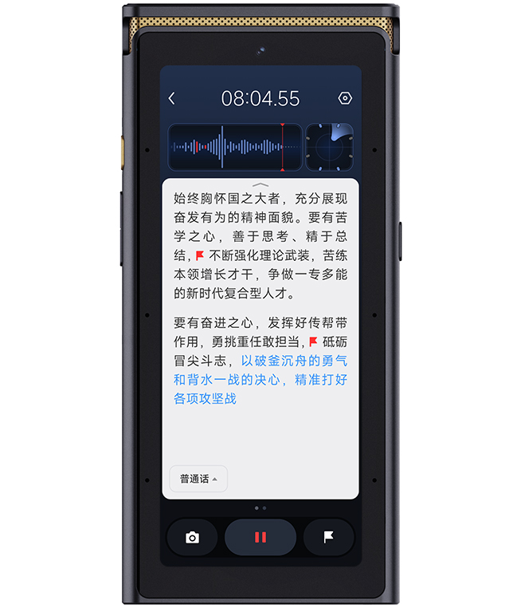
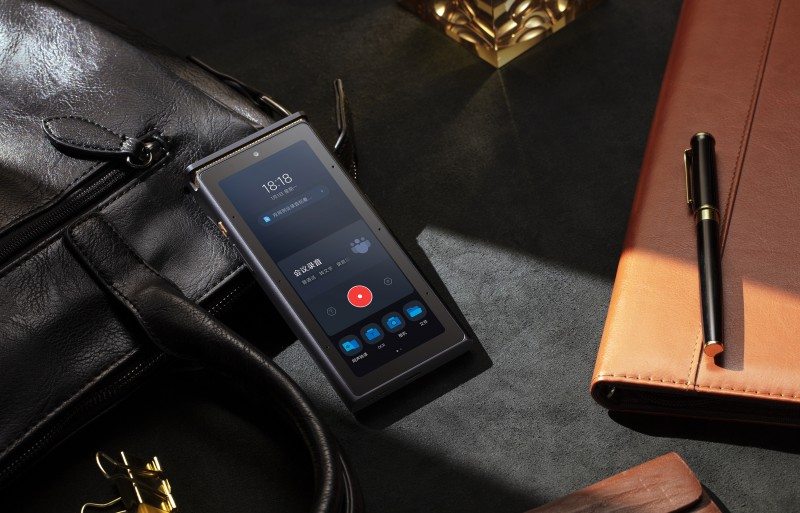
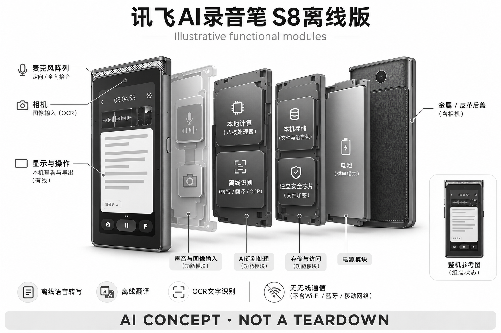

# 讯飞AI录音笔 S8离线版

**科大讯飞** · 录音与记忆 · 核查 2026-11-04

无无线通信、强调本地识别的独立记录终端

## 产品图片与结构参考

### 产品图

讯飞官方 S8 离线版正面界面图 · 来源：[科大讯飞 · 官方产品图片](<https://www.iflyrecorder.com/Goods_desc/1/598.html>) · [原始图片](<https://www.iflyrecorder.com/filespath/images/goods/1733912262.jpg>)

### 参考图

极客公园 S8 离线版发布报道的桌面场景配图 · 来源：[极客公园 · 讯飞S8离线版发布报道配图](<https://www.geekpark.net/news/344287>) · [原始图片](<https://imgslim.geekpark.net/uploads/image/file/c8/8e/c88ea774dad84d1160eee9c2c9f69ae5.jpeg>)

### AI 生成爆炸示意

**AI 生成 · 非实物拆机。** 内部为概念推断，不能作为元件布局、BOM 或维修依据。[生成提示词](../../content/hardware/prompts/iflytek-s8-offline.txt)

> 外形依据核验参考图；内部位置、模块形状与装配关系仅作AI概念展示。

> 图片按源站提供格式保存，未裁切或改色；厂商渲染/场景示意不代表实机测试。

> 主图为官方；第二张为注明来源的发布报道配图。

> 分析为基于公开资料的案头研究与 AI 辅助判断，未经用户访谈、销量审计或实物拆机。需求、画像、竞争冷门度、审美及商业机会均为研究假设，不是投资结论。

## 销售与购买

- 状态：在售。当前官方目录、产品页与参数页列出S8离线版，标价¥6999并提供京东立即购买入口。官方参数明确无线通信方式为无；不是仅凭旧发布新闻认定在售。

- 地区：中国大陆

- 价格：¥6999（官网标价）。官方参数价；不同套装、渠道与采购合同可能不同。本地处理并不自动意味着适合任何保密等级或免除额外管理成本。

- 中国大陆：已打开国内官方产品、参数与京东入口。实际地区库存及单位采购条件仍需以订单和自身信息管理制度为准。

- [官方产品 / 商店](<https://www.iflyrecorder.com/Goods_desc/1/598.html>)

## AI 的实际作用

本型号已核实的核心AI为离线语音转写、翻译与OCR等识别能力；未把系列通用生成式摘要宣传自动算给S8。

服务与联网依赖：无无线通信，数据与语言包通过本地设备和有线流程管理。具体语种、版本与更新方式应查本型号说明，不等同云端全功能。

## 是否冷门

细分专业（研究判断）：以离线与受控记录流程为主要用途；专业细分不等于自动满足任何安全标准。

## 需求与市场

需求假设：某些工作环境要求音频不进入公网服务，同时仍希望减少手工转写。这里的关键价值是部署边界可控，而不是联网AI功能更多；需求应由真实信息管理要求和使用流程确认。

## 用户画像

画像推断：有明确离线记录流程的组织人员，比普通轻度消费者更匹配。厂商面向政企的定位不能直接视为通过所有保密审查，实际采购仍需机构依据自己的规范进行设备和软件评估。

## 竞争与替代

案头判断：与传统离线录音器、本地电脑转写及受控私有化方案竞争，属于专业细分。没有采购访谈、销量或总成本数据，不能据较高价格判断壁垒，也不能把少量竞品误作市场空间。

## 供应链

官网公开八核处理器、存储、麦克风布局和屏幕规格，但芯片供应商及整机工厂仍不明。厂商年报提及独立安全芯片；本研究没有芯片型号、认证报告或制造审计，不能扩写成全面安全保证。

## 技术路径

参数页明确无无线通信，厂商报告说明本型号支持转写、翻译及文件加密。它证明AI硬件可以以识别为核心，不必拥有云端聊天；未核实的生成式纪要、模型大小和语种表现均不补写。

## 产品审美

参数与图示呈现较大的带屏独立终端，金属与皮革材料偏正式办公。相比小录音卡更便于本机查看，但携带负担也不同；外观商务化不意味着采集质量或数据安全更高。

## 关键风险

离线减少网络依赖，却不消除丢失、口令、导出介质和人员操作风险。识别错误仍可能发生，语言包更新也要管理；不能把厂商安全定位等同所有组织的准入认证或法律合规结论。

## 机会与验证

市场差异在于以本地处理和无无线通信作为明确边界。尚待验证的购买理由是用户是否真的需要这一限制、是否能接受功能与更新方式的取舍，以及本机流程是否比受控电脑方案更省事。

## 功能分层示意

这是功能关系，不是实物拆机、真实空间结构或已核实 BOM。

1. **声音与图像输入**：定向/全向麦克风与相机，概念功能架构，非拆机物料图。（官方披露）

2. **本地计算**：八核处理器与本机存储，官方明确无无线通信。（官方披露）

3. **识别处理**：本型号离线转写、翻译及OCR；不默认包含云端系列功能。（官方披露）

4. **存储与访问**：厂商披露独立安全芯片和文件加密；本研究未进行安全验证。（官方披露）

5. **本机查看与导出**：屏幕查看，通过有线方式管理内容；具体机构流程需另行配置。（分析推断）

## 来源

1. [讯飞录音笔官网 · S8离线版与购买入口](<https://www.iflyrecorder.com/Goods_desc/1/598.html>) — 已打开，明确本型号并有京东立即购买入口；未完成结算验证。

2. [讯飞录音笔官网 · S8离线版参数](<https://www.iflyrecorder.com/Goods_parms/1/598.html>) — 已打开，¥6999、无线通信方式无、八核处理器等；未补写芯片厂商。

3. [科大讯飞2024年年报 · S8离线版说明（第28页）](<https://static.cninfo.com.cn/finalpage/2025-04-22/1223191180.PDF>) — 已打开并定位本型号段落，支持转写、翻译和安全芯片厂商陈述；不采用系列销量宣传推算本型号市场。

[返回目录](../hardware-market.md) · [网页分析](https://romanagent.github.io/Roman/#hardware/product/iflytek-s8-offline)
