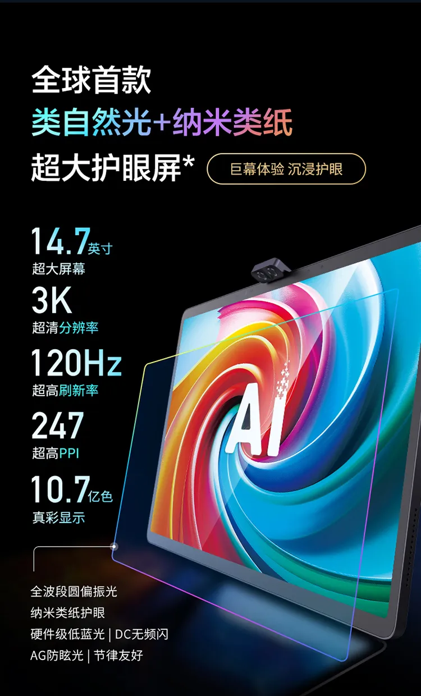
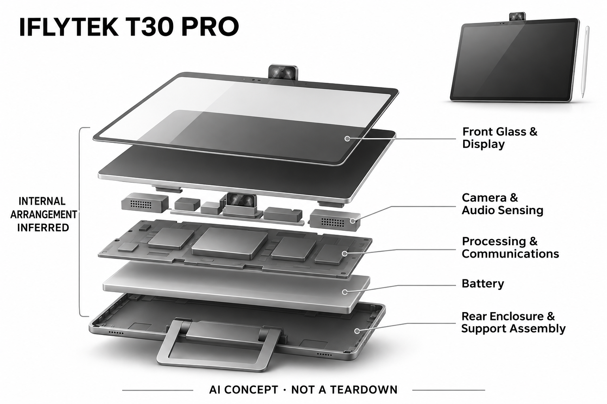

# 讯飞AI学习机 T30 Pro

**科大讯飞** · 教育与学习 · 核查 2026-11-04

以星火模型讲题与学科诊断辅助课后学习

消费渠道：个人零售。

## 产品图片与结构参考

### 产品图

讯飞 T30 Pro 官方产品宣传图 · 来源：[科大讯飞 · 官方图片](<https://ly.xunfei.cn/goods/k8AuU6yWkvGx>) · [原始图片](<https://img.xunfei.cn/lyoa/prod/ifly-mall-vip-service/business/ifly-mall-vip-service/business/private/202503251547004905.jpg?q=80&c=1&f=webp&o=2>)

### 参考图

讯飞 T30 Pro 官方显示屏角度参考 · 来源：[科大讯飞 · 官方图片](<https://ly.xunfei.cn/goods/k8AuU6yWkvGx>) · [原始图片](<https://img.xunfei.cn/lyoa/prod/ifly-mall-vip-service/business/ifly-mall-vip-service/business/private/202503251547007834.jpg?q=80&c=1&f=webp&o=2>)

### AI 生成爆炸示意

**AI 生成 · 非实物拆机。** 内部为概念推断，不能作为元件布局、BOM 或维修依据。[生成提示词](../../content/hardware/prompts/iflytek-t30-pro.txt)

> 已目视核对产品外形与AI标识；verified不代表内部布局经实物拆机验证。

> 保留官方宣传图原始文案与颜色；仅作为型号和外观参考，非本项目功效验证。

> 分析为基于公开资料的案头研究与 AI 辅助判断，未经用户访谈、销量审计或实物拆机。需求、画像、竞争冷门度、审美及商业机会均为研究假设，不是投资结论。

## 销售与购买

- 状态：待复核。讯飞官方领用商城该型号页面显示剩余0件和商品无库存，价格文本也异常；官方教育站确认产品及能力，但未核实当前普通零售渠道库存，因此不标在售或停售。

- 地区：中国大陆

- 价格：当前有效售价待确认。官方领用商城显示“价格无效”及异常数字，不将该数值作为零售价，也不引用第三方历史促销价。

- 中国大陆：已核实官方品牌、产品和国内服务渠道存在，但本次商店该SKU为0库存。官方渠道存在与当前可买是两回事，实时在售状态仍待确认。

- [官方产品 / 商店](<https://ly.xunfei.cn/goods/k8AuU6yWkvGx>)

## AI 的实际作用

官方2024介绍列星火模型支持语数英一对一讲解、语音或圈画提问和多模态板书，并提供学科知识薄弱点诊断。

服务与联网依赖：模型能力与学科内容依赖厂商软件服务；具体离线课程、网络条件及后续机型升级权益需以该型号当前规则确认。

## 是否冷门

竞争密集（研究判断）：国内课后辅学需求明确，但教研、渠道和品牌竞争已密集。

## 需求与市场

需求假设：家长希望孩子遇到难题时获得及时解释，同时减少重复查找答案的时间。应区分真正理解解题步骤与直接抄写答案的行为，不把设备完成讲解视为孩子已经掌握。

## 用户画像

用户画像推断：使用中国学校教材、课后练习较多且家长愿意管理学习节奏的家庭更适合。孩子年级、学科薄弱点与自主学习能力差异明显，不能把高配置平板默认推荐给所有学生。

## 竞争与替代

竞争判断：中国学习机已有讯飞、作业帮、学而思、小度等品牌，属于拥挤市场。题库、教研、讲解正确性和本地服务比模型名称更重要，屏幕尺寸或参数提升不一定改变核心体验。

## 供应链

供应链推断：平板主板、显示、相机和支架属于硬件基础，课程授权与题目维护构成更长周期投入。官方未在本次资料中披露制造工厂，不能仅凭品牌或外观推断代工关系。

## 技术路径

官方介绍星火模型、多模态讲题和学科诊断。推断难点是题目识别、知识点归因、分步解释与追问的一致性；不同版本内容更新不应假设自动覆盖所有老机型，需逐SKU核对。

## 产品审美

审美判断：学习机以大屏、支架和书桌使用姿态突出工具属性，家长更容易将其归入学习投入。视觉设计仍应观察信息密度、字号和干扰内容，而不是把“护眼”外观当作健康保证。

## 关键风险

风险判断：当前官方页面无库存不能推出该型号已全面停售，也不能代表零售库存。大模型可能讲错题，使用时间和家长监督仍重要；本目录不承诺提分、治疗视力或替代教师。

## 机会与验证

市场观察：该条适合作为国内大模型学习机的历史与能力参照，但当前购买状态应单列待确认。与新型号比较时，应核对讲题方式、教材适配和权益，而非将旧款价格简单外推。

## 功能分层示意

这是功能关系，不是实物拆机、真实空间结构或已核实 BOM。

1. **问题输入**：语音、圈画及题目等多种输入进入讲题流程。（官方披露）

2. **学科理解**：官方介绍知识薄弱点诊断与同步AI学习。（官方披露）

3. **模型讲解**：星火支持分步讲解、图示和重点板书。（官方披露）

4. **追问反馈**：通过语音、圈画或点击板书继续提问。（官方披露）

5. **内容维护**：教材、课程及模型服务组成持续更新层的功能示意。（分析推断）

## 来源

1. [讯飞领用商城T30 Pro](<https://ly.xunfei.cn/goods/k8AuU6yWkvGx>) — 页面明确无库存、价格无效，因此保守待确认。

2. [科大讯飞智慧教育T30 Pro介绍](<https://edu.iflytek.com/about-us/news/special-column/1355.html>) — 2024-09官方产品介绍可支持能力，不作为2026实时库存证据。

[返回目录](../hardware-market.md) · [网页分析](https://romanagent.github.io/Roman/#hardware/product/iflytek-t30-pro)
