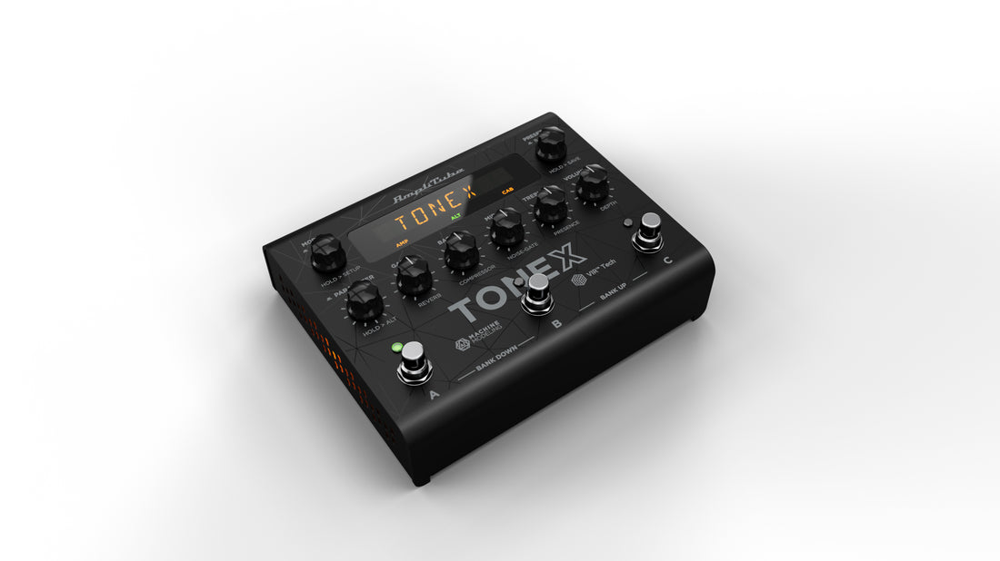
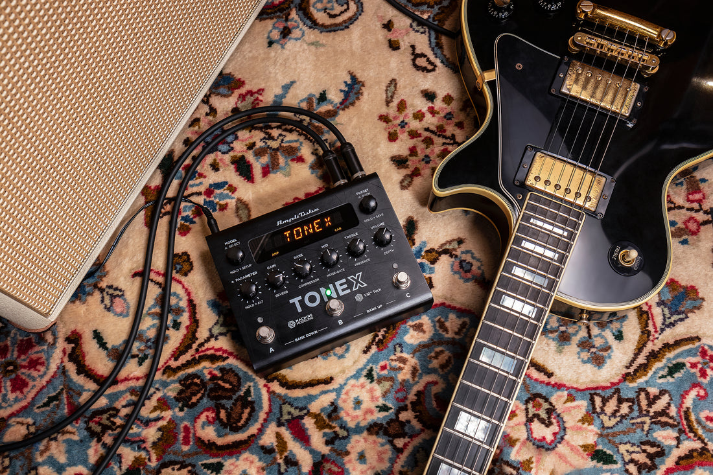
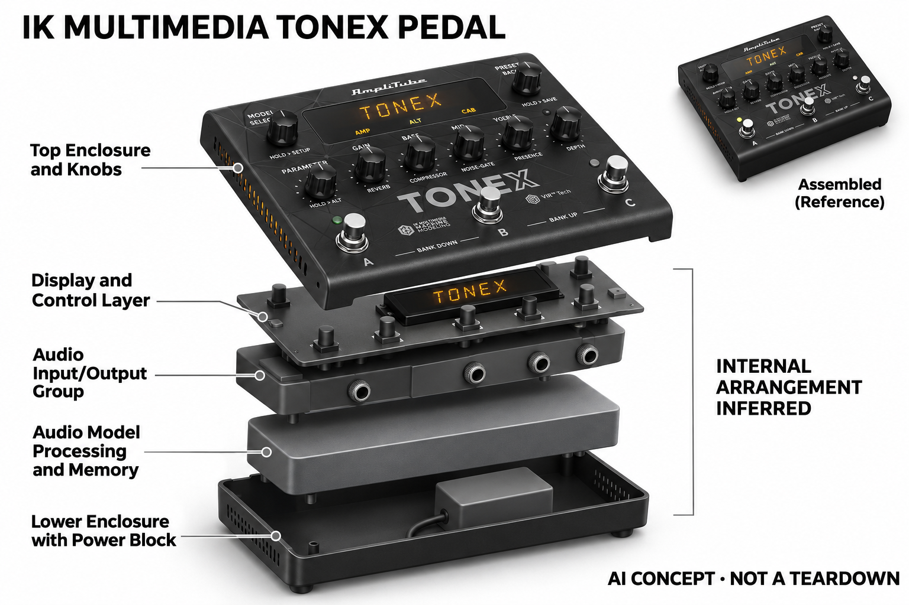

# IK Multimedia TONEX Pedal

**IK Multimedia** · 音乐与乐器 · 核查 2026-11-04

在实体踏板上播放机器学习得到的音箱音色

消费渠道：个人零售。

## 产品图片与结构参考

### 产品图

IK Multimedia TONEX Pedal · 官方产品图 · 来源：[IK Multimedia · 官方图片](<https://ikmultimedia.com/products/tonexpedal>) · [原始图片](<https://ikmultimedia.com/cdn/shop/files/TONEX-Pedal---Studio-57101.jpg?v=1783348434&width=1100>)

### 参考图

IK Multimedia TONEX Pedal · 官方参考图 · 来源：[IK Multimedia · 官方图片](<https://ikmultimedia.com/products/tonexpedal>) · [原始图片](<https://ikmultimedia.com/cdn/shop/files/ToneX_Pedal_IMG_0038_r.jpg?v=1783348439&width=1100>)

### AI 生成爆炸示意

**AI 生成 · 非实物拆机。** 内部为概念推断，不能作为元件布局、BOM 或维修依据。[生成提示词](../../content/hardware/prompts/ik-tonex-pedal.txt)

> 已目视核对外形、标签与非拆机声明；不代表内部结构经实测验证。

> 分析为基于公开资料的案头研究与 AI 辅助判断，未经用户访谈、销量审计或实物拆机。需求、画像、竞争冷门度、审美及商业机会均为研究假设，不是投资结论。

## 销售与购买

- 状态：在售。官方产品商店有Buy Now；官方Shopify产品数据available为true，另一个官方购物入口提供加入购物车。只计标准硬件，不把贝斯预设或周年配色另计。

- 地区：官方国际商店

- 价格：以地区官方结算为准。官方不同入口显示欧元及美元报价；模型软件权益和税费应按所选地区确认，不把预设特别版重复计数。

- 中国大陆：本轮核实所列区域官方商店；未确认中国大陆官方现货、账户及完整服务，不把境外可购等同大陆可用。

- [官方产品 / 商店](<https://ikmultimedia.com/products/tonexpedal>)

## AI 的实际作用

AI Machine Modeling在配套建模流程中学习真实音箱或效果器，TONEX Pedal保存并实时播放Tone Models；普通EQ和混响不是本条AI依据。

服务与联网依赖：建立自有Tone Models使用配套软件及采集链路，踏板可离线演奏已加载模型；ToneNET下载和账户权益另有条件。

## 是否冷门

细分专业（研究判断）：针对需要真实设备音色的乐手，格式与使用链路是主要差异。

## 需求与市场

需求假设：个人乐手希望把录音室选择的音箱响应带到演出现场，而不用携带全部原设备。应比较模型准备与舞台调用的完整流程，并检查演奏动态是否合适，不能只数能保存多少个音色。

## 用户画像

画像推断：愿意在电脑上准备声音、现场偏好脚控操作的吉他或贝斯用户较匹配。需要设备直接完成全部捕获的人应注意软件依赖，偶尔居家练习者也可能已有更简单的低成本方案。

## 竞争与替代

竞争判断：音色模型踏板与多效果器、电脑插件、传统放大器同时竞争。机器学习是声音获取方式的差异，但模型格式、软件库和切换习惯会形成迁移成本，不能仅凭AI名称认为更适合用户。

## 供应链

供应链推断：音频转换、脚控、旋钮与坚固外壳需要满足反复演出使用，软件授权同样属于交付。官方未公开具体组装工厂和完整成本，模型库支持与更新兼容应计入产品生命周期。

## 技术路径

官方区分机器学习建模软件与实体踏板的模型播放。技术判断应避免把离线演奏误写为离线训练所有模型，采样、训练、传输和实时音效也应分别测试，才便于比较不同技术路线。

## 产品审美

审美判断：传统踏板形式让已有乐手容易理解连接和踩踏，显示与旋钮服务于音色调用。信息是否足够清楚取决于舞台光照和预设命名；外形熟悉并不能证明首次设置一定简单。

## 关键风险

风险判断：模型的原始采样和制作方式会影响效果，现场听感还受箱体与监听设备影响。软件账户、内容授权及设备兼容须按当前方案核对，不能把所有下载音色视为可自由再发布素材。

## 机会与验证

市场观察：它适合呈现软件学习与硬件执行结合的消费创作路径。评估应记录准备一套真实演出预设所需时间、失败恢复和更新依赖，避免把模型下载数量当作付费需求或长期使用证据。

## 功能分层示意

这是功能关系，不是实物拆机、真实空间结构或已核实 BOM。

1. **建模来源**：配套软件采集真实音箱和效果器响应。（官方披露）

2. **学习模型**：AI Machine Modeling形成Tone Models。（官方披露）

3. **踏板播放**：本地实时运行已加载模型及效果。（官方披露）

4. **操作共享**：脚控、编辑软件和ToneNET管理。（官方披露）

## 来源

1. [TONEX Pedal官方商店](<https://ikmultimedia.com/products/tonexpedal>) — 已打开，购买按钮与官方产品数据可购。

2. [TONEX Pedal官方购物入口](<https://www.ikmultimedia.com/shop/cart.php?alias=tonex-pedal>) — 已打开，提供加入购物车；地区报价与新商店可能不同。

[返回目录](../hardware-market.md) · [网页分析](https://romanagent.github.io/Roman/#hardware/product/ik-tonex-pedal)
