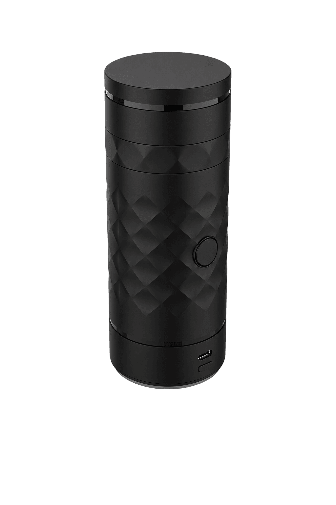
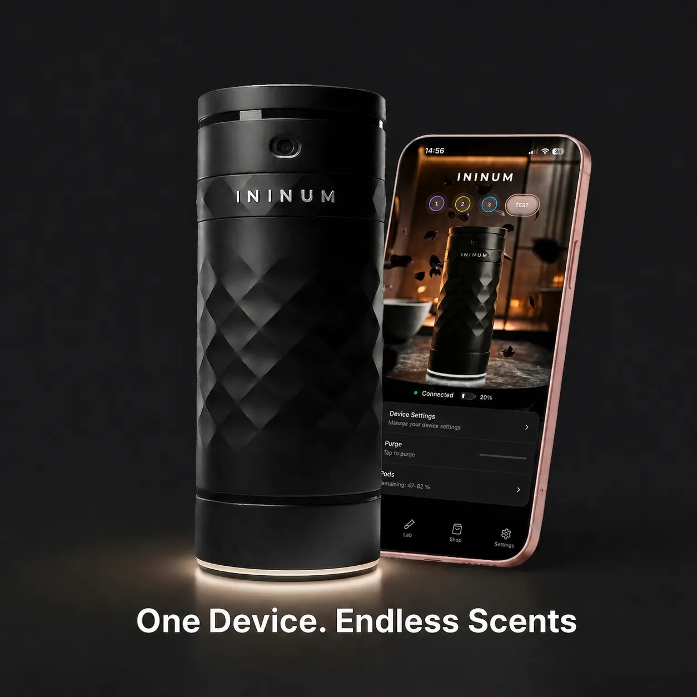
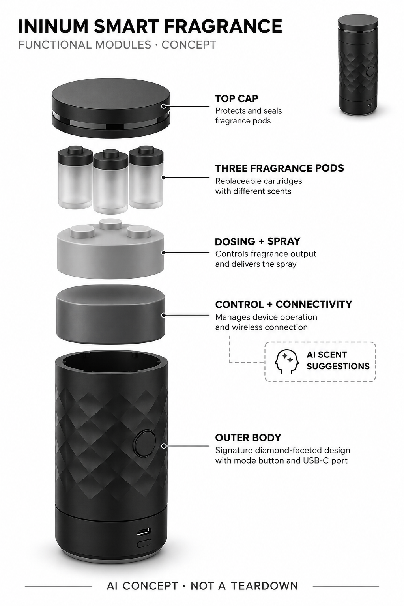

# ININUM Smart Fragrance

**ININUM** · 护理与美容 · 核查 2026-11-04

把穿搭与对话建议转换为随身香氛比例的喷洒设备

消费渠道：个人零售。

## 产品图片与结构参考

### 产品图

官方最终设备外形 · 来源：[ININUM · 官方图片](<https://www.ininum.com/products/ininum>) · [原始图片](<https://www.ininum.com/_next/image?url=%2Fimages%2Fininum-final-device-transparent-v2.png&w=3840&q=75>)

### 参考图

官方设备与应用展示 · 来源：[ININUM · 官方图片](<https://www.ininum.com/products/ininum>) · [原始图片](<https://www.ininum.com/_next/image?url=%2Fimages%2Fproduct-hero-shopify-clean.webp&w=1920&q=75>)

### AI 生成爆炸示意

**AI 生成 · 非实物拆机。** 内部为概念推断，不能作为元件布局、BOM 或维修依据。[生成提示词](../../content/hardware/prompts/ininum-smart-fragrance.txt)

> 实际查看并核对当前型号；官方原图未改色或语义编辑，宣传文字不作为独立实测。

> 分析为基于公开资料的案头研究与 AI 辅助判断，未经用户访谈、销量审计或实物拆机。需求、画像、竞争冷门度、审美及商业机会均为研究假设，不是投资结论。

## 销售与购买

- 状态：在售。官方当前商品页显示Order now US$199，含设备与Original Trio；美国补货通知写2026-11-03恢复发货，日期已到但仍提示Restocking，因此以可订购、实际出库待商家确认记录。

- 地区：美国

- 价格：当前美国页 US$199。含设备和三支Original Trio香氛POD；AI Companion与AI Photo Style免费期已于2026-10-31结束，之后需订阅，具体费用以应用地区为准。

- 中国大陆：当前美站说明美国之外需联系确认运输选项，未验证中国大陆官方配送、香氛运输或售后；不把旧站EU/US笼统文字当现售承诺。

- [官方产品 / 商店](<https://www.ininum.com/products/ininum>)

## AI 的实际作用

官方应用通过对话输入或穿搭照片提出香氛混配建议，设备将专业调制的POD按选定比例喷出；AI不合成新的香料分子。

服务与联网依赖：建议来自应用中的付费AI功能，连接设备进行比例设置；可在设备切换已保存香型，完整离线AI能力未披露。

## 是否冷门

细分专业（研究判断）：个人香氛调配是窄而具体的实体任务，材料与软件一起构成体验；需验证耗材复购及AI建议的实际增量。

## 需求与市场

需求假设：喜爱香氛变化的人希望在同一设备中重复获得不同组合，并减少多瓶携带。价值应由真实佩戴、再选和补充POD验证，不能把组合数量等同独立气味都被喜欢，也不能把AI建议当作客观更适合某个人的证明。

### 产品任务与边界 · 研究判断

需求假设：喜爱香氛变化的人希望在同一设备中重复获得不同组合，并减少多瓶携带。价值应由真实佩戴、再选和补充POD验证，不能把组合数量等同独立气味都被喜欢，也不能把AI建议当作客观更适合某个人的证明。

依据：[ININUM当前官方商品页](<https://www.ininum.com/products/ininum>) · [ININUM官方应用与AI权限](<https://www.ininum.com/app>)

### 需求判断 · 研究判断

香氛探索经常需要携带多瓶或记住手工叠加方式，设备的直接作用是保存和再次喷出一种比例。对话或穿搭照片可以降低选择门槛，但不决定用户真的喜欢闻到的结果；需求应围绕体验和重复性，不把主观气味偏好当成算法可客观预测的事实。

依据：[ININUM当前官方商品页](<https://www.ininum.com/products/ininum>) · [ININUM官方应用与AI权限](<https://www.ininum.com/app>)

### 需求验证 · 待验证

可记录自愿用户选择建议、调整比例、保存及再次使用的完整过程，并比较旅行分装或手工叠香。只使用用户确认适合自己的官方耗材，避免以强烈香味或增加喷洒量作为测试目标；组合公式数量与宣传评论都不能替代真实持续使用。

依据：[ININUM当前官方商品页](<https://www.ininum.com/products/ininum>) · [ININUM官方应用与AI权限](<https://www.ininum.com/app>)

## 用户画像

画像推断：愿意使用手机设置、尝试比例并接受专用耗材的个人香氛爱好者更匹配。只固定使用一个香型或对香料敏感的人需求不同，应尊重个人感受与成分限制，不根据职业、性别或拍摄外观推定审美和购买意愿。

### 适用行为与条件 · 研究判断

画像推断：愿意使用手机设置、尝试比例并接受专用耗材的个人香氛爱好者更匹配。只固定使用一个香型或对香料敏感的人需求不同，应尊重个人感受与成分限制，不根据职业、性别或拍摄外观推定审美和购买意愿。

依据：[ININUM当前官方商品页](<https://www.ininum.com/products/ininum>) · [ININUM官方应用与AI权限](<https://www.ininum.com/app>)

### 人群取舍 · 研究判断

经常在不同场景切换香型的人可能重视便携和复现，而固定爱用一瓶的人可能把应用视为额外步骤。画像还应包含对专用POD供应和订阅的接受度，不根据服装照片推断性格、身份或社会角色，也不能把赠礼者好奇当成收礼者真实需求。

依据：[ININUM当前官方商品页](<https://www.ininum.com/products/ininum>) · [ININUM官方应用与AI权限](<https://www.ininum.com/app>)

### 画像验证 · 待验证

画像验证应询问日常香型使用和携带方式，再观察开合、充电与设置是否被接受。把实际佩戴者、购买者及礼物使用者分开，记录敏感气味和环境限制；不能让AI推荐覆盖个人嗅觉感受，更不应按性别或职业预设应当喜欢的香氛。

依据：[ININUM当前官方商品页](<https://www.ininum.com/products/ininum>) · [ININUM官方应用与AI权限](<https://www.ininum.com/app>)

## 竞争与替代

竞争判断：与普通香水、旅行分装和手工叠香竞争，区别是记录比例并用对话或照片辅助探索。旧NINU名称和POD组合不拆为多款硬件；应比较携带、重复性与维护，不因AI或配方组合多就认为替代所有香水瓶。

### 比较对象与差异 · 研究判断

竞争判断：与普通香水、旅行分装和手工叠香竞争，区别是记录比例并用对话或照片辅助探索。旧NINU名称和POD组合不拆为多款硬件；应比较携带、重复性与维护，不因AI或配方组合多就认为替代所有香水瓶。

依据：[ININUM当前官方商品页](<https://www.ininum.com/products/ininum>) · [ININUM官方应用与AI权限](<https://www.ininum.com/app>)

### 竞争判断 · 研究判断

普通香水容易随取随用，分装瓶成本低且不依赖软件，而本设备以可存比例与材料替换形成差异。更多控制不一定更便利，尤其当用户只用一个POD时；比较应包含耗材可得和清理，而非把所有可能组合都当成独立高价值香水。

依据：[ININUM当前官方商品页](<https://www.ininum.com/products/ininum>) · [ININUM官方应用与AI权限](<https://www.ininum.com/app>)

### 竞争验证 · 待验证

竞争验证可用相同日常使用目标比较分装、手工叠香和设备保存比例，再分别查看AI建议是否被重复采用。旧NINU品牌和新的ININUM不重复计数，基础滑杆与收藏也不算生成AI；应按当前已收费服务计算总成本而非引用过去免费宣传。

依据：[ININUM当前官方商品页](<https://www.ininum.com/products/ininum>) · [ININUM官方应用与AI权限](<https://www.ininum.com/app>)

## 供应链

供应链分析：成品香氛POD、密封与定量喷洒、外壳、电池连接及应用服务组成系统，整机工厂和BOM未披露。挥发、残留、材料相容与跨境运输影响交付，不能把香氛产地的说明推定为全部硬件也在同地制造。

### 功能模块拆分 · 研究判断

结构功能包括外壳和操作键、三个成品香氛POD、比例计量与喷洒、电源连接和应用控制。挥发性材料长期接触密封与出料口，需要关注残留及相容性；公开最终外形无法证明内部泵、通路或主板，概念图只说明功能而不假造结构细节。

依据：[ININUM当前官方商品页](<https://www.ininum.com/products/ininum>) · [ININUM官方应用与AI权限](<https://www.ininum.com/app>)

### 制造与供应约束 · 研究判断

供应链分析：成品香氛POD、密封与定量喷洒、外壳、电池连接及应用服务组成系统，整机工厂和BOM未披露。挥发、残留、材料相容与跨境运输影响交付，不能把香氛产地的说明推定为全部硬件也在同地制造。

依据：[ININUM当前官方商品页](<https://www.ininum.com/products/ininum>) · [ININUM官方应用与AI权限](<https://www.ininum.com/app>)

### 候选与证据缺口 · 研究判断

Fictiv可支持便携外壳和POD接口的精密原型评估，USI可对应低功耗连接与电子整合，两者无本型号点名供货证据。香氛相容性、计量喷洒和跨境耗材运输需另行负责，不能因品牌声明香氛意大利制造就推定全部硬件和电子来源。

依据：[ININUM当前官方商品页](<https://www.ininum.com/products/ininum>) · [ININUM官方应用与AI权限](<https://www.ininum.com/app>)

## 技术路径

技术判断：官方应用明确AI对话与照片风格建议，普通比例滑杆和保存收藏本身不是生成AI。硬件按选择混配已存在香氛，模型不会创造新分子；训练方法与建议精度未披露，照片匹配属于主观探索而非可验证的人格判断。

### 已披露技术边界 · 研究判断

技术判断：官方应用明确AI对话与照片风格建议，普通比例滑杆和保存收藏本身不是生成AI。硬件按选择混配已存在香氛，模型不会创造新分子；训练方法与建议精度未披露，照片匹配属于主观探索而非可验证的人格判断。

依据：[ININUM当前官方商品页](<https://www.ininum.com/products/ininum>) · [ININUM官方应用与AI权限](<https://www.ininum.com/app>)

### 系统难点判断 · 研究判断

AI Companion把语言偏好转成建议，Photo Style把照片作为灵感输入，普通Lab则由人直接调比例。三者应清楚区分；设备喷出的仍是既定POD混合，既不是分子设计也不是客观人格识别，公开没有足够信息判断模型训练数据和本地运行范围。

依据：[ININUM当前官方商品页](<https://www.ininum.com/products/ininum>) · [ININUM官方应用与AI权限](<https://www.ininum.com/app>)

### 技术验证 · 待验证

技术验证应检查建议能否映射到实际已装POD、缺少材料时如何提示，并观察保存比例在重复喷洒中的一致性。照片输入使用自愿且不敏感的材料，不能根据人像得出身份或健康判断；也不把界面生成一段香氛描述当成物理混配结果已被验证。

依据：[ININUM当前官方商品页](<https://www.ininum.com/products/ininum>) · [ININUM官方应用与AI权限](<https://www.ininum.com/app>)

## 产品审美

审美判断：哑光深色筒体接近便携香氛器材，按钮和顶部POD仓让使用较直接。喷头残留、指纹、开合及随身体量决定长期观感，展示应保持真实最终外形，不能用旧概念瓶或过度科技灯效掩盖实际操作步骤。

### 外观与交互语言 · 研究判断

审美判断：哑光深色筒体接近便携香氛器材，按钮和顶部POD仓让使用较直接。喷头残留、指纹、开合及随身体量决定长期观感，展示应保持真实最终外形，不能用旧概念瓶或过度科技灯效掩盖实际操作步骤。

依据：[ININUM当前官方商品页](<https://www.ininum.com/products/ininum>) · [ININUM官方应用与AI权限](<https://www.ininum.com/app>)

### 使用中审美判断 · 研究判断

菱面黑色筒身与平顶盖兼具便携瓶和电子设备特征，USB口及按键需要保持清楚。当前最终外形应与旧概念瓶区分，喷头与握持区域的残留、手印和携带体量更影响体验，不能用华丽气味可视化替代真实操作与材料观察。

依据：[ININUM当前官方商品页](<https://www.ininum.com/products/ininum>) · [ININUM官方应用与AI权限](<https://www.ininum.com/app>)

### 设计验证 · 待验证

设计验证可让用户单手选择保存香型、拿取喷洒和放入随身包，观察是否需要反复打开手机。检查顶盖和POD更换是否容易理解，保留真实比例而不把设备画小；美学判断由使用者表达，不让照片推荐成为对穿搭价值或个人品位的评判。

依据：[ININUM当前官方商品页](<https://www.ininum.com/products/ininum>) · [ININUM官方应用与AI权限](<https://www.ininum.com/app>)

## 关键风险

风险判断：专用POD缺货、喷口残留、应用变化与AI订阅会影响体验，当前补货发货时间需确认。用户按实际香料成分和使用说明决定是否使用，AI不能保证不过敏或适合任何场合，也不应把旧免费期说明沿用到当前付费服务。

### 主要失效与依赖 · 研究判断

风险判断：专用POD缺货、喷口残留、应用变化与AI订阅会影响体验，当前补货发货时间需确认。用户按实际香料成分和使用说明决定是否使用，AI不能保证不过敏或适合任何场合，也不应把旧免费期说明沿用到当前付费服务。

依据：[ININUM当前官方商品页](<https://www.ininum.com/products/ininum>) · [ININUM官方应用与AI权限](<https://www.ininum.com/app>)

### 风险传播判断 · 研究判断

专用材料供应、密封老化和软件订阅会共同决定长期可用性；美国页面仍显示补货提示，即使恢复发货日期已到，也不能保证某个订单立即出库。AI功能免费期已经结束，用户必须知道手动混配和高级建议的权限不同，而不是购买后才发现。

依据：[ININUM当前官方商品页](<https://www.ininum.com/products/ininum>) · [ININUM官方应用与AI权限](<https://www.ininum.com/app>)

### 风险验证 · 待验证

风险验证应核对订阅费用、POD补充、运输地区与实际交付状态，确认停订后哪些已保存功能仍可用。使用遵循香氛说明，不能将建议当成不过敏或适合所有公共场所的保证；跨境地区未核实就保留不确定，不用旧价格或旧发货文案填空。

依据：[ININUM当前官方商品页](<https://www.ininum.com/products/ininum>) · [ININUM官方应用与AI权限](<https://www.ininum.com/app>)

## 机会与验证

机会假设：低摩擦地保存和复现偏好比例，可能比一次性新奇的照片推荐更能形成持续需求。可先记录重复选择和POD使用，再判断AI层是否值得额外付费；不以香水总体市场或组合公式数量直接推算设备的潜在销量。

### 可能的机会入口 · 研究判断

机会假设：低摩擦地保存和复现偏好比例，可能比一次性新奇的照片推荐更能形成持续需求。可先记录重复选择和POD使用，再判断AI层是否值得额外付费；不以香水总体市场或组合公式数量直接推算设备的潜在销量。

依据：[ININUM当前官方商品页](<https://www.ininum.com/products/ininum>) · [ININUM官方应用与AI权限](<https://www.ininum.com/app>)

### 机会成立条件 · 研究判断

机会可能在使个人偏好容易记录和复现，并降低外出时的材料切换负担。AI只有在减少犹豫且产生重复喜欢的结果时才是增量，不能单凭对话流畅和照片风格演示成立；新项目应先验证材料和计量体验，再讨论订阅内容与推荐复杂度。

依据：[ININUM当前官方商品页](<https://www.ininum.com/products/ininum>) · [ININUM官方应用与AI权限](<https://www.ininum.com/app>)

### 下一步验证 · 待验证

下一步可追踪建议采纳、人工改配、收藏复用和POD消耗，把免费手动操作与付费AI分别对照。依据真实佩戴和补充行为判断价值，不用香水总体市场或无限组合叙事推定销量，也不把用户一次尝新称为建立长期情感或审美依赖。

依据：[ININUM当前官方商品页](<https://www.ininum.com/products/ininum>) · [ININUM官方应用与AI权限](<https://www.ininum.com/app>)

## 对应供应链公司

能力候选用于选型研究，不代表本产品实际采用；未公开的供货关系不作推断。

- [fictiv](../supply-chain/fictiv.md) — **能力候选 · 非已采用** / 便携香氛外壳与POD接口原型：Fictiv公开数字制造及原型能力可对应菱面外壳、顶盖和POD接口装配验证，但香氛密封、化学相容及喷洒计量需专门测试；未见ININUM点名采用，候选不能当作实际工厂或材料供应事实。

- [usi](../supply-chain/usi.md) — **能力候选 · 非已采用** / 便携设备无线连接与电子整合：USI的无线和系统级电子能力可对应应用连接、控制及低功耗整合，但不覆盖成品香氛开发、喷口和定量机构验证；没有ININUM实际供货证据，本链接仅说明功能匹配的工程候选。

[浏览供应链目录](../supply-chain.md)

## 功能分层示意

这是功能关系，不是实物拆机、真实空间结构或已核实 BOM。

1. **外壳与操作**：随身筒形设备提供喷洒、模式与USB-C充电接口。（官方披露）

2. **香氛POD**：内部容纳三支可替换香氛。（官方披露）

3. **定量混配与喷洒**：控制各POD贡献比例；具体泵和内部通路未披露。（官方披露）

4. **控制与连接**：设备存储和应用连接的概念功能层。（分析推断）

5. **AI建议服务**：对话与照片风格输入给出可供试用调整的配方。（官方披露）

## 来源

1. [ININUM当前官方商品页](<https://www.ininum.com/products/ininum>) — 实际打开US$199订单入口与11月3日恢复发货说明；补货状态、美国外配送需确认。

2. [ININUM官方应用与AI权限](<https://www.ininum.com/app>) — 实际打开AI Companion与Photo Style；免费期于2026-10-31结束，之后订阅，普通Lab混配分开说明。

[返回目录](../hardware-market.md) · [网页分析](https://romanagent.github.io/Roman/#hardware/product/ininum-smart-fragrance)
