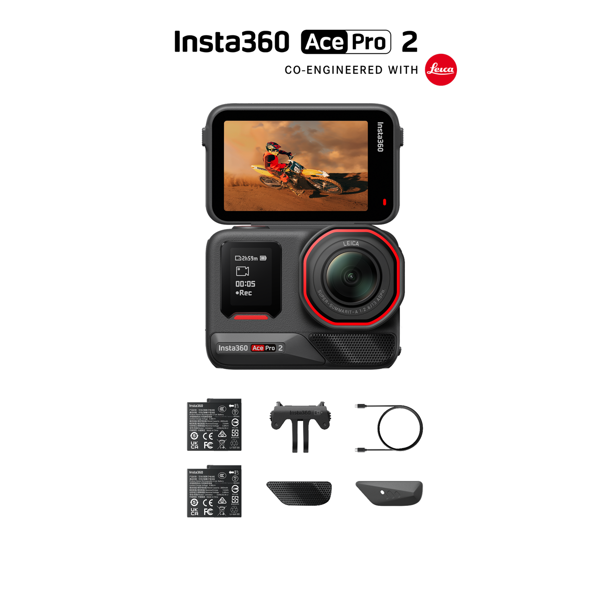
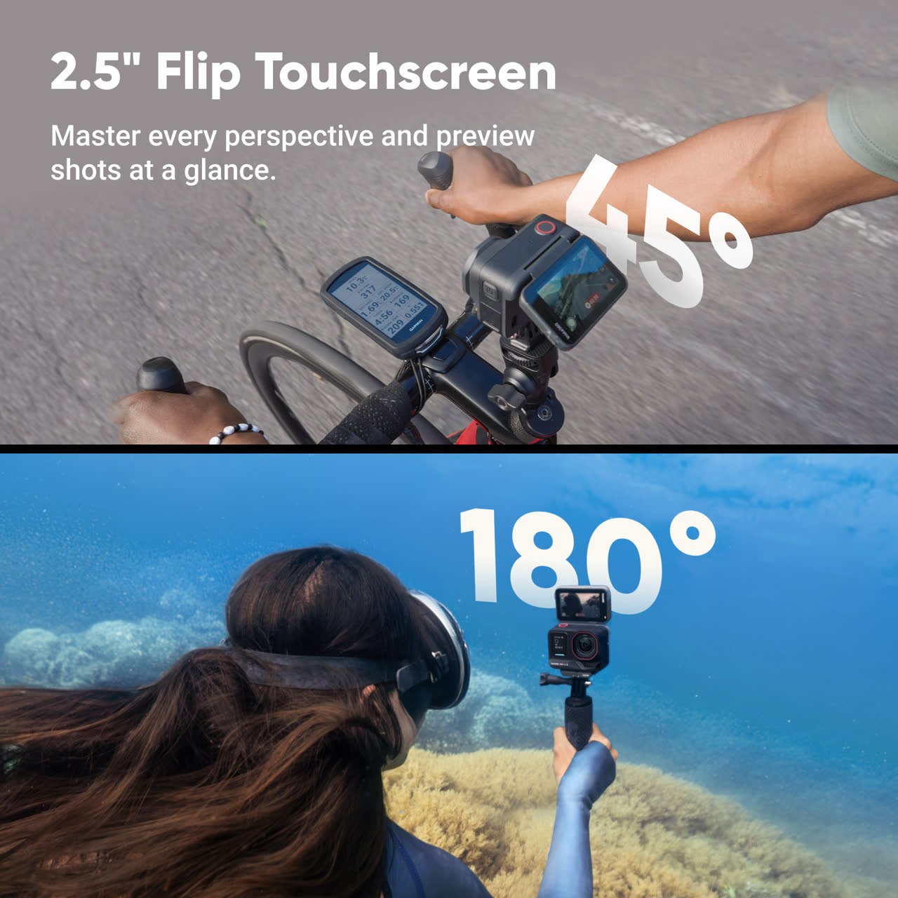
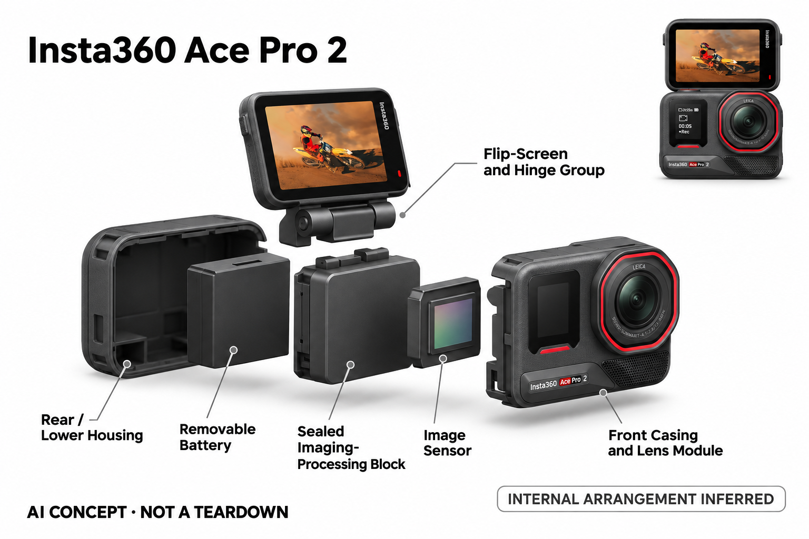

# Insta360 Ace Pro 2

**Insta360** · 影像与创作 · 核查 2026-11-04

把机内AI高光筛选用于运动素材管理

消费渠道：个人零售。

## 产品图片与结构参考

### 产品图

Insta360 Ace Pro 2 · 官方产品图 · 来源：[Insta360 · 官方图片](<https://store.insta360.com/product/ace-pro-2>) · [原始图片](<https://wassets.insta360.com/store/93bb64af59314190801a7d11946e641c/8827_53907e3f-98e0-4ac3-96ac-b18c29aa3741.png>)

### 参考图

Insta360 Ace Pro 2 · 官方参考图 · 来源：[Insta360 · 官方图片](<https://store.insta360.com/product/ace-pro-2>) · [原始图片](<https://wassets.insta360.com/store/133b2e9de5d747f5bd344dbfd0713920/13762_7b07aec5-4d82-4c92-911d-285360439841.jpg>)

### AI 生成爆炸示意

**AI 生成 · 非实物拆机。** 内部为概念推断，不能作为元件布局、BOM 或维修依据。[生成提示词](../../content/hardware/prompts/insta360-ace-pro-2.txt)

> 已目视核对外形、标签与非拆机声明；不代表内部结构经实测验证。

> 分析为基于公开资料的案头研究与 AI 辅助判断，未经用户访谈、销量审计或实物拆机。需求、画像、竞争冷门度、审美及商业机会均为研究假设，不是投资结论。

## 销售与购买

- 状态：在售。官方商城显示通常两天内发货；公开页面商品数据标准套餐isOutOfStock=false且可零售。颜色、电池套餐和握把组合不重复计数。

- 地区：美国官方商城及当地授权市场

- 价格：美国官网标准双电套餐 US$389.99。核查日页面快照；运费、税费、会员和配送区域按官方结算确认，不视为中国到手价。

- 中国大陆：本轮核实所列区域官方商店；未确认中国大陆官方现货、账户及完整服务，不把境外可购等同大陆可用。

- [官方产品 / 商店](<https://store.insta360.com/product/ace-pro-2>)

## AI 的实际作用

设备AI图像处理参与低光优化，AI Highlights Assistant在相机中识别值得保留的片段；应用另提供自动剪辑与生成特效，端侧筛片和付费云效果分别列明。

服务与联网依赖：基本拍摄与机内高光筛选可独立使用；应用自动剪辑、自拍杆擦除和AI Warp等功能依赖兼容手机、网络及相应额度，不保证所有模式同时支持。

## 是否冷门

新兴竞争（研究判断）：拍摄处理与应用生成效果分开形成具体使用场景；本轮没有销量与市场份额证据。

## 需求与市场

需求假设：运动和旅行创作者常积累大量未整理视频，希望更快找到值得保留的片段。应测试筛选是否遗漏用户真正想记录的瞬间，并比较从拍摄到成片的总时间，而不是只看自动剪辑速度。

### 需求假设：运动记录后的整理负担 · 研究判断

Ace Pro 2把广角拍摄、翻转屏和机内高光筛选放在一台运动相机中，需求可能来自难以拿稳手机的拍摄场景，也可能来自大量未整理视频。两者应分别验证，不能因为用户拍了很多素材，就假定他们愿意购买更多自动剪辑功能。

依据：[Ace Pro 2官方商城](<https://store.insta360.com/product/ace-pro-2>) · [Ace Pro 2官方AI功能](<https://www.insta360.com/product/insta360-ace-pro2>)

### 价值判断：筛片是否保留真正重要片段 · 研究判断

机内高光助手的价值在于帮助用户发现可用片段，但动作明显的时刻未必是用户最想保存的记忆。若筛选需要逐一复查，省时效果可能有限；应同时看遗漏、误选和用户控制感，而不是只看系统能自动生成一段视频。

依据：[Ace Pro 2官方AI功能](<https://www.insta360.com/product/insta360-ace-pro2>)

### 验证方案：从一次真实活动到分享 · 待验证

让用户完成一次骑行、旅行或家庭活动，随后整理并分享自己愿意保留的内容，记录从安装到导出的全部时间。比较人工选片与辅助筛选的差异，并询问被漏掉的片段为何重要，避免只用精选演示证明自动化有效。

依据：[Ace Pro 2官方商城](<https://store.insta360.com/product/ace-pro-2>) · [Ace Pro 2官方AI功能](<https://www.insta360.com/product/insta360-ace-pro2>)

## 用户画像

画像推断：经常骑行、旅行或自拍视频且愿意使用小型运动相机的人较匹配。广角、翻转屏和固定支架适合特定场景，但手机已经满足轻度记录者，购买前应明确为何需要独立拍摄设备。

### 画像假设：经常在特定位置安装相机 · 研究判断

潜在用户应有反复出现的骑行、运动或旅行记录任务，并愿意管理安装配件、存储与充电。对只是偶尔拍短视频的人，手机可能已足够；画像需要说明独立运动相机在哪些位置和动作中更有价值，而不是泛称热爱生活的创作者。

依据：[Ace Pro 2官方商城](<https://store.insta360.com/product/ace-pro-2>) · [Ace Pro 2官方AI功能](<https://www.insta360.com/product/insta360-ace-pro2>)

### 使用约束：翻转屏与固定视角的取舍 · 研究判断

翻转屏有助于确认构图，但安装在头盔、车把或胸前后，用户未必能随时查看。固定广角记录与手持自拍视频也有不同操作要求，因此应按实际安装方式划分人群，不能把同一组功能默认都能在每次使用中带来收益。

依据：[Ace Pro 2官方AI功能](<https://www.insta360.com/product/insta360-ace-pro2>)

### 访谈重点：找出素材堆积的真实原因 · 待验证

应让用户展示最近一次没有整理的视频，询问是传输慢、内容太多、剪辑困难还是根本没有分享意愿。只有明确阻力来自片段选择时，高光筛选才可能是直接解法；如果问题是安装麻烦或活动频率低，增加AI入口可能无济于事。

依据：[Ace Pro 2官方AI功能](<https://www.insta360.com/product/insta360-ace-pro2>)

## 竞争与替代

竞争判断：运动相机已有多品牌和手机替代，AI降噪及剪辑也逐渐普及，不能把AI芯片视作独占优势。此款的差别在拍摄姿态、低光流程和机内筛片结合，价值应通过具体素材验证。

### 替代方案：手机与其他运动相机 · 研究判断

Ace Pro 2需要与手机加固定配件、其他广角运动相机及全景设备一起比较。它们在安装、预览和后期取景上有不同方式，不能单靠标称分辨率或AI芯片名称排序；用户已有的配件和编辑习惯也会影响迁移成本。

依据：[Ace Pro 2官方商城](<https://store.insta360.com/product/ace-pro-2>) · [Ace Pro 2官方AI功能](<https://www.insta360.com/product/insta360-ace-pro2>)

### 差异判断：拍摄和筛片是两段价值 · 研究判断

官方将图像处理、机内高光提示与应用编辑分别介绍，这种衔接可能减少素材管理步骤。竞争分析应检查这些环节是否真的连贯，而不是把多项能力简单相加；如果用户仍需换应用反复导出，硬件集成的便利会被削弱。

依据：[Ace Pro 2官方AI功能](<https://www.insta360.com/product/insta360-ace-pro2>)

### 比较方法：保持同一发布目标 · 待验证

让不同方案输出相同长度和画幅的视频，记录安装时间、画面可用率、人工纠错和最终导出步骤。对比时保留所有原始片段，不只看成片是否好看；这样才能判断差异来自镜头、处理还是用户已有的剪辑经验。

依据：[Ace Pro 2官方商城](<https://store.insta360.com/product/ace-pro-2>) · [Ace Pro 2官方AI功能](<https://www.insta360.com/product/insta360-ace-pro2>)

## 供应链

供应链推断：镜头、传感器、翻转屏铰链和防护密封需要协调光学与耐用性，配件接口也影响使用。官方未披露完整代工及物料表，镜片损伤、维修与电池替换都是创作者拥有成本。

### 功能拆分：光学与机内处理并非全部 · 研究判断

公开产品由固定广角光学、图像采集处理、翻转屏、音频与防风结构、电源和安装配件共同形成。高光助手是素材处理的一层，应用中的生成效果又在另一服务链路，不能把全部AI能力画在相机内，也不能据概念图推断真实芯片布局。

依据：[Ace Pro 2官方商城](<https://store.insta360.com/product/ace-pro-2>) · [Ace Pro 2官方AI功能](<https://www.insta360.com/product/insta360-ace-pro2>)

### 制造判断：户外结构和转轴协同 · 研究判断

运动相机需要让镜头保护、翻屏转轴、按键与壳体防护在频繁安装中保持一致，电池和接口也需要可维护。供应评估应关注装配与返修路径，而不是只比较传感器或处理器；本轮没有公开点名的完整原机物料表和工厂确认。

依据：[Ace Pro 2官方AI功能](<https://www.insta360.com/product/insta360-ace-pro2>)

### 候选选型：先拆分可验证模块 · 研究判断

舜宇可作为紧凑成像光学的候选，瑞声可讨论结构与转轴协同，欣旺达可评估消费电池方案。每一项仍需确认视场、温度、机械寿命和供电接口，不能用企业业务范围替代具体料号匹配，也不表明这些公司已经为Ace Pro 2供货。

依据：[Ace Pro 2官方商城](<https://store.insta360.com/product/ace-pro-2>) · [Ace Pro 2官方AI功能](<https://www.insta360.com/product/insta360-ace-pro2>)

## 技术路径

官方将图像AI处理、机内高光助手与应用生成效果分开介绍。技术判断应比较原始细节保留、误删建议和导出时间，不能将降噪画面自然等同真实细节恢复，也不推断未知芯片型号。

### 已披露能力：机内与应用AI分开 · 官方资料

官方描述机内图像AI处理以及高光助手对片段的筛选提示，应用还提供自动剪辑、自拍杆擦除和生成效果。分析应保持推理位置和服务权益的区别，不能把所有后期能力都称为离线机内功能，也不把算法修正视作真实细节恢复。

依据：[Ace Pro 2官方AI功能](<https://www.insta360.com/product/insta360-ace-pro2>)

### 技术判断：画面平滑不代表信息忠实 · 研究判断

低光处理可能改善观看感受，但用户是否需要保留纹理、运动细节或原始氛围，取决于题材。高光筛选也涉及主观重要性，评价应分别观察图像处理和素材判断，不把降噪后的干净画面与值得保留的内容合并成同一种成功。

依据：[Ace Pro 2官方AI功能](<https://www.insta360.com/product/insta360-ace-pro2>)

### 验证方案：同时检查误选和遗漏 · 待验证

使用有快速动作、静态对话和低光变化的真实视频，记录助手标记的片段与用户最终选择是否一致。对图像处理则保留相同条件下的原始比较，观察细节、拖影和颜色变化；不能只用一段自动生成成片代表全部技术表现。

依据：[Ace Pro 2官方AI功能](<https://www.insta360.com/product/insta360-ace-pro2>)

## 产品审美

审美判断：紧凑黑色机身、正面镜头和可翻转大屏表达明确拍摄工具定位，适合在运动装备中存在。翻屏占用、戴手套操作和麦克风防风附件会改变外形与手感，需要在目标场景下体验。

### 外形判断：翻屏使相机角色更明显 · 研究判断

黑色紧凑机身、正面镜头与上翻显示让Ace Pro 2具有明确的拍摄工具语言，防风部件和固定架则影响最终轮廓。审美需要放到骑行或旅行装备中观察，不能只看裸机渲染；用户是否愿意安装和展示设备也是体验的一部分。

依据：[Ace Pro 2官方商城](<https://store.insta360.com/product/ace-pro-2>) · [Ace Pro 2官方AI功能](<https://www.insta360.com/product/insta360-ace-pro2>)

### 交互判断：看得见与戴手套操作 · 研究判断

翻转屏可以帮助预览，但戴手套、湿手或边走边拍时，按钮与屏幕承担的任务可能不同。应检查哪些操作需要停下来完成，以及屏幕翻起是否影响安装角度；外观上的小巧不必然意味着运动场景中操作简单。

依据：[Ace Pro 2官方AI功能](<https://www.insta360.com/product/insta360-ace-pro2>)

### 体验验证：带着真实配件完成活动 · 待验证

让参与者使用平常的衣物、头盔或车辆安装设备，再记录取下、换角度和查看画面的动作。随后讨论哪些设计减少了犹豫、哪些部件容易被遗忘，避免用桌面拿在手里的短暂体验，推断长时间户外使用的舒适与便利。

依据：[Ace Pro 2官方商城](<https://store.insta360.com/product/ace-pro-2>) · [Ace Pro 2官方AI功能](<https://www.insta360.com/product/insta360-ace-pro2>)

## 关键风险

风险判断：算法筛选可能漏掉低动作但有意义的片段，应用生成效果可能收费并改变原始内容。户外拍摄还需遵守安全和场所规则，重要素材应先备份，不把防护宣传或AI建议当作使用保证。

### 内容风险：自动筛选可能遗漏记忆 · 研究判断

高动作或清晰画面不一定是个人最重视的片段，自动筛选可能遗漏安静但有意义的瞬间。用户应能查看原始素材并自行决定保留范围，不能把AI建议当作唯一删除依据；本轮没有测量该型号对不同题材的筛选准确性。

依据：[Ace Pro 2官方AI功能](<https://www.insta360.com/product/insta360-ace-pro2>)

### 服务风险：应用权益与模式条件 · 研究判断

应用中的生成效果可能受额度、网络和账户条件影响，不同拍摄模式也未必同时支持全部功能。购买者需核对当前软件与所选配置，不能把硬件一次性价格当作所有AI服务的永久权益，也不能把当地商店可购等同全球支持一致。

依据：[Ace Pro 2官方商城](<https://store.insta360.com/product/ace-pro-2>) · [Ace Pro 2官方AI功能](<https://www.insta360.com/product/insta360-ace-pro2>)

### 验证安排：保留原片并记录安装条件 · 待验证

重要活动应在使用前测试固定与录制流程，试用记录需包含安装方式、存储状态和模式设置。自动编辑前保留可恢复的原片，方便判断问题来自采集、传输还是后期；这些是验证步骤，不是对产品耐用性或安全性能的未经测试结论。

依据：[Ace Pro 2官方商城](<https://store.insta360.com/product/ace-pro-2>) · [Ace Pro 2官方AI功能](<https://www.insta360.com/product/insta360-ace-pro2>)

## 机会与验证

市场观察：可让真实旅行用户用同一路线比较手机与相机，记录携带、安装、筛片和分享耗时。将画质、操作便利与AI节省的整理时间分别衡量，不以参数总量和品牌宣传推算市场成功。

### 研究方向：从素材管理而非参数起步 · 研究判断

Ace Pro 2提示的研究问题是个人创作者能否更轻松地从大量运动素材中找回真正重要的内容。机会可能在安装、筛片或跨设备整理，而不一定需要新硬件；应先确认用户在哪一环反复停滞，再决定是否值得投入算法或产品开发。

依据：[Ace Pro 2官方AI功能](<https://www.insta360.com/product/insta360-ace-pro2>)

### 执行计划：建立活动后的行为记录 · 待验证

让用户连续几次活动记录拍摄时长、最终保留片段和整理耗时，访谈追问哪些建议被接受或忽略。把首次新鲜感与后续习惯分开，并比较不同题材；没有这种纵向证据，不能从自动成片展示推断长期留存或付费需求。

依据：[Ace Pro 2官方商城](<https://store.insta360.com/product/ace-pro-2>) · [Ace Pro 2官方AI功能](<https://www.insta360.com/product/insta360-ace-pro2>)

### 决策边界：用可核查任务支撑机会判断 · 研究判断

只有当素材管理成本反复出现、现有替代明显不足且用户愿意改变流程时，才值得进一步做原型验证。供应商能力、AI标签和画质参数都不能预测创业成功，本轮也没有用户访谈、销量或市场份额数据，结论保持案头假设。

依据：[Ace Pro 2官方商城](<https://store.insta360.com/product/ace-pro-2>) · [Ace Pro 2官方AI功能](<https://www.insta360.com/product/insta360-ace-pro2>)

## 对应供应链公司

能力候选用于选型研究，不代表本产品实际采用；未公开的供货关系不作推断。

- [sunny-optical](../supply-chain/sunny-optical.md) — **能力候选 · 非已采用** / 紧凑广角成像光学候选：舜宇公开镜头和视觉模组产品，可作为Ace Pro 2这类固定广角影像设备的光学能力候选；仍需确认视场、像面、畸变校正和户外温度条件是否符合具体设计，不能把普通监控或机器人镜头直接视为原机替换件，也没有点名供货证据。

- [aac-technologies](../supply-chain/aac-technologies.md) — **能力候选 · 非已采用** / 翻转显示转轴与紧凑外壳候选：瑞声精密制造包含转轴、结构件和空间协同能力，与Ace Pro 2翻转显示及紧凑防护外壳的工程问题有对应关系；但运动安装、机械寿命及防护工艺需要专门确认，本条不声称其参与该相机结构制造或为厂商现有合作方。

- [sunwoda](../supply-chain/sunwoda.md) — **能力候选 · 非已采用** / 运动相机充电电源方案候选：欣旺达消费电池能力可用于评估便携拍摄设备电源，但Ace Pro 2的可更换电池结构、保护接口和持续录制负载必须依据正式规格验证。集团有消费电池业务不等于能够直接供应兼容替换电池，当前关联仅表示选型候选。

[浏览供应链目录](../supply-chain.md)

## 功能分层示意

这是功能关系，不是实物拆机、真实空间结构或已核实 BOM。

1. **光学采集**：镜头和传感器记录广角画面。（官方披露）

2. **图像处理**：机内AI辅助低光与画面处理。（官方披露）

3. **素材筛选**：机内高光助手提示值得保留片段。（官方披露）

4. **创作输出**：翻转屏操作及应用编辑导出。（官方披露）

## 来源

1. [Ace Pro 2官方商城](<https://store.insta360.com/product/ace-pro-2>) — 已实际打开官方页面；功能说明不等于独立性能测量。

2. [Ace Pro 2官方AI功能](<https://www.insta360.com/product/insta360-ace-pro2>) — 已实际打开官方页面；功能说明不等于独立性能测量。

[返回目录](../hardware-market.md) · [网页分析](https://romanagent.github.io/Roman/#hardware/product/insta360-ace-pro-2)
