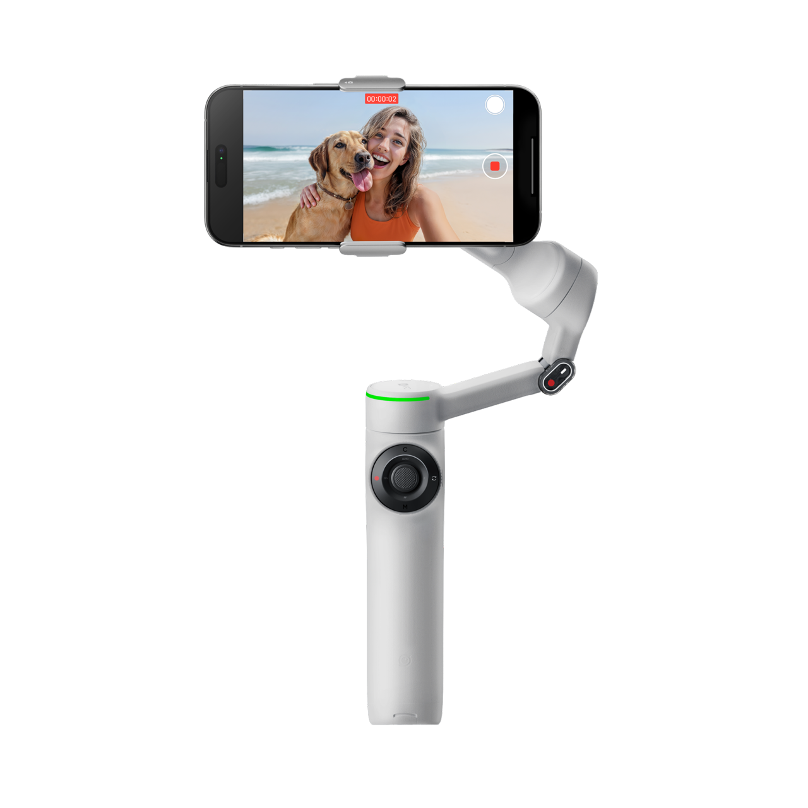
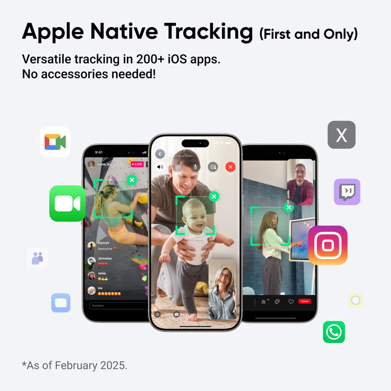
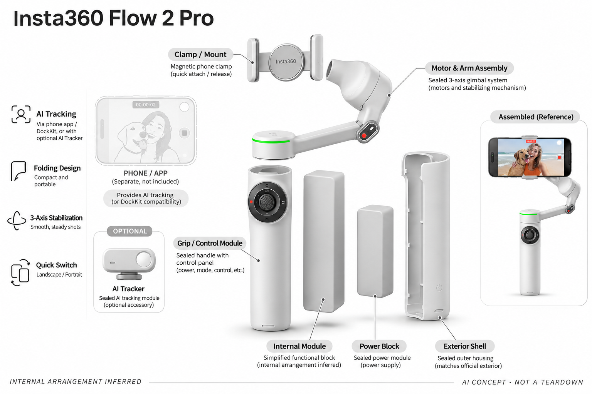

# Insta360 Flow 2 Pro（AI Tracker组合）

**Insta360** · 智能云台 · 核查 2026-11-04

以手机云台、系统跟踪与可选AI模块支持个人创作。

消费渠道：个人零售。

## 产品图片与结构参考

### 产品图

Insta360 Flow 2 Pro（AI Tracker组合） 官方产品图（相机/手机用于展示，非默认随附） · 来源：[Insta360](<https://store.insta360.com/product/flow-2-pro>) · [原始图片](<https://res.insta360.com/dynamic/store/fbcdc1ca1ba8f05015d9a9919c3968fd/391_e3aefc32-78fb-4ba4-b3e0-b8c9a026573d.png>)

### 参考图

官方DockKit路径参考：该路径与外置AI Tracker功能不同（相机/手机用于展示，非默认随附） · 来源：[Insta360](<https://store.insta360.com/product/flow-2-pro>) · [原始图片](<https://res.insta360.com/dynamic/store/0b3fb422477f2a841609975d3536134b/586_04beaf19-f53e-4293-ae10-87a55e42a854.jpg>)

### AI 生成爆炸示意

**AI 生成 · 非实物拆机。** 内部为概念推断，不能作为元件布局、BOM 或维修依据。[生成提示词](../../content/hardware/prompts/insta360-flow-2-pro.txt)

> 分析为基于公开资料的案头研究与 AI 辅助判断，未经用户访谈、销量审计或实物拆机。需求、画像、竞争冷门度、审美及商业机会均为研究假设，不是投资结论。

## 销售与购买

- 状态：在售。官方Flow 2系列页面列出Pro的AI Tracker Bundle与正常发货说明，AI Tracker另有官方可加购页面。颜色与不同包装合并为一款。

- 地区：美国官方店、其他官方地区另查

- 价格：AI Tracker Bundle US$179.99。为所标地区和配置的核查参考；活动、税费、物流及可选服务以实际结算为准，不进行汇率换算或保证最低价。

- 中国大陆：本轮核查海外官方消费渠道，未验证中国大陆结算、型号、保修与全部AI服务可用性；不因品牌来源或支持中文推定国内可购。

- [官方产品 / 商店](<https://store.insta360.com/product/flow-2-pro>)

## AI 的实际作用

Flow 2 Pro提供手机跟拍，AI Tracker模块进一步支持跨App与更多手机的视觉追踪；Apple DockKit和Insta360 App的对象范围不同。

服务与联网依赖：本条按含AI Tracker的组合分析。标准Pro套装不含该模块，系统版本、App和手机平台会改变可用功能，不把所有模式混为一种能力。

## 是否冷门

竞争密集（研究判断）：AI手机云台竞争密集，跨平台兼容属于实际细分需求而非天然空白市场。

## 需求与市场

需求假设：个人创作者需要在原生相机、直播和视频通话之间继续保持人物或目标构图。系统兼容是比单纯三轴稳定更清晰的问题，但是否频繁跨App使用还需要真实场景验证。

### 需求假设：换到常用应用仍保持手机构图 · 研究判断

Flow 2 Pro加AI Tracker针对个人作者在原生相机、直播和通话等应用之间希望继续跟拍的任务，核心是兼容与少重设，而不只是三轴稳定。研究应确认跨应用是否反复发生，不能以支持更多入口推断所有手机用户都需要。

依据：[Flow 2 Pro 官方系列商店](<https://store.insta360.com/product/flow-2-pro>) · [Flow 2 系列 AI Tracker 官方页](<https://store.insta360.com/product/flow-2-pro-ai-tracker>)

### 价值判断：不同跟踪路径可能增加理解成本 · 研究判断

DockKit、Insta360应用和外置Tracker提供不同路线，用户获得灵活性也需要知道当前哪一条在工作。研究应观察切换是否减少步骤，不能把三种能力混成一种无条件追踪，也不将某路径支持对象推广到所有相机与平台。

依据：[Flow 2 Pro 官方系列商店](<https://store.insta360.com/product/flow-2-pro>) · [Flow 2 系列 AI Tracker 官方页](<https://store.insta360.com/product/flow-2-pro-ai-tracker>)

### 验证方案：用用户日常应用完成连续任务 · 待验证

让创作者在自己常用手机上完成录像、直播或通话的实际切换，记录安装、权限、目标选择和恢复，比较原有支架方案。保持任务真实，不只在厂商应用中演示，也不以一次成功跟拍推断系统升级后和所有平台都可用。

依据：[Flow 2 Pro 官方系列商店](<https://store.insta360.com/product/flow-2-pro>) · [Flow 2 系列 AI Tracker 官方页](<https://store.insta360.com/product/flow-2-pro-ai-tracker>)

## 用户画像

画像推断：手机视频作者、远程讲解者和希望记录家庭运动的个人，已拥有兼容手机。iOS与Android用户面对的功能路径不同，不能用一个演示账户的体验代表所有消费者。

### 画像假设：手机工作流中反复切换应用的人 · 研究判断

较匹配者经常用手机制作人物内容或远程讲解，有明确跨应用需求，并愿意携带云台与模块。只在一个相机应用拍摄的人可能需要更简单配置，画像应包含平台、系统和常用应用，不把所有手机摄影爱好者视为同一需求。

依据：[Flow 2 Pro 官方系列商店](<https://store.insta360.com/product/flow-2-pro>) · [Flow 2 系列 AI Tracker 官方页](<https://store.insta360.com/product/flow-2-pro-ai-tracker>)

### 使用约束：iOS与Android路径需要分别理解 · 研究判断

不同手机与系统版本面对不同跟踪入口，外置模块可扩展部分场景却不消除全部条件。用户需要确认自己的设备、夹具和套装，不能用某个演示账户代表全部消费者，也不把标准Pro包装默认视为包含AI Tracker。

依据：[Flow 2 Pro 官方系列商店](<https://store.insta360.com/product/flow-2-pro>) · [Flow 2 系列 AI Tracker 官方页](<https://store.insta360.com/product/flow-2-pro-ai-tracker>)

### 访谈重点：切换应用时具体丢失什么 · 待验证

请用户展示从拍摄到直播或通话时需要重新做的步骤，说明是跟踪、构图、权限还是摆位，再观察组合如何改变。这个问题能区分真正兼容需求与模式探索，不能只问想支持多少应用，也不将更多平台列表当作购买理由。

依据：[Flow 2 系列 AI Tracker 官方页](<https://store.insta360.com/product/flow-2-pro-ai-tracker>)

## 竞争与替代

竞争判断：它与其他AI手机云台、追踪支架及手机裁切竞争。模块与系统跟踪的组合提供灵活性，但也增加选购理解成本；买家可能更重视常用App是否顺手，而非模式数量。

### 替代方案：手机云台、追踪支架与软件裁切 · 研究判断

Flow组合与其他手机云台、桌面自动支架和手机内裁切竞争，不同方案在稳定、转向与应用兼容上有取舍。比较应按常用工作流，不能把机械稳定与识别合成同一指标，也不因多路径组合就推断属于没有竞争的新场景。

依据：[Flow 2 Pro 官方系列商店](<https://store.insta360.com/product/flow-2-pro>) · [Flow 2 系列 AI Tracker 官方页](<https://store.insta360.com/product/flow-2-pro-ai-tracker>)

### 差异判断：系统生态与外置模块互补 · 研究判断

DockKit、Deep Track和Tracker各有对象与运行条件，组合价值可能在某些应用间减少中断，但也增加选购和状态判断。研究应明确哪一条解决真实问题，不把某模式的宠物追踪扩展到所有应用，也不以模块价格推断制造成本。

依据：[Flow 2 Pro 官方系列商店](<https://store.insta360.com/product/flow-2-pro>) · [Flow 2 系列 AI Tracker 官方页](<https://store.insta360.com/product/flow-2-pro-ai-tracker>)

### 比较方法：按同一手机的跨应用步骤对照 · 待验证

让不同方案完成相同应用顺序和内容任务，记录展开、安装、权限与重新锁定目标，检查最终片段或通话取景。不要只在一个最优应用中排名，也不将系统不支持的功能算成硬件故障，分清路径才能判断组合是否值得。

依据：[Flow 2 Pro 官方系列商店](<https://store.insta360.com/product/flow-2-pro>) · [Flow 2 系列 AI Tracker 官方页](<https://store.insta360.com/product/flow-2-pro-ai-tracker>)

## 供应链

公开资料区分云台、磁吸夹具和AI Tracker，具体芯片及全套供应商未公开。分析重点是磁吸可靠性、视觉模块装配、马达调校和折叠寿命，不能将附件零售价直接当作制造成本。

### 功能拆分：云台、手机与外置Tracker分离 · 研究判断

公开系统包括三轴结构、磁吸夹具、手机应用或系统跟踪以及AI Tracker模块，本条以包含模块的组合理解。不能将外置模块和手机传感器混成同一BOM，也不默认基础包装具备全部能力，具体芯片、驱动和工厂未披露。

依据：[Flow 2 Pro 官方系列商店](<https://store.insta360.com/product/flow-2-pro>) · [Flow 2 系列 AI Tracker 官方页](<https://store.insta360.com/product/flow-2-pro-ai-tracker>)

### 制造判断：折叠夹持与视觉安装共同影响使用 · 研究判断

磁吸夹具、折叠、伸展和三脚架整合减少零散件，同时对安装反馈、马达调校和长期连接提出要求。供应评估应看完整手机负载与模块位置，本轮没有夹持、寿命或实拍测试，不能由紧凑造型或附件售价推断可靠性与成本。

依据：[Flow 2 Pro 官方系列商店](<https://store.insta360.com/product/flow-2-pro>) · [Flow 2 系列 AI Tracker 官方页](<https://store.insta360.com/product/flow-2-pro-ai-tracker>)

### 候选选型：结构与视觉输入各自限定 · 研究判断

瑞声可作为折叠和夹持周边结构候选，Arducam可讨论Tracker视觉输入，Sunwoda可研究供电。磁吸、尺寸、视场和不同软件路径需专项验证，候选不提供DockKit授权或Deep Track，也没有Insta360点名供应证据，不能直接替换原件。

依据：[Flow 2 Pro 官方系列商店](<https://store.insta360.com/product/flow-2-pro>) · [Flow 2 系列 AI Tracker 官方页](<https://store.insta360.com/product/flow-2-pro-ai-tracker>)

## 技术路径

技术上需分清DockKit、Insta360 Deep Track和外置AI Tracker三条识别路径。它们的对象范围和运行条件不同，不能因为某一模式能追宠物就推定全部相机App都能做到。

### 已披露能力：三条识别路线各有条件 · 官方资料

原目录核查区分Apple DockKit、Insta360 Deep Track与外置AI Tracker，后者扩展跨应用和更多手机的视觉追踪。它们的对象和运行条件不同，不能因为一条路径识别宠物就称所有应用都支持，也不把机械稳定与系统识别混为同一AI。

依据：[Flow 2 Pro 官方系列商店](<https://store.insta360.com/product/flow-2-pro>) · [Flow 2 系列 AI Tracker 官方页](<https://store.insta360.com/product/flow-2-pro-ai-tracker>)

### 技术判断：切换路径需要清楚显示状态 · 研究判断

用户可能不知道当前由手机系统、应用还是模块追踪，出现问题时也就难以恢复，组合灵活性可能转成认知负担。研究应观察目标选择、暂停与切换是否可理解，不能只看正常跟随平滑，也不以支持应用数量推断端到端可靠性。

依据：[Flow 2 Pro 官方系列商店](<https://store.insta360.com/product/flow-2-pro>) · [Flow 2 系列 AI Tracker 官方页](<https://store.insta360.com/product/flow-2-pro-ai-tracker>)

### 验证方案：按平台与应用逐项记录 · 待验证

在目标手机上分别验证所需路径，保存系统、应用、模块和权限条件，再检查同一任务的跟随与恢复。不要用一个平台结果推广另一个，也不把未来兼容预期写成当前功能，本轮没有跨平台实拍或所有应用的成功率数据。

依据：[Flow 2 Pro 官方系列商店](<https://store.insta360.com/product/flow-2-pro>) · [Flow 2 系列 AI Tracker 官方页](<https://store.insta360.com/product/flow-2-pro-ai-tracker>)

## 产品审美

设计观察：折叠、自拍杆与三脚架整合降低携带件数，小型AI模块却需要清晰的安装反馈。日常使用品质来自收纳、展开和切换操作，不应仅凭金属或透明细节判断高级感。

### 外形判断：折叠与支撑整合降低散件数量 · 研究判断

Flow的折叠、自拍杆与三脚架整合可减少携带件数，AI模块又需要额外安装与保管，完整形态必须包括手机。设计评价应看展开、夹持和收纳，不只看透明或金属细节，也不能从小模块外观推断容易装对或长期不易丢失。

依据：[Flow 2 Pro 官方系列商店](<https://store.insta360.com/product/flow-2-pro>) · [Flow 2 系列 AI Tracker 官方页](<https://store.insta360.com/product/flow-2-pro-ai-tracker>)

### 交互判断：安装与软件反馈要对应 · 研究判断

手机夹持与Tracker位置需要清楚的物理反馈，软件也要让用户知道当前路径和目标，二者不能各自孤立。研究应观察是否需要反复拆装或试手势，不把磁吸简单视为不会出错，也不将应用功能丰富当作跨平台体验已经一致。

依据：[Flow 2 Pro 官方系列商店](<https://store.insta360.com/product/flow-2-pro>) · [Flow 2 系列 AI Tracker 官方页](<https://store.insta360.com/product/flow-2-pro-ai-tracker>)

### 体验验证：从口袋到不同应用拍摄 · 待验证

让用户用自己的手机、保护壳和常用应用完成展开、安装、跟拍、切换和收起，记录额外附件与权限操作。不要只在裸手机和指定应用中展示，完整日常条件更能说明整合形态是否减少步骤，也能纳入不愿携带模块的人。

依据：[Flow 2 Pro 官方系列商店](<https://store.insta360.com/product/flow-2-pro>) · [Flow 2 系列 AI Tracker 官方页](<https://store.insta360.com/product/flow-2-pro-ai-tracker>)

## 关键风险

风险在于套装缺件、系统升级后的兼容变化和追踪丢失。标准版价格不包含所有AI能力，本目录因此以组合价说明；稳定的跨App体验仍需要在目标手机上验证。

### 配置风险：标准套装不含全部AI能力 · 研究判断

本条按AI Tracker组合分析，标准Pro套装不能默认包含外置模块，手机和系统版本还会改变功能路径。用户应核对实际包装与常用应用，不能用最低价格和最高宣传能力拼成一个不存在的配置，本轮没有全部组合实测。

依据：[Flow 2 Pro 官方系列商店](<https://store.insta360.com/product/flow-2-pro>) · [Flow 2 系列 AI Tracker 官方页](<https://store.insta360.com/product/flow-2-pro-ai-tracker>)

### 兼容风险：系统与应用更新影响跟拍 · 研究判断

跨应用体验涉及外部系统和软件，更新、权限或后台状态可能改变行为，用户需要知道如何恢复或选择另一条路径。目录不把兼容列表当作永久承诺，也不由一条路径正常推断全部平台可靠，夹持、电池和追踪丢失仍需按说明管理。

依据：[Flow 2 Pro 官方系列商店](<https://store.insta360.com/product/flow-2-pro>) · [Flow 2 系列 AI Tracker 官方页](<https://store.insta360.com/product/flow-2-pro-ai-tracker>)

### 验证安排：记录切换失败与模块闲置 · 待验证

试用应保留用户只用一种路径、放弃外置模块或改回普通支架的原因，区分不需要和不好用。不要只统计支持应用总数，也不把关闭某项功能视为整机无价值，实际切换频率与恢复成本才说明组合需求是否持续。

依据：[Flow 2 Pro 官方系列商店](<https://store.insta360.com/product/flow-2-pro>) · [Flow 2 系列 AI Tracker 官方页](<https://store.insta360.com/product/flow-2-pro-ai-tracker>)

## 机会与验证

可验证的购买理由是减少跨App拍摄时重新布置机位的步骤。应比较常用平台上的准备和恢复时间，并纳入不愿携带配件的人群，本轮不以兼容App数量预测市场规模。

### 研究方向：让跨应用构图少一次重新配置 · 研究判断

Flow组合可帮助研究用户在不同手机内容任务之间如何保持取景，机会可能在兼容解释、状态和恢复，而不是增加更多路径。应先确认用户真的频繁切换，再讨论模块价值，避免把系统生态能力和硬件功能叠加成笼统AI优势。

依据：[Flow 2 Pro 官方系列商店](<https://store.insta360.com/product/flow-2-pro>) · [Flow 2 系列 AI Tracker 官方页](<https://store.insta360.com/product/flow-2-pro-ai-tracker>)

### 执行计划：按真实平台追踪切换与携带 · 待验证

记录多次拍摄中的手机系统、应用顺序、模块使用和重设，访谈一次放弃切换或不携带设备的任务。将稳定、跟踪和平台兼容收益分开，不用应用数量、演示流畅或初次兴趣代表留存，也不冒充已经完成广泛实测。

依据：[Flow 2 Pro 官方系列商店](<https://store.insta360.com/product/flow-2-pro>) · [Flow 2 系列 AI Tracker 官方页](<https://store.insta360.com/product/flow-2-pro-ai-tracker>)

### 决策边界：手机跟拍共享需求下保留路径差异 · 研究判断

本款与其他手机云台共享人物构图和稳定任务，系统与外置模块组合是具体区别，不能按每个应用统计为新市场。当前没有访谈、销量与供应报价，不以配件数、AI标签或模型评分预测创业成功，应看反复任务中减少了什么。

依据：[Flow 2 Pro 官方系列商店](<https://store.insta360.com/product/flow-2-pro>) · [Flow 2 系列 AI Tracker 官方页](<https://store.insta360.com/product/flow-2-pro-ai-tracker>)

## 对应供应链公司

能力候选用于选型研究，不代表本产品实际采用；未公开的供货关系不作推断。

- [aac-technologies](../supply-chain/aac-technologies.md) — **能力候选 · 非已采用** / 折叠与手机夹持周边结构候选：瑞声公开精密结构与转轴协同，可用于Flow 2 Pro折叠及夹持周边工程，但磁吸可靠、保护壳适配、线缆和长期展开需专项验证，不能从普通结构经验推定整机适配。当前无Insta360点名采用证据，也不提供原夹具替换件。

- [arducam](../supply-chain/arducam.md) — **能力候选 · 非已采用** / 外置AI Tracker视觉输入候选：Arducam公开相机模组和驱动工程，可作为Flow AI Tracker采集层候选，但尺寸、视场、功耗与跨应用跟踪实现需确认，通用模块不提供DockKit或Deep Track能力。当前没有原机采用证据，也不能将手机内置相机视为附件供应。

- [sunwoda](../supply-chain/sunwoda.md) — **能力候选 · 非已采用** / 手机云台与跟踪附件供电候选：Sunwoda消费电池能力可用于讨论Flow组合电源，但实际手机负载、三轴动作、模块和充电保护需共同验证，不能从容量推断工作时长。当前无原机电池来源证据，也不保证通用电芯可替换或覆盖所有套装供电要求。

[浏览供应链目录](../supply-chain.md)

## 功能分层示意

这是功能关系，不是实物拆机、真实空间结构或已核实 BOM。

1. **视觉输入**：AI跟踪模块或应用视觉输入识别目标。（官方披露）

2. **跟踪计算**：将目标位置转换为构图和运动决策。（官方披露）

3. **三轴执行**：电机和关节保持拍摄方向，实际表现需测试。（官方披露）

4. **控制与连接**：屏幕、按键或App提供个人操作入口。（官方披露）

5. **电池与结构**：供电、夹具与配重影响持续拍摄。（分析推断）

## 来源

1. [Flow 2 Pro 官方系列商店](<https://store.insta360.com/product/flow-2-pro>) — 区分标准与AI Tracker组合，提供发货与方案信息。

2. [Flow 2 系列 AI Tracker 官方页](<https://store.insta360.com/product/flow-2-pro-ai-tracker>) — 说明额外模块与跨App追踪能力，不另计一款主产品。

[返回目录](../hardware-market.md) · [网页分析](https://romanagent.github.io/Roman/#hardware/product/insta360-flow-2-pro)
