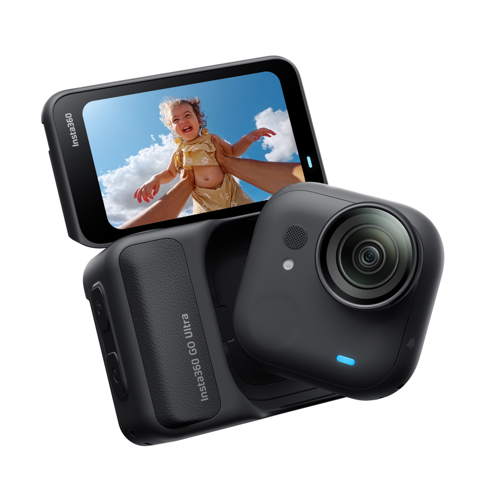
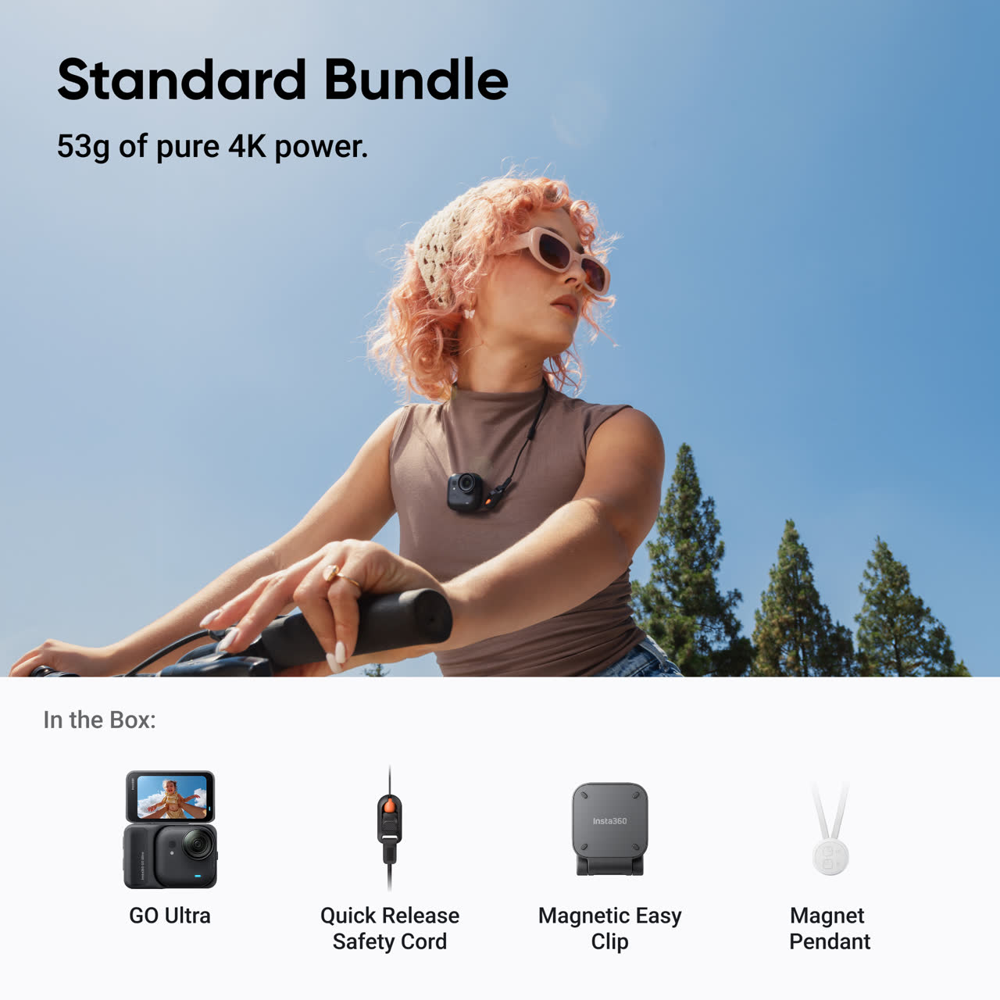
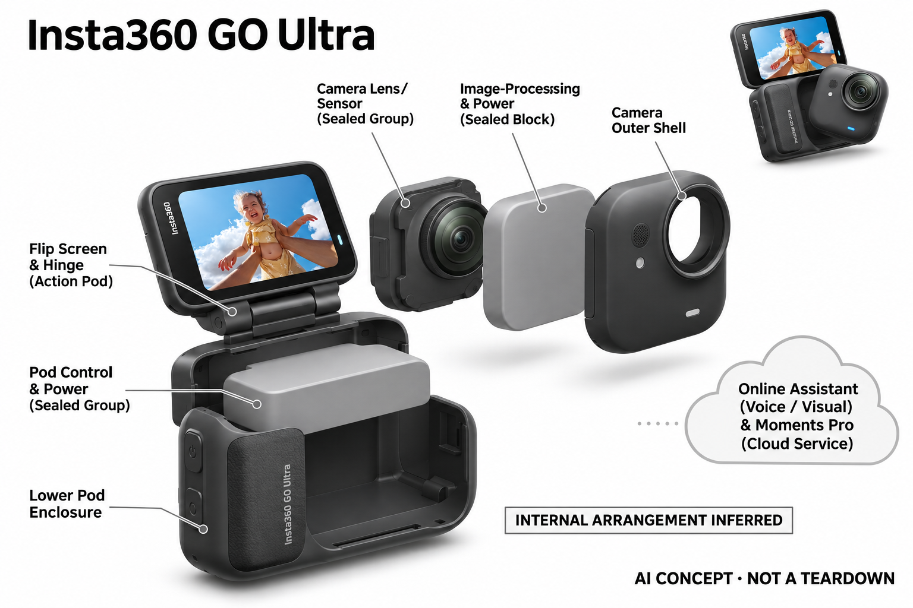

# Insta360 GO Ultra

**Insta360** · 影像与创作 · 核查 2026-11-04

将佩戴式拍摄与视觉语音助手结合

消费渠道：个人零售。

## 产品图片与结构参考

### 产品图

Insta360 GO Ultra · 官方产品图 · 来源：[Insta360 · 官方图片](<https://store.insta360.com/product/go-ultra>) · [原始图片](<https://res.insta360.com/dynamic/store/5409431d311915be34372c2afec1219b/314_da52bdad-a6a4-41bb-8268-668cf1332716.png>)

### 参考图

Insta360 GO Ultra · 官方参考图 · 来源：[Insta360 · 官方图片](<https://store.insta360.com/product/go-ultra>) · [原始图片](<https://res.insta360.com/dynamic/store/4b94f18017a9ccd1eca54eacfb5e8214/314_9fcd41a0-17b9-418c-948b-215ce654b4c9.jpg>)

### AI 生成爆炸示意

**AI 生成 · 非实物拆机。** 内部为概念推断，不能作为元件布局、BOM 或维修依据。[生成提示词](../../content/hardware/prompts/insta360-go-ultra.txt)

> 分析为基于公开资料的案头研究与 AI 辅助判断，未经用户访谈、销量审计或实物拆机。需求、画像、竞争冷门度、审美及商业机会均为研究假设，不是投资结论。

## 销售与购买

- 状态：在售。官方商城显示通常两天内发货，标准套餐数据isOutOfStock=false；本条只计GO Ultra，颜色与磁吸附件套装不另计。

- 地区：美国官方商城

- 价格：官网标准套餐 US$449.99。核查日页面快照；运费、税费、会员和配送区域按官方结算确认，不视为中国到手价。

- 中国大陆：本轮核实所列区域官方商店；未确认中国大陆官方现货、账户及完整服务，不把境外可购等同大陆可用。

- [官方产品 / 商店](<https://store.insta360.com/product/go-ultra>)

## AI 的实际作用

PureVideo使用AI降噪；当前官网还披露语音助手的拍照问答、语音问答与翻译，以及Moments Pro素材整理。问答使用联网大模型，不是仅靠相机芯片独立完成。

服务与联网依赖：小相机与Action Pod用途不同；语音问答和Moments Pro依赖网络与云服务，实际语言地区和权限应核对。存储卡另配，磁吸固定与使用条件按说明确认。

## 是否冷门

新兴竞争（研究判断）：第一视角记录与云端问答分开形成具体使用场景；本轮没有销量与市场份额证据。

## 需求与市场

需求假设：做饭、亲子活动或旅行时双手忙碌的人，希望从自身视角持续记录而不用拿着手机。应观察实际佩戴时长和有价值片段比例，确认免手持并没有增加无用素材与后期整理。

## 用户画像

画像推断：经常进行第一视角记录、接受胸前或帽檐固定方式的个人创作者较匹配。相机本体与底座分离后需要管理两件设备，衣物材质、活动强度和场所规则都会影响适用范围。

## 竞争与替代

竞争判断：小型运动相机、手机胸挂和普通穿戴摄像头都是替代，云端视觉问答又面对手机助手。GO Ultra的差异是拍摄姿态和可拆底座结合，不能仅凭多个AI入口认定形成独占场景。

## 供应链

供应链推断：小相机、磁吸固定、显示底座和充电触点需要共同保持连接可靠，防护等级也不完全相同。官方未披露完整工厂和物料表；配件兼容、跌落与卡槽维护会增加售后复杂度。

## 技术路径

官方说明图像降噪在拍摄链路中，而问答依赖联网大模型。技术判断应分别评估佩戴画面、语音唤醒和云端视觉回答，不能把看到场景等同事实判断准确，也不将底座与本体能力混写。

## 产品审美

审美判断：小方形相机让记录装置更容易隐藏在日常衣物中，翻转屏底座又恢复手持相机的熟悉操作。固定夹、挂绳和衣物轮廓会改变外观，需要真实佩戴而非只观察整机渲染。

## 关键风险

风险判断：佩戴拍摄可能无意记录旁人，云端问答还会传输所选画面；磁吸配件存在特定使用限制。相机和底座防护不同，自动生成旅行视频也需检查内容，不应完全依赖算法决定保留什么。

## 机会与验证

市场观察：可以用一周生活记录比较佩戴相机与手机，记录主动开启、错误固定、云问答和最终分享次数。区分拍摄价值与助手价值，避免用设备轻巧或模型能力推断用户愿意长期随身携带。

## 功能分层示意

这是功能关系，不是实物拆机、真实空间结构或已核实 BOM。

1. **可拆相机**：小型镜头传感与麦克风记录第一视角。（官方披露）

2. **本机影像**：AI降噪等处理拍摄素材。（官方披露）

3. **显示底座**：Action Pod提供显示、控制与补能。（官方披露）

4. **在线助手**：云端模型完成问答及部分视频创作。（官方披露）

## 来源

1. [GO Ultra官方商城](<https://store.insta360.com/product/go-ultra>) — 已实际打开官方页面；功能说明不等于独立性能测量。

2. [GO Ultra官方功能与云服务脚注](<https://www.insta360.com/product/insta360-go-ultra>) — 已实际打开官方页面；功能说明不等于独立性能测量。

[返回目录](../hardware-market.md) · [网页分析](https://romanagent.github.io/Roman/#hardware/product/insta360-go-ultra)
