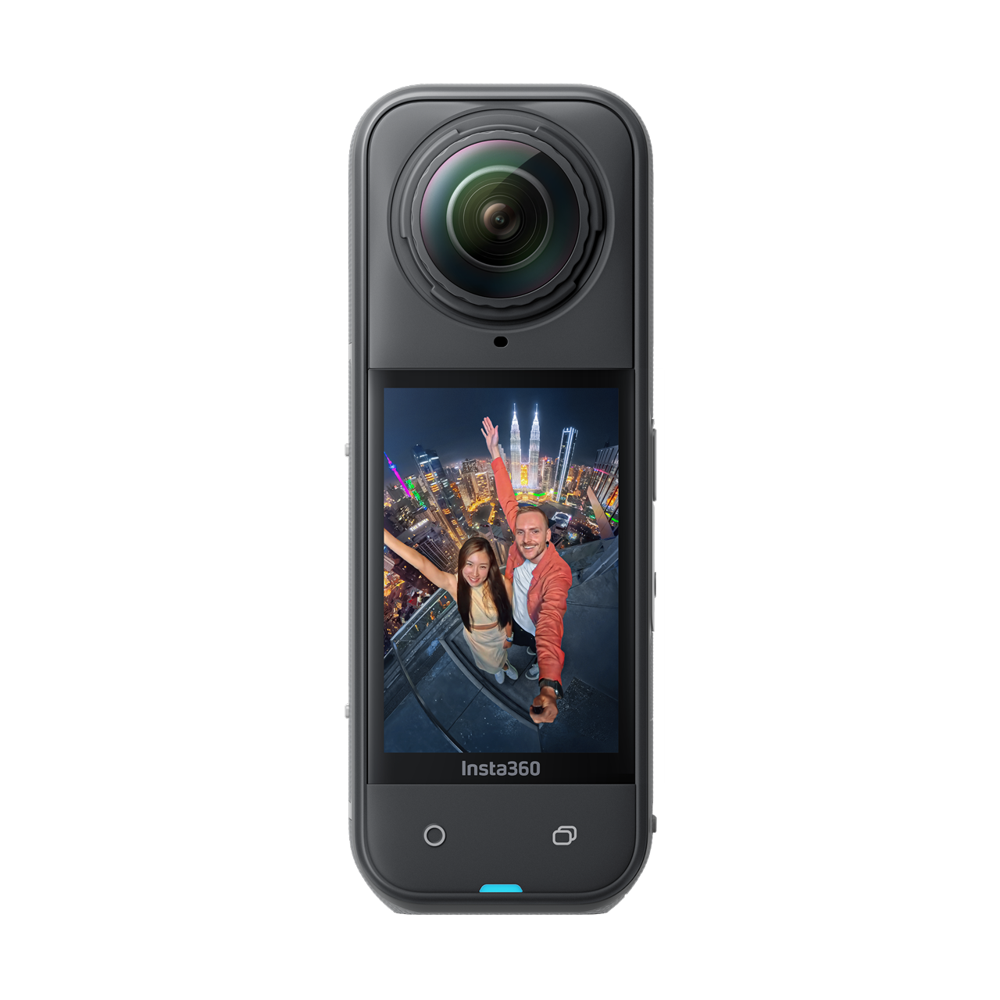
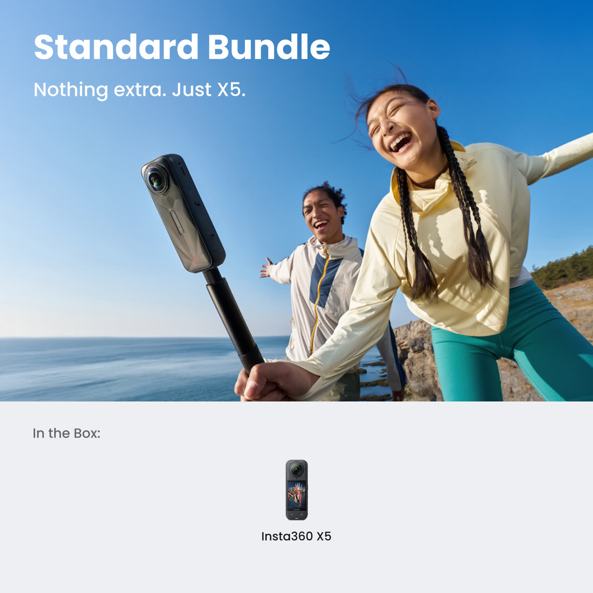
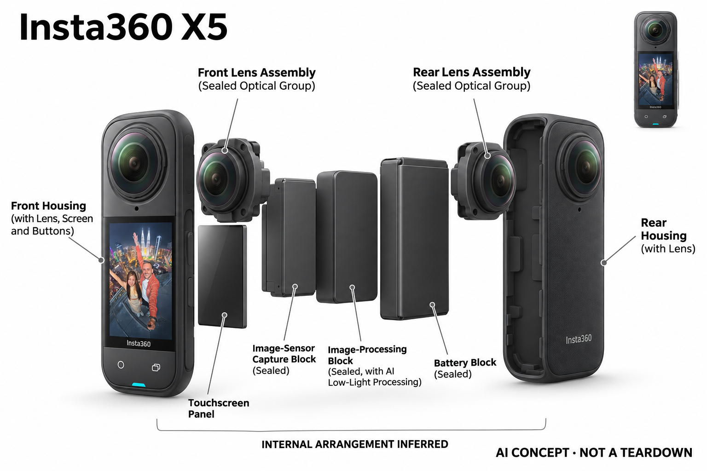

# Insta360 X5

**Insta360** · 影像与创作 · 核查 2026-11-04

在全景记录中使用AI低光处理

消费渠道：个人零售。

## 产品图片与结构参考

### 产品图

Insta360 X5 · 官方产品图 · 来源：[Insta360 · 官方图片](<https://store.insta360.com/product/x5>) · [原始图片](<https://res.insta360.com/dynamic/store/425b39024abae85975ddbfb24d67961b/404_0e155d9f-5268-4582-bd1f-bc8ab5b33971.png>)

### 参考图

Insta360 X5 · 官方参考图 · 来源：[Insta360 · 官方图片](<https://store.insta360.com/product/x5>) · [原始图片](<https://wassets.insta360.com/store/b8e0a72650ed425aadbc57c8a67c81e8/331_560fa73d-5ee4-4555-91a0-679adf2f0c3a.jpg>)

### AI 生成爆炸示意

**AI 生成 · 非实物拆机。** 内部为概念推断，不能作为元件布局、BOM 或维修依据。[生成提示词](../../content/hardware/prompts/insta360-x5.txt)

> 分析为基于公开资料的案头研究与 AI 辅助判断，未经用户访谈、销量审计或实物拆机。需求、画像、竞争冷门度、审美及商业机会均为研究假设，不是投资结论。

## 销售与购买

- 状态：在售。官方商城标明通常两天内发货，标准套餐公开商品数据isOutOfStock=false。只计X5，不将配色、赛事纪念版或自拍杆组合另计。

- 地区：美国官方商城

- 价格：官网标准套餐 US$549.99。核查日页面快照；运费、税费、会员和配送区域按官方结算确认，不视为中国到手价。

- 中国大陆：本轮核实所列区域官方商店；未确认中国大陆官方现货、账户及完整服务，不把境外可购等同大陆可用。

- [官方产品 / 商店](<https://store.insta360.com/product/x5>)

## AI 的实际作用

PureVideo使用AI降噪与动态范围优化处理低光全景画面；应用提供自动取景与编辑辅助。双镜头拼接、普通防抖和生成式效果不混为同一能力。

服务与联网依赖：拍摄与机内图像处理可独立完成；全景重构图和部分编辑依赖Insta360应用或电脑软件，具体模式与服务权限按固件和账户核对。

## 是否冷门

新兴竞争（研究判断）：双镜头与可更换镜片的运动创作工具形成具体使用场景；本轮没有销量与市场份额证据。

## 需求与市场

需求假设：运动与旅行用户希望先记录周围环境，再在事后选择角度，降低错过画面的担忧。应测试重构图需要的额外时间与实际分享率，确认全景自由度没有变成持续堆积素材的负担。

## 用户画像

画像推断：愿意学习全景编辑、经常骑行或户外旅行的个人创作者较匹配。对随手拍完即发的人来说，双镜头保护、文件传输和后期选择可能增加步骤，不能按广视角直接推定更方便。

## 竞争与替代

竞争判断：全景相机、广角运动相机和手机有不同取舍，AI低光处理只是竞争的一部分。可后期选角度形成差异，但用户可能只需要固定视角，不能把记录范围更大等同更强的消费价值。

## 供应链

供应链推断：两组凸出光学镜片、传感器同步和防护密封需保持一致，可更换镜片也增加备件与安装要求。官方未披露完整工厂和物料清单，镜片损伤、保护罩和校准会影响拥有成本。

## 技术路径

官方明确PureVideo使用AI降噪与动态范围优化。技术判断应在真实低光运动场景比较细节、拖影和拼接边缘，不能把算法生成的平滑画面视为真实细节恢复，也不把全部编辑都写成端侧。

## 产品审美

审美判断：竖长机身和双面凸镜让全景能力易于辨认，也让收纳保护成为外观的一部分。自拍杆、镜头罩与安装位置会改变携带体验，产品正面图无法代表实际户外装备组合。

## 关键风险

风险判断：全景会录入拍摄者没有注意到的旁人和环境，分享前需检查取景范围；低光算法与拼接也可能产生瑕疵。镜片更换需要按说明操作，重要原片应先备份再进行自动剪辑。

## 机会与验证

市场观察：可以记录一次真实旅行中的拍摄、传输、选角度和分享全过程，比较最终采用的视角数量。只有额外自由度被持续使用才形成价值，不用全景参数或短视频演示推算市场规模。

## 功能分层示意

这是功能关系，不是实物拆机、真实空间结构或已核实 BOM。

1. **双向采集**：双镜头与传感器记录全景素材。（官方披露）

2. **AI图像处理**：PureVideo进行降噪和动态范围优化。（官方披露）

3. **全景处理**：拼接与画面方向管理。（官方披露）

4. **创作输出**：应用或电脑软件重构图并导出。（官方披露）

## 来源

1. [X5官方商城](<https://store.insta360.com/product/x5>) — 已实际打开官方页面；功能说明不等于独立性能测量。

2. [X5官方AI与全景功能](<https://www.insta360.com/product/insta360-x5>) — 已实际打开官方页面；功能说明不等于独立性能测量。

[返回目录](../hardware-market.md) · [网页分析](https://romanagent.github.io/Roman/#hardware/product/insta360-x5)
