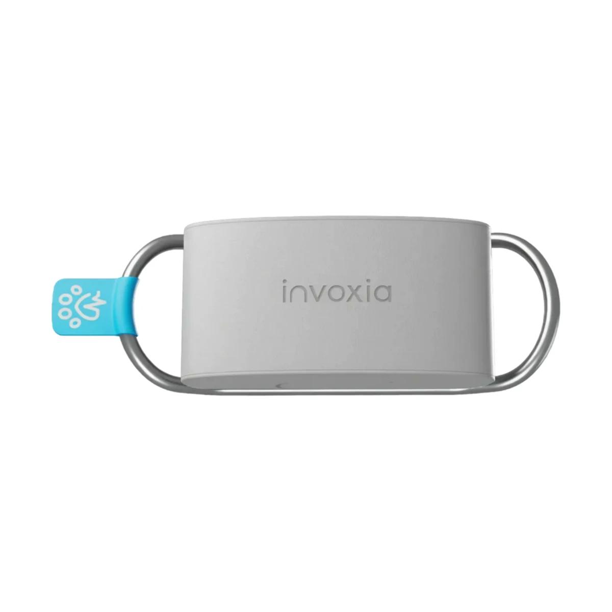
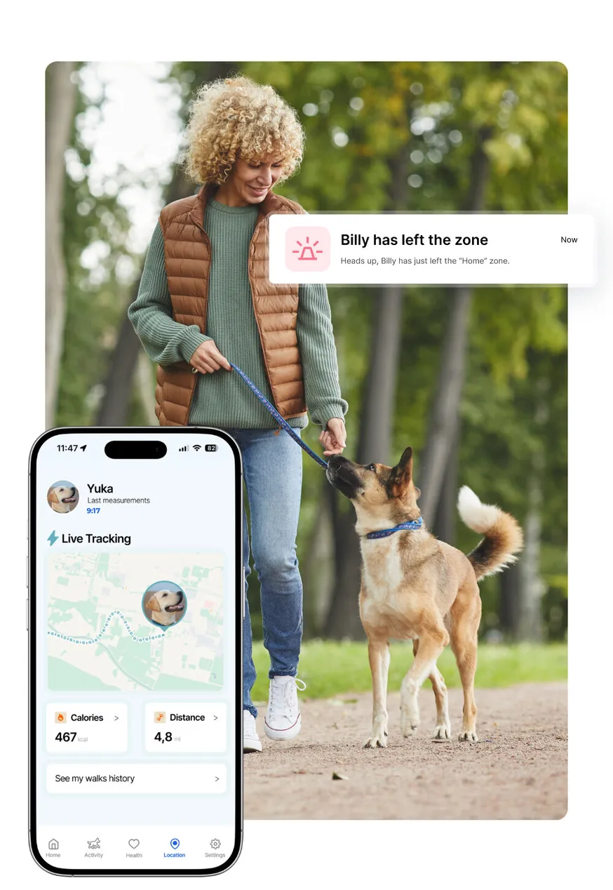
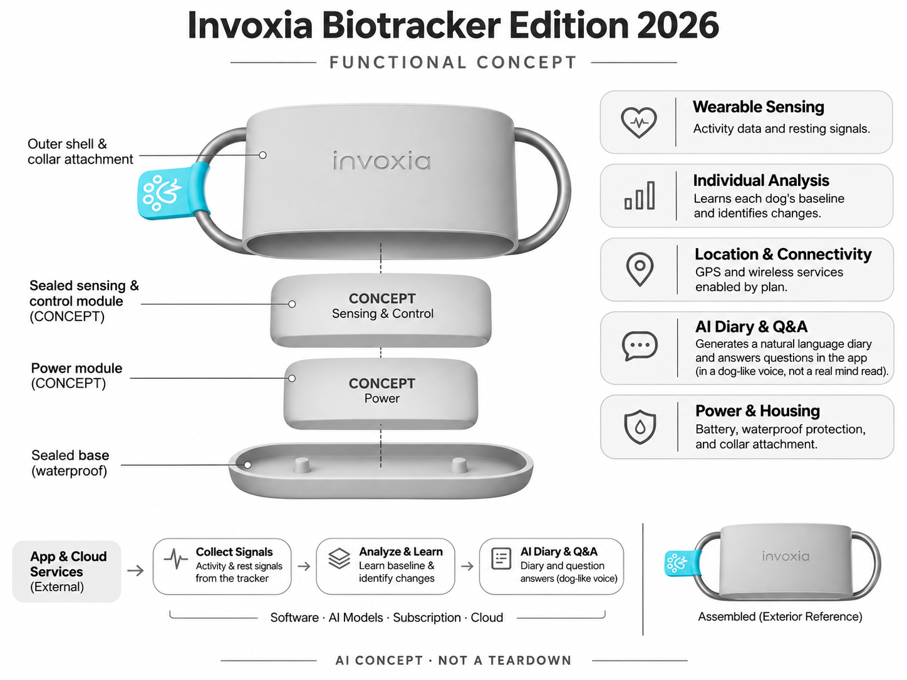

# Invoxia Biotracker Edition 2026

**Invoxia** · 宠物照护 · 核查 2026-11-04

用生理和行为数据辅助理解犬只日常变化

消费渠道：个人零售。

## 产品图片与结构参考

### 产品图

Invoxia Biotracker Edition 2026 官方产品图 · 来源：[Invoxia · 官方图片](<https://www.invoxia.com/en-US/petcare/biotracker>) · [原始图片](<https://www.invoxia.com/images/product/tracker/lwt6m1-1x1.webp>)

### 参考图

Invoxia Biotracker Edition 2026 官方外观、结构或使用参考 · 来源：[Invoxia · 官方图片](<https://www.invoxia.com/en-US/petcare/biotracker>) · [原始图片](<https://www.invoxia.com/_ipx/f_webp%26q_80%26s_874x1268/images/dafolle/biotracker/features/gps-alerts-en-us.jpg>)

### AI 生成爆炸示意

**AI 生成 · 非实物拆机。** 内部为概念推断，不能作为元件布局、BOM 或维修依据。[生成提示词](../../content/hardware/prompts/invoxia-biotracker-2026-assist-creative-repair.txt)

> 已目视核对型号、外形、功能标签与非拆机声明；内部模块为概念，不代表实测结构。

> 已将感知标签修正为活动数据与静息信号，避免扩展为活动期间的生理测量声明。

> 保留官方图片原始内容和出处；画面宣传参数不是本轮独立实测。

> 分析为基于公开资料的案头研究与 AI 辅助判断，未经用户访谈、销量审计或实物拆机。需求、画像、竞争冷门度、审美及商业机会均为研究假设，不是投资结论。

## 销售与购买

- 状态：在售。美国官方商店明确列出Biotracker Edition 2026与Add to cart；不同GPS服务配置只计同一硬件系列一款。

- 地区：美国官方商店

- 价格：按官方地区商店与服务方案结账。核查时官方地区参考价，保留原币种；订阅、税运、附件及优惠以结账为准，预订定金不等于整机价格。

- 中国大陆：本轮核实所列海外官方渠道；中国大陆同型号现货、保修及服务可用性未确认。进口前需核对供电、网络、配件和地区条款。

- [官方产品 / 商店](<https://www.invoxia.com/en-US/shop/petcare>)

## AI 的实际作用

分析犬只活动、休息心率和呼吸等信号，学习个体基线并生成自然语言日记与数据问答；模拟狗的语气不是读取动物真实思想。

服务与联网依赖：基础健康与活动功能和付费Plus/Max GPS分层；AI提示、日记与问答属于付费层，服务与定位覆盖按购买地区确认。

## 是否冷门

细分专业（研究判断）：犬只生理监测比普通宠物定位更细分，仍有专业品牌竞争，医疗边界与持续订阅是主要门槛。

## 需求与市场

需求假设：狗主人希望在不全天陪伴时了解日常活动与休息变化，并在需要时向兽医提供记录。应评估记录完整性和可解释性，不能把更频繁的通知直接当作更早发现疾病的证据。

### 任务与触发场景 · 研究判断

Biotracker 2026的需求在于持续了解犬只日常活动和休息相关趋势，再通过应用解读和日记降低主人阅读数据的门槛。它不是让动物真正说话的翻译器，拟人语气只是呈现方式。研究应从主人想回答的具体问题开始，例如最近行为是否与平常不同，而不是只展示有趣的宠物口吻。

依据：[Invoxia Biotracker Edition 2026 官方购买页](<https://www.invoxia.com/en-US/shop/petcare>) · [Invoxia Biotracker 官方技术和方案](<https://www.invoxia.com/en-US/petcare/biotracker>)

### 流程中的收益与代价 · 研究判断

日记和问答可能让较复杂的数据更易接近，也可能让用户忽略信息缺失与不确定性。佩戴、充电、联网和查看仍然需要长期维护，不能把自动生成文字当成零成本照护。应比较原有观察、活动记录和应用解读在完整流程里的作用，看看是否真的减少猜测和沟通负担。

依据：[Invoxia Biotracker Edition 2026 官方购买页](<https://www.invoxia.com/en-US/shop/petcare>) · [Invoxia Biotracker 官方技术和方案](<https://www.invoxia.com/en-US/petcare/biotracker>)

### 需求如何验证 · 待验证

建议观察主人如何理解一段日记与对应数据，是否能分清真实记录、算法推断和拟人表达，再记录后续采取的行动。健康相关效果需要适当独立验证，不能由喜欢文案的反馈代替。当前没有家庭实验和临床数据，不承诺提前诊断、准确理解动物情绪或减少医疗支出。

依据：[Invoxia Biotracker Edition 2026 官方购买页](<https://www.invoxia.com/en-US/shop/petcare>) · [Invoxia Biotracker 官方技术和方案](<https://www.invoxia.com/en-US/petcare/biotracker>)

## 用户画像

画像推断：愿意长期给狗佩戴设备并查看趋势的家庭，可能有年长犬或频繁外出需求。不同体型、毛发和佩戴习惯会影响数据与舒适度，健康焦虑也可能导致过度依赖自动报告。

### 优先使用者 · 研究判断

优先画像是愿意让犬只持续佩戴设备、经常关心日常状态并能维护应用服务的养犬家庭。实际适配取决于犬只活动、佩戴接受度和主人参与，而不是仅按年龄或对科技的兴趣。需要区分为了日常了解、为了定位或为了健康沟通购买的人，不能把这些任务混成同一画像。

依据：[Invoxia Biotracker Edition 2026 官方购买页](<https://www.invoxia.com/en-US/shop/petcare>) · [Invoxia Biotracker 官方技术和方案](<https://www.invoxia.com/en-US/petcare/biotracker>)

### 购买者与使用者 · 研究判断

家庭成员可能轮流遛狗、喂养和维护设备，日记中的背景也可能只有其中一人知道。研究应确认谁接收提醒、谁补充事件以及谁解释数据，避免把生成文本当作所有成员共享的事实。拟人表达可能增强阅读意愿，但也可能使用户误以为系统知道动物没有被记录的经历。

依据：[Invoxia Biotracker Edition 2026 官方购买页](<https://www.invoxia.com/en-US/shop/petcare>) · [Invoxia Biotracker 官方技术和方案](<https://www.invoxia.com/en-US/petcare/biotracker>)

### 不适配与分层验证 · 待验证

无法维持佩戴、缺少适配服务或主要需要专业健康判断的家庭，应先核对边界。建议比较已有宠物追踪器用户与初次购买者，并保留停用和不购买原因。当前国际销售渠道不能自动证明中国大陆的连接、账户和支持完整可用，地区限制需要单独确认。

依据：[Invoxia Biotracker Edition 2026 官方购买页](<https://www.invoxia.com/en-US/shop/petcare>) · [Invoxia Biotracker 官方技术和方案](<https://www.invoxia.com/en-US/petcare/biotracker>)

## 竞争与替代

竞争判断：与PetPace、Maven和普通GPS定位器竞争，生理记录与生成式日记是差异。用户可能只需要防走失，购买分析需拆开定位、健康趋势和故事化互动，避免把全部功能价值相加。

### 直接与间接替代 · 研究判断

替代方案包括其他宠物健康或活动追踪器、定位设备、摄像观察和人工日记，它们解决的问题并不相同。佩戴数据提供连续记录的可能，摄像能呈现部分行为细节，专业检查承担另一个层面的判断。比较必须先固定主人希望了解什么，不能只按指标数量或AI文案的趣味性排序。

依据：[Invoxia Biotracker Edition 2026 官方购买页](<https://www.invoxia.com/en-US/shop/petcare>) · [Invoxia Biotracker 官方技术和方案](<https://www.invoxia.com/en-US/petcare/biotracker>)

### 具体差异与条件 · 研究判断

2026版公开强调个体趋势、自然语言日记和数据问答，差异可以理解为把记录转成更易阅读的信息。是否比普通仪表盘更有价值，需要观察主人是否理解边界并减少错误判断。拟人日记的情感吸引力与数据可靠性是两件事，不应使用前者证明后者。

依据：[Invoxia Biotracker Edition 2026 官方购买页](<https://www.invoxia.com/en-US/shop/petcare>) · [Invoxia Biotracker 官方技术和方案](<https://www.invoxia.com/en-US/petcare/biotracker>)

### 同条件比较方法 · 待验证

建议让同一主人查看图表、普通文字总结和拟人日记，比较其理解、误解和后续沟通，而不是只问哪种更喜欢。硬件比较还应记录佩戴缺口、维护和服务费用。当前没有同条件独立测试与销量数据，不对不同宠物追踪器的健康效果或市场份额作排名。

依据：[Invoxia Biotracker Edition 2026 官方购买页](<https://www.invoxia.com/en-US/shop/petcare>) · [Invoxia Biotracker 官方技术和方案](<https://www.invoxia.com/en-US/petcare/biotracker>)

## 供应链

供应链分析：佩戴固定件、生理与运动感知、无线连接、电池和防水壳体组成系统，具体工厂与BOM未知。持续服务、定位网络、丢失更换和小型犬舒适性会影响实际交付成本。

### 功能与交付拆分 · 研究判断

公开能力支持把系统拆为犬只佩戴终端、固定结构、信号采集、供电、连接、个体分析与应用呈现，但没有披露完整元件和制造身份。供应链研究应把自然语言生成与原始数据质量分开，不把云服务或日记人格画成机身里某个已知芯片，也不从指标名称推断传感器类型。

依据：[Invoxia Biotracker Edition 2026 官方购买页](<https://www.invoxia.com/en-US/shop/petcare>) · [Invoxia Biotracker 官方技术和方案](<https://www.invoxia.com/en-US/petcare/biotracker>)

### 制造与服务约束 · 研究判断

佩戴位置、活动和动物接触条件可能影响输入，电量与连接缺口又会影响连续记录，因此结构、电子与算法不能各自单独验收。应用版本和服务变化也属于长期交付。换用同样尺寸的传感器或电池，不一定保留原有表现，需要在最终机身和使用条件下重新验证。

依据：[Invoxia Biotracker Edition 2026 官方购买页](<https://www.invoxia.com/en-US/shop/petcare>) · [Invoxia Biotracker 官方技术和方案](<https://www.invoxia.com/en-US/petcare/biotracker>)

### 候选公司与导入 · 研究判断

候选公司可从动作传感和小型电池方案研究，用于重新开发类似终端时准备样件。下方关系不是Invoxia实际BOM，也不说明候选厂商能够直接复现所有生命体征或日记功能。询价前需要明确佩戴、数据、功耗、环境和服务边界，再安排专业技术验证。

依据：[Invoxia Biotracker Edition 2026 官方购买页](<https://www.invoxia.com/en-US/shop/petcare>) · [Invoxia Biotracker 官方技术和方案](<https://www.invoxia.com/en-US/petcare/biotracker>)

## 技术路径

官方说明学习个体基线、生成每日自然语言报告并基于记录回答问题。技术判断：佩戴松紧和活动会影响信号，语言模型应清楚表达测量缺失；拟人化回答不能证明它知道狗的真实感受。

### 已知功能与处理链路 · 研究判断

官方描述分析活动及休息相关心率、呼吸等信息，学习个体基线，并用自然语言提供日记和问答。理解时应区分采集、数据质量、趋势推断和语言呈现，不能把生成文本当作新的测量。真实模型、全部传感机制及各功能端云分工未完整公开，不由名称补出工程细节。

依据：[Invoxia Biotracker Edition 2026 官方购买页](<https://www.invoxia.com/en-US/shop/petcare>) · [Invoxia Biotracker 官方技术和方案](<https://www.invoxia.com/en-US/petcare/biotracker>)

### 主要技术约束 · 研究判断

当输入缺失或佩戴变化时，语言层仍可能输出流畅文字，因此需要明确它依据了哪些记录、哪些部分属于解释。个体基线也不是一成不变，日常变化与真正需要关注的情况可能难以区分。系统应让用户查看原始趋势和不确定性，而非只接受一个拟人化故事。

依据：[Invoxia Biotracker Edition 2026 官方购买页](<https://www.invoxia.com/en-US/shop/petcare>) · [Invoxia Biotracker 官方技术和方案](<https://www.invoxia.com/en-US/petcare/biotracker>)

### 系统验证方法 · 待验证

建议在正常日常使用中记录佩戴缺口、事件背景、应用版本与生成文本，再由合适团队评估数据与解释的一致性。不要制造健康异常来测试产品，也不用用户觉得准确代替测量验证。当前没有独立实验，因此不承诺生命体征准确率、疾病检测或动物情绪识别。

依据：[Invoxia Biotracker Edition 2026 官方购买页](<https://www.invoxia.com/en-US/shop/petcare>) · [Invoxia Biotracker 官方技术和方案](<https://www.invoxia.com/en-US/petcare/biotracker>)

## 产品审美

审美判断：小型附着模块需与项圈协调，并减少晃动、啃咬和卡住风险。用户看重的是狗愿意长期佩戴、易拆充电和耐污，App叙事风格也应避免把健康不确定性包装成过度确定的故事。

### 形态与使用环境 · 研究判断

宠物佩戴设备的审美首先与动物和项圈共同使用有关，机身体积、固定方式和外观识别都应放在真实活动里看。主人喜欢产品照片并不意味着犬只接受长期佩戴。设计观察还应包括取下、清洁、充电和重新装回，不能只评价颜色与科技感。

依据：[Invoxia Biotracker Edition 2026 官方购买页](<https://www.invoxia.com/en-US/shop/petcare>) · [Invoxia Biotracker 官方技术和方案](<https://www.invoxia.com/en-US/petcare/biotracker>)

### 交互与身体体验 · 研究判断

日记和问答让界面更接近交流，但语言风格需要与证据边界保持一致。拟人语气可能方便阅读，也可能让主人误以为内容来自宠物真实想法。应观察用户是否能迅速查看数据依据、区分推断和记录，并在信息不完整时获得清楚说明，而不是被流畅文案掩盖问题。

依据：[Invoxia Biotracker Edition 2026 官方购买页](<https://www.invoxia.com/en-US/shop/petcare>) · [Invoxia Biotracker 官方技术和方案](<https://www.invoxia.com/en-US/petcare/biotracker>)

### 长期维护与设计验证 · 待验证

建议连续观察照护者之间交接设备与信息的过程，记录通知频率、应用入口和维护步骤是否造成负担。长期互动不应只看阅读次数，还要看是否产生正确理解和有用沟通。当前未做佩戴、材料和防护实测，不由外观或宣传图保证舒适、耐久和环境适用。

依据：[Invoxia Biotracker Edition 2026 官方购买页](<https://www.invoxia.com/en-US/shop/petcare>) · [Invoxia Biotracker 官方技术和方案](<https://www.invoxia.com/en-US/petcare/biotracker>)

## 关键风险

风险判断：AI健康提示和日记是付费方案，基础无强制订阅不等于所有AI免费。异常提示应交由兽医判断，不用于自行调整药物；定位覆盖、隐私及拟人化语言造成的误解都需明确。

### 主要失败情形 · 研究判断

主要风险是把拟人日记当作动物真实表达，或把算法趋势解释成确定健康结论。佩戴、活动、连接和模型都可能影响输出，生成文字的肯定语气不代表证据充分。研究必须检查主人能否发现数据缺口与推断边界，尤其不能把没有提醒直接理解为没有问题。

依据：[Invoxia Biotracker Edition 2026 官方购买页](<https://www.invoxia.com/en-US/shop/petcare>) · [Invoxia Biotracker 官方技术和方案](<https://www.invoxia.com/en-US/petcare/biotracker>)

### 购买与持续服务 · 研究判断

使用需要按具体地区确认设备、连接、订阅与服务支持，硬件购买入口并不保证所有功能长期包含。家庭还需了解数据导出、停用和更换设备后的处理方式。当前没有取得全部市场的服务条款与长期运营记录，不由国际在售状态推断中国大陆完整可用。

依据：[Invoxia Biotracker Edition 2026 官方购买页](<https://www.invoxia.com/en-US/shop/petcare>) · [Invoxia Biotracker 官方技术和方案](<https://www.invoxia.com/en-US/petcare/biotracker>)

### 风险验证及停止条件 · 待验证

试用应设定佩戴无法维持、数据经常缺失、提示无法解释或家庭成员持续误读文本等停止条件。保存实际失败和后续处理，不把喜欢日记当成效果证明。健康相关价值需要独立证据，本轮不作诊断、治疗或降低疾病风险的承诺，也不提供动物医疗建议。

依据：[Invoxia Biotracker Edition 2026 官方购买页](<https://www.invoxia.com/en-US/shop/petcare>) · [Invoxia Biotracker 官方技术和方案](<https://www.invoxia.com/en-US/petcare/biotracker>)

## 机会与验证

机会假设：把有效趋势、漏测说明和便于兽医阅读的摘要作为验证重点，比较故事化日记是否提高理解。若用户只在异常时打开App，少而可信的提醒可能比每天生成长报告更有价值。

### 可检验的差异 · 研究判断

可探索的差异是让宠物数据变得可理解而不失去边界：用户能看到哪些记录支持结论，哪些只是推断，以及下一步怎样补充背景。相比让宠物说得更像人，更重要的可能是减少错误归因。创业方向应围绕这一具体信息任务，而不是把拟人对话本身视为新需求。

依据：[Invoxia Biotracker Edition 2026 官方购买页](<https://www.invoxia.com/en-US/shop/petcare>) · [Invoxia Biotracker 官方技术和方案](<https://www.invoxia.com/en-US/petcare/biotracker>)

### 实现与商业约束 · 研究判断

实现约束包括长期佩戴、数据质量、生成服务和用户支持，内容层不能独立补救硬件问题。需要研究日记是否促进持续记录，还是只带来短期新鲜感。当前没有真实成本、订阅留存和专业使用价值数据，不因宠物陪伴市场广泛就推断该形态具有同样市场空间。

依据：[Invoxia Biotracker Edition 2026 官方购买页](<https://www.invoxia.com/en-US/shop/petcare>) · [Invoxia Biotracker 官方技术和方案](<https://www.invoxia.com/en-US/petcare/biotracker>)

### 下一阶段验证 · 待验证

下一步可对照同一组记录的不同呈现方式，观察主人理解、误解和共享信息的动作，再验证哪些解释真正有帮助。技术和健康效果需独立评估。如果主要障碍是固定方式或充电，应先改善硬件流程。只有确认长期任务收益后，再扩大生成内容或新的情感交互。

依据：[Invoxia Biotracker Edition 2026 官方购买页](<https://www.invoxia.com/en-US/shop/petcare>) · [Invoxia Biotracker 官方技术和方案](<https://www.invoxia.com/en-US/petcare/biotracker>)

## 对应供应链公司

能力候选用于选型研究，不代表本产品实际采用；未公开的供货关系不作推断。

- [bosch-sensortec](../supply-chain/bosch-sensortec.md) — **能力候选 · 非已采用** / 佩戴动作感知模块候选：Bosch Sensortec公开动作传感能力可用于新犬只佩戴方案的输入研究，但不能由此推断完整生命体征测量或AI日记效果。需要按佩戴位置与动物活动验证数据链路，本目录没有Invoxia此型号实际采用该公司器件的证据。

- [grepow](../supply-chain/grepow.md) — **能力候选 · 非已采用** / 小型佩戴设备电池候选：Grepow公开电池定制能力可作为新宠物终端的供电询问入口，仍需确认体积、固定、环境、保护和充电方案。候选电池不能直接用于原机替换，也不承担算法或健康效果，本条未确认Invoxia当前电池供应商。

[浏览供应链目录](../supply-chain.md)

## 功能分层示意

这是功能关系，不是实物拆机、真实空间结构或已核实 BOM。

1. **佩戴传感**：记录活动和休息时生理信号。（官方披露）

2. **个体分析**：学习基线与识别变化。（官方披露）

3. **位置连接**：GPS及无线服务按方案启用。（官方披露）

4. **AI叙事**：日记与问答在App服务层。（官方披露）

5. **能源外壳**：电池、防水与项圈固定功能。（官方披露）

## 来源

1. [Invoxia Biotracker Edition 2026 官方购买页](<https://www.invoxia.com/en-US/shop/petcare>) — 实际打开核查当前购买或预订入口，未实际下单；价格与交付按具体地区。

2. [Invoxia Biotracker 官方技术和方案](<https://www.invoxia.com/en-US/petcare/biotracker>) — 实际打开的官方技术与使用资料，宣传效果并非本轮独立实测。

[返回目录](../hardware-market.md) · [网页分析](https://romanagent.github.io/Roman/#hardware/product/invoxia-biotracker-2026)
