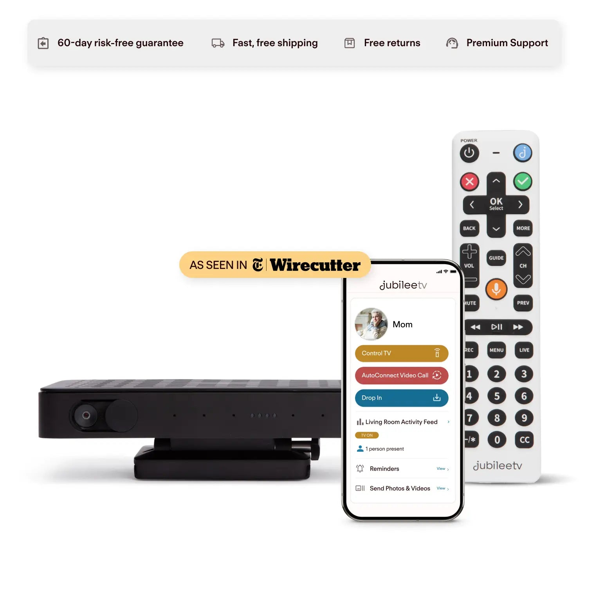
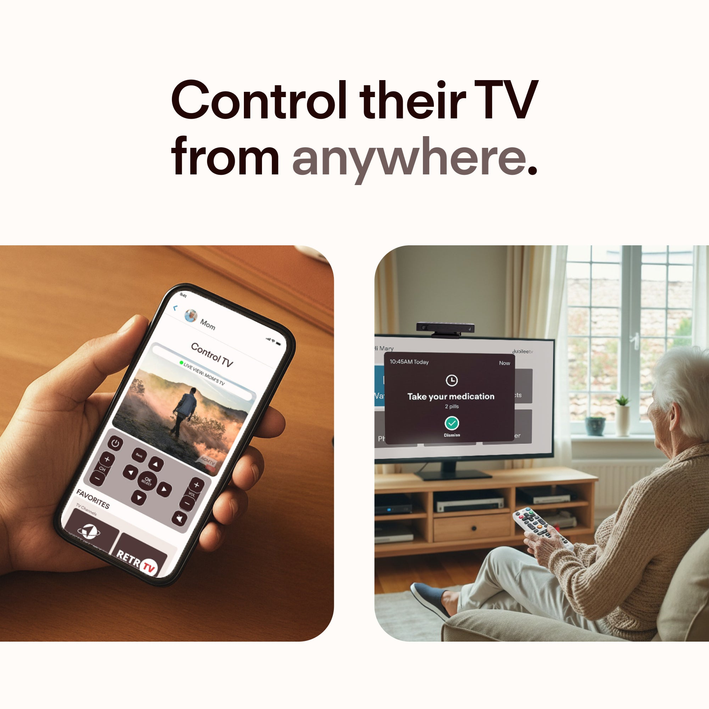
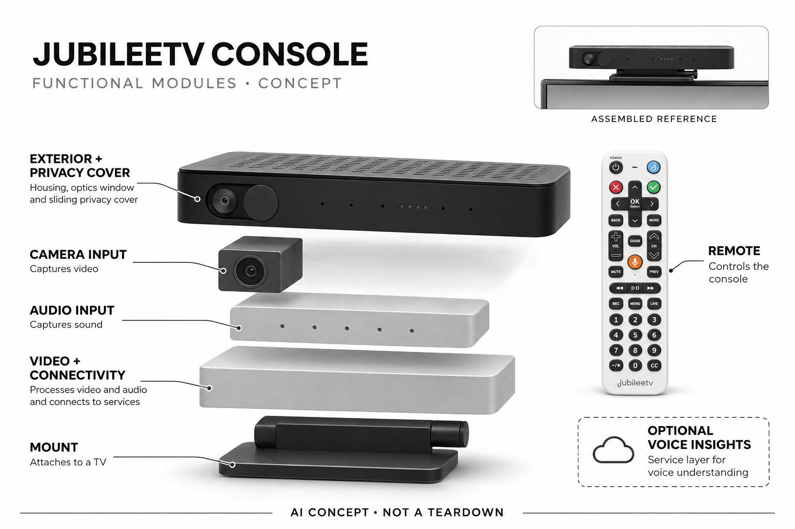

# JubileeTV Console + Membership

**JubileeTV / Caavo** · 无障碍与辅助沟通 · 核查 2026-11-04

把熟悉的电视变成长者远程协助入口

消费渠道：硬件租赁 / 订阅。

## 产品图片与结构参考

### 产品图

官方Console、遥控器与应用展示 · 来源：[JubileeTV / Caavo · 官方图片](<https://getjubileetv.com/products/jubilee-tv-direct>) · [原始图片](<https://cdn.shopify.com/s/files/1/0831/0430/1340/files/control_elderly_tv_remotely_main_sq_e8d3ae25-79ca-4f86-9521-44eb0c11e4da.webp?v=1778082072>)

### 参考图

官方电视顶部安装与远程协助场景 · 来源：[JubileeTV / Caavo · 官方图片](<https://getjubileetv.com/products/jubilee-tv-direct>) · [原始图片](<https://cdn.shopify.com/s/files/1/0831/0430/1340/files/JubileeTV-Direct-PDP-02.jpg?v=1784569659>)

### AI 生成爆炸示意

**AI 生成 · 非实物拆机。** 内部为概念推断，不能作为元件布局、BOM 或维修依据。[生成提示词](../../content/hardware/prompts/jubilee-tv-console.txt)

> 依据已核验官方外形与公开功能生成；未知内部仅为概念功能块，不代表原机电路板、芯片或实际布局。

> 原图按官方文件保存，未改色或语义编辑；图片中的营销文字不视为本研究独立验证。

> 分析为基于公开资料的案头研究与 AI 辅助判断，未经用户访谈、销量审计或实物拆机。需求、画像、竞争冷门度、审美及商业机会均为研究假设，不是投资结论。

## 销售与购买

- 状态：在售。官网当前会员方案可加购且明确含带相机Console、遥控器与配件；这是含实体硬件的服务方案，取消会员按条款需归还设备。

- 地区：美国（设备使用者）

- 价格：US$39/月起（含硬件的会员方案）。年度及All-In方案另列，当前促销按官网；取消服务需按规则归还硬件，不按一次买断设备表达。

- 中国大陆：官网明确设备只面向居住美国的长者，境外转售未经授权；家属应用可从其他地区连接美国设备，不等于可在大陆部署。

- [官方产品 / 商店](<https://getjubileetv.com/products/jubilee-tv-direct>)

## AI 的实际作用

当前Console相机进行人物与活动状态识别；可选Voice Insights由Canary Speech AI分析通话中的声学与语言特征生成趋势。远程遥控与提醒本身不算AI。

服务与联网依赖：需要现有电视、兼容信号源、网络及会员；摄像盖关闭会停止在场检测，语音分析需双方明确开启及同意，不能作医疗诊断。

## 是否冷门

细分专业（研究判断）：长者既有电视的远程协助是明确细分，区别于普通音箱屏幕；成功取决于双方同意、兼容与持续服务。

## 需求与市场

需求假设：家属希望减少为调整电视而往返，同时让长者继续使用熟悉的大屏沟通。应记录远程解决、长者自主性和设置负担，不能把活动记录或语音评分当作健康改善，也不以家属安心替代使用者真实接受。

### 产品任务与边界 · 研究判断

需求假设：家属希望减少为调整电视而往返，同时让长者继续使用熟悉的大屏沟通。应记录远程解决、长者自主性和设置负担，不能把活动记录或语音评分当作健康改善，也不以家属安心替代使用者真实接受。

依据：[JubileeTV当前含硬件会员方案](<https://getjubileetv.com/products/jubilee-tv-direct>) · [JubileeTV官方Activity Feed机制](<https://docs.getjubileetv.com/activity-feed>)

### 需求判断 · 研究判断

复用电视减少学习新设备的要求，远程帮助和通话可能比健康分析更直接解决日常问题。家属希望方便查看不等于长者愿意被观察，需求研究应同时衡量自主性、同意和沟通负担，不能只从照护者安心推断价值已经成立。

依据：[JubileeTV当前含硬件会员方案](<https://getjubileetv.com/products/jubilee-tv-direct>) · [JubileeTV官方Activity Feed机制](<https://docs.getjubileetv.com/activity-feed>)

### 需求验证 · 待验证

可记录真实电视故障由家属远程解决的次数、长者主动通话和人工上门需求，再观察权限与摄像设置。将基础协助与可选AI分别评估，不以活动曲线、语音评分或用户故事推断认知、情绪或健康得到改善。

依据：[JubileeTV当前含硬件会员方案](<https://getjubileetv.com/products/jubilee-tv-direct>) · [JubileeTV官方Activity Feed机制](<https://docs.getjubileetv.com/activity-feed>)

## 用户画像

画像推断：美国有兼容电视网络、远方家属愿意管理权限并取得长者同意的家庭较适合。购买者与被观察者不同，简化遥控和视觉监测需要分别评估，不能只从照护者便利推定长者愿接受持续摄像。

### 适用行为与条件 · 研究判断

画像推断：美国有兼容电视网络、远方家属愿意管理权限并取得长者同意的家庭较适合。购买者与被观察者不同，简化遥控和视觉监测需要分别评估，不能只从照护者便利推定长者愿接受持续摄像。

依据：[JubileeTV当前含硬件会员方案](<https://getjubileetv.com/products/jubilee-tv-direct>) · [JubileeTV官方Activity Feed机制](<https://docs.getjubileetv.com/activity-feed>)

### 人群取舍 · 研究判断

兼容信号源、电视输入和家庭网络影响能否使用，简化遥控也需要与已有习惯协调。购买者可能远程管理而无法现场处理故障，画像应包含实际安装者、同意与支持路径，不能把所有独居长者都视为相同用户。

依据：[JubileeTV当前含硬件会员方案](<https://getjubileetv.com/products/jubilee-tv-direct>) · [JubileeTV官方Activity Feed机制](<https://docs.getjubileetv.com/activity-feed>)

### 画像验证 · 待验证

画像验证应让长者与家属共同选择权限并完成一次呼叫和电视恢复，记录谁理解了哪些状态。再观察长期是否主动使用而非仅被查看，识别双方都认可的流程，避免把家属支付意愿替代长者体验和自主选择。

依据：[JubileeTV当前含硬件会员方案](<https://getjubileetv.com/products/jubilee-tv-direct>) · [JubileeTV官方Activity Feed机制](<https://docs.getjubileetv.com/activity-feed>)

## 竞争与替代

竞争判断：与普通视频通话设备、智能电视和远程协助方案竞争，差异在复用既有电视与照护流程。硬件随会员提供并需归还，不能只比较盒子售价；AI趋势是补充，不应掩盖基础遥控和兼容是否可靠。

### 比较对象与差异 · 研究判断

竞争判断：与普通视频通话设备、智能电视和远程协助方案竞争，差异在复用既有电视与照护流程。硬件随会员提供并需归还，不能只比较盒子售价；AI趋势是补充，不应掩盖基础遥控和兼容是否可靠。

依据：[JubileeTV当前含硬件会员方案](<https://getjubileetv.com/products/jubilee-tv-direct>) · [JubileeTV官方Activity Feed机制](<https://docs.getjubileetv.com/activity-feed>)

### 竞争判断 · 研究判断

当前方案是会员包含实体硬件且取消需归还，与购买普通电视盒子不同，比较必须计算持续服务和退出条件。视觉与语音AI是补充层，若基础遥控兼容不佳，再多趋势也难以减少日常支持，不能按设备价格或模型能力排序。

依据：[JubileeTV当前含硬件会员方案](<https://getjubileetv.com/products/jubilee-tv-direct>) · [JubileeTV官方Activity Feed机制](<https://docs.getjubileetv.com/activity-feed>)

### 竞争验证 · 待验证

可比较普通视频通话、远程电视帮助和完整会员方案的设置、通话与故障恢复，明确美国使用限制和归还条款。分别测试简单模式与高级功能，不能把完整展示流程推定为所有电视、信号源及家庭权限下都一样可靠。

依据：[JubileeTV当前含硬件会员方案](<https://getjubileetv.com/products/jubilee-tv-direct>) · [JubileeTV官方Activity Feed机制](<https://docs.getjubileetv.com/activity-feed>)

## 供应链

供应链分析：相机主机、遥控、HDMI、红外、智能插座与服务后台共同交付，实际工厂与BOM未披露。电视兼容、安装支持、权限和持续维护形成主要成本，不能把通用机顶盒物料当作完整照护服务成本。

### 功能模块拆分 · 研究判断

功能层包括带相机主机、物理隐私盖、遥控和红外、电视连接与智能插座、视觉活动及可选语音服务、家属应用与会员。电源状态与遥控次数不等于AI，旧Hub也不能套用当前Console的视觉能力，公开未披露完整硬件BOM。

依据：[JubileeTV当前含硬件会员方案](<https://getjubileetv.com/products/jubilee-tv-direct>) · [JubileeTV官方Activity Feed机制](<https://docs.getjubileetv.com/activity-feed>) · [JubileeTV官方Voice Insights](<https://docs.getjubileetv.com/voice-insights>)

### 制造与供应约束 · 研究判断

供应链分析：相机主机、遥控、HDMI、红外、智能插座与服务后台共同交付，实际工厂与BOM未披露。电视兼容、安装支持、权限和持续维护形成主要成本，不能把通用机顶盒物料当作完整照护服务成本。

依据：[JubileeTV当前含硬件会员方案](<https://getjubileetv.com/products/jubilee-tv-direct>) · [JubileeTV官方Activity Feed机制](<https://docs.getjubileetv.com/activity-feed>) · [JubileeTV官方Voice Insights](<https://docs.getjubileetv.com/voice-insights>)

### 候选与证据缺口 · 研究判断

华勤可作为音视频终端工程候选，歌尔可支持声学与遥控交互整合；两者未被点名为主机供方。官方明确语音服务由Canary Speech提供，但不能据此推断硬件制造，电视兼容、权限和模型效果仍需独立核查。

依据：[JubileeTV当前含硬件会员方案](<https://getjubileetv.com/products/jubilee-tv-direct>) · [JubileeTV官方Activity Feed机制](<https://docs.getjubileetv.com/activity-feed>) · [JubileeTV官方Voice Insights](<https://docs.getjubileetv.com/voice-insights>)

## 技术路径

技术判断：官方文档区分插座电源监测、遥控记录、视觉活动及可选语音分析。当前相机型号与老Hub能力不同，声音趋势也可能误判；需要原始情境与纠错，不能将情绪或认知标签作为临床结论。

### 已披露技术边界 · 研究判断

技术判断：官方文档区分插座电源监测、遥控记录、视觉活动及可选语音分析。当前相机型号与老Hub能力不同，声音趋势也可能误判；需要原始情境与纠错，不能将情绪或认知标签作为临床结论。

依据：[JubileeTV当前含硬件会员方案](<https://getjubileetv.com/products/jubilee-tv-direct>) · [JubileeTV官方Activity Feed机制](<https://docs.getjubileetv.com/activity-feed>) · [JubileeTV官方Voice Insights](<https://docs.getjubileetv.com/voice-insights>)

### 系统难点判断 · 研究判断

视觉存在与活动判断会受位置、遮挡和画面反射影响，语音AI又只在双方开启的通话中分析，两个路径不能混同全天健康监测。系统需要保留不确定和纠错，不能把正常看电视或少说话直接解释成明确身心状态。

依据：[JubileeTV当前含硬件会员方案](<https://getjubileetv.com/products/jubilee-tv-direct>) · [JubileeTV官方Activity Feed机制](<https://docs.getjubileetv.com/activity-feed>) · [JubileeTV官方Voice Insights](<https://docs.getjubileetv.com/voice-insights>)

### 技术验证 · 待验证

验证应记录不同房间位置、误检测和隐私盖状态，再在自愿参与的通话中检查语音分析开启及可见性。测试仅评估操作与解释，不自行形成临床结论，也不把评分连续或名称专业当作认知及情绪诊断准确。

依据：[JubileeTV当前含硬件会员方案](<https://getjubileetv.com/products/jubilee-tv-direct>) · [JubileeTV官方Activity Feed机制](<https://docs.getjubileetv.com/activity-feed>) · [JubileeTV官方Voice Insights](<https://docs.getjubileetv.com/voice-insights>)

## 产品审美

审美判断：顶部或旁置小主机复用熟悉电视，物理摄像盖有助理解状态；线材、红外头和简化遥控仍影响家庭整洁。界面应让长者知道谁在连接和何时被观察，不能用低调外形掩盖持续采集。

### 外观与交互语言 · 研究判断

审美判断：顶部或旁置小主机复用熟悉电视，物理摄像盖有助理解状态；线材、红外头和简化遥控仍影响家庭整洁。界面应让长者知道谁在连接和何时被观察，不能用低调外形掩盖持续采集。

依据：[JubileeTV当前含硬件会员方案](<https://getjubileetv.com/products/jubilee-tv-direct>) · [JubileeTV官方Activity Feed机制](<https://docs.getjubileetv.com/activity-feed>)

### 使用中审美判断 · 研究判断

顶部相机条和简化遥控可融入既有电视，但线缆、红外头和智能插座仍需清楚安排。隐私盖和指示灯应让长者直接理解采集状态，设计不能只降低设备存在感而让被观察者难以知道何时有家属接入或算法运行。

依据：[JubileeTV当前含硬件会员方案](<https://getjubileetv.com/products/jubilee-tv-direct>) · [JubileeTV官方Activity Feed机制](<https://docs.getjubileetv.com/activity-feed>)

### 设计验证 · 待验证

设计验证应让长者辨认呼叫、远程帮助与单向查看，观察遥控按钮和状态是否易懂，再检查实际线材。不能仅凭大字或少按钮判断无障碍，也不因家属操作方便忽略长者关闭、拒绝或恢复普通电视使用的能力。

依据：[JubileeTV当前含硬件会员方案](<https://getjubileetv.com/products/jubilee-tv-direct>) · [JubileeTV官方Activity Feed机制](<https://docs.getjubileetv.com/activity-feed>)

## 关键风险

风险判断：自动接听与单向查看需要清楚同意和权限，语音AI也有两步开启条件。网络、会员和美国地区限制影响使用，产品不能替代照护或医疗评估，取消服务后的硬件归还和剩余能力需要提前理解。

### 主要失效与依赖 · 研究判断

风险判断：自动接听与单向查看需要清楚同意和权限，语音AI也有两步开启条件。网络、会员和美国地区限制影响使用，产品不能替代照护或医疗评估，取消服务后的硬件归还和剩余能力需要提前理解。

依据：[JubileeTV当前含硬件会员方案](<https://getjubileetv.com/products/jubilee-tv-direct>) · [JubileeTV官方Activity Feed机制](<https://docs.getjubileetv.com/activity-feed>) · [JubileeTV官方Voice Insights](<https://docs.getjubileetv.com/voice-insights>)

### 风险传播判断 · 研究判断

自动接听、单向查看和家庭管理员权限容易产生不同理解，产品需要清楚可撤回的选择。会员、网络与美国地区限制也会改变完整流程，语音趋势不能替代医疗评估，设备离线更不应被误读为长者没有活动或已经安全。

依据：[JubileeTV当前含硬件会员方案](<https://getjubileetv.com/products/jubilee-tv-direct>) · [JubileeTV官方Activity Feed机制](<https://docs.getjubileetv.com/activity-feed>) · [JubileeTV官方Voice Insights](<https://docs.getjubileetv.com/voice-insights>)

### 风险验证 · 待验证

风险验证应演练隐私盖关闭、权限撤回、网络失败及取消会员，检查双方是否知道哪些功能停止和硬件须归还。所有健康相关文字保持辅助观察定位，不以无提醒或算法分数决定医疗行动，也不把家属境外应用可用等同大陆可部署。

依据：[JubileeTV当前含硬件会员方案](<https://getjubileetv.com/products/jubilee-tv-direct>) · [JubileeTV官方Activity Feed机制](<https://docs.getjubileetv.com/activity-feed>) · [JubileeTV官方Voice Insights](<https://docs.getjubileetv.com/voice-insights>)

## 机会与验证

机会假设：先验证远程电视故障协助和低步骤通话，再研究可选活动信息是否真正帮助家庭。若核心痛点是遥控兼容，可靠安装与服务可能比更多健康评分更重要，需求应同时由长者和家属确认。

### 可能的机会入口 · 研究判断

机会假设：先验证远程电视故障协助和低步骤通话，再研究可选活动信息是否真正帮助家庭。若核心痛点是遥控兼容，可靠安装与服务可能比更多健康评分更重要，需求应同时由长者和家属确认。

依据：[JubileeTV当前含硬件会员方案](<https://getjubileetv.com/products/jubilee-tv-direct>) · [JubileeTV官方Activity Feed机制](<https://docs.getjubileetv.com/activity-feed>)

### 机会成立条件 · 研究判断

机会首先可能在远程排查电视与低步骤家庭沟通，AI活动信息只有在双方认可且可解释时才增加价值。新项目可先用最少功能验证支持需求，不应为了照护叙事加入更多健康评分或让摄像成为默认不可退出的配置。

依据：[JubileeTV当前含硬件会员方案](<https://getjubileetv.com/products/jubilee-tv-direct>) · [JubileeTV官方Activity Feed机制](<https://docs.getjubileetv.com/activity-feed>)

### 下一步验证 · 待验证

下一步可比较基础协助、可选视觉和语音信息对上门、沟通与长者自主使用的影响，记录同意和退出体验。根据双方实际收益选择硬件和服务，避免只用照护者安心、设备活跃或健康趋势界面预测持续需求。

依据：[JubileeTV当前含硬件会员方案](<https://getjubileetv.com/products/jubilee-tv-direct>) · [JubileeTV官方Activity Feed机制](<https://docs.getjubileetv.com/activity-feed>)

## 对应供应链公司

能力候选用于选型研究，不代表本产品实际采用；未公开的供货关系不作推断。

- [huaqin](../supply-chain/huaqin.md) — **能力候选 · 非已采用** / 电视连接与带相机音视频终端工程：华勤的智能终端研发制造能力可对应摄像、视频连接和联网控制整合，但电视兼容、红外和权限需专项验证；没有JubileeTV点名硬件供货证据，候选不代表实际主机代工或语音服务。

- [goertek](../supply-chain/goertek.md) — **能力候选 · 非已采用** / 通话声学与简化遥控交互整合：歌尔公开声学和智能硬件能力可支持收音、发声与遥控电子评估，但长者可用性及Canary Speech服务需另行负责；未见JubileeTV硬件合作披露，当前只列工程候选。

[浏览供应链目录](../supply-chain.md)

## 功能分层示意

这是功能关系，不是实物拆机、真实空间结构或已核实 BOM。

1. **电视连接**：Console通过HDMI、红外和智能插座辅助现有电视。（官方披露）

2. **视觉输入**：带物理盖的相机观察人物和活动状态。（官方披露）

3. **语音分析**：同意后通话音频由Canary Speech AI进行趋势分析。（官方披露）

4. **家庭协助**：远程屏幕查看、遥控、通话与提醒。（官方披露）

5. **权限服务**：会员、管理员权限及设备归还构成完整交付条件。（官方披露）

## 来源

1. [JubileeTV当前含硬件会员方案](<https://getjubileetv.com/products/jubilee-tv-direct>) — 已打开，含Console和遥控等实体设备，可加购；只支持美国长者，取消需归还。

2. [JubileeTV官方Activity Feed机制](<https://docs.getjubileetv.com/activity-feed>) — 已打开，说明相机存在与活动、插座电源、遥控日志及误检测机制。

3. [JubileeTV官方Voice Insights](<https://docs.getjubileetv.com/voice-insights>) — 已打开，点名Canary Speech AI及双方开启/同意流程，算法评分不作为诊断证据。

[返回目录](../hardware-market.md) · [网页分析](https://romanagent.github.io/Roman/#hardware/product/jubilee-tv-console)
