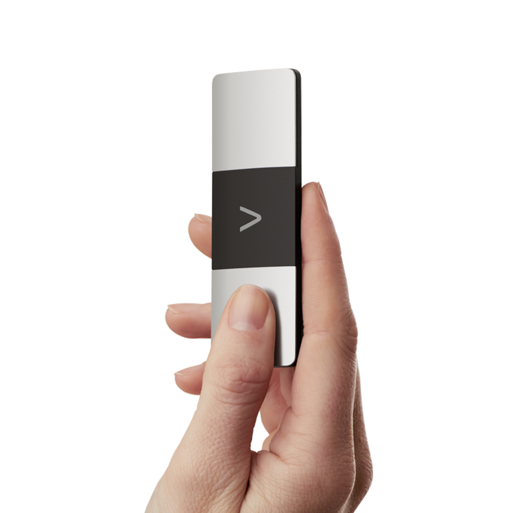
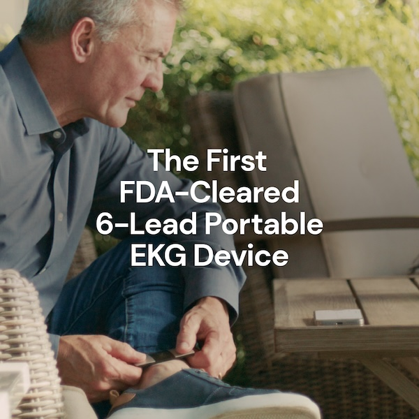
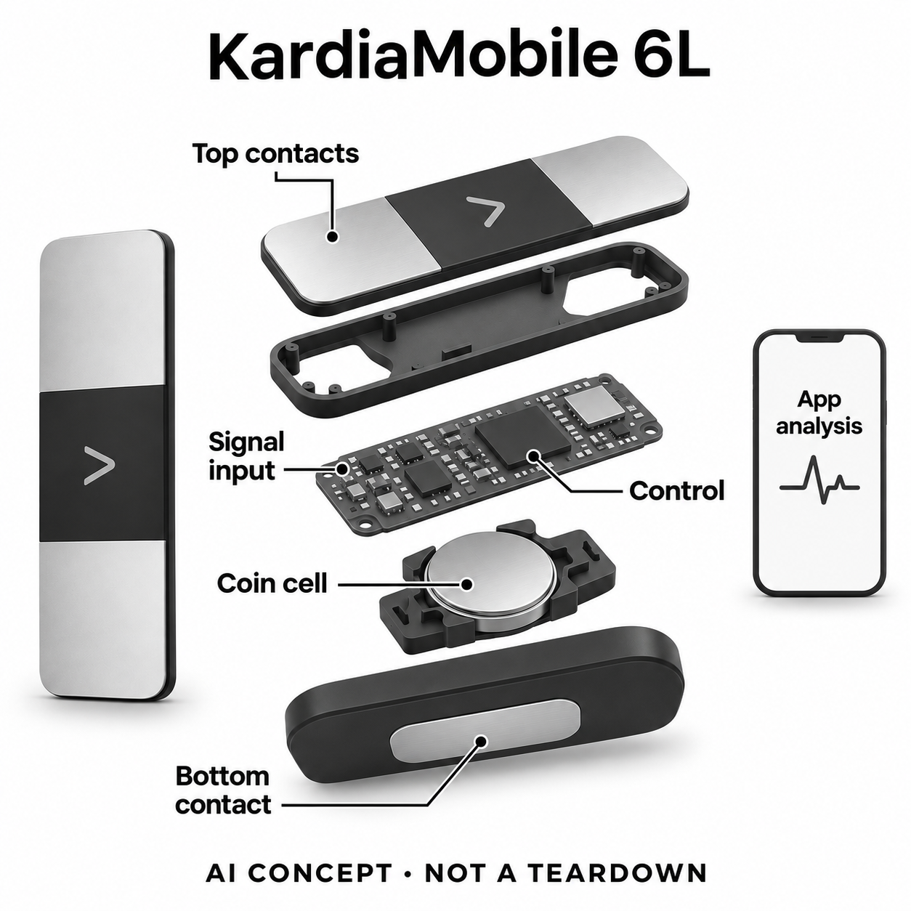

# AliveCor KardiaMobile 6L

**AliveCor / Kardia** · 居家健康 · 核查 2026-11-04

三电极个人心电采集与AI节律初步分类

消费渠道：个人零售。

## 产品图片与结构参考

### 产品图

KardiaMobile 6L官方手持产品图，正面两处接触电极 · 来源：[AliveCor · 官方产品图片](<https://kardia.com/products/kardiamobile6l>) · [原始图片](<https://kardia.com/_next/static/media/kardiamobile-6l-1.294dd4fd.jpg>)

### 参考图

KardiaMobile 6L官方使用场景，文字为厂商宣传 · 来源：[AliveCor · 官方产品图片](<https://kardia.com/products/kardiamobile6l>) · [原始图片](<https://kardia.com/_next/static/media/kardiamobile-6l-2.ddde109a.jpg>)

### AI 生成爆炸示意

**AI 生成 · 非实物拆机。** 内部为概念推断，不能作为元件布局、BOM 或维修依据。[生成提示词](../../content/hardware/prompts/kardiamobile-6l.txt)

> 已视觉检查外形、灰阶、文字及无虚构参数；内部模块形状、板卡和布置仅为概念，不代表完整BOM。

> 初稿底部电极被画在侧边，已用内置ImageGen修正为底面；保留原稿及完整修正prompt作为生成记录。

> 源图逐张实际查看，按当前具体型号核对；未改色或裁切，宣传界面与效果文案不作为实测。

> 分析为基于公开资料的案头研究与 AI 辅助判断，未经用户访谈、销量审计或实物拆机。需求、画像、竞争冷门度、审美及商业机会均为研究假设，不是投资结论。

## 销售与购买

- 状态：在售。当前官方具体6L商品页显示US$129与Add to Cart，明确个人EKG设备；未用仅供专业人员的Kardia 12L或6L Max会员套装重复计数。

- 地区：美国官网当前购买渠道、其他官方区域需核对本地型号和应用

- 价格：US$129（所见标准KardiaMobile 6L）。基础记录与部分即时分析不强制会员；扩展分析和人工复核服务按当地KardiaCare计划确认，不混用Max套装价。

- 中国大陆：未核实中国大陆该具体型号的正式销售、软件功能和医疗器械适用范围；海外购买入口不能证明大陆完整服务。

- [官方产品 / 商店](<https://kardia.com/products/kardiamobile6l>)

## AI 的实际作用

官方明确6L使用KardiaAI及机器学习分析心电节律，提供潜在发现和未分类结果；硬件记录两路心电并导出六个导联视角。

服务与联网依赖：需兼容手机/平板与Kardia应用、正确接触和相应服务权限；AI输出不是完整诊断，不将蓝牙采集当所有分析均在硬件本地执行。

## 是否冷门

细分专业（研究判断）：关注个人短时心电记录和复核准备，区别于普通健康手表；医疗用途已有成熟竞争，不据AI名称判断优越。

## 需求与市场

需求假设是用户希望在合适的日常记录安排中得到可保存、可分享的心电资料，而不仅是回忆当时感受。便携设备降低准备步骤，也把正确接触、时间标记和解释任务交给本人；价值应由记录是否有助于专业沟通衡量，不能从导联更多直接推导个人健康结果更好。

### 官方｜个人记录与初步节律分析 · 官方资料

KardiaMobile 6L是一件可直接购买的个人心电设备，通过接触电极记录信号并在兼容应用中呈现KardiaAI分析。官方资料明确机器学习参与节律判断，但这些输出是潜在发现和记录辅助，不能理解为一次短时检查即可排除所有心脏问题，也不是检测心脏病发作的工具。

依据：[KardiaMobile 6L官方当前商品页](<https://kardia.com/products/kardiamobile6l>) · [KardiaMobile 6L官方IFU（2022年3月历史版本）](<https://www.kardia.com/assets/old/ifus/kardiamobile6l/19LB65.02-en.pdf>) · [AliveCor 6L官方机器学习技术说明](<https://kardia.com/assets/images/AliveCor_BioPharma_Sponsor_6L_Factsheet.pdf>)

### 判断｜把短时信号保留下来供讨论 · 研究判断

需求假设是用户希望在合适的日常记录安排中得到可保存、可分享的心电资料，而不仅是回忆当时感受。便携设备降低准备步骤，也把正确接触、时间标记和解释任务交给本人；价值应由记录是否有助于专业沟通衡量，不能从导联更多直接推导个人健康结果更好。

依据：[KardiaMobile 6L官方当前商品页](<https://kardia.com/products/kardiamobile6l>) · [KardiaMobile 6L官方IFU（2022年3月历史版本）](<https://www.kardia.com/assets/old/ifus/kardiamobile6l/19LB65.02-en.pdf>)

### 验证｜评价记录链路而非自行诊断 · 待验证

产品试用可记录连接、接触提示、可读波形保存和分享是否顺利，将信号质量问题与分析结果分开。重要健康解释仍应进入合适的专业流程，不为测试设备而改变既有治疗或制造症状；本目录没有实机或独立临床验证，只提出个人信息工具的流程评估方法。

依据：[KardiaMobile 6L官方当前商品页](<https://kardia.com/products/kardiamobile6l>) · [KardiaMobile 6L官方IFU（2022年3月历史版本）](<https://www.kardia.com/assets/old/ifus/kardiamobile6l/19LB65.02-en.pdf>)

## 用户画像

能够理解接触状态、保持记录条件并管理手机结果的人，可能更容易完成这一任务。若用户需要他人协助，设备仍可能有价值，但服务方案应承认协助需求；图表和自动标签也需要解释，不应把熟练使用手机当作能够自行判断心电或决定医疗行动的证明。

### 官方｜个人使用需要兼容终端 · 官方资料

设备依赖兼容手机或平板与相应应用，官方维护具体终端列表，并在说明中限定使用范围。它既可供个人保存记录，也可能进入专业服务流程，但这不代表任何人、任何手机或任何医疗状况都适合；本目录不以年龄、职业或自述感受替代个体适配判断。

依据：[KardiaMobile 6L官方当前商品页](<https://kardia.com/products/kardiamobile6l>) · [KardiaMobile 6L官方IFU（2022年3月历史版本）](<https://www.kardia.com/assets/old/ifus/kardiamobile6l/19LB65.02-en.pdf>) · [Kardia官方当前手机兼容列表](<https://kardia.com/compatibility>)

### 判断｜操作和解释支持同样重要 · 研究判断

能够理解接触状态、保持记录条件并管理手机结果的人，可能更容易完成这一任务。若用户需要他人协助，设备仍可能有价值，但服务方案应承认协助需求；图表和自动标签也需要解释，不应把熟练使用手机当作能够自行判断心电或决定医疗行动的证明。

依据：[KardiaMobile 6L官方IFU（2022年3月历史版本）](<https://www.kardia.com/assets/old/ifus/kardiamobile6l/19LB65.02-en.pdf>) · [Kardia官方当前手机兼容列表](<https://kardia.com/compatibility>)

### 验证｜检查本人能完成的环节 · 待验证

可让本人完成应用连接、识别无法分析的提示、找到记录日期和分享入口，再说明需要帮助时联系谁。把首次设置与后续使用分开，记录是否反复丢失账号或使用不兼容终端；这些具体环节比简单的科技熟练度标签更能帮助判断个人购买和支持成本。

依据：[KardiaMobile 6L官方当前商品页](<https://kardia.com/products/kardiamobile6l>) · [KardiaMobile 6L官方IFU（2022年3月历史版本）](<https://www.kardia.com/assets/old/ifus/kardiamobile6l/19LB65.02-en.pdf>) · [Kardia官方当前手机兼容列表](<https://kardia.com/compatibility>)

## 竞争与替代

与单导联消费设备比较，六导联提供不同电活动视角，但它仍是用户主动进行的短时记录，不能据此替代持续监测或专业检查。比较应关注用户实际需要保存怎样的资料、能否操作和怎样复核；不能把厂商“更多数据”表达直接转成六倍准确或六倍临床价值。

### 官方｜标准6L与服务套餐有区别 · 官方资料

当前标准6L商品有明确价格和购买按钮，基础记录与部分即时分析不要求强制会员，扩展分析和人工复核服务另有计划。目录没有将6L Max等服务组合当作新硬件，也没有收录仅供专业人员的12L作为普通个人购买替代；实际套餐需按地区和当前服务说明核对。

依据：[KardiaMobile 6L官方当前商品页](<https://kardia.com/products/kardiamobile6l>)

### 判断｜六个视角不等于连续覆盖 · 研究判断

与单导联消费设备比较，六导联提供不同电活动视角，但它仍是用户主动进行的短时记录，不能据此替代持续监测或专业检查。比较应关注用户实际需要保存怎样的资料、能否操作和怎样复核；不能把厂商“更多数据”表达直接转成六倍准确或六倍临床价值。

依据：[KardiaMobile 6L官方当前商品页](<https://kardia.com/products/kardiamobile6l>) · [KardiaMobile 6L官方IFU（2022年3月历史版本）](<https://www.kardia.com/assets/old/ifus/kardiamobile6l/19LB65.02-en.pdf>)

### 验证｜比较完整记录和服务成本 · 待验证

可在专业需求明确后比较设备、兼容手机、会员及复核服务的总投入，并记录成功保存和分享所需步骤。不同检测项目和服务级别要保持一致，避免用裸机价对照含人工解释的方案；本研究没有销量、长期采用或效果对照，不能从零售便利判断市场接受度。

依据：[KardiaMobile 6L官方当前商品页](<https://kardia.com/products/kardiamobile6l>) · [Kardia官方当前手机兼容列表](<https://kardia.com/compatibility>)

## 供应链

同类新设计需要把低噪声采集、输入保护、接触材料和无线干扰一起验证，不能只选择一个支持ECG的芯片就认为完成个人设备。外壳与电极位置也影响稳定接触和维护；算法不能自动修复所有不合格波形，供应研究必须保留原始信号质量与成品验证的区别。

### 官方｜三个电极与底部电池位置 · 官方资料

官方说明明确两个电极在正面、一个在底面，可更换纽扣电池位于底部电极后方；蓝牙负责向应用传输。六导联不表示六个物理电极，原始两路记录还会派生其他导联。具体模拟前端、无线芯片、工厂和完整板级布局未公开，概念图不补造这些供应关系。

依据：[KardiaMobile 6L官方IFU（2022年3月历史版本）](<https://www.kardia.com/assets/old/ifus/kardiamobile6l/19LB65.02-en.pdf>)

### 判断｜输入保护和接触质量不能省略 · 研究判断

同类新设计需要把低噪声采集、输入保护、接触材料和无线干扰一起验证，不能只选择一个支持ECG的芯片就认为完成个人设备。外壳与电极位置也影响稳定接触和维护；算法不能自动修复所有不合格波形，供应研究必须保留原始信号质量与成品验证的区别。

依据：[KardiaMobile 6L官方IFU（2022年3月历史版本）](<https://www.kardia.com/assets/old/ifus/kardiamobile6l/19LB65.02-en.pdf>)

### 验证｜按采集与连接分开选型 · 待验证

候选可以分别对应多通道生物电前端与低功耗蓝牙控制，但需要重新核对电极阻抗、采样、同步和电源条件。通用器件不包含KardiaAI、应用兼容或医疗器械许可，也不是消费者换件方案；没有点名证据就只标功能候选，不能推断原设备采用或复制其性能。

依据：[KardiaMobile 6L官方IFU（2022年3月历史版本）](<https://www.kardia.com/assets/old/ifus/kardiamobile6l/19LB65.02-en.pdf>) · [AliveCor 6L官方机器学习技术说明](<https://kardia.com/assets/images/AliveCor_BioPharma_Sponsor_6L_Factsheet.pdf>)

## 技术路径

自动标签帮助用户整理记录，但单个分类不包含全部临床背景，未分类也不自动意味着某种疾病。算法结果应与波形、采集条件和时间联系，避免只留下一个颜色或结论；技术分析需要区分输入不可读、模型不确定和真正需要进一步解释的情形，不将它们混成统一分数。

### 官方｜采集、派生与分类不同层次 · 官方资料

6L可同时采集相关原始通道并形成六导联视角，应用再展示节律分类和未能分类等结果。机器学习依据厂商明确的KardiaAI资料，不因普通蓝牙或心率计算而被纳入；面向临床研究的材料还包含额外功能，不能将这些SDK或研究分析项目默认交付给标准零售用户。

依据：[KardiaMobile 6L官方IFU（2022年3月历史版本）](<https://www.kardia.com/assets/old/ifus/kardiamobile6l/19LB65.02-en.pdf>) · [AliveCor 6L官方机器学习技术说明](<https://kardia.com/assets/images/AliveCor_BioPharma_Sponsor_6L_Factsheet.pdf>)

### 判断｜波形与标签需要一起理解 · 研究判断

自动标签帮助用户整理记录，但单个分类不包含全部临床背景，未分类也不自动意味着某种疾病。算法结果应与波形、采集条件和时间联系，避免只留下一个颜色或结论；技术分析需要区分输入不可读、模型不确定和真正需要进一步解释的情形，不将它们混成统一分数。

依据：[KardiaMobile 6L官方IFU（2022年3月历史版本）](<https://www.kardia.com/assets/old/ifus/kardiamobile6l/19LB65.02-en.pdf>)

### 验证｜关注不可读记录的处理 · 待验证

试用可观察接触不足、终端不兼容或传输中断时系统如何提示，确认用户能够找到原始记录而不是只记住自动标签。对报告分享应核对日期和完整性，后续医疗解释由适当专业人员承担；本目录没有验证灵敏度或特异性，也不把厂商清除或注册信息等同个人效果保证。

依据：[KardiaMobile 6L官方IFU（2022年3月历史版本）](<https://www.kardia.com/assets/old/ifus/kardiamobile6l/19LB65.02-en.pdf>) · [Kardia官方当前手机兼容列表](<https://kardia.com/compatibility>)

## 产品审美

用户需要区分正反面、识别电极并保持适当接触，因此太小或过于光滑不一定更方便。外观应帮助理解设备只负责采集，手机才呈现分析；收纳与取出是否容易、金属面是否便于按说明维护，也会影响愿不愿意持续携带，而不只是口袋里能否放下。

### 官方｜细长便携体与明确接触面 · 官方资料

官方图显示细长深色主体、两端金属接触区与底面额外电极，没有设备内置大屏。显示和解释交给手机，使主体更简洁，但同时依赖外部终端；照片不能证明所有手部操作能力或日常场景都容易获得稳定接触，最终使用便利需要本人实际确认。

依据：[KardiaMobile 6L官方当前商品页](<https://kardia.com/products/kardiamobile6l>) · [KardiaMobile 6L官方IFU（2022年3月历史版本）](<https://www.kardia.com/assets/old/ifus/kardiamobile6l/19LB65.02-en.pdf>)

### 判断｜可辨认方向比极小尺寸更重要 · 研究判断

用户需要区分正反面、识别电极并保持适当接触，因此太小或过于光滑不一定更方便。外观应帮助理解设备只负责采集，手机才呈现分析；收纳与取出是否容易、金属面是否便于按说明维护，也会影响愿不愿意持续携带，而不只是口袋里能否放下。

依据：[KardiaMobile 6L官方IFU（2022年3月历史版本）](<https://www.kardia.com/assets/old/ifus/kardiamobile6l/19LB65.02-en.pdf>)

### 验证｜观察取放和结果衔接 · 待验证

可以记录从取出设备到找到手机结果的全过程，检查是否因方向、连接或显示切换而需要帮助。维护和电池更换按官方说明进行，研究不提供拆修指引；宣传照片中的熟练动作无法替代不同使用者的真实反馈，本轮没有长时携带或操作可靠性实测。

依据：[KardiaMobile 6L官方当前商品页](<https://kardia.com/products/kardiamobile6l>) · [KardiaMobile 6L官方IFU（2022年3月历史版本）](<https://www.kardia.com/assets/old/ifus/kardiamobile6l/19LB65.02-en.pdf>)

## 关键风险

个人可能过度相信一次正常结果，或因一个无法分类的标签产生不必要担忧，两种情况都说明解释流程很重要。短时记录也可能没有覆盖实际关注的时间段，不能根据缺少异常标签判断持续状态；本目录不进行诊断，应把数据保存和专业复核路径作为产品能力的一部分。

### 官方｜分析存在明确使用限制 · 官方资料

官方说明该设备不检测心脏病发作，分析不能替代完整诊断，并对特定使用条件和人群设有限制。目录保留这一范围，不将正常标签理解为排除所有问题，也不把海外销售证明移植为中国大陆正式许可或服务；具体适用性与版本应查看当地说明和专业意见。

依据：[KardiaMobile 6L官方当前商品页](<https://kardia.com/products/kardiamobile6l>) · [KardiaMobile 6L官方IFU（2022年3月历史版本）](<https://www.kardia.com/assets/old/ifus/kardiamobile6l/19LB65.02-en.pdf>)

### 判断｜自动结果可能形成错误安心 · 研究判断

个人可能过度相信一次正常结果，或因一个无法分类的标签产生不必要担忧，两种情况都说明解释流程很重要。短时记录也可能没有覆盖实际关注的时间段，不能根据缺少异常标签判断持续状态；本目录不进行诊断，应把数据保存和专业复核路径作为产品能力的一部分。

依据：[KardiaMobile 6L官方IFU（2022年3月历史版本）](<https://www.kardia.com/assets/old/ifus/kardiamobile6l/19LB65.02-en.pdf>)

### 验证｜确认复核与退出的路径 · 待验证

购买前应核对当前手机、地区功能、会员与报告分享方式，使用中记录无法分析或不理解的结果如何获得帮助。不要依据本目录或自动标签自行改变药物及医疗安排；这些是对产品使用边界的核查，不是针对个人健康状态的建议，也不承诺某类问题一定能被设备发现。

依据：[KardiaMobile 6L官方当前商品页](<https://kardia.com/products/kardiamobile6l>) · [KardiaMobile 6L官方IFU（2022年3月历史版本）](<https://www.kardia.com/assets/old/ifus/kardiamobile6l/19LB65.02-en.pdf>) · [Kardia官方当前手机兼容列表](<https://kardia.com/compatibility>)

## 机会与验证

值得研究的是用户能否稳定保留所需资料并在适当时机清楚表达问题，而不是把设备变成随时给自己下结论的工具。如果分享、时间标记和不可读提示更容易理解，即使分类种类有限也可能有价值；这一假设仍需真实服务流程与用户体验验证，不能只靠AI名称支持。

### 官方｜个人心电资料是核心任务 · 官方资料

KardiaMobile 6L提供个人短时采集、保存和节律初步分析，使消费电子入口与专业沟通之间有一份更具体的记录。它与腕部普通活动监测有不同输入任务，但同品牌卡片、会员和套装变化不应无限增加需求；目录选择这一明确可购型号保留结构与服务边界。

依据：[KardiaMobile 6L官方当前商品页](<https://kardia.com/products/kardiamobile6l>) · [KardiaMobile 6L官方IFU（2022年3月历史版本）](<https://www.kardia.com/assets/old/ifus/kardiamobile6l/19LB65.02-en.pdf>)

### 判断｜有用记录比更多自动结论重要 · 研究判断

值得研究的是用户能否稳定保留所需资料并在适当时机清楚表达问题，而不是把设备变成随时给自己下结论的工具。如果分享、时间标记和不可读提示更容易理解，即使分类种类有限也可能有价值；这一假设仍需真实服务流程与用户体验验证，不能只靠AI名称支持。

依据：[KardiaMobile 6L官方当前商品页](<https://kardia.com/products/kardiamobile6l>) · [KardiaMobile 6L官方IFU（2022年3月历史版本）](<https://www.kardia.com/assets/old/ifus/kardiamobile6l/19LB65.02-en.pdf>)

### 验证｜跟踪实际沟通价值 · 待验证

后续研究可记录有效记录比例、操作协助、分享和复核需求，并询问资料是否帮助用户更准确地描述关注点。把信息流程与临床效果分别评价，遵循合适的专业支持安排；当前仅为公开资料与市场分析，没有独立临床、长期访谈或销售证据，不预判个体收益和商业结果。

依据：[KardiaMobile 6L官方当前商品页](<https://kardia.com/products/kardiamobile6l>) · [KardiaMobile 6L官方IFU（2022年3月历史版本）](<https://www.kardia.com/assets/old/ifus/kardiamobile6l/19LB65.02-en.pdf>)

## 对应供应链公司

能力候选用于选型研究，不代表本产品实际采用；未公开的供货关系不作推断。

- [texas-instruments](../supply-chain/texas-instruments.md) — **能力候选 · 非已采用** / 同类个人多导联ECG的生物电前端候选：TI ADS1299公开低噪声多通道生物电采集及ECG应用，可用于研究两路同步输入和导联派生的相近新设计，但通道数、供电、输入保护和尺寸需重新评估。芯片不含KardiaAI或成品许可，且没有6L点名采用证据；不能把候选前端直接当作原机替换件。

- [nordic-semiconductor](../supply-chain/nordic-semiconductor.md) — **能力候选 · 非已采用** / 同类个人心电器的数据传输控制候选：Nordic低功耗蓝牙平台与6L公开的手机传输路径相符，可用于研究连接、缓存和纽扣电池负载，但需核对采样时序与无线干扰。它不提供节律分析或医疗许可，当前未被AliveCor点名采用；此链接只用于相近新设计的功能比较，不推断原机无线料号。

[浏览供应链目录](../supply-chain.md)

## 功能分层示意

这是功能关系，不是实物拆机、真实空间结构或已核实 BOM。

1. **三电极接触**：正面两个接触区域、底面一个接触区域；六导联不是六个电极。（官方披露）

2. **生物电采集**：可记录单路或两路信号，并据其得到相关导联视角，具体芯片未知。（官方披露）

3. **无线与电源**：蓝牙向兼容手机传输，可更换纽扣电池位于底部电极后方。（官方披露）

4. **KardiaAI分析**：应用展示记录和节律分析，具体功能依版本及会员，模型内部未完整公开。（官方披露）

5. **分享与专业复核**：用户可保存或分享记录，潜在发现不能替代完整临床判断。（官方披露）

## 来源

1. [KardiaMobile 6L官方当前商品页](<https://kardia.com/products/kardiamobile6l>) — 本轮已打开US$129与Add to Cart、标准6L个人用途；不混用6L Max计划或12L专业机。

2. [KardiaMobile 6L官方IFU（2022年3月历史版本）](<https://www.kardia.com/assets/old/ifus/kardiamobile6l/19LB65.02-en.pdf>) — 本轮已打开，明确三电极、两路采集及导联派生、底部纽扣电池、蓝牙和KardiaAI；仅作已知结构/用途边界，不据历史文档推定当前所有地区服务。

3. [AliveCor 6L官方机器学习技术说明](<https://kardia.com/assets/images/AliveCor_BioPharma_Sponsor_6L_Factsheet.pdf>) — 本轮已打开，明确6L为AI与ML支持的设备；该材料面向临床研究，不把其QT、SDK或研究服务能力套入普通消费者套餐。

4. [Kardia官方当前手机兼容列表](<https://kardia.com/compatibility>) — 本轮已打开，按具体手机和系统核验兼容，不认为所有蓝牙手机都支持。

[返回目录](../hardware-market.md) · [网页分析](https://romanagent.github.io/Roman/#hardware/product/kardiamobile-6l)
