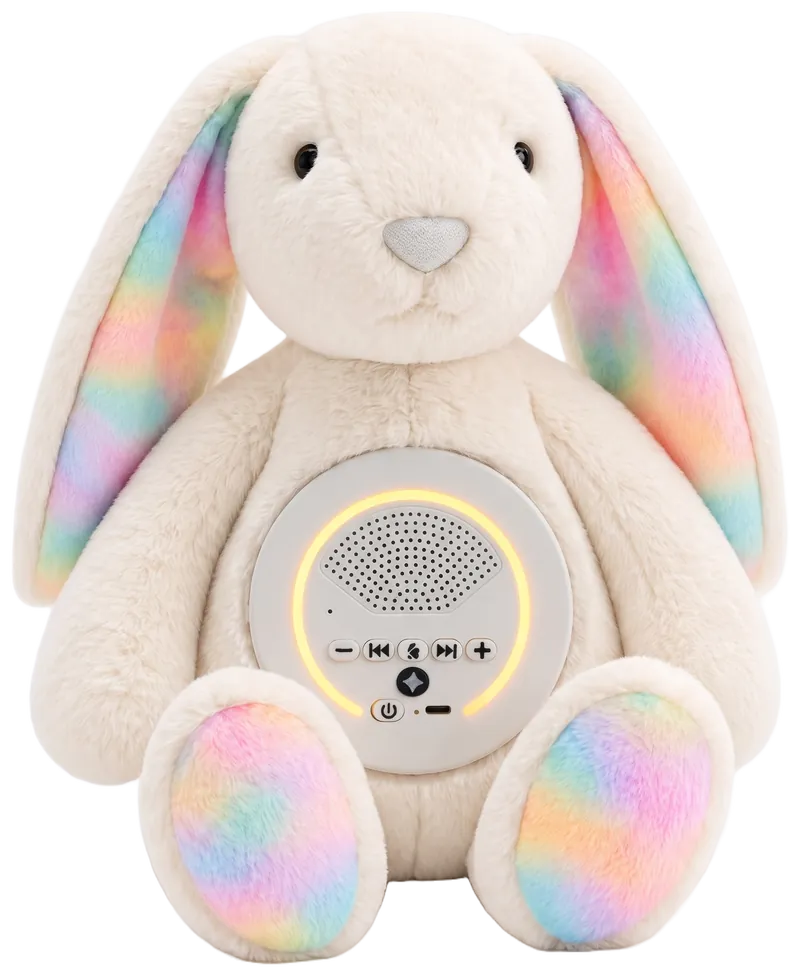
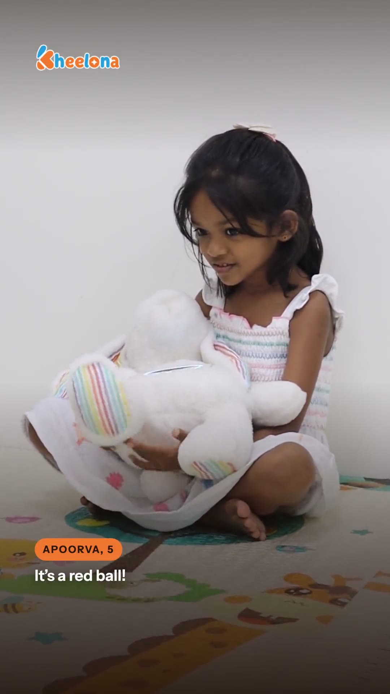
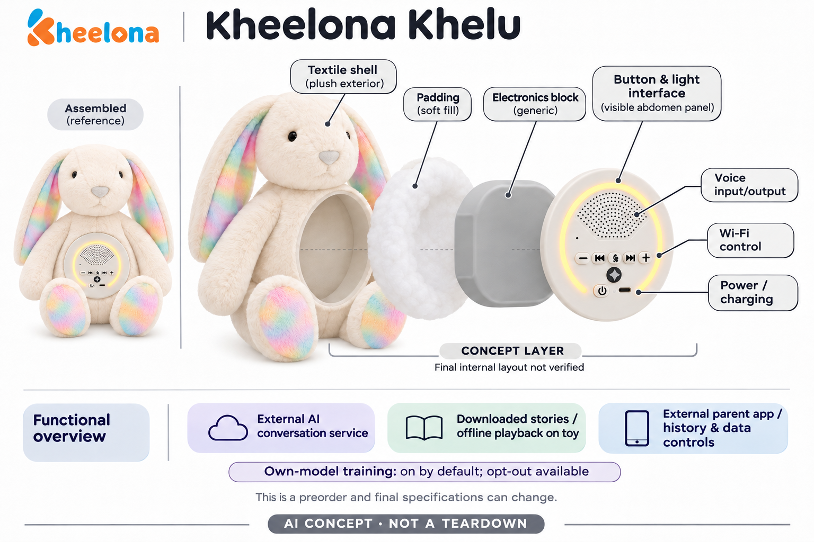

# Kheelona Khelu / Kheelu

**Kheelona** · AI玩具 · 核查 2026-11-06

面向印度家庭、带实体语音面板与离线故事的兔子毛绒预售

消费渠道：消费预订。

## 产品图片与结构参考

### 产品图

官方Khelu预售外观图，量产细节仍可变 · 来源：[产品品牌官网](<https://kheelona.com/>) · [原始图片](<https://kheelona.com/assets/img/kheelu-800.22d962e874.webp>)

### 参考图

官方试用家庭视频封面，所示为试用阶段样品 · 来源：[产品品牌官网](<https://kheelona.com/>) · [原始图片](<https://store.kheelona.com/video/moments/learning-by-asking.jpg>)

### AI 生成爆炸示意

**AI 生成 · 非实物拆机。** 内部为概念推断，不能作为元件布局、BOM 或维修依据。[生成提示词](../../content/hardware/prompts/kheelona-khelu.txt)

> 内置ImageGen按本产品官方参考独立生成；未知内部为概念层，不是BOM或维修依据。

> 修订明确离线故事在玩具播放，云AI和家长App为外部服务，初稿与修订提示词保留。

> 图片保留官方原貌；效果、安全与性能宣传不代表本目录独立验证。

> 分析为基于公开资料的案头研究与 AI 辅助判断，未经用户访谈、销量审计或实物拆机。需求、画像、竞争冷门度、审美及商业机会均为研究假设，不是投资结论。

## 销售与购买

- 状态：预售 / 接受延期订单。当前官方商店及2026-10-14条款明确每笔预售订一只Khelu，首付₹499、总价₹4,999、尾款₹4,500发货前付，付款后确认订单号，尾款后派送已保留设备。预计11月中开始印度交付，规格及时间仍可调整，未付款验证履约。

- 地区：印度

- 价格：₹4,999 总价；首付₹499 + 尾款₹4,500。当前首批价含GST和印度配送，包含6个月Kheelona+；之后硬件定价及订阅方案另核，不将首付当整机价格，也不承诺未来月费免费。

- 中国大陆：官方条款明确需要印度电话号码与收货地址，目前不向印度以外配送；未发现大陆正式销售或服务，不把跨境转运视为官方渠道。

- [官方产品 / 商店](<https://store.kheelona.com/>)

## AI 的实际作用

按实体按钮启动语音，联网服务识别并生成按年龄配置的回复，可反问与编故事；已下载故事和歌曲可离线播放。厂商自己的模型默认使用录音和转写学习，应用可关闭，不能概括为所有提供方都不训练。

服务与联网依赖：AI对话需家庭Wi-Fi、家长应用和账户，语音经Kheelona服务器及外部服务处理；自有模型训练和录音保存有分别设置，已训练模型不会因退出自动重训。

## 是否冷门

新兴竞争（研究判断）：印度语言语境、实体操作与按键对话是实现重点，仍与其他儿童AI毛绒共享任务；无独立销量或脑发育效果证据，不将宣传转成市场或疗效结论。

## 需求与市场

印度家庭可能在多种语言和日常活动之间切换，希望孩子不必打字就能提问。价值应看玩具是否听懂真实表达、能否接上家庭游戏，而不是语言数量和技术名称；如果交流需要不断由成人翻译和修正，实体兔子的亲切外形未必能抵消负担。

### 事实｜玩具通过按键进入对话 · 官方资料

Khelu使用实体按钮开启语音，接续问题和故事，并可提出引导性追问；下载后的歌曲和故事则有离线播放路径。它同时包含生成式与音频播放功能，不能把所有内容都描述为即时AI，也不能由反问的形式证明儿童思考或语言能力必然得到改善。

依据：[Khelu官方产品与试用资料](<https://kheelona.com/>) · [Kheelona当前隐私与训练政策](<https://kheelona.com/privacy>)

### 判断｜需求可能来自当地家庭的表达场景 · 研究判断

印度家庭可能在多种语言和日常活动之间切换，希望孩子不必打字就能提问。价值应看玩具是否听懂真实表达、能否接上家庭游戏，而不是语言数量和技术名称；如果交流需要不断由成人翻译和修正，实体兔子的亲切外形未必能抵消负担。

依据：[Khelu官方产品与试用资料](<https://kheelona.com/>)

### 验证｜观察共玩而非只看演示对话 · 待验证

后续可记录孩子主动发起的主题、误解后的修正和父母参与，再与既有故事机及亲子讲述比较。官方试用影片只能说明展示过某些互动，不能证明普遍教育效果；本目录没有独立家庭访谈或销量研究，需求和前景仍是待检验假设。

依据：[Khelu官方产品与试用资料](<https://kheelona.com/>) · [Kheelona当前隐私与训练政策](<https://kheelona.com/privacy>)

## 用户画像

产品提供对话记录和个性化，但默认训练及录音保存设置也要求家长理解。适配画像应包括愿意查看规则、设置网络和维护内容的成人，而不只是喜欢兔子外观的孩子；不同家庭对记录和训练的接受程度可能不同，不能用年龄统一推定。

### 事实｜成人与印度联系渠道是购买条件 · 官方资料

当前条款要求成年人下单，并提供印度电话号码和收货地址，每笔预售对应一只硬件。儿童使用定位三至七岁，家长负责账户管理；这些条件限定当前交付范围，不应因为网站可以国际访问就把产品描述成全球正式销售。

依据：[Kheelona官方硬件预售商店](<https://store.kheelona.com/>) · [Khelu官方预售条款](<https://kheelona.com/terms>)

### 判断｜家长需要愿意管理资料与设置 · 研究判断

产品提供对话记录和个性化，但默认训练及录音保存设置也要求家长理解。适配画像应包括愿意查看规则、设置网络和维护内容的成人，而不只是喜欢兔子外观的孩子；不同家庭对记录和训练的接受程度可能不同，不能用年龄统一推定。

依据：[Khelu官方预售条款](<https://kheelona.com/terms>) · [Kheelona当前隐私与训练政策](<https://kheelona.com/privacy>)

### 验证｜检验孩子与家长对状态的理解 · 待验证

可以让孩子用公开主题按键讲话，成人查看相应文字和设置，确认收音灯、结束和录音控制是否被正确理解。多人在旁时也需注意哪些话会进入记录；本轮未提交账户和儿童资料，不通过真实私密对话验证个性化或模型训练。

依据：[Khelu官方产品与试用资料](<https://kheelona.com/>) · [Kheelona当前隐私与训练政策](<https://kheelona.com/privacy>)

## 竞争与替代

明确的故事、音量和对话操作可能比隐藏式按钮更容易辨认，也可能让幼儿面对更多选择。它需要与简单故事机、其他聊天毛绒和手机应用比较，看家庭真正使用哪些操作；功能多不等于更易用，硬件预售也不能直接与成熟现货体验等量比较。

### 事实｜这笔首付对应具体预售硬件 · 官方资料

条款明确一只Khelu、盒内物品、确认订单号、锁定总价和发货前尾款，付款安排不是只获得未来购买资格。预计时间仍可变化，无法供货时按条款退款；目录据此列正式预售，但不把首付金额当整机售价或预售确认当已经完成交付。

依据：[Kheelona官方硬件预售商店](<https://store.kheelona.com/>) · [Khelu官方预售条款](<https://kheelona.com/terms>)

### 判断｜实体面板与手机应用各有负担 · 研究判断

明确的故事、音量和对话操作可能比隐藏式按钮更容易辨认，也可能让幼儿面对更多选择。它需要与简单故事机、其他聊天毛绒和手机应用比较，看家庭真正使用哪些操作；功能多不等于更易用，硬件预售也不能直接与成熟现货体验等量比较。

依据：[Khelu官方产品与试用资料](<https://kheelona.com/>)

### 验证｜把套餐和服务周期纳入比较 · 待验证

首批价包含一定期限的Kheelona+，后续服务条件需要在采用时确认，不能只比较购买首付款。可记录真实使用的联网与离线比例，再计算硬件、网络和服务维护；本研究没有实际订单及经营成本，不推断产品利润或长期订阅价值。

依据：[Kheelona官方硬件预售商店](<https://store.kheelona.com/>) · [Khelu官方预售条款](<https://kheelona.com/terms>)

## 供应链

扬声器、按键、灯环与软质外皮共处，会影响抱持、采音和清洁；孩子可能直接压住面板，也可能边播放边讲话。类似产品的供应设计要处理声学、机械和电源共同约束，不能只以一个云对话模块成熟就推定整机已适合长期使用。

### 事实｜当前外观与试用影片有不同证据作用 · 官方资料

官网展示兔形外观和腹部电子面板，条款说明部分网站图片可能是AI插画，而试用影片来自获得许可的家庭。目录保留这一差别，不把所有场景当成客户实拍；量产前规格可调整，内部主控、电池与工厂没有公开完整物料证据。

依据：[Khelu官方预售条款](<https://kheelona.com/terms>) · [Khelu官方产品与试用资料](<https://kheelona.com/>)

### 判断｜面板和毛绒需要一起验证 · 研究判断

扬声器、按键、灯环与软质外皮共处，会影响抱持、采音和清洁；孩子可能直接压住面板，也可能边播放边讲话。类似产品的供应设计要处理声学、机械和电源共同约束，不能只以一个云对话模块成熟就推定整机已适合长期使用。

依据：[Khelu官方产品与试用资料](<https://kheelona.com/>)

### 验证｜候选公司不构成已采用清单 · 待验证

可考察Wi-Fi控制和MEMS采音器件，并在实际外壳、声音与抱持环境中测试，再确认离线存储和充电方案。没有品牌点名关系时，只能列同类研发候选；厂商标注本地制作也不能让研究者猜测具体工厂、芯片品牌或供应成本。

依据：[Khelu官方产品与试用资料](<https://kheelona.com/>) · [Kheelona当前隐私与训练政策](<https://kheelona.com/privacy>)

## 技术路径

保存一段文字用于接续故事，与把多次对话纳入模型训练具有不同用途和退出影响。家长可能只想让玩具记住兴趣，并不自然意味着愿意贡献训练资料；技术说明应把记忆、历史、录音和模型学习分别表达，不能用越玩越懂你把这些过程混为一谈。

### 事实｜即时回应与自有模型训练分开 · 官方资料

隐私政策称外部语音和AI提供方仅为即时回复处理资料，不训练其自身模型；Kheelona自己的模型则默认使用儿童录音和转写学习。两者不是同一承诺，不能把外部供应商不训练概括为整个系统不训练，录音保存和训练退出也有各自设置。

依据：[Kheelona当前隐私与训练政策](<https://kheelona.com/privacy>)

### 判断｜个性化记忆不等于训练基础模型 · 研究判断

保存一段文字用于接续故事，与把多次对话纳入模型训练具有不同用途和退出影响。家长可能只想让玩具记住兴趣，并不自然意味着愿意贡献训练资料；技术说明应把记忆、历史、录音和模型学习分别表达，不能用越玩越懂你把这些过程混为一谈。

依据：[Kheelona当前隐私与训练政策](<https://kheelona.com/privacy>)

### 验证｜核对退出训练后的实际边界 · 待验证

官方说关闭后停止新用途并从训练数据移除，但已训练模型不会自动重训。评估应检查界面是否清楚表达这一点，以及关闭是否保持其他玩法可用；本目录没有后台审计，既不保证模型遗忘，也不把厂商自述当作独立验证的数据处理结果。

依据：[Kheelona当前隐私与训练政策](<https://kheelona.com/privacy>)

## 产品审美

与把按钮藏在绒毛里的方案相比，明显面板可能方便家长说明什么时候开始和结束，同时也可能影响拥抱触感。审美应结合孩子能否区分故事播放和AI模式，而不只看颜色；亲切外形和灯光不能替代可靠的状态提示或成人参与。

### 事实｜腹部操作面板构成明显视觉中心 · 官方资料

当前外观图中的兔子有长耳和腹部圆形出声、按键及灯环区域，电子功能并非完全隐藏。图片支持理解操作布局，却不能证明每个生产版本都保持同样细节；眼部没有摄像头的披露，概念图不会添加镜头或大模型芯片。

依据：[Khelu官方产品与试用资料](<https://kheelona.com/>)

### 判断｜可见控件有助于解释玩具状态 · 研究判断

与把按钮藏在绒毛里的方案相比，明显面板可能方便家长说明什么时候开始和结束，同时也可能影响拥抱触感。审美应结合孩子能否区分故事播放和AI模式，而不只看颜色；亲切外形和灯光不能替代可靠的状态提示或成人参与。

依据：[Khelu官方产品与试用资料](<https://kheelona.com/>) · [Kheelona当前隐私与训练政策](<https://kheelona.com/privacy>)

### 验证｜观察抱持误触和日常维护 · 待验证

后续可在坐着、抱着和收纳时观察是否容易误按，声音是否被遮住，以及成人能否按最终说明充电和清洁。试用样品与量产仍可能不同，需要在实际收到的版本上测试；本轮没有实物材料或机械验证，不宣称可水洗、抗跌或易维修。

依据：[Khelu官方产品与试用资料](<https://kheelona.com/>)

## 关键风险

家长可能把无广告理解为没有其他数据用途，但产品仍有训练和历史功能。与此同时，量产、认证和交期尚在完成中，样品效果与最终体验可能不同；应避免把网站关于脑发育的宣传、试用家长评价或服务器筛选规则当成已证明的成长效果。

### 事实｜训练默认开启是重要采用条件 · 官方资料

官方当前条款明确自有模型训练默认开启、可在家长应用关闭，录音保存也可关闭，文字历史保留至用户删除。它还说明收音期间附近其他人的话可能进入对话，因此不能只按主使用儿童理解资料范围；这些条件应在购买前就能被家庭看到。

依据：[Khelu官方预售条款](<https://kheelona.com/terms>) · [Kheelona当前隐私与训练政策](<https://kheelona.com/privacy>)

### 判断｜服务和家庭期待之间可能出现落差 · 研究判断

家长可能把无广告理解为没有其他数据用途，但产品仍有训练和历史功能。与此同时，量产、认证和交期尚在完成中，样品效果与最终体验可能不同；应避免把网站关于脑发育的宣传、试用家长评价或服务器筛选规则当成已证明的成长效果。

依据：[Kheelona官方硬件预售商店](<https://store.kheelona.com/>) · [Kheelona当前隐私与训练政策](<https://kheelona.com/privacy>)

### 验证｜同时检查数据设置和预售变更 · 待验证

采用时应保存当期订单、服务权益与隐私规则，核对交期或规格改变如何通知、取消如何处理，以及关闭记录和训练是否生效。测试以少量非敏感内容进行，不要求孩子提供困境作为示例；本目录不做医疗、法律或安全认证结论。

依据：[Khelu官方预售条款](<https://kheelona.com/terms>) · [Kheelona当前隐私与训练政策](<https://kheelona.com/privacy>)

## 机会与验证

如果实体控件、当地语言和离线内容让家庭容易理解和持续使用，可能形成特定消费价值。但模型训练默认设置与维护负担也会影响选择，创业研究需要把便利与资料控制放到同一个流程中，不应只用反问玩法或AI标签判断前景。

### 事实｜联网对话与离线内容有独立使用条件 · 官方资料

条款说明AI对话需家庭Wi-Fi，而已经下载的故事和歌曲可以离线播放。购买包含硬件与一定期限的付费服务权益，免费家长应用并不代表所有AI服务一直免费；中国大陆也不在当前配送范围，不能把语言支持当作当地渠道证据。

依据：[Khelu官方预售条款](<https://kheelona.com/terms>)

### 判断｜机会在清楚且可维护的家庭流程 · 研究判断

如果实体控件、当地语言和离线内容让家庭容易理解和持续使用，可能形成特定消费价值。但模型训练默认设置与维护负担也会影响选择，创业研究需要把便利与资料控制放到同一个流程中，不应只用反问玩法或AI标签判断前景。

依据：[Khelu官方产品与试用资料](<https://kheelona.com/>) · [Kheelona当前隐私与训练政策](<https://kheelona.com/privacy>)

### 验证｜跟踪交付后的继续与退出理由 · 待验证

后续可观察实际收到版本、使用频率、家长设置时间、错误回复和订阅到期后的选择，分别评价实体与服务。预售订单号只能证明交易安排，不证明未来留存和盈利；当前为案头研究，没有独立销量、学习效果或长期家庭使用证据。

依据：[Kheelona官方硬件预售商店](<https://store.kheelona.com/>) · [Khelu官方预售条款](<https://kheelona.com/terms>) · [Khelu官方产品与试用资料](<https://kheelona.com/>)

## 对应供应链公司

能力候选用于选型研究，不代表本产品实际采用；未公开的供货关系不作推断。

- [espressif](../supply-chain/espressif.md) — **能力候选 · 非已采用** / 同类Wi-Fi玩具的联网与离线内容控制候选：Espressif无线平台可用于类似腹部面板玩具的Wi-Fi连接、按键状态与离线内容管理研究，但不代表Khelu采用该芯片。实际存储、音频播放和充电方案需另行验证，不能把板级能力等同云模型服务；公开资料没有具体主控或工厂点名，因此仅列能力候选。

- [infineon](../supply-chain/infineon.md) — **能力候选 · 非已采用** / 腹部扬声器附近的儿童采音候选：Infineon MEMS麦克风可用于研究类似Khelu面板附近的语音采集，必须测试扬声器回声、近距离抱持和多个家庭成员讲话。它不负责家长账户、模型训练许可或内容过滤，也没有该产品采用关系证据；器件能力与成品的识别质量、资料规则应分别验证。

[浏览供应链目录](../supply-chain.md)

## 功能分层示意

这是功能关系，不是实物拆机、真实空间结构或已核实 BOM。

1. **毛绒与面板**：长耳兔形态、腹部扬声器与按键/灯环，当前外观及试用样品不保证最终量产完全一致。（官方披露）

2. **语音触发**：按唤醒按钮开始收音，灯提示状态，静默后结束；无唤醒词和摄像头。（官方披露）

3. **网络与内容**：Wi-Fi承载AI对话，下载故事和歌曲可离线播放，家长App配置管理。（官方披露）

4. **外部AI处理**：服务器与语音/AI提供方生成回复，具体型号与调用路径未完全公开。（官方披露）

5. **资料与训练控制**：家长可回看文字，自有模型默认学习录音及转写，可关闭训练和录音保存；与即时回复的处理分开。（官方披露）

## 来源

1. [Kheelona官方硬件预售商店](<https://store.kheelona.com/>) — 已打开具体一只硬件、499首付/4500尾款/4999总价与印度交付，不提交姓名、电话或付款。

2. [Khelu官方预售条款](<https://kheelona.com/terms>) — 2026-10-14版明确订单号、硬件内容、锁价、尾款后派送与不能供货退款；不是只买未来优先资格。

3. [Khelu官方产品与试用资料](<https://kheelona.com/>) — 已打开按钮、灯环、故事与对话机制及试用片段；网站家庭插画与真实试用影片按条款区分，不能转写脑发育宣传为证据。

4. [Kheelona当前隐私与训练政策](<https://kheelona.com/privacy>) — 2026-10-14版明确自有模型默认训练、录音保存与退出，以及外部服务商规则；既有模型不会因退出自动重训，未独立审计。

[返回目录](../hardware-market.md) · [网页分析](https://romanagent.github.io/Roman/#hardware/product/kheelona-khelu)
