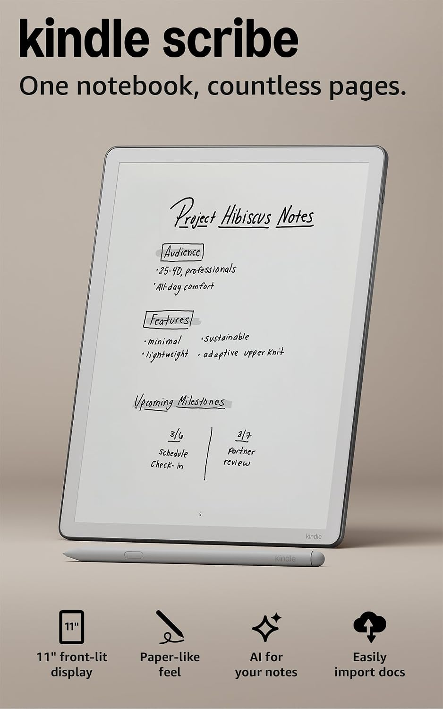
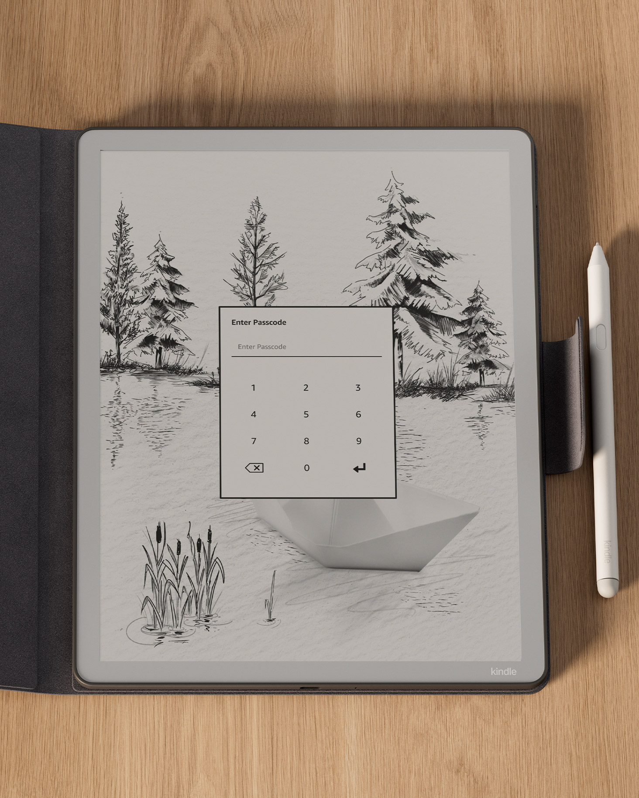
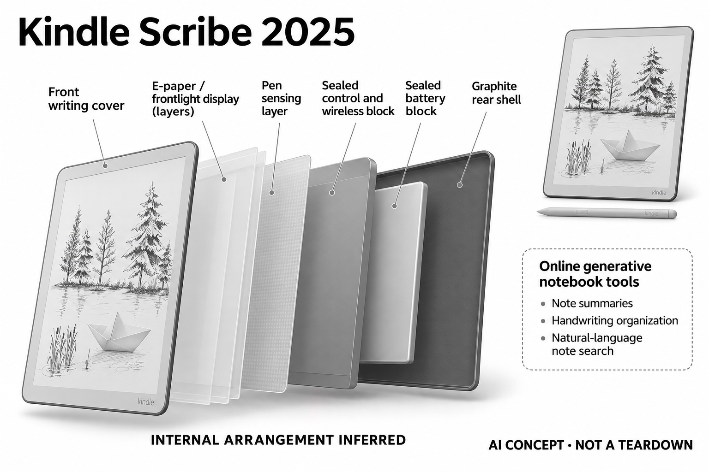

# Amazon Kindle Scribe（2025，第三代）

**Amazon** · 手机与 AI PC · 核查 2026-11-04

电子纸手写与生成式笔记搜索

消费渠道：个人零售。

## 产品图片与结构参考

### 产品图

Amazon Kindle Scribe（2025，第三代） · 官方产品图 · 来源：[Amazon · 官方图片](<https://www.amazon.com/dp/B0FC1ZS9QZ>) · [原始图片](<https://m.media-amazon.com/images/I/616QLgnAn6L._AC_SL1500_.jpg>)

### 参考图

Amazon Kindle Scribe（2025，第三代） · 官方参考图 · 来源：[Amazon · 官方图片](<https://www.amazon.com/dp/B0FC1ZS9QZ>) · [原始图片](<https://m.media-amazon.com/images/G/01/kindle/journeys/TyLOXJtbOiD1ZxRNClkSSQxh961s27StsY6FbvVbHpg3D/NmUwMGMxZDIt._CB799488765_.jpg>)

### AI 生成爆炸示意

**AI 生成 · 非实物拆机。** 内部为概念推断，不能作为元件布局、BOM 或维修依据。[生成提示词](../../content/hardware/prompts/kindle-scribe-2025.txt)

> 已目视核对外形、标签与非拆机声明；不代表内部结构经实测验证。

> 分析为基于公开资料的案头研究与 AI 辅助判断，未经用户访谈、销量审计或实物拆机。需求、画像、竞争冷门度、审美及商业机会均为研究假设，不是投资结论。

## 销售与购买

- 状态：在售。已打开Amazon官方第三代64GB新机商品，卖家与发货方为Amazon.com且有Add to cart；不把翻新报价、容量和无前光版重复计数。

- 地区：美国Amazon官方商店

- 价格：以Amazon所选容量当前报价为准。核查日页面快照；运费、税费、会员和配送区域按官方结算确认，不视为中国到手价。

- 中国大陆：本轮核实所列区域官方商店；未确认中国大陆官方现货、账户及完整服务，不把境外可购等同大陆可用。

- [官方产品 / 商店](<https://www.amazon.com/dp/B0FC1ZS9QZ>)

## AI 的实际作用

内置生成式笔记摘要、手写整理及自然语言笔记搜索；官方将相关新功能的可用范围标为美国，不能把全球可买硬件等同所有AI功能可用。

服务与联网依赖：需要Amazon账户与相应联网服务；语言、地区和功能版本受限制。基础阅读、原始手写与在线AI处理是不同环节。

## 是否冷门

新兴竞争（研究判断）：Kindle阅读生态中的专用书写终端形成具体使用场景；本轮没有销量与市场份额证据。

## 需求与市场

需求假设：已有Kindle阅读习惯的人可能希望把批注、个人笔记和查找内容放在同一设备中。应观察用户是否真会回顾自己的笔记，以及AI搜索能否找到关键原句而不只是生成看似合理的摘要。

## 用户画像

画像推断：重视长文阅读和手写、已经接受Amazon账户生态的个人用户较匹配。对中文资料、开放应用或复杂绘图有要求的人需先核对支持范围，不能只按大屏和附笔判断适合所有笔记任务。

## 竞争与替代

竞争判断：普通Kindle加纸笔、其他电子纸手写板和iPad都构成替代，品牌阅读生态是主要区别。AI摘要在软件中也很常见，硬件价值需要由阅读书写的连贯性与长期内容管理体现。

## 供应链

供应链推断：大电子纸、前光、笔输入和轻薄机身需要可靠屏幕保护，笔尖与保护套影响持续书写成本。官方未在本轮资料中披露具体工厂和完整物料表，不推算制造利润或内部芯片布局。

## 技术路径

官方说明自然语言笔记搜索、摘要和手写整理，并限定部分功能的地区范围。技术判断应将识别笔迹、检索原文和生成概括分别测试，检查省略和错引，不能将流畅总结当作完全忠实记录。

## 产品审美

审美判断：中性色窄边机身与大纸页保持阅读器的克制外观，手写笔让产品成为随身笔记物件。实际持握重心、前光均匀性和笔尖摩擦影响长时体验，展示图无法替代连续阅读书写。

## 关键风险

风险判断：地区账户和服务政策会决定AI功能是否可用，私人笔记处理前需理解云端与分享范围。导出的摘要可能丢失细节，重要记录应保留原笔迹；不把无通知或电子纸视为注意力改善保证。

## 机会与验证

市场观察：适合从现有Kindle用户和普通笔记用户分别验证，记录阅读到写作转换次数、笔记找回成功率及纠错。生态熟悉度与AI价值应分开考察，不能由品牌体量推断这类手写需求规模。

## 功能分层示意

这是功能关系，不是实物拆机、真实空间结构或已核实 BOM。

1. **纸页显示**：电子纸及前光呈现书籍与笔记。（官方披露）

2. **笔迹输入**：附带手写笔记录原始内容。（官方披露）

3. **笔记处理**：摘要、整理与自然语言搜索。（官方披露）

4. **账户连接**：Amazon账户与联网服务管理内容。（官方披露）

## 来源

1. [Kindle Scribe第三代Amazon官方新机](<https://www.amazon.com/dp/B0FC1ZS9QZ>) — 已核对新机Amazon.com卖家与加购入口，未使用Amazon Resale库存。

2. [Amazon官方Scribe生成式功能说明](<https://www.aboutamazon.com/news/devices/kindle-scribe-gen-ai-notebook>) — 已实际打开官方页面；功能说明不等于独立性能测量。

[返回目录](../hardware-market.md) · [网页分析](https://romanagent.github.io/Roman/#hardware/product/kindle-scribe-2025)
