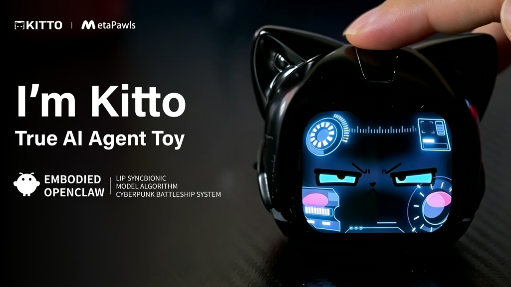
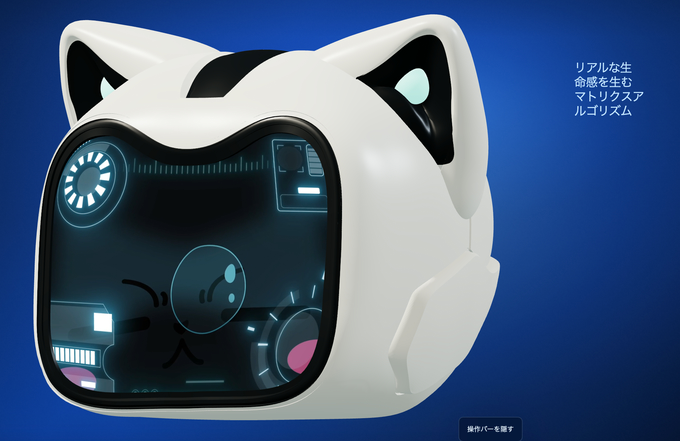
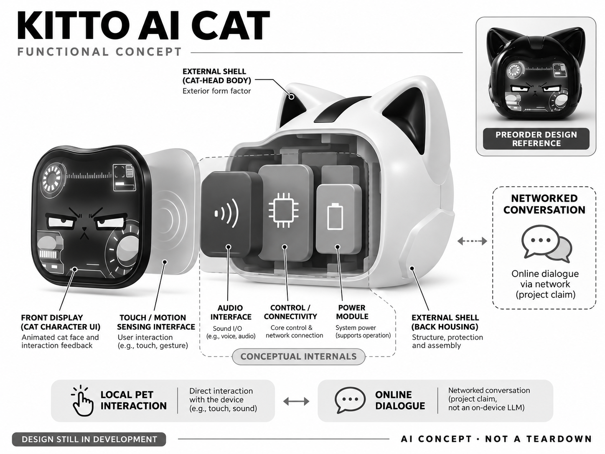

# Kitto AI Cat

**Kitto / Jason Wei** · AI玩具 · 核查 2026-11-06

仍在研发的桌面电子猫，正式后期预售与未来功能分开标注

消费渠道：消费预订。

## 产品图片与结构参考

### 产品图

Kitto 官方众筹封面（原型 / 预售设计资料） · 来源：[Kitto / Jason Wei 官方资料](<https://www.kickstarter.com/projects/kitto/kitto-true-ai-agent-toy/description>) · [原始图片](<https://i.kickstarter.com/assets/054/551/727/5379f751068443fea8f9551ef2eae864_original.png?anim=false&fit=cover&gravity=auto&height=576&origin=ugc&q=92&v=1784972570&width=1024&sig=X2sFdopgXoDAziM1ukospL5iCRYpfKiqS%2BmPwreZig4%3D>)

### 参考图

Kitto 白色版本官方预售设计参考（非量产证明） · 来源：[Kitto / Jason Wei 官方资料](<https://www.kickstarter.com/projects/kitto/kitto-true-ai-agent-toy/description>) · [原始图片](<https://i.kickstarter.com/assets/055/429/455/91d849eb8aaf8af2f8951481657793e2_original.png?fit=scale-down&origin=ugc&q=100&v=1791430251&width=680&sig=qrNxU4uTjq%2B%2BqAIFHs1lsUqqm7Xz9UPm%2B2v1%2B0MCujE%3D>)

### AI 生成爆炸示意

**AI 生成 · 非实物拆机。** 内部为概念推断，不能作为元件布局、BOM 或维修依据。[生成提示词](../../content/hardware/prompts/kitto-ai-cat.txt)

> 图中网络对话属于项目方预售功能说明，量产形态与实际效果待交付确认。

> 图片为官方众筹封面和预售外形设计，不是量产交付证明。封面OpenClaw文字属于项目宣传，正文明确深度集成仍为未来计划。

> 浏览器实际导出资源为AVIF；只进行无语义PNG格式转换，未改色、裁切或重绘。

> 分析为基于公开资料的案头研究与 AI 辅助判断，未经用户访谈、销量审计或实物拆机。需求、画像、竞争冷门度、审美及商业机会均为研究假设，不是投资结论。

## 销售与购买

- 状态：预售 / 接受延期订单。本轮实际浏览确认Late Pledge仍开放，黑/白单台HK$1800按钮可用，预计Jan2027、Ships anywhere；不采回报描述残留旧价，不把多台套餐另计。

- 地区：官方回报所列全球目的地

- 价格：HK$1,800单台后期支持。预计2027年1月交付，运费另计；黑白与多台套餐合一款，旧描述换算价格不用于当前报价。

- 中国大陆：回报写Ships anywhere，尚未逐地址确认中国大陆支付、税运费、应用和模型服务；不等同国内现货或保证中文首发。

- [官方产品 / 商店](<https://www.kickstarter.com/projects/kitto/kitto-true-ai-agent-toy/rewards>)

## AI 的实际作用

预售方案将联网生成式对话与电子猫养成、语音口型和表情同步结合；项目方披露外部AI及语音服务用于该体验。

服务与联网依赖：实时对话需网络；基础养成计划可离线。应用、更多代理能力、旋转底座及自接模型仍有开发路线边界，尚未量产，最终语言与服务需交付验证。

## 是否冷门

新兴竞争（研究判断）：竞争判断包括手机数字宠物、现售桌面机器人和普通角色摆件。手机方案更新和输入更方便，实体产品则可以长期占据一个可见位置；若没有明显触摸和表情体验，独立硬件可能只是昂贵外壳。预售设备的可比性还受交付时间和功能变更影响。

## 需求与市场

需求判断是把屏幕中的猫角色固定在一个可触摸的桌面物件上，让照顾与交谈形成连续体验。硬件价值可能来自随时看得见的存在感和角色动画，而不只是换一种方式调用聊天模型；是否值得额外购买，需要与用户已有手机和桌面摆件比较。

### 事实与范围 · 官方资料

Kitto以电子猫角色、语音对话、口型与表情同步和养成玩法构成预售方案，当前众筹回报仍接受单台后期支持。项目不是只有应用的数字宠物，但也尚未进入量产；本条描述可订购的研发产品，不把演示中的代理愿景写成已稳定交付的日常助手。

依据：[Kitto当前官方后期支持回报](<https://www.kickstarter.com/projects/kitto/kitto-true-ai-agent-toy/rewards>) · [Kitto官方众筹FAQ](<https://www.kickstarter.com/projects/kitto/kitto-true-ai-agent-toy/faqs>)

### 判断与差异 · 研究判断

需求判断是把屏幕中的猫角色固定在一个可触摸的桌面物件上，让照顾与交谈形成连续体验。硬件价值可能来自随时看得见的存在感和角色动画，而不只是换一种方式调用聊天模型；是否值得额外购买，需要与用户已有手机和桌面摆件比较。

依据：[Kitto当前官方后期支持回报](<https://www.kickstarter.com/projects/kitto/kitto-true-ai-agent-toy/rewards>) · [Kitto官方众筹FAQ](<https://www.kickstarter.com/projects/kitto/kitto-true-ai-agent-toy/faqs>)

### 验证与限制 · 待验证

验证计划应在真实交付后记录用户何时主动照顾、聊天和停止使用，分别询问是角色形象、对话质量还是实体形态吸引他们。预售支持者可能愿意尝试未完成产品，不能把这种意愿当作普通消费者对成熟设备的需求，也不由筹款规模推算长期留存。

依据：[Kitto当前官方后期支持回报](<https://www.kickstarter.com/projects/kitto/kitto-true-ai-agent-toy/rewards>) · [Kitto官方众筹FAQ](<https://www.kickstarter.com/projects/kitto/kitto-true-ai-agent-toy/faqs>)

## 用户画像

潜在人群可假设为喜欢数字宠物和动画角色的成人，以及愿意参与早期产品反馈的技术爱好者。普通礼物购买者对确定交期和易用性的要求可能更高；即使外形可爱，也不说明适合无人监督儿童，更不能将独居或情绪压力当成自动购买理由。

### 事实与范围 · 官方资料

当前单台黑色和白色回报同价，包含设备与基本附件，说明可以作为个人拥有的电子玩具预订；多个颜色与多台套餐只计同一产品。官方FAQ对首发语言仍使用取决于开发进展的措辞，因此不能提前承诺所有中文或多语言用户都能完整使用。

依据：[Kitto当前官方后期支持回报](<https://www.kickstarter.com/projects/kitto/kitto-true-ai-agent-toy/rewards>) · [Kitto官方众筹FAQ](<https://www.kickstarter.com/projects/kitto/kitto-true-ai-agent-toy/faqs>)

### 判断与差异 · 研究判断

潜在人群可假设为喜欢数字宠物和动画角色的成人，以及愿意参与早期产品反馈的技术爱好者。普通礼物购买者对确定交期和易用性的要求可能更高；即使外形可爱，也不说明适合无人监督儿童，更不能将独居或情绪压力当成自动购买理由。

依据：[Kitto当前官方后期支持回报](<https://www.kickstarter.com/projects/kitto/kitto-true-ai-agent-toy/rewards>) · [Kitto官方众筹FAQ](<https://www.kickstarter.com/projects/kitto/kitto-true-ai-agent-toy/faqs>)

### 验证与限制 · 待验证

招募应先询问参与者能接受多少设置和版本变化，再让其阅读实际回报及功能边界，检查是否理解订购并不等于立即收到。交付后记录语言设置、配网和养成积分是否造成负担，区分对项目理念的支持与对每天使用设备的真实兴趣。

依据：[Kitto当前官方后期支持回报](<https://www.kickstarter.com/projects/kitto/kitto-true-ai-agent-toy/rewards>) · [Kitto官方众筹FAQ](<https://www.kickstarter.com/projects/kitto/kitto-true-ai-agent-toy/faqs>)

## 竞争与替代

竞争判断包括手机数字宠物、现售桌面机器人和普通角色摆件。手机方案更新和输入更方便，实体产品则可以长期占据一个可见位置；若没有明显触摸和表情体验，独立硬件可能只是昂贵外壳。预售设备的可比性还受交付时间和功能变更影响。

### 事实与范围 · 官方资料

项目将养成积分与对话结合，计划通过代码驱动动画和实时口型让电子猫有更多表达；FAQ同时把自接模型和更多代理能力放在未来路线。与既有实体伙伴比较时，应以已经说明的对话养成方案为依据，不能靠尚未开发完成的功能数量形成领先结论。

依据：[Kitto当前官方后期支持回报](<https://www.kickstarter.com/projects/kitto/kitto-true-ai-agent-toy/rewards>) · [Kitto官方众筹FAQ](<https://www.kickstarter.com/projects/kitto/kitto-true-ai-agent-toy/faqs>)

### 判断与差异 · 研究判断

竞争判断包括手机数字宠物、现售桌面机器人和普通角色摆件。手机方案更新和输入更方便，实体产品则可以长期占据一个可见位置；若没有明显触摸和表情体验，独立硬件可能只是昂贵外壳。预售设备的可比性还受交付时间和功能变更影响。

依据：[Kitto当前官方后期支持回报](<https://www.kickstarter.com/projects/kitto/kitto-true-ai-agent-toy/rewards>) · [Kitto官方众筹FAQ](<https://www.kickstarter.com/projects/kitto/kitto-true-ai-agent-toy/faqs>)

### 验证与限制 · 待验证

可让用户先比较相同角色在手机和实体屏幕上的短暂互动，再等量产版具备条件时测连续使用。分别记录动画吸引力、回答质量和维护成本，不用代理功能清单压过体验；与现售产品对比时明确原型与成品阶段差异，避免把承诺当实测性能。

依据：[Kitto当前官方后期支持回报](<https://www.kickstarter.com/projects/kitto/kitto-true-ai-agent-toy/rewards>) · [Kitto官方众筹FAQ](<https://www.kickstarter.com/projects/kitto/kitto-true-ai-agent-toy/faqs>)

## 供应链

工程判断是动画、音频与触摸响应需要共同调试，屏幕延迟和语音等待会直接影响角色感。小批样机运行成功不能证明长期散热、装配一致性和音腔效果；如果后续增加旋转底座，还会带来结构、电源与可靠性的新约束，不能当作免费软件升级。

### 事实与范围 · 官方资料

项目正文坦承内部硬件结构仍需优化、尚未量产，资金也用于方案团队、供应链和质量控制。公开内容没有稳定的完整物料表或工厂点名，因此结构图只解释显示、输入、控制与云服务的功能关系，不能借原型照片推断最终电路与制造成熟度。

依据：[Kitto当前官方后期支持回报](<https://www.kickstarter.com/projects/kitto/kitto-true-ai-agent-toy/rewards>) · [Kitto官方众筹FAQ](<https://www.kickstarter.com/projects/kitto/kitto-true-ai-agent-toy/faqs>) · [Kitto官方项目正文与研发风险](<https://www.kickstarter.com/projects/kitto/kitto-true-ai-agent-toy/description>)

### 判断与差异 · 研究判断

工程判断是动画、音频与触摸响应需要共同调试，屏幕延迟和语音等待会直接影响角色感。小批样机运行成功不能证明长期散热、装配一致性和音腔效果；如果后续增加旋转底座，还会带来结构、电源与可靠性的新约束，不能当作免费软件升级。

依据：[Kitto当前官方后期支持回报](<https://www.kickstarter.com/projects/kitto/kitto-true-ai-agent-toy/rewards>) · [Kitto官方众筹FAQ](<https://www.kickstarter.com/projects/kitto/kitto-true-ai-agent-toy/faqs>) · [Kitto官方项目正文与研发风险](<https://www.kickstarter.com/projects/kitto/kitto-true-ai-agent-toy/description>)

### 验证与限制 · 待验证

可以向显示与微型声学公司询问能力，但需先冻结可交付的尺寸、亮度、观看角度和语音场景。试产应检查连续对话的温升、屏幕装配、输入误触和维护方式，工厂、单价及起订量都应等待实际沟通，不从众筹价格倒推成本或利润。

依据：[Kitto当前官方后期支持回报](<https://www.kickstarter.com/projects/kitto/kitto-true-ai-agent-toy/rewards>) · [Kitto官方众筹FAQ](<https://www.kickstarter.com/projects/kitto/kitto-true-ai-agent-toy/faqs>) · [Kitto官方项目正文与研发风险](<https://www.kickstarter.com/projects/kitto/kitto-true-ai-agent-toy/description>)

## 技术路径

技术判断是口型与表情同步决定角色是否连贯，但这与模型拥有记忆、准确回答或执行任务是不同能力。项目列出多个模型服务名称也不等于每个地区同时可选，具体版本和数据流仍需交付说明；养成积分影响对话机会，不应误写成无限免费聊天。

### 事实与范围 · 官方资料

项目方披露对话与内容生成使用外部AI服务，FAQ明确实时对话要联网，基础养成互动计划支持离线。应用、旋转底座、自接模型和深入代理集成仍有开发或未来措辞；本条只将生成式对话作为预售AI机制，不认定完整自主代理系统已经可用。

依据：[Kitto当前官方后期支持回报](<https://www.kickstarter.com/projects/kitto/kitto-true-ai-agent-toy/rewards>) · [Kitto官方众筹FAQ](<https://www.kickstarter.com/projects/kitto/kitto-true-ai-agent-toy/faqs>) · [Kitto官方项目正文与研发风险](<https://www.kickstarter.com/projects/kitto/kitto-true-ai-agent-toy/description>)

### 判断与差异 · 研究判断

技术判断是口型与表情同步决定角色是否连贯，但这与模型拥有记忆、准确回答或执行任务是不同能力。项目列出多个模型服务名称也不等于每个地区同时可选，具体版本和数据流仍需交付说明；养成积分影响对话机会，不应误写成无限免费聊天。

依据：[Kitto当前官方后期支持回报](<https://www.kickstarter.com/projects/kitto/kitto-true-ai-agent-toy/rewards>) · [Kitto官方众筹FAQ](<https://www.kickstarter.com/projects/kitto/kitto-true-ai-agent-toy/faqs>) · [Kitto官方项目正文与研发风险](<https://www.kickstarter.com/projects/kitto/kitto-true-ai-agent-toy/description>)

### 验证与限制 · 待验证

验证应在交付版本上分别检查触摸养成、网络对话、动画同步和应用设置，记录断网、等待与内容错误时的反馈。对发送消息、执行外部动作等代理能力，需要额外确认用户授权和失败回退；不能因为项目展示调试控制台就推断这些流程已成熟。

依据：[Kitto当前官方后期支持回报](<https://www.kickstarter.com/projects/kitto/kitto-true-ai-agent-toy/rewards>) · [Kitto官方众筹FAQ](<https://www.kickstarter.com/projects/kitto/kitto-true-ai-agent-toy/faqs>) · [Kitto官方项目正文与研发风险](<https://www.kickstarter.com/projects/kitto/kitto-true-ai-agent-toy/description>)

## 产品审美

设计判断是角色动画可能比硬件外壳更频繁地影响体验：表情同步自然可以维持注意力，重复循环或等待过长则会让角色感消失。赛博风格也不一定适合所有工作空间，持续亮屏、声音和养成提醒需要与用户的真实日常节奏共同评估。

### 事实与范围 · 官方资料

官方众筹把猫角色的表情、口型和赛博风格界面作为主要视觉表达，正文同时展示配置界面和开发过程。媒体应注明来自项目方的原型或预售设计资料，不能称为已量产实拍；生成图也必须标明概念，不用未交付的旋转底座和行走机构丰富外观。

依据：[Kitto当前官方后期支持回报](<https://www.kickstarter.com/projects/kitto/kitto-true-ai-agent-toy/rewards>) · [Kitto官方众筹FAQ](<https://www.kickstarter.com/projects/kitto/kitto-true-ai-agent-toy/faqs>)

### 判断与差异 · 研究判断

设计判断是角色动画可能比硬件外壳更频繁地影响体验：表情同步自然可以维持注意力，重复循环或等待过长则会让角色感消失。赛博风格也不一定适合所有工作空间，持续亮屏、声音和养成提醒需要与用户的真实日常节奏共同评估。

依据：[Kitto当前官方后期支持回报](<https://www.kickstarter.com/projects/kitto/kitto-true-ai-agent-toy/rewards>) · [Kitto官方众筹FAQ](<https://www.kickstarter.com/projects/kitto/kitto-true-ai-agent-toy/faqs>)

### 验证与限制 · 待验证

审美验证可以在原型和量产样机之间分阶段进行，先评价角色表达，再检查实体摆放、反光和屏幕可读性。让用户说明哪些动画愿意每天看到、哪些提醒希望减少，不因效果图动人就推断材料、声音和长期维护体验同样成熟。

依据：[Kitto当前官方后期支持回报](<https://www.kickstarter.com/projects/kitto/kitto-true-ai-agent-toy/rewards>) · [Kitto官方众筹FAQ](<https://www.kickstarter.com/projects/kitto/kitto-true-ai-agent-toy/faqs>)

## 关键风险

风险判断包括供应链延期、软件范围缩减、云调用持续成本以及生成内容和家庭数据的处理。项目方提出未来整合代理工具，并同时承认数据安全还需完善；这不等于已经发现具体漏洞，但足以要求更清楚的权限边界，不能默认儿童或敏感对话安全。

### 事实与范围 · 官方资料

当前可用单台后期回报按钮是港币一千八百元，预计二〇二七年一月交付；回报描述仍残留不同旧价格，本条以当前可付款金额为准。项目正文明确未量产且硬件继续优化，预售判断不应被读成库存现货或对交付时间的保证。

依据：[Kitto当前官方后期支持回报](<https://www.kickstarter.com/projects/kitto/kitto-true-ai-agent-toy/rewards>) · [Kitto官方众筹FAQ](<https://www.kickstarter.com/projects/kitto/kitto-true-ai-agent-toy/faqs>) · [Kitto官方项目正文与研发风险](<https://www.kickstarter.com/projects/kitto/kitto-true-ai-agent-toy/description>)

### 判断与差异 · 研究判断

风险判断包括供应链延期、软件范围缩减、云调用持续成本以及生成内容和家庭数据的处理。项目方提出未来整合代理工具，并同时承认数据安全还需完善；这不等于已经发现具体漏洞，但足以要求更清楚的权限边界，不能默认儿童或敏感对话安全。

依据：[Kitto当前官方后期支持回报](<https://www.kickstarter.com/projects/kitto/kitto-true-ai-agent-toy/rewards>) · [Kitto官方众筹FAQ](<https://www.kickstarter.com/projects/kitto/kitto-true-ai-agent-toy/faqs>) · [Kitto官方项目正文与研发风险](<https://www.kickstarter.com/projects/kitto/kitto-true-ai-agent-toy/description>)

### 验证与限制 · 待验证

支持前应确认退款延期规则、首发语言、对话积分与后续收费，以及应用和服务在所在地能否使用。交付验证应查看录音、记忆和账户删除方式，先用不含私人信息的对话体验；没有独立测试时不宣称云端安全、情绪疗效或所有承诺已经实现。

依据：[Kitto当前官方后期支持回报](<https://www.kickstarter.com/projects/kitto/kitto-true-ai-agent-toy/rewards>) · [Kitto官方众筹FAQ](<https://www.kickstarter.com/projects/kitto/kitto-true-ai-agent-toy/faqs>) · [Kitto官方项目正文与研发风险](<https://www.kickstarter.com/projects/kitto/kitto-true-ai-agent-toy/description>)

## 机会与验证

商业判断中，养成积分替代订阅可能降低持续付款压力，也可能让用户感觉为了聊天必须完成任务。小团队需要验证积分是否形成愉快仪式，还是阻挡核心功能的门槛；云服务费用和动画内容维护仍存在，不能从无订阅承诺推断运营无需持续收入。

### 事实与范围 · 官方资料

可研究的机会是先做好一个具有稳定表达的桌面电子猫，让养成动作与少量可理解的对话形成闭环，再讨论更复杂代理功能。这个判断来自当前研发边界，而非对项目成功的预测；若基础延迟和口型体验尚未稳定，继续堆功能可能增加交付负担。

依据：[Kitto当前官方后期支持回报](<https://www.kickstarter.com/projects/kitto/kitto-true-ai-agent-toy/rewards>) · [Kitto官方众筹FAQ](<https://www.kickstarter.com/projects/kitto/kitto-true-ai-agent-toy/faqs>)

### 判断与差异 · 研究判断

商业判断中，养成积分替代订阅可能降低持续付款压力，也可能让用户感觉为了聊天必须完成任务。小团队需要验证积分是否形成愉快仪式，还是阻挡核心功能的门槛；云服务费用和动画内容维护仍存在，不能从无订阅承诺推断运营无需持续收入。

依据：[Kitto当前官方后期支持回报](<https://www.kickstarter.com/projects/kitto/kitto-true-ai-agent-toy/rewards>) · [Kitto官方众筹FAQ](<https://www.kickstarter.com/projects/kitto/kitto-true-ai-agent-toy/faqs>)

### 验证与限制 · 待验证

后续可对首批用户进行分阶段访谈，询问期待与收到内容的差异，记录真正保留的功能、停用原因和对新增能力的付费意愿。结果应同时呈现支持和退订者，不用筹款金额或AI评分估算市场容量，也不把原型演示中的流畅片段当作成熟可靠性。

依据：[Kitto当前官方后期支持回报](<https://www.kickstarter.com/projects/kitto/kitto-true-ai-agent-toy/rewards>) · [Kitto官方众筹FAQ](<https://www.kickstarter.com/projects/kitto/kitto-true-ai-agent-toy/faqs>)

## 对应供应链公司

能力候选用于选型研究，不代表本产品实际采用；未公开的供货关系不作推断。

- [aac-technologies](../supply-chain/aac-technologies.md) — **能力候选 · 非已采用** / 角色语音输入输出能力候选：瑞声公开微型声学器件与系统工程，可为类似桌面电子猫的语音输入输出提供能力参考。实际音腔、屏幕布置和延迟仍需样机验证，没有点名证据显示Kitto采用该公司产品。

- [boe](../supply-chain/boe.md) — **能力候选 · 非已采用** / 桌面角色显示工程候选：京东方公开多形态显示与模组能力，可用于类似电子猫角色的显示路线评估。实际尺寸、观看角度、功耗和供应条件尚待项目定型，本条仅作能力候选，不确认现有采购、价格或可直接替换。

[浏览供应链目录](../supply-chain.md)

## 功能分层示意

这是功能关系，不是实物拆机、真实空间结构或已核实 BOM。

1. **角色表达**：猫角色动画、表情和语音口型构成预售体验。（官方披露）

2. **本地互动**：触摸及运动相关输入用于养成，具体交付配置仍在优化。（官方披露）

3. **联网对话**：实时生成对话依赖互联网与项目服务，模型供应为项目方披露。（官方披露）

4. **应用与未来能力**：设置应用和更多代理能力仍在开发，不作为已交付硬件模块。（官方披露）

5. **内部概念层**：显示、音频、控制和供电的空间结构为推断，非量产物料表。（分析推断）

## 来源

1. [Kitto当前官方后期支持回报](<https://www.kickstarter.com/projects/kitto/kitto-true-ai-agent-toy/rewards>) — 本轮实际浏览确认Late Pledge仍开放，黑/白单台HK$1800按钮可用，预计Jan2027、Ships anywhere；不采回报描述残留旧价，不把多台套餐另计。

2. [Kitto官方众筹FAQ](<https://www.kickstarter.com/projects/kitto/kitto-true-ai-agent-toy/faqs>) — 核联网实时对话、离线养成计划、积分模式、语言未定、应用与旋转底座开发中、自接模型为2027路线；不将未来功能写成当前成品。

3. [Kitto官方项目正文与研发风险](<https://www.kickstarter.com/projects/kitto/kitto-true-ai-agent-toy/description>) — 本轮实际浏览全文；项目明确硬件仍优化且未进入量产，11月底硬件演示为计划。AI披露为项目方对外部服务的说明，OpenClaw深度整合是未来计划。

[返回目录](../hardware-market.md) · [网页分析](https://romanagent.github.io/Roman/#hardware/product/kitto-ai-cat)
