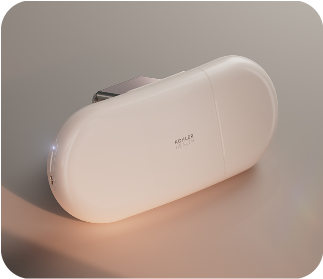
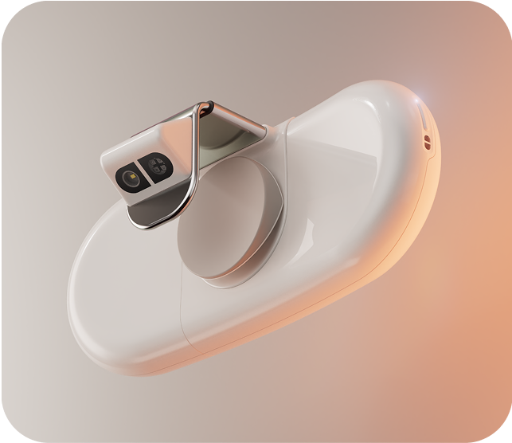
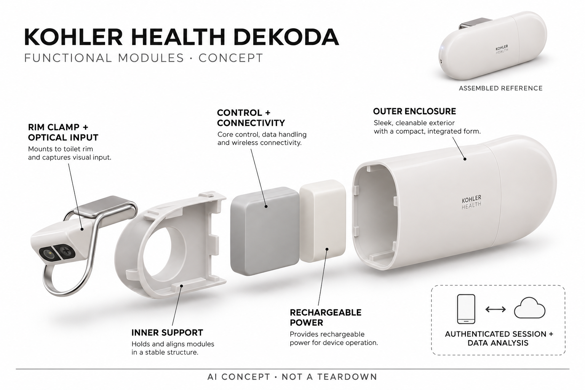

# Kohler Health Dekoda

**Kohler Health** · 居家健康 · 核查 2026-11-05

在既有坐便器上进行光学观察，形成经本人启动的排泄与水合趋势记录

消费渠道：个人零售。

## 产品图片与结构参考

### 产品图

官方Dekoda外侧机身展示 · 来源：[Kohler Health · 官方图片](<https://www.kohlerhealth.com/purchase/>) · [原始图片](<https://images.ctfassets.net/veq5rt4lbvkn/76cVLPg7HVdxmHrMDijSRF/cb8381b6b592e3fd7068faed1c134123/t2-2x.png>)

### 参考图

官方Dekoda内侧夹持与光学区域参考 · 来源：[Kohler Health · 官方图片](<https://www.kohlerhealth.com/purchase/>) · [原始图片](<https://images.ctfassets.net/veq5rt4lbvkn/2I19lYLE05fU95hSk7vQcr/53d371b25efa96a7d3d80e758c171b90/t1_2x.png>)

### AI 生成爆炸示意

**AI 生成 · 非实物拆机。** 内部为概念推断，不能作为元件布局、BOM 或维修依据。[生成提示词](../../content/hardware/prompts/kohler-dekoda.txt)

> 依据已核验官方外形与公开功能生成；未知内部仅为概念功能块，不代表原机电路板、芯片或实际布局。

> 目视核对当前Dekoda型号与两侧结构，官方图未改色或语义编辑；不含人体、标本或私人健康数据。

> 分析为基于公开资料的案头研究与 AI 辅助判断，未经用户访谈、销量审计或实物拆机。需求、画像、竞争冷门度、审美及商业机会均为研究假设，不是投资结论。

## 销售与购买

- 状态：在售。2026-11-05实际浏览官方购买页，Dekoda US$449、Add to Cart可用，配套会员为启用必需；页面明确仅美国销售。不是旧发布期的预订价，也不把会员当硬件租赁。

- 地区：美国

- 价格：官方硬件 US$449＋必需会员。单人月费US$6.99或年费US$70；家庭月费US$12.99或年费US$130，最多六个成人个人档案。选择No membership仅表示已有或激活前另买会员，不代表可免订阅使用。

- 中国大陆：当前官方购买页明确产品仅在美国销售；未确认中国大陆官方硬件、会员或售后，不能从科勒在中国经营卫浴业务推定Dekoda已在国内销售。

- [官方产品 / 商店](<https://www.kohlerhealth.com/purchase/>)

## AI 的实际作用

官方披露光学传感与光谱技术，并用训练算法分析排泄物相关图像和信号，生成形态、频次、水合与血液迹象等线索；不是试剂取样或直接诊断疾病。

服务与联网依赖：需要适配的坐便器、供电充电、网络、个人会话认证、应用与会员。官方健康数据政策明确涵盖标本图像及模型训练用途，不能宣称不采集图像或所有分析完全本地。

## 是否冷门

细分专业（研究判断）：既有便器上的认证光学趋势观察是较少见的家庭任务，区别穿戴测量和试剂取样；适配、隐私、会员及结果解释形成明显门槛。

## 需求与市场

需求假设：希望减少手工记录排泄规律的成年人，可能需要把日常如厕中的线索组织成可回顾信息。设备价值在记录与沟通辅助，不能从自动生成分数推导诊断能力，也不能假设每个人都希望或需要在浴室持续产生健康数据。

### 产品任务与边界 · 研究判断

需求假设：希望减少手工记录排泄规律的成年人，可能需要把日常如厕中的线索组织成可回顾信息。设备价值在记录与沟通辅助，不能从自动生成分数推导诊断能力，也不能假设每个人都希望或需要在浴室持续产生健康数据。

依据：[Kohler Health Dekoda当前官方购买](<https://www.kohlerhealth.com/purchase/>) · [Kohler Health官方工作原理](<https://www.kohlerhealth.com/how-it-works/>) · [Dekoda官方外观与适配说明](<https://www.kohlerhealth.com/dekoda/>) · [Kohler Health消费健康数据政策](<https://www.kohlerhealth.com/data-privacy/>)

### 需求判断 · 研究判断

判断：把如厕相关变化长期记录下来可能有助于个人回顾和就诊沟通，但多数人不愿每天手工填写。Dekoda试图减少记录动作，同时仍需主动认证会话；是否值得使用取决于信息是否可理解和有实际用途，而不是产生更多健康分数。

依据：[Kohler Health Dekoda当前官方购买](<https://www.kohlerhealth.com/purchase/>) · [Kohler Health官方工作原理](<https://www.kohlerhealth.com/how-it-works/>) · [Dekoda官方外观与适配说明](<https://www.kohlerhealth.com/dekoda/>) · [Kohler Health消费健康数据政策](<https://www.kohlerhealth.com/data-privacy/>)

### 需求验证 · 待验证

验证：从自愿且理解数据用途的成年人开始，比较人工日志与设备记录是否减少遗漏和整理时间。只评估记录流程及结果理解，不让测试代替需要的专业检查；出现真实异常时，不能以设备没有提示作为延迟求助或否定症状的依据。

依据：[Kohler Health Dekoda当前官方购买](<https://www.kohlerhealth.com/purchase/>) · [Kohler Health官方工作原理](<https://www.kohlerhealth.com/how-it-works/>) · [Dekoda官方外观与适配说明](<https://www.kohlerhealth.com/dekoda/>) · [Kohler Health消费健康数据政策](<https://www.kohlerhealth.com/data-privacy/>)

## 用户画像

画像推断：愿意主动启动会话、理解会员和数据处理、且有适配便器的成年人较匹配。共用浴室中的购买者和其他使用者可能有不同隐私偏好，个人档案隔离不等于无需告知；不能根据健康焦虑直接推定适用和购买需求。

### 适用行为与条件 · 研究判断

画像推断：愿意主动启动会话、理解会员和数据处理、且有适配便器的成年人较匹配。共用浴室中的购买者和其他使用者可能有不同隐私偏好，个人档案隔离不等于无需告知；不能根据健康焦虑直接推定适用和购买需求。

依据：[Kohler Health Dekoda当前官方购买](<https://www.kohlerhealth.com/purchase/>) · [Kohler Health官方工作原理](<https://www.kohlerhealth.com/how-it-works/>) · [Dekoda官方外观与适配说明](<https://www.kohlerhealth.com/dekoda/>) · [Kohler Health消费健康数据政策](<https://www.kohlerhealth.com/data-privacy/>)

### 人群取舍 · 研究判断

判断：个人使用与家庭共享有不同的归属和隐私问题，同住者可能并不愿意参与，即使硬件由另一人购买。用户还需要理解白色便器、安装间隙、网络和充电等条件，因此适用性不能只由健康关注度或拥有智能家居决定。

依据：[Kohler Health Dekoda当前官方购买](<https://www.kohlerhealth.com/purchase/>) · [Kohler Health官方工作原理](<https://www.kohlerhealth.com/how-it-works/>) · [Dekoda官方外观与适配说明](<https://www.kohlerhealth.com/dekoda/>) · [Kohler Health消费健康数据政策](<https://www.kohlerhealth.com/data-privacy/>)

### 画像验证 · 待验证

验证：分别确认购买者和其他浴室使用者是否知情，能否解释如何启动和停止个人会话以及谁可以查看结果。观察实际便器适配、清洁与充电操作，明确家庭档案面向成年人；画像来自行为和接受条件，不由疾病或焦虑标签推定。

依据：[Kohler Health Dekoda当前官方购买](<https://www.kohlerhealth.com/purchase/>) · [Kohler Health官方工作原理](<https://www.kohlerhealth.com/how-it-works/>) · [Dekoda官方外观与适配说明](<https://www.kohlerhealth.com/dekoda/>) · [Kohler Health消费健康数据政策](<https://www.kohlerhealth.com/data-privacy/>)

## 竞争与替代

竞争判断：与手工日志、普通健康应用、专业检测及尿液试剂设备比较，差异是便器上的光学观察与趋势整理。光学与试剂的测量对象、限制和维护不同，不能仅凭无需试剂就推定更准确，也不把家庭会员人数拆成新品。

### 比较对象与差异 · 研究判断

竞争判断：与手工日志、普通健康应用、专业检测及尿液试剂设备比较，差异是便器上的光学观察与趋势整理。光学与试剂的测量对象、限制和维护不同，不能仅凭无需试剂就推定更准确，也不把家庭会员人数拆成新品。

依据：[Kohler Health Dekoda当前官方购买](<https://www.kohlerhealth.com/purchase/>) · [Kohler Health官方工作原理](<https://www.kohlerhealth.com/how-it-works/>) · [Dekoda官方外观与适配说明](<https://www.kohlerhealth.com/dekoda/>) · [Kohler Health消费健康数据政策](<https://www.kohlerhealth.com/data-privacy/>)

### 竞争判断 · 研究判断

判断：手工日志几乎没有硬件维护，专业检验提供不同用途的证据，U-Scan等试剂设备则以另一种采样方式分析尿液。Dekoda的独特路径是光学观察排便形态及相关趋势，不能因无需试剂就宣称能替代专项化验或覆盖所有健康问题。

依据：[Kohler Health Dekoda当前官方购买](<https://www.kohlerhealth.com/purchase/>) · [Kohler Health官方工作原理](<https://www.kohlerhealth.com/how-it-works/>) · [Dekoda官方外观与适配说明](<https://www.kohlerhealth.com/dekoda/>) · [Kohler Health消费健康数据政策](<https://www.kohlerhealth.com/data-privacy/>)

### 竞争验证 · 待验证

验证：围绕一个具体记录目标比较手工记录和光学记录的完整性与复核步骤，把频率形态信息与尿液化学指标分开。比较还应包含清洁、认证、会员及数据管理劳动，不能只按检测项目名称或厂商关于准确的形容词来排高低。

依据：[Kohler Health Dekoda当前官方购买](<https://www.kohlerhealth.com/purchase/>) · [Kohler Health官方工作原理](<https://www.kohlerhealth.com/how-it-works/>) · [Dekoda官方外观与适配说明](<https://www.kohlerhealth.com/dekoda/>) · [Kohler Health消费健康数据政策](<https://www.kohlerhealth.com/data-privacy/>)

## 供应链

供应链分析：便器夹持、光学与光谱输入、防水外壳、充电连接、认证遥控和服务共同构成产品，完整工厂和BOM未披露。清洁、对准和不同便器光环境影响输入，不能用普通摄像头价格估算系统成本或推定实际制造伙伴。

### 功能模块拆分 · 研究判断

模块拆分：夹持与外壳固定观察方向，光学输入与光谱相关功能采集便器内信息，控制、连接和电源维持记录，认证与会员服务组织个人档案。没有公开拆机时不推定内部镜片、波长、芯片、光路排列或新增试剂泵等实际部件。

依据：[Kohler Health Dekoda当前官方购买](<https://www.kohlerhealth.com/purchase/>) · [Kohler Health官方工作原理](<https://www.kohlerhealth.com/how-it-works/>) · [Dekoda官方外观与适配说明](<https://www.kohlerhealth.com/dekoda/>) · [Kohler Health消费健康数据政策](<https://www.kohlerhealth.com/data-privacy/>)

### 制造与供应约束 · 研究判断

供应链分析：便器夹持、光学与光谱输入、防水外壳、充电连接、认证遥控和服务共同构成产品，完整工厂和BOM未披露。清洁、对准和不同便器光环境影响输入，不能用普通摄像头价格估算系统成本或推定实际制造伙伴。

依据：[Kohler Health Dekoda当前官方购买](<https://www.kohlerhealth.com/purchase/>) · [Kohler Health官方工作原理](<https://www.kohlerhealth.com/how-it-works/>) · [Dekoda官方外观与适配说明](<https://www.kohlerhealth.com/dekoda/>) · [Kohler Health消费健康数据政策](<https://www.kohlerhealth.com/data-privacy/>)

### 候选与证据缺口 · 研究判断

候选判断：Protolabs可用于夹持结构和便器适配样件的迭代，捷普可作为光学采集电子与整机测试流程的制造候选。未发现两者与Dekoda的型号供货证据；污湿环境、清洁耐受与光学一致性需专项验证，不能从一般服务范围推定已满足。

依据：[Kohler Health Dekoda当前官方购买](<https://www.kohlerhealth.com/purchase/>) · [Kohler Health官方工作原理](<https://www.kohlerhealth.com/how-it-works/>) · [Dekoda官方外观与适配说明](<https://www.kohlerhealth.com/dekoda/>) · [Kohler Health消费健康数据政策](<https://www.kohlerhealth.com/data-privacy/>)

## 技术路径

技术判断：官方说明训练算法参考尿比重、形态图表与血红蛋白相关测量分析输入，但没有因此证明任何个人结果都是正确。应区分光学信号、算法推断和临床确认；隐私政策还明确包含标本图像，不能把光谱一词解释为完全无成像。

### 已披露技术边界 · 研究判断

技术判断：官方说明训练算法参考尿比重、形态图表与血红蛋白相关测量分析输入，但没有因此证明任何个人结果都是正确。应区分光学信号、算法推断和临床确认；隐私政策还明确包含标本图像，不能把光谱一词解释为完全无成像。

依据：[Kohler Health Dekoda当前官方购买](<https://www.kohlerhealth.com/purchase/>) · [Kohler Health官方工作原理](<https://www.kohlerhealth.com/how-it-works/>) · [Dekoda官方外观与适配说明](<https://www.kohlerhealth.com/dekoda/>) · [Kohler Health消费健康数据政策](<https://www.kohlerhealth.com/data-privacy/>)

### 系统难点判断 · 研究判断

判断：厂商描述训练算法参考尿比重、形态图表及血红蛋白相关测量，但这不等于对所有家庭环境和个体都同样有效。光学输入、模型解释与临床确认必须分开，设备的趋势功能也不应被扩大成普遍疾病筛查或自动治疗决策。

依据：[Kohler Health Dekoda当前官方购买](<https://www.kohlerhealth.com/purchase/>) · [Kohler Health官方工作原理](<https://www.kohlerhealth.com/how-it-works/>) · [Dekoda官方外观与适配说明](<https://www.kohlerhealth.com/dekoda/>) · [Kohler Health消费健康数据政策](<https://www.kohlerhealth.com/data-privacy/>)

### 技术验证 · 待验证

验证：检查不同适配便器、清洁状态与安装位置下是否能给出稳定且可解释的结果，并确认信号不足时不会强行给出确定结论。性能需要合适的独立验证，本次不进行人体试验或读取私人标本数据，也不把官方训练数据量当准确率。

依据：[Kohler Health Dekoda当前官方购买](<https://www.kohlerhealth.com/purchase/>) · [Kohler Health官方工作原理](<https://www.kohlerhealth.com/how-it-works/>) · [Dekoda官方外观与适配说明](<https://www.kohlerhealth.com/dekoda/>) · [Kohler Health消费健康数据政策](<https://www.kohlerhealth.com/data-privacy/>)

## 产品审美

审美判断：白色胶囊机身与卫浴材质相近，夹装后仍会影响座圈间隙、清洁和日常触达。低存在感不应掩盖数据采集状态，用户需要知道是否启动个人会话，展示图的洁净环境也不能代替长期使用后的维护体验。

### 外观与交互语言 · 研究判断

审美判断：白色胶囊机身与卫浴材质相近，夹装后仍会影响座圈间隙、清洁和日常触达。低存在感不应掩盖数据采集状态，用户需要知道是否启动个人会话，展示图的洁净环境也不能代替长期使用后的维护体验。

依据：[Kohler Health Dekoda当前官方购买](<https://www.kohlerhealth.com/purchase/>) · [Kohler Health官方工作原理](<https://www.kohlerhealth.com/how-it-works/>) · [Dekoda官方外观与适配说明](<https://www.kohlerhealth.com/dekoda/>) · [Kohler Health消费健康数据政策](<https://www.kohlerhealth.com/data-privacy/>)

### 使用中审美判断 · 研究判断

判断：白色圆润机身与常见卫浴环境协调，但夹在边缘后仍会改变座圈附近清洁和触达。若外观过于隐蔽而会话状态又不清晰，其他使用者可能不知道何时在采集，因此低存在感应与明确状态提示并存，而不是作为隐私保证。

依据：[Kohler Health Dekoda当前官方购买](<https://www.kohlerhealth.com/purchase/>) · [Kohler Health官方工作原理](<https://www.kohlerhealth.com/how-it-works/>) · [Dekoda官方外观与适配说明](<https://www.kohlerhealth.com/dekoda/>) · [Kohler Health消费健康数据政策](<https://www.kohlerhealth.com/data-privacy/>)

### 设计验证 · 待验证

验证：在适配便器上模拟日常擦拭、充电取放与重新固定，观察是否容易误碰或影响座圈。让首次接触者辨认采集开始和结束状态，确认图示不会把设备表现成任何便器均可用；长期清洁体验比理想化商品渲染更有参考价值。

依据：[Kohler Health Dekoda当前官方购买](<https://www.kohlerhealth.com/purchase/>) · [Kohler Health官方工作原理](<https://www.kohlerhealth.com/how-it-works/>) · [Dekoda官方外观与适配说明](<https://www.kohlerhealth.com/dekoda/>) · [Kohler Health消费健康数据政策](<https://www.kohlerhealth.com/data-privacy/>)

## 关键风险

风险判断：便器颜色、位置、残留清洁剂和未正确认证都可能影响采集或归属，异常提醒也可能引发误读。官方限定美国销售与会员依赖，用户还需理解健康数据和图像处理；有实际异常时不能用设备未报警作为忽略问题的理由。

### 主要失效与依赖 · 研究判断

风险判断：便器颜色、位置、残留清洁剂和未正确认证都可能影响采集或归属，异常提醒也可能引发误读。官方限定美国销售与会员依赖，用户还需理解健康数据和图像处理；有实际异常时不能用设备未报警作为忽略问题的理由。

依据：[Kohler Health Dekoda当前官方购买](<https://www.kohlerhealth.com/purchase/>) · [Kohler Health官方工作原理](<https://www.kohlerhealth.com/how-it-works/>) · [Dekoda官方外观与适配说明](<https://www.kohlerhealth.com/dekoda/>) · [Kohler Health消费健康数据政策](<https://www.kohlerhealth.com/data-privacy/>)

### 风险传播判断 · 研究判断

判断：官方健康数据政策明确涉及标本图像、个人健康资料、推断和模型训练用途，不能把光谱或个人认证解释成完全不收集图像。错误归属、误报或未提醒也可能改变用户行为，会员与服务变化会使硬件长期价值受到外部条件影响。

依据：[Kohler Health Dekoda当前官方购买](<https://www.kohlerhealth.com/purchase/>) · [Kohler Health官方工作原理](<https://www.kohlerhealth.com/how-it-works/>) · [Dekoda官方外观与适配说明](<https://www.kohlerhealth.com/dekoda/>) · [Kohler Health消费健康数据政策](<https://www.kohlerhealth.com/data-privacy/>)

### 风险验证 · 待验证

验证：核对认证失败、网络中断、低电量和共享浴室使用时的数据归属与状态提示，并阅读当前数据选择和删除条件。让用户区分记录、推断与已确认检查结果；本研究不提供个体诊断，也不以缺少设备警报证明任何人的健康状态。

依据：[Kohler Health Dekoda当前官方购买](<https://www.kohlerhealth.com/purchase/>) · [Kohler Health官方工作原理](<https://www.kohlerhealth.com/how-it-works/>) · [Dekoda官方外观与适配说明](<https://www.kohlerhealth.com/dekoda/>) · [Kohler Health消费健康数据政策](<https://www.kohlerhealth.com/data-privacy/>)

## 机会与验证

机会假设：可先验证被动光学记录是否帮助用户整理可讨论的变化，而不是制造更多分数和健康焦虑。若清洁、认证和订阅增加的负担超过手工记录，价值会受限；可解释结果与清楚数据选择比扩大疾病预测宣传更重要。

### 可能的机会入口 · 研究判断

机会假设：可先验证被动光学记录是否帮助用户整理可讨论的变化，而不是制造更多分数和健康焦虑。若清洁、认证和订阅增加的负担超过手工记录，价值会受限；可解释结果与清楚数据选择比扩大疾病预测宣传更重要。

依据：[Kohler Health Dekoda当前官方购买](<https://www.kohlerhealth.com/purchase/>) · [Kohler Health官方工作原理](<https://www.kohlerhealth.com/how-it-works/>) · [Dekoda官方外观与适配说明](<https://www.kohlerhealth.com/dekoda/>) · [Kohler Health消费健康数据政策](<https://www.kohlerhealth.com/data-privacy/>)

### 机会成立条件 · 研究判断

判断：更可持续的机会是把生活规律变化转成可以理解和讨论的记录，而非夸大早期发现所有疾病。若用户因为分数频繁波动而产生困扰，或长期不再查看记录，则自动采集本身未必产生价值，解释和数据选择应是核心设计。

依据：[Kohler Health Dekoda当前官方购买](<https://www.kohlerhealth.com/purchase/>) · [Kohler Health官方工作原理](<https://www.kohlerhealth.com/how-it-works/>) · [Dekoda官方外观与适配说明](<https://www.kohlerhealth.com/dekoda/>) · [Kohler Health消费健康数据政策](<https://www.kohlerhealth.com/data-privacy/>)

### 下一步验证 · 待验证

验证：以较长周期观察自愿用户是否能更清楚整理自己的变化，并记录误解、维护与会员成本。评价应包含不再使用的原因和退出数据处理的体验，不把持续订阅等同健康改善；只有用途与接受条件明确后，才讨论跨家庭扩展。

依据：[Kohler Health Dekoda当前官方购买](<https://www.kohlerhealth.com/purchase/>) · [Kohler Health官方工作原理](<https://www.kohlerhealth.com/how-it-works/>) · [Dekoda官方外观与适配说明](<https://www.kohlerhealth.com/dekoda/>) · [Kohler Health消费健康数据政策](<https://www.kohlerhealth.com/data-privacy/>)

## 对应供应链公司

能力候选用于选型研究，不代表本产品实际采用；未公开的供货关系不作推断。

- [protolabs](../supply-chain/protolabs.md) — **能力候选 · 非已采用** / 便器夹持与外壳适配样件：Protolabs公开原型和数字制造服务可用于便器夹持、外壳与装配适配样件的工程迭代。没有其参与Dekoda的供货证据，候选能力不证明当前合作；清洁耐受、密封和不同便器光环境仍需要产品专门验证。

- [jabil](../supply-chain/jabil.md) — **能力候选 · 非已采用** / 光学采集电子与整机测试：捷普公开电子系统制造和测试能力可对应光学采集、连接及整机质量流程的候选需求。未确认Dekoda实际制造关系，不能将通用能力当已采用BOM，也不以该候选支持任何算法准确性、临床用途或隐私安全保证。

[浏览供应链目录](../supply-chain.md)

## 功能分层示意

这是功能关系，不是实物拆机、真实空间结构或已核实 BOM。

1. **外壳与固定**：白色长胶囊状机身和夹持结构安装在便器边缘。（官方披露）

2. **光学输入**：朝向便器内的传感区域与光谱观察功能。（官方披露）

3. **控制与连接**：数据采集、网络连接和应用交互，不重构未知电路。（分析推断）

4. **能源与充电**：可充电电源及配套充电连接。（官方披露）

5. **认证与分析服务**：遥控器或应用启动会话，训练算法与个人趋势服务。（官方披露）

## 来源

1. [Kohler Health Dekoda当前官方购买](<https://www.kohlerhealth.com/purchase/>) — 实际浏览器核对US$449、可加购、必需会员和美国限定，未注册、未下单、未输入私人健康资料。

2. [Kohler Health官方工作原理](<https://www.kohlerhealth.com/how-it-works/>) — 实际打开光学/光谱与Science-backed results折叠说明，训练算法参考尿比重、形态图表及血红蛋白；厂商声明不视为本研究独立验证。

3. [Dekoda官方外观与适配说明](<https://www.kohlerhealth.com/dekoda/>) — 实际浏览白色住宅便器、夹持间隙与充电/认证说明，深色便器有适配限制；奖项与专家宣传不当作准确率证据。

4. [Kohler Health消费健康数据政策](<https://www.kohlerhealth.com/data-privacy/>) — 实际阅读2025-10-14生效政策，标本图像、健康推断、服务改进与AI/机器学习训练用途及选择条件；不宣传绝对匿名或完全本地。

[返回目录](../hardware-market.md) · [网页分析](https://romanagent.github.io/Roman/#hardware/product/kohler-dekoda)
