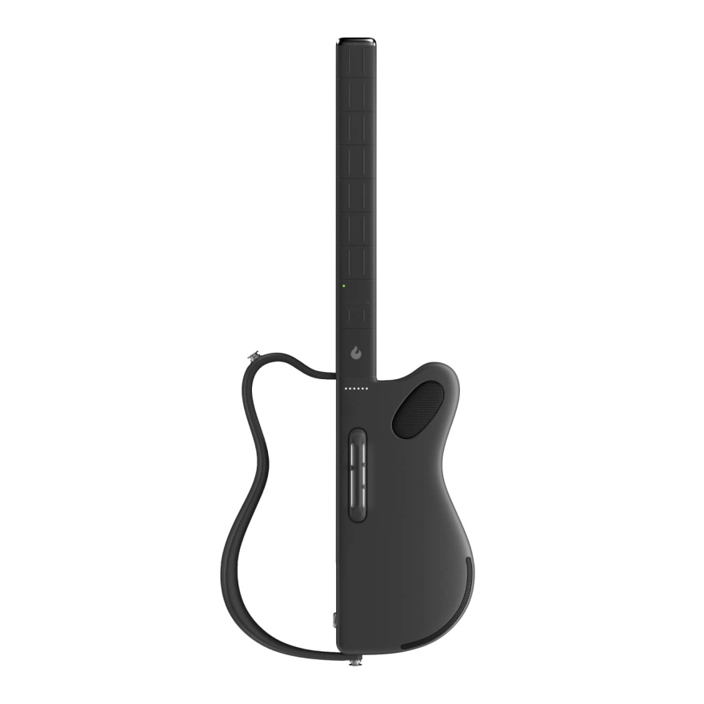
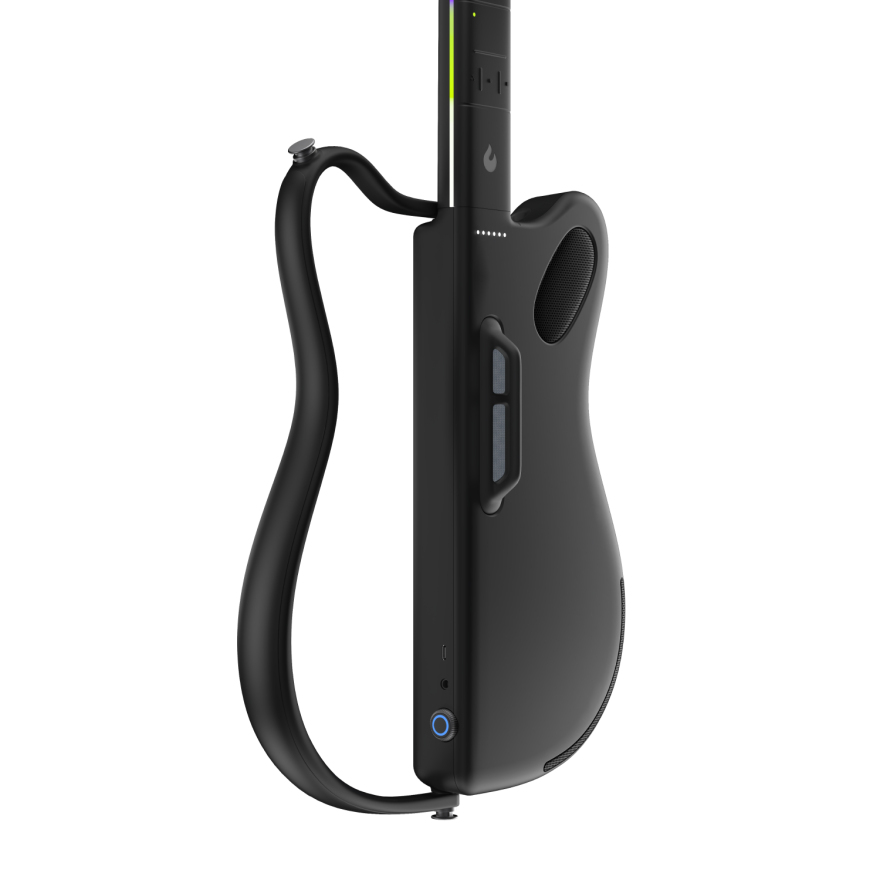
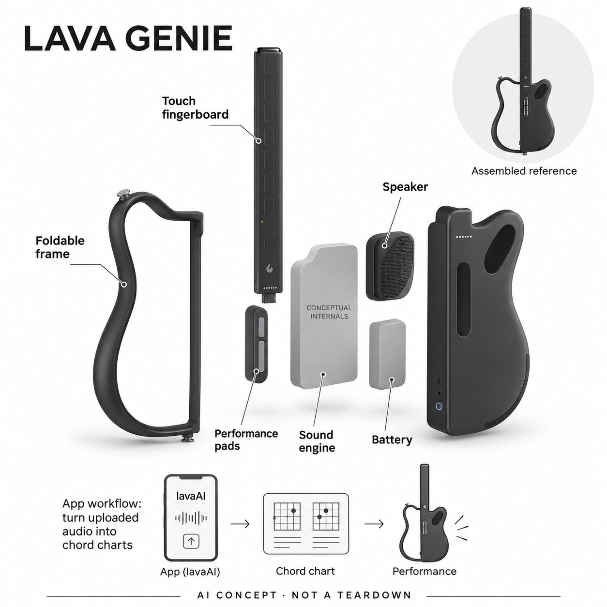

# LAVA GENIE（拿火精灵）

**LAVA MUSIC** · 音乐与乐器 · 核查 2026-11-04

把AI音频制谱接入触控和弦演奏的无弦电子乐器

消费渠道：个人零售。

## 产品图片与结构参考

### 产品图

LAVA GENIE（拿火精灵） 官方产品图 · 来源：[LAVA MUSIC · 官方资料](<https://store.lavamusic.com/productDetail/lava-genie?id=83>) · [原始图片](<https://attach-intl-cdn.lavamusic.com/attach/10001/20250923/bd820dda034749b8308d28bafe6464b2.jpg?x-oss-process=image/resize,w_880/quality,q_100>)

### 参考图

LAVA GENIE（拿火精灵） 官方外观与使用参考图 · 来源：[LAVA MUSIC · 官方资料](<https://store.lavamusic.com/productDetail/lava-genie?id=83>) · [原始图片](<https://attach-intl-cdn.lavamusic.com/attach/10001/20250605/b3c74520e0048db0ae284a48db62bdfe.jpg?x-oss-process=image/resize,w_880/quality,q_100>)

### AI 生成爆炸示意

**AI 生成 · 非实物拆机。** 内部为概念推断，不能作为元件布局、BOM 或维修依据。[生成提示词](../../content/hardware/prompts/lava-genie.txt)

> 以已目视核对的官方图片独立生成，未知内部为功能概念，不代表真实PCB、拆机或已采用供应商。

> 保留官方图片原貌；图片中的宣传数字和效果不作为本站实测。

> 分析为基于公开资料的案头研究与 AI 辅助判断，未经用户访谈、销量审计或实物拆机。需求、画像、竞争冷门度、审美及商业机会均为研究假设，不是投资结论。

## 销售与购买

- 状态：在售。核查日美国官方商店浏览器实际显示US$399、2–5天发货及启用的Add To Cart/Buy Now。搜索抓取中的Out of stock来自未展开模板，已以实际已加载页面核对；黑白与麦克风套装仅算一款。

- 地区：美国、香港等官方地区（库存按地区确认）

- 价格：美国官方商店US$399。标准Full Package；可选无线麦克风另计。授权歌曲会员与硬件功能分开，AI制谱额度、费用和地区支持按当前App确认。

- 中国大陆：可核中文拿火+ App及香港官方产品页，未独立打开验证大陆硬件官方销售SKU和当前价格。国内与海外曲库、账号和AI制谱权益须以对应App核对。

- [官方产品 / 商店](<https://store.lavamusic.com/productDetail/lava-genie?id=83>)

## AI 的实际作用

lavaAI在LAVA+ App中把上传音频转换为和弦谱，设备通过触控指板、打击垫和引导灯连接到演奏流程。采样音色、混响和普通自动伴奏本身不作为AI依据。

服务与联网依赖：AI制谱是App/账户工作流，不是乐器本机离线识谱。乐器负责触控演奏、发声和反馈；授权曲库有会员选项，模型和服务地区细节未充分披露。

## 是否冷门

新兴竞争（研究判断）：无弦演奏设备已出现多种路线，降低输入门槛不必然带来长期音乐练习；制谱与硬件反馈的衔接需验证。

## 需求与市场

案头需求是让想弹唱的人用较简单的手势表达和弦与节奏，再把喜欢的音频转为可练习谱面。它改变演奏输入方式而不是模拟传统按弦训练；能否持续创作要看用户是否超出跟灯操作。

### 事实：任务边界 · 官方资料

LAVA GENIE用触控指板选择和弦、用打击垫和压力输入组织演奏，官方同时把LAVA+中的音频AI制谱连接到练习流程。它的任务是让想弹唱的人通过新的输入方式演奏喜欢的音乐，不是将传统吉他的按弦与拨弦训练完整复制到电子外壳里。

依据：[LAVA GENIE美国官方商店](<https://store.lavamusic.com/productDetail/lava-genie?id=83>) · [LAVA GENIE香港官方产品页](<https://www.lavamusic.com/hk/lava-genie>) · [拿火+开发者官方App说明](<https://apps.apple.com/cn/app/%E6%8B%BF%E7%81%AB/id1571614661>)

### 判断：真实需求 · 研究判断

需求判断要区分想唱歌时有伴奏、想学习传统乐器技法和想创作新内容的人。前一种可能重视快速发声与切换和弦，后一种可能更看重节奏与编配自由；降低初次上手门槛并不能自动证明长期表达空间足够，更不意味着无需练习。

依据：[LAVA GENIE美国官方商店](<https://store.lavamusic.com/productDetail/lava-genie?id=83>) · [LAVA GENIE香港官方产品页](<https://www.lavamusic.com/hk/lava-genie>) · [拿火+开发者官方App说明](<https://apps.apple.com/cn/app/%E6%8B%BF%E7%81%AB/id1571614661>)

### 验证：任务完成 · 待验证

调研可以请参与者带一段自己想唱的音频，完成制谱、核对、跟随灯光和独立演奏，记录各步困难。访谈问他们原本被什么阻挡、对弹得出来的标准是什么，以及在学会第一首后想继续练第二首还是只把它当一次聚会玩具。

依据：[LAVA GENIE美国官方商店](<https://store.lavamusic.com/productDetail/lava-genie?id=83>) · [LAVA GENIE香港官方产品页](<https://www.lavamusic.com/hk/lava-genie>) · [拿火+开发者官方App说明](<https://apps.apple.com/cn/app/%E6%8B%BF%E7%81%AB/id1571614661>)

## 用户画像

适合想快速参与弹唱、愿意使用App和接受电子音色的初学者或休闲创作者。传统吉他手指技法、纯原声音色或复杂演奏表现是不同目标，不能把无弦更容易上手说成替代全部乐器学习。

### 事实：使用条件 · 官方资料

官方产品页介绍压力感应、触控、引导灯与App配合，软件另提供歌曲内容和会员选项。使用者需要接受电子音源与屏幕辅助，而不是仅凭外形就把它当原声吉他；设备可独立发声与AI制谱需要App，是不同层面的使用条件。

依据：[LAVA GENIE美国官方商店](<https://store.lavamusic.com/productDetail/lava-genie?id=83>) · [LAVA GENIE香港官方产品页](<https://www.lavamusic.com/hk/lava-genie>)

### 判断：人群筛选 · 研究判断

潜在用户可以是希望快速参与弹唱的休闲爱好者、会唱但不熟悉按弦的人，或把新控制方式加入创作的音乐玩家。传统吉他学习者如果目标是手指技法，未必适配；不能因为宣传没有音乐基础也可玩，就推断所有年龄与学习目标都相同。

依据：[LAVA GENIE美国官方商店](<https://store.lavamusic.com/productDetail/lava-genie?id=83>) · [LAVA GENIE香港官方产品页](<https://www.lavamusic.com/hk/lava-genie>)

### 验证：参与者差异 · 待验证

招募时记录参与者会不会读和弦、是否已有其它乐器以及最想演奏的场景，让他们自行连接App并解释灯光含义。访谈可问愿不愿意在没有屏幕时演奏、是否喜欢电子音色，以及哪种手势最难掌握，把音乐目标放在设备新奇感之前。

依据：[LAVA GENIE美国官方商店](<https://store.lavamusic.com/productDetail/lava-genie?id=83>) · [LAVA GENIE香港官方产品页](<https://www.lavamusic.com/hk/lava-genie>)

## 竞争与替代

替代包括和弦键盘、其他无弦乐器、手机伴奏和传统吉他。本轮只留一款触控演奏代表，不用颜色、套餐或同类自动伴奏设备补数量；AI来源是制谱流程，普通音效不重复包装。

### 事实：方案范围 · 官方资料

无弦乐器、和弦键盘、手机伴奏与传统吉他都能支持部分弹唱任务，但输入和学习路径不同。本轮只记录GENIE一个触控演奏代表，不将黑白配色、附无线麦克风或同类自动伴奏升级包装成独立场景；普通音色与效果器也不因名称智能就算AI。

依据：[LAVA GENIE美国官方商店](<https://store.lavamusic.com/productDetail/lava-genie?id=83>) · [LAVA GENIE香港官方产品页](<https://www.lavamusic.com/hk/lava-genie>)

### 判断：替代关系 · 研究判断

与手机伴奏相比，实体触控和抱持姿势提供可表演的动作反馈；与传统吉他相比，它减少按弦负担，却不训练同一套演奏技巧。与和弦键盘相比，开放琴身的姿态可能更适合某些弹唱场景，但哪种更自然需要参与者任务而非产品照片决定。

依据：[LAVA GENIE美国官方商店](<https://store.lavamusic.com/productDetail/lava-genie?id=83>) · [LAVA GENIE香港官方产品页](<https://www.lavamusic.com/hk/lava-genie>)

### 验证：比较方法 · 待验证

可以选择同一首简单歌曲，让用户分别用现有工具和GENIE完成伴奏，记录准备、错和弦、节奏中断与演唱专注度。评价应包含之后是否能离开引导灯完成片段，不把首次顺利触发预设声音等同于学会传统吉他，也不把硬件价格独立于内容费用比较。

依据：[LAVA GENIE美国官方商店](<https://store.lavamusic.com/productDetail/lava-genie?id=83>) · [LAVA GENIE香港官方产品页](<https://www.lavamusic.com/hk/lava-genie>)

## 供应链

硬件需要触控指板、压力输入、音源、扬声器、电池及可折叠结构，软件承接AI制谱和内容。具体工厂及元件来源未披露；触控与发声延迟、折叠寿命和声学腔体比外观造型更影响可玩性。

### 事实：功能组成 · 官方资料

公开结构包含触控指板、打击垫与压力输入、机内音源和扬声器、电池及折叠开放式机身，App负责音频制谱和内容。具体触控芯片、音频主控、电芯与代工厂未公开；官方音色或软件名称不能证明其中某个上游芯片承担了AI模型推理。

依据：[LAVA GENIE美国官方商店](<https://store.lavamusic.com/productDetail/lava-genie?id=83>) · [LAVA GENIE香港官方产品页](<https://www.lavamusic.com/hk/lava-genie>)

### 判断：交付约束 · 研究判断

工程约束在于触摸和压力动作到发声的响应、扬声器与机身结构的声学关系，以及折叠和连接处长期重复使用的一致性。即使单个触控传感器响应很好，组合后的时序、误触和音量也可能影响音乐表达，供应验证应围绕完整演奏而非静态规格。

依据：[LAVA GENIE美国官方商店](<https://store.lavamusic.com/productDetail/lava-genie?id=83>) · [LAVA GENIE香港官方产品页](<https://www.lavamusic.com/hk/lava-genie>)

### 验证：选型缺口 · 待验证

Merry可作为扬声器与声学整合候选，欣旺达可作为便携电子乐器电池候选；Protolabs还可用于折叠结构样件研究。三者都没有被公开点名为GENIE供应商，需补充声学空间、负载、连接和疲劳要求，不能据相似外观推断物料价格或工厂。

依据：[LAVA GENIE美国官方商店](<https://store.lavamusic.com/productDetail/lava-genie?id=83>) · [LAVA GENIE香港官方产品页](<https://www.lavamusic.com/hk/lava-genie>)

## 技术路径

官方App说明上传音频可生成和弦谱，产品页将其与指板数字和引导灯对应。识谱错误仍可能存在，应允许用户核对和修改；算法模型未披露，不宣称它自动理解任何歌曲或在机内运行。

### 事实：AI机制 · 官方资料

开发者在官方App说明中明确写出上传音频生成和弦谱，产品页则展示App数字与触控指板、引导灯的对应关系。这是音频识别到实体演奏的具体衔接，AI服务不被描述为在乐器单体离线运行，普通混响、延迟和采样发声另作常规音频能力。

依据：[LAVA GENIE香港官方产品页](<https://www.lavamusic.com/hk/lava-genie>) · [拿火+开发者官方App说明](<https://apps.apple.com/cn/app/%E6%8B%BF%E7%81%AB/id1571614661>)

### 判断：系统边界 · 研究判断

制谱可能降低寻找谱面的时间，但和弦识别、时间对齐及复杂编配仍有不确定性；公开资料没有给出各风格准确率或模型结构。生成谱面是待核对的演奏草稿，不应被写成对任何音频都准确理解，也不能把所有自动伴奏或灯光提示都归入AI。

依据：[LAVA GENIE香港官方产品页](<https://www.lavamusic.com/hk/lava-genie>) · [拿火+开发者官方App说明](<https://apps.apple.com/cn/app/%E6%8B%BF%E7%81%AB/id1571614661>)

### 验证：算法与体验 · 待验证

验证可选不同编配密度与节奏的允许使用音频，将生成和弦与人工核对版本比较，再看用户能否修正并在设备上演奏。应记录从上传到可弹片段的总时间，而不仅是生成速度；若手机无网络或账户条件变化，也要观察功能和提示的真实边界。

依据：[LAVA GENIE香港官方产品页](<https://www.lavamusic.com/hk/lava-genie>) · [拿火+开发者官方App说明](<https://apps.apple.com/cn/app/%E6%8B%BF%E7%81%AB/id1571614661>)

## 产品审美

开放式轮廓、半琴身和长触控指板保留抱持乐器的姿态，同时省去琴弦和调音旋钮。黑色版本较克制；审美体验还取决于触摸区域是否直观、灯光是否帮助节奏，以及折叠后是否真正便携。

### 事实：外观与交互 · 官方资料

官方图片显示长触控指板、半侧实体琴身、开放弧形框架、扬声器开口和垂直打击区域，黑色款没有琴弦、琴头调音旋钮或传统音孔。所选参考图展示整体与侧面操作，概念分层保持这些特征，并把外部制谱流程画在乐器之外。

依据：[LAVA GENIE美国官方商店](<https://store.lavamusic.com/productDetail/lava-genie?id=83>) · [LAVA GENIE香港官方产品页](<https://www.lavamusic.com/hk/lava-genie>)

### 判断：使用中的形态 · 研究判断

这种形态保留抱持乐器的身体姿势，同时用触控区域传达不同演奏逻辑。开放框架可能降低视觉体量，但握持、肩带平衡和折叠操作未必能从主图判断；引导灯既帮助初学，也可能让表演过度依赖视觉提示，审美应与动作体验一起评估。

依据：[LAVA GENIE美国官方商店](<https://store.lavamusic.com/productDetail/lava-genie?id=83>) · [LAVA GENIE香港官方产品页](<https://www.lavamusic.com/hk/lava-genie>)

### 验证：日常接受度 · 待验证

可观察站姿、坐姿和佩戴肩带时的触达与误触，让参与者指出不看屏幕是否能找到正确位置。将折叠、放入随身包和重新展开也纳入测试，询问在朋友面前表演是否自然，避免只用未来感或小巧这类印象评价日常音乐工具。

依据：[LAVA GENIE美国官方商店](<https://store.lavamusic.com/productDetail/lava-genie?id=83>) · [LAVA GENIE香港官方产品页](<https://www.lavamusic.com/hk/lava-genie>)

## 关键风险

风险在于AI制谱准确性、曲库授权与账号权益变化，以及用户把跟灯完成曲目误认为掌握传统吉他。实体乐器可发声不等于AI服务离线可用，购买时需要区分机身功能与App内容条件。

### 事实：已知限制 · 官方资料

产品页面区分机身固件功能和授权歌曲会员，AI制谱又属于App流程，具体额度与地区权益需要当前软件核对。美国商店的购买状态已用浏览器确认，但本轮没有独立验证大陆硬件销售SKU，中文App存在不能直接证明国内库存或跨地区账户互通。

依据：[LAVA GENIE美国官方商店](<https://store.lavamusic.com/productDetail/lava-genie?id=83>) · [LAVA GENIE香港官方产品页](<https://www.lavamusic.com/hk/lava-genie>) · [拿火+开发者官方App说明](<https://apps.apple.com/cn/app/%E6%8B%BF%E7%81%AB/id1571614661>)

### 判断：失效影响 · 研究判断

风险包括制谱错误让用户学到不正确和弦、内容条件变化影响常弹曲目，以及把跟灯触发声音误认为已掌握传统乐器技巧。它也可能成为短期新奇玩具而非持续创作工具；这些是需求与信息边界，不能由厂家演示或积极评论直接排除。

依据：[LAVA GENIE美国官方商店](<https://store.lavamusic.com/productDetail/lava-genie?id=83>) · [LAVA GENIE香港官方产品页](<https://www.lavamusic.com/hk/lava-genie>) · [拿火+开发者官方App说明](<https://apps.apple.com/cn/app/%E6%8B%BF%E7%81%AB/id1571614661>)

### 验证：风险处理 · 待验证

试用应保留手工修改与自建谱面的操作，让参与者知道生成结果可以出错，并核对无会员、无网络和仅使用机身时分别还能做什么。采购前确认所需歌曲、语言和平台条件，不用免费固件更新的说明替代全部曲库与AI服务永久免费的承诺。

依据：[LAVA GENIE美国官方商店](<https://store.lavamusic.com/productDetail/lava-genie?id=83>) · [LAVA GENIE香港官方产品页](<https://www.lavamusic.com/hk/lava-genie>) · [拿火+开发者官方App说明](<https://apps.apple.com/cn/app/%E6%8B%BF%E7%81%AB/id1571614661>)

## 机会与验证

可验证机会是让用户更快把自己喜欢的歌变成可演奏的和弦草稿。调研应观察首首歌完成时间、错谱修正、脱离灯光的表现和隔周是否再弹，而不是只收集第一次发出声音时的兴奋反馈。

### 判断：可尝试切口 · 研究判断

可尝试的切口是把用户自己的喜欢歌曲变成容易核对并可演奏的和弦草稿，再逐步减少对屏幕和灯光的依赖。若主要瓶颈是识谱后的纠错和节奏理解，改进谱面编辑与练习反馈可能比继续增加音色数量更有价值；这需要实际学习流程验证。

依据：[LAVA GENIE美国官方商店](<https://store.lavamusic.com/productDetail/lava-genie?id=83>) · [LAVA GENIE香港官方产品页](<https://www.lavamusic.com/hk/lava-genie>) · [拿火+开发者官方App说明](<https://apps.apple.com/cn/app/%E6%8B%BF%E7%81%AB/id1571614661>)

### 判断：商业边界 · 研究判断

商业边界在于休闲弹唱、长期学习和音乐创作的留存动力不同，不能把初次发声的兴奋当作稳定练习。授权曲库能降低找内容的摩擦，但也引入持续成本；本轮没有课程访谈、使用日志或销售数据，无法据此估计无弦乐器整体市场规模。

依据：[LAVA GENIE美国官方商店](<https://store.lavamusic.com/productDetail/lava-genie?id=83>) · [LAVA GENIE香港官方产品页](<https://www.lavamusic.com/hk/lava-genie>) · [拿火+开发者官方App说明](<https://apps.apple.com/cn/app/%E6%8B%BF%E7%81%AB/id1571614661>)

### 验证：下一步调研 · 待验证

下一步可做四周跟踪，记录完成的歌曲、修改谱面次数、离开灯光后能演奏的片段和真实聚会使用，再访谈停用者为何没继续。把参与行为与主观喜欢分别展示，不用模型评分预测成功，也不把电子控制方式的熟练程度等同于传统吉他技能。

依据：[LAVA GENIE美国官方商店](<https://store.lavamusic.com/productDetail/lava-genie?id=83>) · [LAVA GENIE香港官方产品页](<https://www.lavamusic.com/hk/lava-genie>) · [拿火+开发者官方App说明](<https://apps.apple.com/cn/app/%E6%8B%BF%E7%81%AB/id1571614661>)

## 对应供应链公司

能力候选用于选型研究，不代表本产品实际采用；未公开的供货关系不作推断。

- [merry-electronics](../supply-chain/merry-electronics.md) — **能力候选 · 非已采用** / 内置扬声器及声学整合候选：GENIE需要在有限琴身内把电子音源转成适合弹唱的声音，Merry公开娱乐音频、扬声器与测试整合能力，可作为声学模块候选。箱体、频响、音量与结构振动仍须按乐器任务验证，没有证据表明Merry已为该产品供货。

- [sunwoda](../supply-chain/sunwoda.md) — **能力候选 · 非已采用** / 便携电子乐器供电候选：GENIE由电池支持触控、音源和扬声器，欣旺达公开消费电池与电源工程能力，可作为此类便携负载候选。持续音频负载、充电、保护和机身空间需要具体匹配，本轮没有公开点名采用关系，也不假定其现有电池可直接装入。

- [protolabs](../supply-chain/protolabs.md) — **能力候选 · 非已采用** / 折叠机身与连接结构原型候选：GENIE的开放框架及折叠结构需要握持和重复连接验证，Protolabs公开原型、注塑及结构加工能力，可为该类迭代提供样件候选。实际材料、疲劳、声学耦合与量产要求仍未知，不能以制造能力推断LAVA已采用其服务。

[浏览供应链目录](../supply-chain.md)

## 功能分层示意

这是功能关系，不是实物拆机、真实空间结构或已核实 BOM。

1. **触控演奏**：长触控指板选和弦，打击垫与压力感应组织节奏。（官方披露）

2. **声音输出**：机内音源、效果及扬声器产生声音，普通DSP不额外标AI。（官方披露）

3. **App制谱**：lavaAI从上传音频生成和弦谱，服务计算不等于机内推理。（官方披露）

4. **练习反馈**：App数字与设备引导灯映射到可触摸的演奏位置。（官方披露）

5. **电源与折叠**：电池、充电与开放可折叠机身支持携带，内部仅作概念分层。（官方披露）

## 来源

1. [LAVA GENIE美国官方商店](<https://store.lavamusic.com/productDetail/lava-genie?id=83>) — 实际浏览器打开已加载页面，确认399美元、2–5天发货、启用购买按钮及标准包。

2. [LAVA GENIE香港官方产品页](<https://www.lavamusic.com/hk/lava-genie>) — 实际浏览器打开；触控和压力输入、App和弦引导、lavaAI转谱及固件功能与曲库会员区分。

3. [拿火+开发者官方App说明](<https://apps.apple.com/cn/app/%E6%8B%BF%E7%81%AB/id1571614661>) — 实际打开中国App Store开发者描述，明确上传音频的lavaAI制谱；不由App可用推断硬件国内库存。

[返回目录](../hardware-market.md) · [网页分析](https://romanagent.github.io/Roman/#hardware/product/lava-genie)
