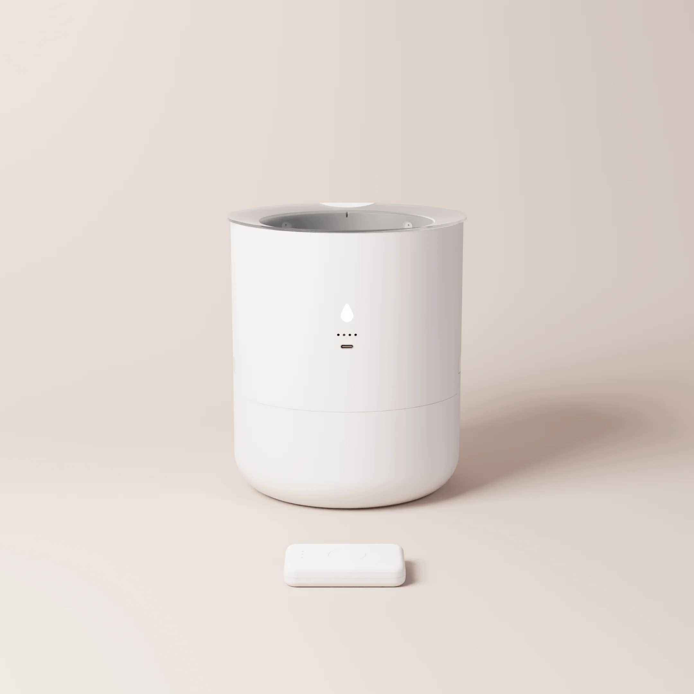
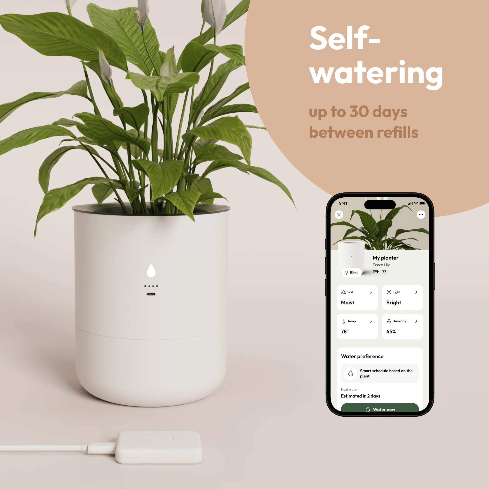
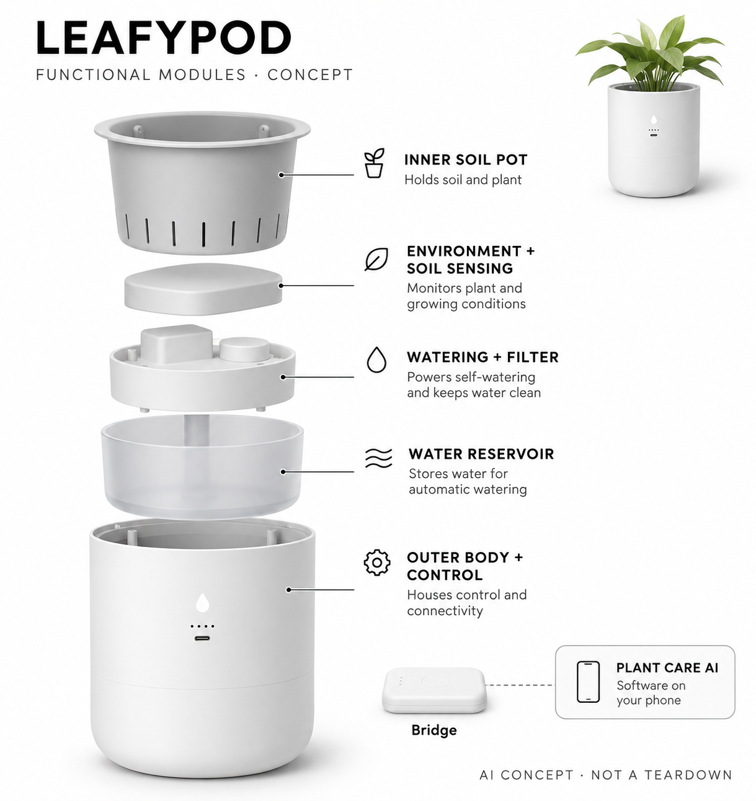

# LeafyPod Starter Pack

**LeafyPod** · 庭院与自然 · 核查 2026-11-04

为现有室内土培观叶植物学习浇水节奏的花盆与桥接器

消费渠道：个人零售。

## 产品图片与结构参考

### 产品图

官方单盆与Bridge套装 · 来源：[LeafyPod · 官方图片](<https://www.theleafypod.com/products/leafypod-bridge-planter-package>) · [原始图片](<https://www.theleafypod.com/_next/image?url=https%3A%2F%2Fcdn.shopify.com%2Fs%2Ffiles%2F1%2F0674%2F4162%2F3240%2Ffiles%2Fbundle-1-min.png%3Fv%3D1756546146&w=3840&q=75>)

### 参考图

官方种植与应用参考（含原厂营销标注） · 来源：[LeafyPod · 官方图片](<https://www.theleafypod.com/products/leafypod-bridge-planter-package>) · [原始图片](<https://www.theleafypod.com/_next/image?url=https%3A%2F%2Fcdn.shopify.com%2Fs%2Ffiles%2F1%2F0674%2F4162%2F3240%2Ffiles%2Fplanter-bundle-image-1.compressed.png%3Fv%3D1756546146&w=3840&q=75>)

### AI 生成爆炸示意

**AI 生成 · 非实物拆机。** 内部为概念推断，不能作为元件布局、BOM 或维修依据。[生成提示词](../../content/hardware/prompts/leafypod-starter-pack.txt)

> 依据已核验官方外形与公开功能生成；未知内部仅为概念功能块，不代表原机电路板、芯片或实际布局。

> 实际查看并核对对应型号，原图未经改色或语义编辑；厂商标注不等同本研究实测。

> 分析为基于公开资料的案头研究与 AI 辅助判断，未经用户访谈、销量审计或实物拆机。需求、画像、竞争冷门度、审美及商业机会均为研究假设，不是投资结论。

## 销售与购买

- 状态：在售。官方单盆加Bridge套装显示US$145与Add to Cart；FAQ明确目前向美国和加拿大发货。仅收单盆系统，不重复计算多盆套装。

- 地区：美国、加拿大

- 价格：单盆＋Bridge US$145。当前促销价，页面划线价US$178；不同多盆数量不另算型号，滤芯与后续费用按地区及官方条款。

- 中国大陆：官方FAQ仅列美国和加拿大配送，未确认中国大陆官方购买和售后；不要将第三方转运视为官方支持。

- [官方产品 / 商店](<https://www.theleafypod.com/products/leafypod-bridge-planter-package>)

## AI 的实际作用

用户用手机拍照识别植物，LeafyLearn结合用户输入、环境与土壤传感建立个体养护档案并调整浇水；盆内未披露摄像头。

服务与联网依赖：花盆以蓝牙连接Bridge，Bridge连接Wi-Fi和应用；模型及联网失效时的完整自主边界未详细披露。

## 是否冷门

新兴竞争（研究判断）：家用浇水已有成熟替代，结合植物学习档案与主动顶部供水形成细分机制；需要通过维护收益验证，不把植物种类数当市场规模。

## 需求与市场

需求假设：喜爱观叶植物但常忘记或过量浇水的家庭希望减少凭经验猜测。价值应体现在具体植物的维护节奏和人工负担，不能把自动供水等同永远不会烂根，也不能以绿植照片推断比所有普通花盆更健康。

### 产品任务与边界 · 研究判断

需求假设：喜爱观叶植物但常忘记或过量浇水的家庭希望减少凭经验猜测。价值应体现在具体植物的维护节奏和人工负担，不能把自动供水等同永远不会烂根，也不能以绿植照片推断比所有普通花盆更健康。

依据：[LeafyPod Starter Pack官方商品页](<https://www.theleafypod.com/products/leafypod-bridge-planter-package>) · [LeafyPod官方植物识别与供水说明](<https://www.theleafypod.com/>)

### 需求判断 · 研究判断

土培观叶植物的浇水问题常来自用户无法把物种偏好与室内真实环境对应起来，而不只是忘记一个固定日期。系统若能减少过度与不足浇水的猜测会有价值，但仍要求换盆、补水和清理，不能把短期自动供水等同完全不需要养护。

依据：[LeafyPod Starter Pack官方商品页](<https://www.theleafypod.com/products/leafypod-bridge-planter-package>) · [LeafyPod官方植物识别与供水说明](<https://www.theleafypod.com/>)

### 需求验证 · 待验证

需求验证应选用户已经养的适配植物，记录原先判断、实际补水与维护，再比较普通盆和自吸水盆。观察跨季节或至少多个干湿周期的使用，不以一张茂盛照片证明系统更健康，也不把官网支持物种数量当作所有植物都能可靠托管。

依据：[LeafyPod Starter Pack官方商品页](<https://www.theleafypod.com/products/leafypod-bridge-planter-package>) · [LeafyPod官方植物识别与供水说明](<https://www.theleafypod.com/>)

## 用户画像

画像推断：有适配盆径的室内土培植物、愿意初次换盆并维护水箱滤材的人较匹配。大株、户外园艺与只养耐旱少量植物的用户不同，出差需求也需结合补水和供电，不能只按植物爱好或忙碌程度判断。

### 适用行为与条件 · 研究判断

画像推断：有适配盆径的室内土培植物、愿意初次换盆并维护水箱滤材的人较匹配。大株、户外园艺与只养耐旱少量植物的用户不同，出差需求也需结合补水和供电，不能只按植物爱好或忙碌程度判断。

依据：[LeafyPod Starter Pack官方商品页](<https://www.theleafypod.com/products/leafypod-bridge-planter-package>) · [LeafyPod官方植物识别与供水说明](<https://www.theleafypod.com/>)

### 人群取舍 · 研究判断

愿意为现有盆栽换盆并保留固定Bridge覆盖的人，和只想偶尔收到提醒的人需求不同。小尺寸内盆限定了根系与植株适配，用户仍需知道如何补水和更换滤材；长期旅行并不自动意味着不用托管，因为水箱和能源都有具体条件。

依据：[LeafyPod Starter Pack官方商品页](<https://www.theleafypod.com/products/leafypod-bridge-planter-package>) · [LeafyPod官方植物识别与供水说明](<https://www.theleafypod.com/>)

### 画像验证 · 待验证

画像验证应检查现有植物、盆土与放置环境，观察用户能否完成换盆、连接和维护，并记录对外观改变的接受。对大植株或不愿使用应用的人明确注明不匹配，不以热爱绿植、经常忘事或产品推荐的物种列表替代真实适用性判断。

依据：[LeafyPod Starter Pack官方商品页](<https://www.theleafypod.com/products/leafypod-bridge-planter-package>) · [LeafyPod官方植物识别与供水说明](<https://www.theleafypod.com/>)

## 竞争与替代

竞争判断：与普通自吸水盆、土壤湿度提醒器和人工浇水竞争，差异是植物档案学习与顶部主动供水。与Gardyn的水培食物种植任务不同，但同款多盆套装不新增场景；应比较长期维护而非仅比较自动化字样。

### 比较对象与差异 · 研究判断

竞争判断：与普通自吸水盆、土壤湿度提醒器和人工浇水竞争，差异是植物档案学习与顶部主动供水。与Gardyn的水培食物种植任务不同，但同款多盆套装不新增场景；应比较长期维护而非仅比较自动化字样。

依据：[LeafyPod Starter Pack官方商品页](<https://www.theleafypod.com/products/leafypod-bridge-planter-package>) · [LeafyPod官方植物识别与供水说明](<https://www.theleafypod.com/>)

### 竞争判断 · 研究判断

被动自吸水结构便宜且无需联网，本产品的增量是植物档案和环境反馈驱动的主动供水，因此必须证明额外复杂度值得维护。水培食物种植塔有另一套生产和采收任务，不能拿不同用途互相替代，也不应把同款多盆数量当成新的独立类别。

依据：[LeafyPod Starter Pack官方商品页](<https://www.theleafypod.com/products/leafypod-bridge-planter-package>) · [LeafyPod官方植物识别与供水说明](<https://www.theleafypod.com/>)

### 竞争验证 · 待验证

竞争验证可在相近植物和盆土条件下比较手动、被动自吸及学习控制的维护负担，记录何时仍需要人判断。将AI识别、状态提醒和实际浇水分别评估，不拿更高传感数量或应用界面丰富程度作为植物状态更好和商业价值更大的证明。

依据：[LeafyPod Starter Pack官方商品页](<https://www.theleafypod.com/products/leafypod-bridge-planter-package>) · [LeafyPod官方植物识别与供水说明](<https://www.theleafypod.com/>)

## 供应链

供应链分析：内外盆、水箱、过滤、水路、土壤环境传感、低功耗控制与Bridge组成系统，实际工厂和BOM未知。土壤污染、根系增长及滤材更换影响长期使用，不应仅围绕AI或无线模组估算整个产品交付难度。

### 功能模块拆分 · 研究判断

功能层包括土培内盆、土壤与环境信号、顶部供水、过滤回流、水箱与控制能源，以及连接多盆的Bridge。公开页面没有给出内部泵和传感器精确位置，工程上要关注根系、泥土与长期回水污染，不应画成带摄像头的水培机器人。

依据：[LeafyPod Starter Pack官方商品页](<https://www.theleafypod.com/products/leafypod-bridge-planter-package>) · [LeafyPod官方植物识别与供水说明](<https://www.theleafypod.com/>)

### 制造与供应约束 · 研究判断

供应链分析：内外盆、水箱、过滤、水路、土壤环境传感、低功耗控制与Bridge组成系统，实际工厂和BOM未知。土壤污染、根系增长及滤材更换影响长期使用，不应仅围绕AI或无线模组估算整个产品交付难度。

依据：[LeafyPod Starter Pack官方商品页](<https://www.theleafypod.com/products/leafypod-bridge-planter-package>) · [LeafyPod官方植物识别与供水说明](<https://www.theleafypod.com/>)

### 候选与证据缺口 · 研究判断

Sensirion可作为环境温湿度感知候选，睿迅可支持盆体与水箱结构原型，均未被LeafyPod点名采用。土壤含水测量、滤材、泵和养护模型还需其他专业验证，环境芯片或加工能力不能代表已匹配整套植物控制系统及实际供应关系。

依据：[LeafyPod Starter Pack官方商品页](<https://www.theleafypod.com/products/leafypod-bridge-planter-package>) · [LeafyPod官方植物识别与供水说明](<https://www.theleafypod.com/>)

## 技术路径

技术判断：官网LeafyLearn利用输入、传感与数据库逐步形成植物档案，识别照片由用户手机提供。具体模型未公开，感知名称不意味着传感器自身具备AI；需要测试误识别、不同土壤与断连时的控制边界。

### 已披露技术边界 · 研究判断

技术判断：官网LeafyLearn利用输入、传感与数据库逐步形成植物档案，识别照片由用户手机提供。具体模型未公开，感知名称不意味着传感器自身具备AI；需要测试误识别、不同土壤与断连时的控制边界。

依据：[LeafyPod Starter Pack官方商品页](<https://www.theleafypod.com/products/leafypod-bridge-planter-package>) · [LeafyPod官方植物识别与供水说明](<https://www.theleafypod.com/>) · [LeafyPod官方FAQ](<https://www.theleafypod.com/faq>)

### 系统难点判断 · 研究判断

手机照片确定植物档案后，系统还需结合真实土壤与光照形成控制判断，错误识别可能让后续推荐一起偏离。官网LeafyLearn描述输入与传感共同学习，但未说明模型架构，不能自行称每只传感器都有AI，也不把数据库匹配全等同在线模型训练。

依据：[LeafyPod Starter Pack官方商品页](<https://www.theleafypod.com/products/leafypod-bridge-planter-package>) · [LeafyPod官方植物识别与供水说明](<https://www.theleafypod.com/>) · [LeafyPod官方FAQ](<https://www.theleafypod.com/faq>)

### 技术验证 · 待验证

技术验证应在允许范围内比较不同盆土、光照和用户档案修正后的供水变化，检查缺水与断连提示。确认手机识别和花盆执行之间是否保留人工覆盖，不使用危险供电或极端过量试验，更不能根据一次正常浇水推断所有根系不会发生问题。

依据：[LeafyPod Starter Pack官方商品页](<https://www.theleafypod.com/products/leafypod-bridge-planter-package>) · [LeafyPod官方植物识别与供水说明](<https://www.theleafypod.com/>) · [LeafyPod官方FAQ](<https://www.theleafypod.com/faq>)

## 产品审美

审美判断：圆柱花盆比专用种植箱更易融入书桌和窗边，但可见探杆、桥接器和充电维护仍影响体验。土壤、积水和根系会改变长期观感，应同时评价拆洗、补水和状态表达，不能只看摆拍中的茂盛植物。

### 外观与交互语言 · 研究判断

审美判断：圆柱花盆比专用种植箱更易融入书桌和窗边，但可见探杆、桥接器和充电维护仍影响体验。土壤、积水和根系会改变长期观感，应同时评价拆洗、补水和状态表达，不能只看摆拍中的茂盛植物。

依据：[LeafyPod Starter Pack官方商品页](<https://www.theleafypod.com/products/leafypod-bridge-planter-package>) · [LeafyPod官方植物识别与供水说明](<https://www.theleafypod.com/>)

### 使用中审美判断 · 研究判断

白色圆柱外壳、简单状态点与小型桥接器容易进入书桌和窗台，透明内盆有助查看但也会显示积垢和根系。传感部分和水箱拆卸应服务养护，不能只把它当静态摆件；充电线与Bridge摆放也是视觉和使用体验的一部分。

依据：[LeafyPod Starter Pack官方商品页](<https://www.theleafypod.com/products/leafypod-bridge-planter-package>) · [LeafyPod官方植物识别与供水说明](<https://www.theleafypod.com/>)

### 设计验证 · 待验证

设计验证可观察满盆时是否容易提起、补水是否滴到台面、滤材更换是否需要触碰根系，并检查状态点是否可理解。将真实盆土和生长后的体量纳入，而不是只用新品空盆评价极简；不让为了隐藏水箱而增加用户忘记补水的可能。

依据：[LeafyPod Starter Pack官方商品页](<https://www.theleafypod.com/products/leafypod-bridge-planter-package>) · [LeafyPod官方植物识别与供水说明](<https://www.theleafypod.com/>)

## 关键风险

风险判断：错误植物档案、土壤差异、堵塞或缺水可能让自动浇水失效，主人仍需观察植物并维护滤材。官方不同页面的续航表述不完全一致，本目录不将最长时间当保证；海外销售也不意味着大陆云服务与售后可用。

### 主要失效与依赖 · 研究判断

风险判断：错误植物档案、土壤差异、堵塞或缺水可能让自动浇水失效，主人仍需观察植物并维护滤材。官方不同页面的续航表述不完全一致，本目录不将最长时间当保证；海外销售也不意味着大陆云服务与售后可用。

依据：[LeafyPod Starter Pack官方商品页](<https://www.theleafypod.com/products/leafypod-bridge-planter-package>) · [LeafyPod官方植物识别与供水说明](<https://www.theleafypod.com/>)

### 风险传播判断 · 研究判断

滤材堵塞、回流水质变化和植物档案错误可能同时影响浇水，应用仍显示正常不代表根部条件可靠。不同官方页面续航上限不一致时应保留条件，不能许诺出差期间永久免维护，也不能把自动供水和回水过滤表述成疾病或烂根预防保证。

依据：[LeafyPod Starter Pack官方商品页](<https://www.theleafypod.com/products/leafypod-bridge-planter-package>) · [LeafyPod官方植物识别与供水说明](<https://www.theleafypod.com/>)

### 风险验证 · 待验证

风险验证应按说明检查补水、清洗与滤材周期，记录断网、缺水和能源不足后的提示，避免用户只看绿灯就离家。购买地区仅美国加拿大，未核实的跨境使用应保持不确定；不可把厂商退换政策与无条件长期试用混同。

依据：[LeafyPod Starter Pack官方商品页](<https://www.theleafypod.com/products/leafypod-bridge-planter-package>) · [LeafyPod官方植物识别与供水说明](<https://www.theleafypod.com/>)

## 机会与验证

机会假设：可从少数常见室内植物和明确的旅行浇水问题验证，不必一开始覆盖所有物种。若简单自吸水盆已解决需求，学习算法需证明额外价值；应追踪多周补水、纠错与清洁，再决定订阅和硬件复杂度。

### 可能的机会入口 · 研究判断

机会假设：可从少数常见室内植物和明确的旅行浇水问题验证，不必一开始覆盖所有物种。若简单自吸水盆已解决需求，学习算法需证明额外价值；应追踪多周补水、纠错与清洁，再决定订阅和硬件复杂度。

依据：[LeafyPod Starter Pack官方商品页](<https://www.theleafypod.com/products/leafypod-bridge-planter-package>) · [LeafyPod官方植物识别与供水说明](<https://www.theleafypod.com/>)

### 机会成立条件 · 研究判断

机会可以聚焦少数常见观叶植物的可解释维护，帮助主人知道为何需要浇水或暂时不浇，而非追求覆盖所有植物。若被动盆已足够，学习系统需要提供额外证据；对新项目，先验证控制和维护再决定桥接架构与持续软件服务成本。

依据：[LeafyPod Starter Pack官方商品页](<https://www.theleafypod.com/products/leafypod-bridge-planter-package>) · [LeafyPod官方植物识别与供水说明](<https://www.theleafypod.com/>)

### 下一步验证 · 待验证

下一步可记录多个干湿周期中的人工操作、误报、补水和滤材维护，对比用户原有方案的真实负担。把植物观察作为有条件的结果而非健康承诺，依据用户是否继续采用来判断方向，不用物种数据库大小或自动化宣传直接估算需求。

依据：[LeafyPod Starter Pack官方商品页](<https://www.theleafypod.com/products/leafypod-bridge-planter-package>) · [LeafyPod官方植物识别与供水说明](<https://www.theleafypod.com/>)

## 对应供应链公司

能力候选用于选型研究，不代表本产品实际采用；未公开的供货关系不作推断。

- [sensirion](../supply-chain/sensirion.md) — **能力候选 · 非已采用** / 室内温湿度感知候选：Sensirion公开温湿度传感产品可对应植物环境信号采集，但不覆盖土壤水分、光照、泵和养护模型，需确认湿区封装与校准；未见LeafyPod点名采用证据，不能称其实际传感器或整套控制方案。

- [rapiddirect](../supply-chain/rapiddirect.md) — **能力候选 · 非已采用** / 盆体水箱与可拆洗结构原型：RapidDirect的快速加工及模具服务可支持盆体、水箱和维护接口原型，但材料耐久、滤材和水路可靠性需要专项验证；没有LeafyPod供货披露，只作为结构工程匹配候选，不能推定整机制造已落实。

[浏览供应链目录](../supply-chain.md)

## 功能分层示意

这是功能关系，不是实物拆机、真实空间结构或已核实 BOM。

1. **内盆与植物**：透明内盆容纳土培植物并供用户观察。（官方披露）

2. **土壤与环境感知**：官方列土壤水分、光照、温湿度及水位信号。（官方披露）

3. **供水与过滤**：顶部浇水，余水经滤材回到底部水箱。（官方披露）

4. **花盆控制与能源**：控制供水及无线连接；隐藏器件布置未披露。（分析推断）

5. **Bridge与养护服务**：蓝牙至Bridge再接Wi-Fi，应用植物识别与学习养护档案。（官方披露）

## 来源

1. [LeafyPod Starter Pack官方商品页](<https://www.theleafypod.com/products/leafypod-bridge-planter-package>) — 实际打开，单盆加Bridge可加入购物车；连接和传感明确，未采用页面有疑义的防水等级文字。

2. [LeafyPod官方植物识别与供水说明](<https://www.theleafypod.com/>) — 实际打开，手机拍照识别、学习养护与顶部供水；不把广告中植物健康保证当实测。

3. [LeafyPod官方FAQ](<https://www.theleafypod.com/faq>) — 实际打开，LeafyLearn数据来源、回水过滤及美加配送；滤材需要维护。

[返回目录](../hardware-market.md) · [网页分析](https://romanagent.github.io/Roman/#hardware/product/leafypod-starter-pack)
