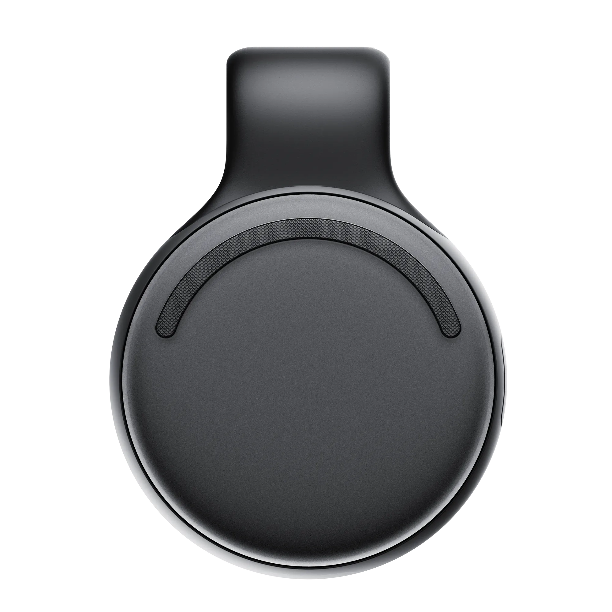
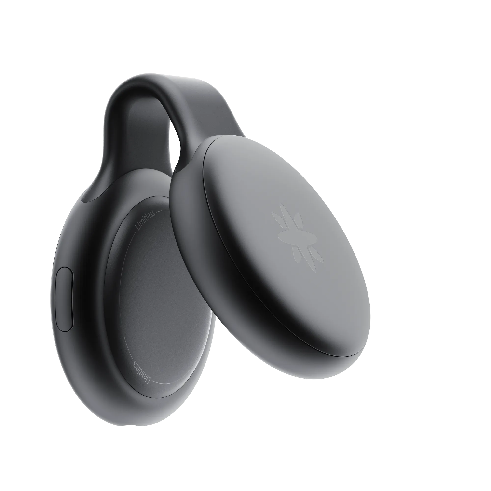
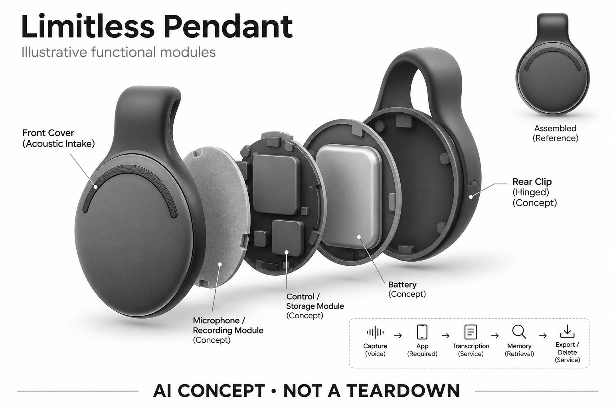

# Limitless Pendant

**Limitless（已被Meta收购）** · 录音与记忆 · 核查 2026-11-04

停售案例：硬件寿命依赖云端服务承诺

消费渠道：个人零售。

## 产品图片与结构参考

### 产品图

Limitless 官方历史黑色 Pendant 正面图 · 来源：[Limitless（已被Meta收购） · 官方产品图片](<https://www.limitless.ai/pendant>) · [原始图片](<https://www.limitless.ai/media/pendant/black/pendant-front.webp>)

### 参考图

Limitless 官方历史 Pendant 夹持结构展开图 · 来源：[Limitless（已被Meta收购） · 官方产品图片](<https://www.limitless.ai/pendant>) · [原始图片](<https://www.limitless.ai/media/pendant/black/pendant-open.webp>)

### AI 生成爆炸示意

**AI 生成 · 非实物拆机。** 内部为概念推断，不能作为元件布局、BOM 或维修依据。[生成提示词](../../content/hardware/prompts/limitless-pendant.txt)

> 外形依据核验参考图；内部位置、模块形状与装配关系仅作AI概念展示。

> 图片按源站提供格式保存，未裁切或改色；厂商渲染/场景示意不代表实机测试。

> 产品已停售；沿图片搜索索引找回仍存放在官方域名的历史产品原图。

> 分析为基于公开资料的案头研究与 AI 辅助判断，未经用户访谈、销量审计或实物拆机。需求、画像、竞争冷门度、审美及商业机会均为研究假设，不是投资结论。

## 销售与购买

- 状态：停售。官方公告及FAQ明确：自2025-12-05起不再销售Pendant；现有客户服务支持贯穿2026年。中国、欧盟、英国等列入停止服务区域。本条为历史与退出风险样本，不是购买推荐。

- 地区：不再向新客户销售、部分现有客户支持贯穿2026年，按官方区域名单限制

- 价格：已停售，无当前官方购买价格。不把历史硬件价或二手转售价展示为在售价。官网表示继续服务的现有客户免费获得Unlimited计划。

- 中国大陆：官网明确中国自2025-12-05起不再提供服务，不能把二手硬件可购视为官方产品可用。

- [官方产品 / 商店](<https://www.limitless.ai/>)

## AI 的实际作用

历史定位为采集现实谈话并转为可检索转写的个人记忆服务。

服务与联网依赖：核心价值依赖配套软件、账户与服务持续运营；官方承诺仅能据原文写到2026年，不能推定其后继续可用。

## 是否冷门

新兴竞争（研究判断）：个人记忆穿戴是探索中的形态；本产品已经退出销售，仅用于生命周期比较。

## 需求与市场

历史需求假设：用户希望事后查回没有手动记下的谈话细节。停售并不能单独证明需求不存在，也不能证明产品成功；只能确认依赖服务的记忆设备会受到公司战略变化直接影响。

### 官方｜已退出新销售的历史样本 · 官方资料

本型号已由官方确认停止向新客户销售，并对不同地区服务作出退出安排，现有客户支持说明只覆盖到公布期限。它在目录中的用途是研究谈话记忆设备与服务依赖，不是当前购买推荐；历史需求仍可分析，但不能把旧网页、二手实物或帮助文章中的旧措辞当作重新开售。

依据：[Limitless · 被Meta收购公告与现有客户FAQ](<https://www.limitless.ai/>)

### 判断｜回忆任务与公司战略分开 · 研究判断

用户希望事后找回未手工记下的谈话细节，这一任务不会因某款产品停售自动消失。停售也不能单独证明需求失败或商业成功，只能说明硬件价值可能被服务与公司决策直接改变；研究应把真实用户任务、产品表现与战略退出分别看待，避免由一次收购推导整个品类结论。

依据：[Limitless · 被Meta收购公告与现有客户FAQ](<https://www.limitless.ai/>) · [Limitless Pendant 交互与同步帮助](<https://help.limitless.ai/en/articles/10546658-interacting-with-the-pendant-search-ask-ai-summaries>)

### 验证｜历史价值如何研究 · 待验证

若研究仍受支持地区的既有用户，可以访谈哪些记录曾被有效找回、哪些错误需要修正，以及退出后如何处理历史内容。不能把这类回顾当作新购体验，也不能要求已退出地区恢复服务；当前目录没有用户访谈，历史功能与实际价值之间仍保留证据缺口。

依据：[Limitless · 被Meta收购公告与现有客户FAQ](<https://www.limitless.ai/>) · [Limitless Pendant 交互与同步帮助](<https://help.limitless.ai/en/articles/10546658-interacting-with-the-pendant-search-ask-ai-summaries>)

## 用户画像

画像推断：现有持有者最关心数据导出、过渡期限和历史内容可访问性；新用户不应被归入当前可购买画像。本条不把二手买家或第三方改装用户当作官方继续销售的证据。

### 判断｜现有持有者的优先需求 · 研究判断

目前最相关的人群是已有设备与历史数据的持有者，他们更关心访问、导出和支持边界，而不是购买新功能。不同地区状态不一致，不能给所有用户相同过渡建议；尤其已公布停止服务和数据期限的地区，不应被描述为仍可正常开启账户或恢复全部历史内容。

依据：[Limitless · 被Meta收购公告与现有客户FAQ](<https://www.limitless.ai/>) · [Limitless 官方数据导出说明](<https://help.limitless.ai/en/articles/13004987-how-to-download-your-limitless-transcripts-and-account-info>)

### 判断｜二手买家不等于官方用户 · 研究判断

实体硬件在二手市场出现，并不证明新账户可用、旧绑定可解除或云功能继续提供。买家可能只看到外形和历史演示，却忽略服务身份与地区条件；目录不把二手可得性计入官方在售，也不根据设备能够通电推断其记忆、转写和问答仍可完整使用。

依据：[Limitless · 被Meta收购公告与现有客户FAQ](<https://www.limitless.ai/>) · [Limitless Pendant 交互与同步帮助](<https://help.limitless.ai/en/articles/10546658-interacting-with-the-pendant-search-ask-ai-summaries>)

### 验证｜按账户与地区核对 · 待验证

后续研究应先核对账户所处地区和官方支持范围，再查看历史数据是否仍可访问及可导出哪些内容。不能越过已经公布的地区截止期限承诺恢复，也不应把其他用户的成功案例当作统一结果；任何过渡判断都需要基于当前账户状态，而非历史产品规格。

依据：[Limitless · 被Meta收购公告与现有客户FAQ](<https://www.limitless.ai/>) · [Limitless 官方数据导出说明](<https://help.limitless.ai/en/articles/13004987-how-to-download-your-limitless-transcripts-and-account-info>)

## 竞争与替代

案头判断：Omi、Bee及会议录音产品承接类似任务，但无法据此推算原客户迁移方向。没有销量、流失率或访谈资料；这里记录服务退出事实，不对收购成败作市场因果判断。

### 判断｜竞争不再是当前选购排名 · 研究判断

停售后，本型号不适合与在售录音器按现价、续航和功能作直接购买排名，比较重点应转向服务退出与数据可携带性。其他产品仍可能满足相似回忆任务，但迁移并不只靠换硬件，历史格式、来源和用户习惯都会影响成本；不能由收购事件推断某个替代品牌必然更可靠。

依据：[Limitless · 被Meta收购公告与现有客户FAQ](<https://www.limitless.ai/>)

### 判断｜云依赖与本地记录的取舍 · 研究判断

单纯本地录音通常更容易保留原始文件，云记忆服务则可能提供跨记录搜索与问答，两者有不同价值和依赖。Limitless 的退出样本提示应把这些层次分别比较，而不是笼统判断云端一定不好；关键是用户是否理解功能在哪一层，以及服务变化后哪些内容仍由自己掌握。

依据：[Limitless · 被Meta收购公告与现有客户FAQ](<https://www.limitless.ai/>) · [Limitless Pendant 交互与同步帮助](<https://help.limitless.ai/en/articles/10546658-interacting-with-the-pendant-search-ask-ai-summaries>)

### 验证｜以可迁移内容比较 · 待验证

可以比较不同记录系统能导出原音、转写、摘要与时间信息的范围，以及导出后是否能在独立工具中查找。不能只看存在导出按钮，还要核对完整与可读性；对本型号应限定为仍可操作的既有账户，历史服务和旧帮助条目不能作为新的购买或持续可用证明。

依据：[Limitless 官方数据导出说明](<https://help.limitless.ai/en/articles/13004987-how-to-download-your-limitless-transcripts-and-account-info>) · [Limitless Pendant 交互与同步帮助](<https://help.limitless.ai/en/articles/10546658-interacting-with-the-pendant-search-ask-ai-summaries>)

## 供应链

当前官方公告未披露整机工厂、器件供应商或后续备件安排，本次均记为不明。硬件仍存在也不代表售后和云服务仍存在；不能从公司被收购推断原供应链被继续用于其他产品。

### 官方｜硬件来源仍不完整 · 官方资料

当前官方公告主要说明服务与销售变化，历史图能确认圆形主体和夹持结构，却不能提供完整器件或工厂信息。被收购不证明原硬件供应链继续用于其他产品，也不代表后续备件安排已公开；目录不从公司归属变化推断主控、麦克风或代工关系。

依据：[Limitless · 被Meta收购公告与现有客户FAQ](<https://www.limitless.ai/>) · [Limitless 官方历史 Pendant 图像资料](<https://www.limitless.ai/pendant>)

### 判断｜服务也是交付依赖 · 研究判断

这类设备除了采集与连接，还依赖账户、应用和后台处理，硬件继续存在并不保证完整功能可持续。供应链分析应把电子备件与服务运营分开，尤其明确哪些问题无法靠更换电池或芯片解决；这不是对内部结构的判断，而是由公开退出事实揭示的产品交付边界。

依据：[Limitless · 被Meta收购公告与现有客户FAQ](<https://www.limitless.ai/>) · [Limitless Pendant 交互与同步帮助](<https://help.limitless.ai/en/articles/10546658-interacting-with-the-pendant-search-ask-ai-summaries>)

### 判断｜候选不是维修恢复方案 · 研究判断

Nordic 的连接与控制、英飞凌的声音输入可用于研究同类新设计，但它们不是已确认的原厂供货方，也不能恢复 Limitless 服务。候选需要重新开发固件、账户和数据流程，不能被展示成现有设备替换料；目录保留这些功能比较，仅为理解架构，不构成采购或改装建议。

依据：[Limitless Pendant 交互与同步帮助](<https://help.limitless.ai/en/articles/10546658-interacting-with-the-pendant-search-ask-ai-summaries>)

## 技术路径

官方当前页面确认Pendant服务、历史转写和导出机制，并未保留完整硬件规格。本目录仅给采集到检索的概念架构，未核实芯片、麦克风数量或离线模型，不以旧宣传补齐空白。

### 官方｜记录与检索的历史链路 · 官方资料

帮助资料描述设备内容经手机同步，再在应用中查看转写、搜索和问答，并提供部分编辑与分享操作。这些资料可说明历史功能分层，但其中旧销售或发货措辞不能推翻当前停售公告；具体可用性应优先按最新地区与账户说明，不能把帮助页面仍存在等同所有功能持续开放。

依据：[Limitless Pendant 交互与同步帮助](<https://help.limitless.ai/en/articles/10546658-interacting-with-the-pendant-search-ask-ai-summaries>)

### 判断｜数据形式决定后续价值 · 研究判断

原始音频、转写、摘要和问答并不是同一种数据，导出其中一类未必保留另一类的上下文。若只留下生成摘要，可能失去纠错所需原话；若只有音频，检索又会更费时间。研究应关注这些层次能否关联，而不是把下载一个文件概括为全部记忆已经完整迁移。

依据：[Limitless 官方数据导出说明](<https://help.limitless.ai/en/articles/13004987-how-to-download-your-limitless-transcripts-and-account-info>) · [Limitless Pendant 交互与同步帮助](<https://help.limitless.ai/en/articles/10546658-interacting-with-the-pendant-search-ask-ai-summaries>)

### 验证｜导出结果要独立检查 · 待验证

对仍可导出的既有账户，应在独立环境核对文件能否打开、时间范围是否完整、原音与文本是否对应，并记录缺失。官方说明可以指导流程，但不保证每个历史账户都仍可访问；已退出地区的期限已经过去，不能据当前帮助文章承诺恢复被删除或不可访问的信息。

依据：[Limitless 官方数据导出说明](<https://help.limitless.ai/en/articles/13004987-how-to-download-your-limitless-transcripts-and-account-info>)

## 产品审美

形态观察：吊坠把记忆采集变成随身物品，但佩戴接受度与云服务可持续性是不同问题。此处仅讨论产品形态，不对停售后的实物成色、佩戴舒适或第三方适配能力作判断。

### 判断｜历史配饰化外观 · 研究判断

本轮重新查看原目录保存的官方历史图，可见圆形主体与夹持结构，意图是让录音设备以配饰方式进入日常。这样的外观可以研究携带与状态理解，但无法证明实际重量、材料触感或舒适；更不能因硬件外形仍有吸引力，就忽略已经发生的服务与销售变化。

依据：[Limitless 官方历史 Pendant 图像资料](<https://www.limitless.ai/pendant>)

### 判断｜夹持结构与记录状态 · 研究判断

夹在衣物上的设备可能便于随身携带，也会受到方向、摩擦和衣物厚度影响，用户及旁人未必总能看清状态。外观研究应把装饰性与记录用途的可解释性分开，不能把不显眼当作天然优势；这些是对历史形态的分析，不代表已对实物耐久或日常体验进行测试。

依据：[Limitless 官方历史 Pendant 图像资料](<https://www.limitless.ai/pendant>)

### 验证｜历史图像不等于当前实物 · 待验证

若继续研究现有持有者，应确认设备版本与保存的历史图一致，再观察夹持、充电和日常管理，不能用渲染图替代实机。二手设备还可能存在磨损和电池差异，与当时出厂状态不同；当前目录仅保留可追溯外观资料，不据此评价所有现存设备的可靠性。

依据：[Limitless 官方历史 Pendant 图像资料](<https://www.limitless.ai/pendant>)

## 关键风险

确定风险是停售、地区退出及支持期限；具体2026年之后的安排不能自行预测。现有用户应依据官方导出与账号说明处理数据，第三方兼容方案也不等同原厂服务或原有隐私承诺。

### 官方｜停售与地区退出已确定 · 官方资料

官方公告明确停止新销售，并列出中国等停止服务地区及当时的数据下载期限。当前日期已晚于该期限，因此不能向这些地区用户承诺仍可导出或恢复；对继续支持的客户，公开说明也只应按原文期限理解，不能自行预测以后必然延续或立即彻底终止。

依据：[Limitless · 被Meta收购公告与现有客户FAQ](<https://www.limitless.ai/>)

### 判断｜硬件所有权与服务使用 · 研究判断

持有硬件不等于控制全部软件与后台，账户、绑定和服务条件会影响实际功能。这个风险与相机或麦克风是否完好不同，用户可能在设备仍能通电时失去主要价值；目录不把第三方改装或兼容方案当作原厂服务延续，也不默认原有隐私承诺覆盖外部替代路径。

依据：[Limitless · 被Meta收购公告与现有客户FAQ](<https://www.limitless.ai/>) · [Limitless Pendant 交互与同步帮助](<https://help.limitless.ai/en/articles/10546658-interacting-with-the-pendant-search-ask-ai-summaries>)

### 验证｜信息冲突按来源范围处理 · 待验证

部分帮助文章仍保留旧发货或购买措辞，核查时应优先采用明确的停售与地区公告，技术文章只用于其功能说明范围。研究还应记录页面日期与适用对象，不因页面近期更新就认定旧销售文案恢复有效；这种来源分层比简单选择看起来最新的一条更可靠。

依据：[Limitless · 被Meta收购公告与现有客户FAQ](<https://www.limitless.ai/>) · [Limitless Pendant 交互与同步帮助](<https://help.limitless.ai/en/articles/10546658-interacting-with-the-pendant-search-ask-ai-summaries>)

## 机会与验证

市场观察价值在于展示硬件销售与服务存续必须分开评估。购买个人记忆设备时，数据可导出性、退出安排和本地功能边界都是比较维度；本条不提出新产品idea或继续购买建议。

### 判断｜退出案例的研究价值 · 研究判断

本型号的价值在于展示个人记忆硬件如何依赖服务持续运营，以及公司变化怎样影响用户已积累的内容。它不应被包装成当前创业购买机会，也不能由退出直接判定整个品类无需求；更有用的问题是用户原本获得了什么，以及哪些价值在服务变化后无法保留。

依据：[Limitless · 被Meta收购公告与现有客户FAQ](<https://www.limitless.ai/>)

### 判断｜可携带性应进入比较 · 研究判断

对于其他记忆设备，用户可能需要在购买前理解原音、文本和摘要的导出能力，以及失去服务后的基础用途。Limitless 提供了具体观察背景，但不能把它的退出路径推广成所有品牌未来；研究应逐个核对现有产品的实际机制，而不是根据公司规模或开源标签猜测长期保证。

依据：[Limitless 官方数据导出说明](<https://help.limitless.ai/en/articles/13004987-how-to-download-your-limitless-transcripts-and-account-info>) · [Limitless Pendant 交互与同步帮助](<https://help.limitless.ai/en/articles/10546658-interacting-with-the-pendant-search-ask-ai-summaries>)

### 验证｜保留历史与当前边界 · 待验证

后续目录更新应继续核对官方支持与数据说明，明确哪些属于历史功能、哪些对仍受支持账户有效。任何新状态都需要实际来源，不能从收购新闻或二手库存推断复售；当前条目维持停售和退出风险样本身份，不计入可购数量，也不提供确定的未来服务预测。

依据：[Limitless · 被Meta收购公告与现有客户FAQ](<https://www.limitless.ai/>) · [Limitless 官方数据导出说明](<https://help.limitless.ai/en/articles/13004987-how-to-download-your-limitless-transcripts-and-account-info>)

## 对应供应链公司

能力候选用于选型研究，不代表本产品实际采用；未公开的供货关系不作推断。

- [nordic-semiconductor](../supply-chain/nordic-semiconductor.md) — **能力候选 · 非已采用** / 历史同类架构的连接与控制候选：帮助资料表明 Pendant 与手机同步，Nordic 可用于研究同类新设备的低功耗连接与状态控制，但没有原厂采用点名。该候选需要全新固件与服务设计，不能解除既有账户限制或恢复 Limitless 后台，也不是二手设备维修替换料或当前购买方案。

- [infineon](../supply-chain/infineon.md) — **能力候选 · 非已采用** / 历史同类录音架构的声音输入候选：英飞凌麦克风可用于比较同类佩戴录音输入的自噪和结构适配，但当前没有 Limitless 实际采用证据，原器件接口也未核实。该候选只说明新设计功能方向，不能恢复停售产品的转写、记忆或地区服务，更不代表已找到原厂备件和维修路径。

[浏览供应链目录](../supply-chain.md)

## 功能分层示意

这是功能关系，不是实物拆机、真实空间结构或已核实 BOM。

1. **佩戴采集**：从历史Pendant用途抽象语音采集层；非拆机，不声明传感器型号。（分析推断）

2. **设备到应用**：采集数据需进入配套软件；当前公告未披露详细传输拓扑。（分析推断）

3. **记录服务**：官方仍讨论现有用户的转写与账户数据访问。（官方披露）

4. **记忆检索**：将记录组织为可回查内容，是用途层抽象，不代表当前所有功能继续可用。（分析推断）

5. **退出与导出**：官方提供数据导出和删除帮助，并列明区域与时间限制。（官方披露）

## 来源

1. [Limitless · 被Meta收购公告与现有客户FAQ](<https://www.limitless.ai/>) — 已打开，明确2025-12-05停售、支持贯穿2026年、中国等地区退出；不依赖新闻推断。

[返回目录](../hardware-market.md) · [网页分析](https://romanagent.github.io/Roman/#hardware/product/limitless-pendant)
