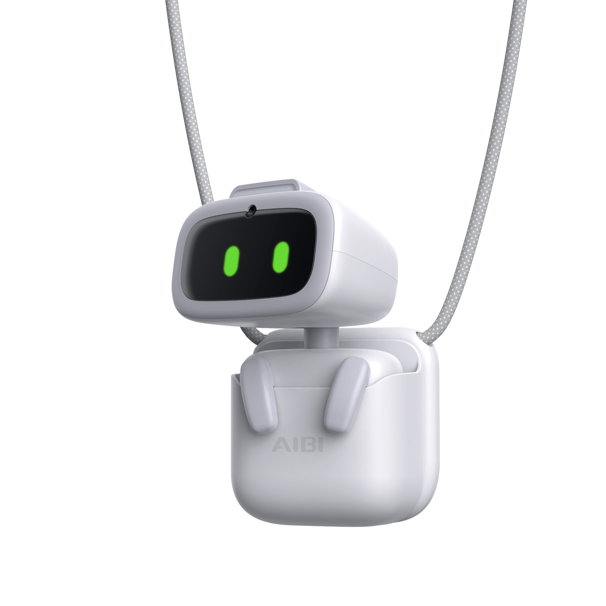
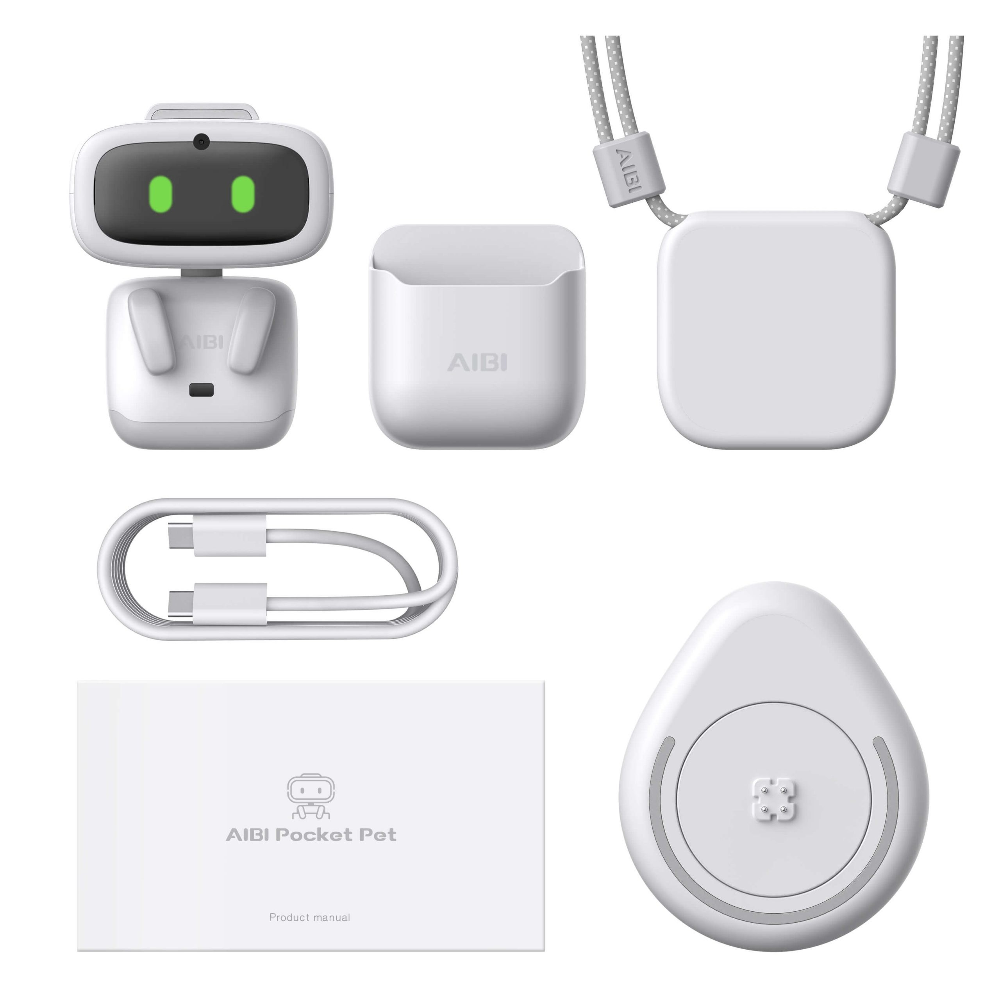
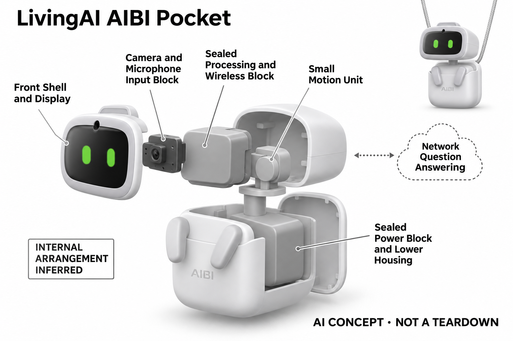

# LivingAI AIBI Pocket

**LivingAI** · 陪伴与宠物 · 核查 2026-11-04

可随身携带的微型表情机器人

消费渠道：个人零售。

## 产品图片与结构参考

### 产品图

LivingAI AIBI Pocket · 官方产品图 · 来源：[LivingAI · 官方图片](<https://living.ai/product/aibi-pocket/>) · [原始图片](<https://i0.wp.com/living.ai/wp-content/uploads/2023/12/2023121605.jpg?fit=2000%2C2000&quality=89&ssl=1>)

### 参考图

LivingAI AIBI Pocket · 官方参考图 · 来源：[LivingAI · 官方图片](<https://living.ai/product/aibi-pocket/>) · [原始图片](<https://i0.wp.com/living.ai/wp-content/uploads/2023/12/2024081201-scaled.jpg?fit=2560%2C2560&quality=89&ssl=1>)

### AI 生成爆炸示意

**AI 生成 · 非实物拆机。** 内部为概念推断，不能作为元件布局、BOM 或维修依据。[生成提示词](../../content/hardware/prompts/livingai-aibi-pocket.txt)

> 已目视核对外形、标签与非拆机声明；不代表内部结构经实测验证。

> 分析为基于公开资料的案头研究与 AI 辅助判断，未经用户访谈、销量审计或实物拆机。需求、画像、竞争冷门度、审美及商业机会均为研究假设，不是投资结论。

## 销售与购买

- 状态：在售。官方商品页提供Add to cart，并说明订单约两周内发货；以当前零售页为准，不沿用旧介绍页的Pre-order字样。

- 地区：所列官方国际商店

- 价格：官网 US$249。核查日页面快照；运费、税费、会员和配送区域按官方结算确认，不视为中国到手价。

- 中国大陆：本轮核实所列区域官方商店；未确认中国大陆官方现货、账户及完整服务，不把境外可购等同大陆可用。

- [官方产品 / 商店](<https://living.ai/product/aibi-pocket/>)

## AI 的实际作用

具有人脸识别、拍照和离线语音指令；复杂问题可联网调用ChatGPT。简单动画和动作不全部归为生成式AI。

服务与联网依赖：离线指令与在线问答能力不同；联网服务、账户与可用地区须核对，挂载和充电依赖配件。

## 是否冷门

新兴竞争（研究判断）：复杂问题使用联网问答形成具体使用场景；本轮没有销量与市场份额证据。

## 需求与市场

需求假设：喜欢随身角色的人可能希望在桌面、衣物和出行之间延续同一只电子宠物，而不追求移动机器人任务能力。应观察实际携带频率和主动互动次数，确认便携是否真的增加使用。

## 用户画像

画像推断：能够管理充电、配对和随身配件的成年玩具爱好者较匹配；面部朝向、环境噪声与穿戴位置会影响交互。送礼者不能仅凭小巧外形假定所有年龄和生活方式都适合。

## 竞争与替代

竞争判断：它同时面对桌面电子宠物、手机虚拟角色及普通潮玩，随身形态是主要差别。微型化并不消除内容更新和留存竞争，用户可能把它作为收藏品而不是每天交谈的工具。

## 供应链

供应链推断：小体积内的显示、音频、摄像和动作结构会争夺空间，并增加防跌落与充电可靠性的要求。官方本轮未披露完整工厂和物料表；磁吸配件遗失也会影响实际使用。

## 技术路径

官方区分离线指令、人脸识别与在线复杂问答。技术判断应分别测试嘈杂场景唤醒、人物识别和网络等待，不把屏幕表情丰富等同对情绪的可靠理解，也不推断所有算力都在设备内。

## 产品审美

审美判断：圆形头部、明亮眼睛和短小身体更接近可以携带的角色物件，配件会决定它在衣物上的存在感。佩戴重量、固定稳定性和环境中的声音，需要实际试戴才能判断接受度。

## 关键风险

风险判断：随身拍照、语音与网络问答涉及旁人和个人信息，外出还会遇到掉落、遮挡和噪声。复杂回答可能出错，提醒功能也不应被当成重要事务或健康管理的唯一保障。

## 机会与验证

市场观察：值得验证的是便携角色能否跨场景保持有意义的互动，而非把更小尺寸直接换算为更大需求。可记录四周的携带天数、充电中断和功能使用结构，区分收藏与持续陪伴。

## 功能分层示意

这是功能关系，不是实物拆机、真实空间结构或已核实 BOM。

1. **感知入口**：摄像与麦克风支持人物和语音输入。（官方披露）

2. **本地响应**：离线指令触发设备行为。（官方披露）

3. **联网问答**：复杂问题通过在线模型处理。（官方披露）

4. **角色反馈**：屏幕表情、声音与小型动作。（官方披露）

## 来源

1. [AIBI官方购买页](<https://living.ai/product/aibi-pocket/>) — 已实际打开官方页面；功能说明不等于独立性能测量。

2. [AIBI官方能力](<https://living.ai/aibi/>) — 已实际打开官方页面；功能说明不等于独立性能测量。

[返回目录](../hardware-market.md) · [网页分析](https://romanagent.github.io/Roman/#hardware/product/livingai-aibi-pocket)
