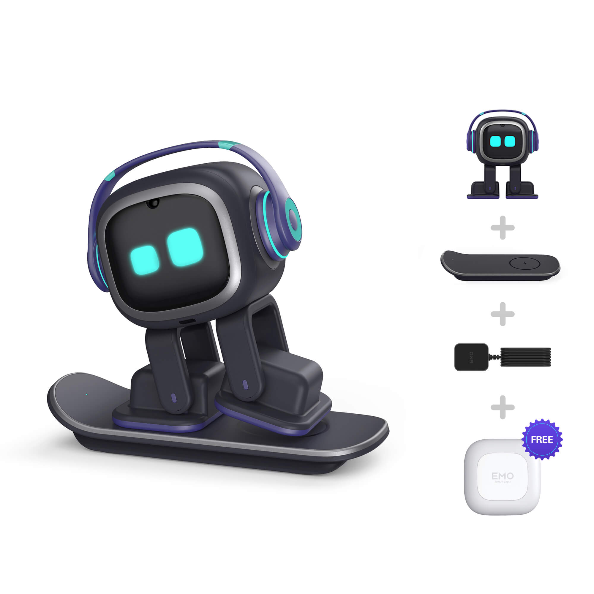
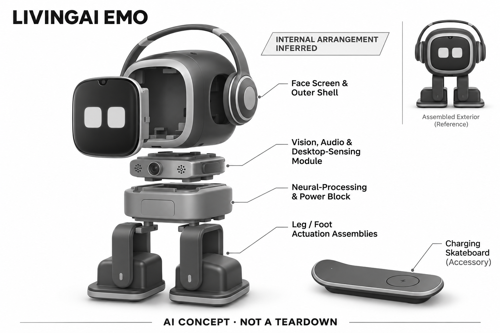

# EMO

**LivingAI** · 陪伴与宠物 · 核查 2026-11-04

以表情、动作和人物识别陪伴桌面时光

消费渠道：个人零售。

## 产品图片与结构参考

### 产品图

EMO 标准款官方正面产品图 · 来源：[LivingAI · 官方图片](<https://living.ai/product/emo/>) · [原始图片](<https://i0.wp.com/living.ai/wp-content/uploads/2020/12/product1-2.jpg?fit=2000%2C2000&quality=89&ssl=1>)

### 参考图

EMO 官方套装与配件参考图 · 来源：[LivingAI · 官方图片](<https://living.ai/product/emo/>) · [原始图片](<https://i0.wp.com/living.ai/wp-content/uploads/2025/04/2026010606.jpg?fit=2000%2C2000&quality=89&ssl=1>)

### AI 生成爆炸示意

**AI 生成 · 非实物拆机。** 内部为概念推断，不能作为元件布局、BOM 或维修依据。[生成提示词](../../content/hardware/prompts/livingai-emo.txt)

> 已目视核对产品外形与AI标识；verified不代表内部布局经实物拆机验证。

> 分析为基于公开资料的案头研究与 AI 辅助判断，未经用户访谈、销量审计或实物拆机。需求、画像、竞争冷门度、审美及商业机会均为研究假设，不是投资结论。

## 销售与购买

- 状态：在售。官方商品页显示US$279、Add to cart，并写明下单后约两周发货；这属于可订购商品，未把旧介绍页的预售措辞当作当前状态。

- 地区：国际官网（收货地区待结算）

- 价格：US$279。官网标准EMO套装标价；自动回充款EMO GO HOME是另一SKU，运税与收货地区以结算为准。

- 中国大陆：本次未核实中国大陆官方销售、中文能力和本地售后，不能从美元商店推断国行可用。

- [官方产品 / 商店](<https://living.ai/product/emo/>)

## AI 的实际作用

官方说明内置神经网络处理器与AI模型，支持人物识别、声音定位和桌面行为；本记录不将所有问答宣称为已核实的大模型能力。

服务与联网依赖：人物与桌面感知有机内处理说明；天气、联网问答和更新涉及网络服务，完整离线能力与云端分工需另核。

## 是否冷门

竞争密集（研究判断）：桌面宠物已有多个成熟角色与相近价位，细分场景仍可区分。

## 需求与市场

需求假设：长时间在电脑前工作的用户，可能想要一个偶尔回应的桌面角色，而不是再增加任务管理工具。应观察是否打断工作、多久主动互动，以及新鲜感过去后仍保留哪些动作。

## 用户画像

用户画像推断：机器人爱好者、桌搭玩家及希望低成本尝试电子宠物的人更可能理解其能力边界。桌面空间较小、噪声敏感或把它当成可靠工作助理的用户，需要单独验证适配。

## 竞争与替代

竞争判断：桌面机器人已面对Eilik、Loona等不同形态及手机宠物应用的竞争。中等价位不等于空白市场；角色性格、持续内容和购后体验比单次演示的动作数量更重要。

## 供应链

供应链推断：小型驱动、显示屏、感知模组和充电配件需共同控制成本及跌落风险；官方未披露具体工厂。标准款和自动回充款的配件差异，还会增加库存、说明书与售后复杂度。

## 技术路径

官方核心是人物识别、声音跟随及神经网络处理。推断关键在桌缘感知与动作可靠性、识别延迟和反馈节奏；网页仍列部分未来功能，不能把规划中的能力算作现有产品优势。

## 产品审美

审美判断：耳机、滑板和屏幕表情形成鲜明桌面角色，更接近潮流玩具而非家电。优点是易形成视觉记忆；限制是强风格未必适合安静办公和黑白极简空间，可研究更克制版本。

## 关键风险

风险判断：桌缘保护不应被理解为任何环境绝不会跌落；高低差、遮挡和杂物仍需实测。境外云服务、保修回寄与未兑现的开发中功能，也可能影响中国用户的长期体验。

## 机会与验证

机会假设：可围绕不打断工作的轻陪伴建立更窄的场景，例如明确休息提示和可解释的互动状态。先验证桌面安全与静音体验，再扩展问答和物联网控制，减少使用预期错位。

## 功能分层示意

这是功能关系，不是实物拆机、真实空间结构或已核实 BOM。

1. **输入感知**：声音、人物与多种内部传感数据进入系统。（官方披露）

2. **机内识别**：官方说明神经网络处理器及AI模型。（官方披露）

3. **角色行为**：动作、面部动画和声音响应组成互动。（官方披露）

4. **联网扩展**：天气与在线内容通过服务形成补充，具体分工示意。（分析推断）

## 来源

1. [LivingAI EMO商品页](<https://living.ai/product/emo/>) — 明确加购及约两周发货。

2. [LivingAI EMO能力介绍](<https://living.ai/emo/>) — 网页中的开发中功能不计入已交付能力。

[返回目录](../hardware-market.md) · [网页分析](https://romanagent.github.io/Roman/#hardware/product/livingai-emo)
