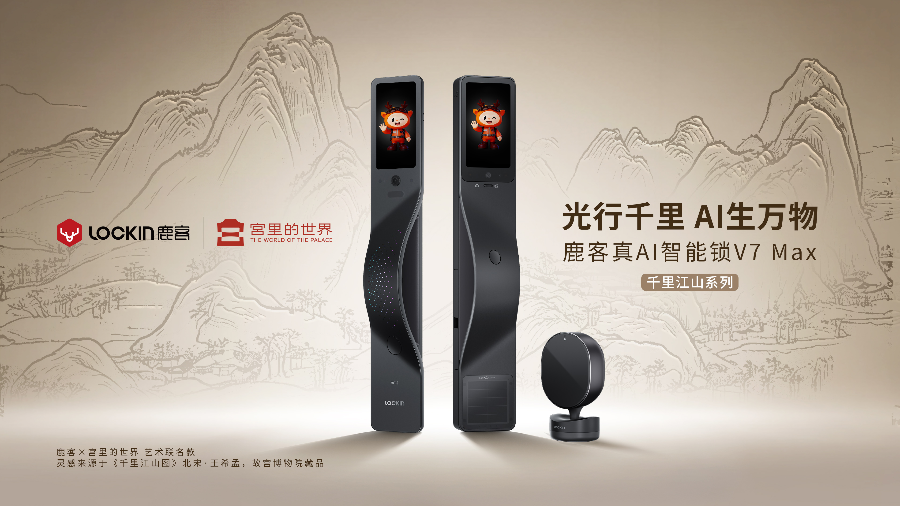
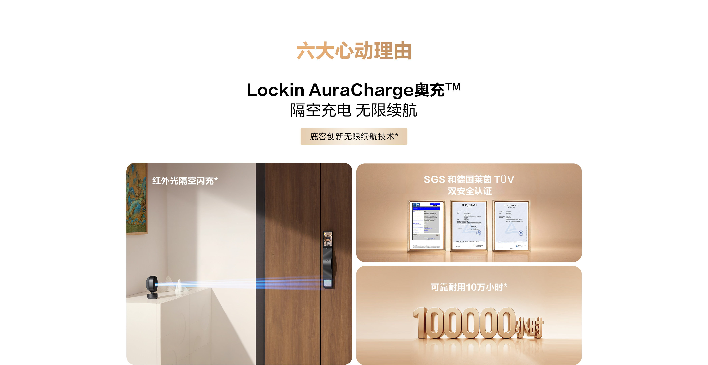
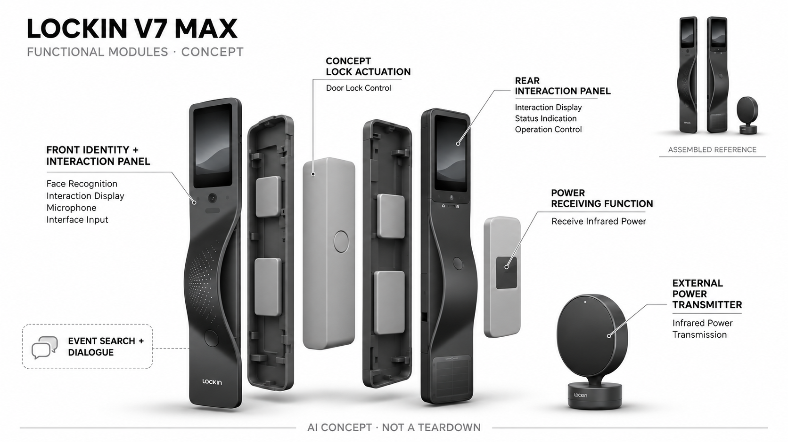

# 鹿客 Lockin V7 Max

**Lockin** · 家庭安防 · 核查 2026-11-04

以红外隔空供电支撑门前识别、对话与事件检索的家用智能锁

消费渠道：个人零售。

## 产品图片与结构参考

### 产品图

官方V7 Max整机与隔空供电器 · 来源：[Lockin · 官方图片](<https://www.lockin.com/detail/?slug=V7>) · [原始图片](<https://www-static.lockin.com/lockin-v3/2cde1a1ab98219d101b9eca352a1df55.jpg>)

### 参考图

官方隔空供电说明（含厂商营销与认证展示） · 来源：[Lockin · 官方图片](<https://www.lockin.com/detail/?slug=V7>) · [原始图片](<https://www-static.lockin.com/lockin-v3/43c540aff56cf4c5d22a485329801850.jpg>)

### AI 生成爆炸示意

**AI 生成 · 非实物拆机。** 内部为概念推断，不能作为元件布局、BOM 或维修依据。[生成提示词](../../content/hardware/prompts/lockin-v7-max.txt)

> 依据已核验官方外形与公开功能生成；未知内部仅为概念功能块，不代表原机电路板、芯片或实际布局。

> 实际查看并核对对应型号，官方原图未改色或语义编辑；营销文字不代表本研究独立验证。

> 分析为基于公开资料的案头研究与 AI 辅助判断，未经用户访谈、销量审计或实物拆机。需求、画像、竞争冷门度、审美及商业机会均为研究假设，不是投资结论。

## 销售与购买

- 状态：在售。2026-11-04实际浏览官网首页显示 V7 Max ¥4799 与购买按钮，点击指向京东商品100348216154；详情页明确 Max 配套隔空供电器。京东要求登录，未验证个人地址库存或提交订单。

- 地区：中国大陆

- 价格：官网标价 ¥4,799。为 V7 Max，非 ¥4,099 的 V7 Pro；首页与型号比较图一致，补贴、安装附加费及地区库存以官方购买渠道为准。

- 中国大陆：中国官网直接提供 V7 Max 的京东商品购买入口；具体门型、地区安装及结算库存需在官方渠道确认。

- [官方产品 / 商店](<https://www.lockin.com/detail/?slug=V7>)

## AI 的实际作用

官方 LockinAI 展示人脸与静脉识别、门前人物看护、自然语言检索回家画面及访客对话；隔空充电是供电机制，本身不是AI。

服务与联网依赖：依赖锁体传感器、控制与品牌软件服务；模型运行位置、离线对话边界及数据保留细节未完整披露，需逐项核实。

## 是否冷门

新兴竞争（研究判断）：家用智能锁成熟拥挤；红外隔空供电结合门前语义交互属于机制差异较大的子方向，尚不能因产品新颖直接判断市场空间。

## 需求与市场

需求假设是高频使用带屏门锁的家庭既希望少维护电池，又希望更快找到孩子到家或访客记录。V7 Max 把供电维护和门口交互合并，但是否值得整体换锁，应比较真实充电频率、检索成功率与原有门铃方案。

### 产品任务与边界 · 研究判断

需求假设是高频使用带屏门锁的家庭既希望少维护电池，又希望更快找到孩子到家或访客记录。V7 Max 把供电维护和门口交互合并，但是否值得整体换锁，应比较真实充电频率、检索成功率与原有门铃方案。

依据：[鹿客官网现售型号与购买入口](<https://www.lockin.com/>) · [鹿客 V7 系列官方详情](<https://www.lockin.com/detail/?slug=V7>)

### 需求判断 · 研究判断

整套入户设备需要同时完成可靠开闭与日常看护，只有当门前记录难查或充电维护频繁时，额外交互才可能有增量。隔空供电让长期开启的功能更可讨论，但其价值仍取决于安装位置和用户真实使用，而不由无限续航的宣传语自动成立。

依据：[鹿客官网现售型号与购买入口](<https://www.lockin.com/>) · [鹿客 V7 系列官方详情](<https://www.lockin.com/detail/?slug=V7>)

### 需求验证 · 待验证

需求验证可记录原有门锁的充电间隔、访客处理和查找回家画面的实际步骤，再用相同家庭任务比较。将门内供电器摆放、网络和隐私设置都纳入，避免只展示一次开锁或问答成功，就认定家庭需要长期保留整套升级。

依据：[鹿客官网现售型号与购买入口](<https://www.lockin.com/>) · [鹿客 V7 系列官方详情](<https://www.lockin.com/detail/?slug=V7>)

## 用户画像

用户画像推断为愿意更换整套锁体、接受专业安装且门内有供电器摆放空间的自住房家庭。老人儿童可以通过不同识别方式进入，但无障碍便利必须实测身高、伸手范围和误拒场景，不能由宣传示意直接推导。

### 适用行为与条件 · 研究判断

用户画像推断为愿意更换整套锁体、接受专业安装且门内有供电器摆放空间的自住房家庭。老人儿童可以通过不同识别方式进入，但无障碍便利必须实测身高、伸手范围和误拒场景，不能由宣传示意直接推导。

依据：[鹿客官网现售型号与购买入口](<https://www.lockin.com/>) · [鹿客 V7 系列官方详情](<https://www.lockin.com/detail/?slug=V7>)

### 人群取舍 · 研究判断

多种身份入口可能照顾不同家庭成员，但每人的使用习惯、身高与授权管理都不同。自住房能改门并不代表有适合隔空供电的稳定位置，画像需包括现场安装条件和家庭管理员角色，尤其不能把对老人儿童的宣传直接视为无障碍结论。

依据：[鹿客官网现售型号与购买入口](<https://www.lockin.com/>) · [鹿客 V7 系列官方详情](<https://www.lockin.com/detail/?slug=V7>)

### 画像验证 · 待验证

可让真实家庭成员完成回家、临时访客和断网时的常规操作，记录谁需要协助以及谁能管理记录。以实际门型和居住布局筛选匹配，而不是仅按收入划分用户；若用户只要稳定钥匙替代，额外屏幕与对话可能并无持续价值。

依据：[鹿客官网现售型号与购买入口](<https://www.lockin.com/>) · [鹿客 V7 系列官方详情](<https://www.lockin.com/detail/?slug=V7>)

## 竞争与替代

门锁市场整体拥挤，本型号的区别是隔空供电与双面交互共同支撑持续服务，而非新增一种颜色或更高摄像清晰度。竞争对象包括电池门锁加独立门铃，也包括有线门禁；整套升级是否更省心仍是待验证问题。

### 比较对象与差异 · 研究判断

门锁市场整体拥挤，本型号的区别是隔空供电与双面交互共同支撑持续服务，而非新增一种颜色或更高摄像清晰度。竞争对象包括电池门锁加独立门铃，也包括有线门禁；整套升级是否更省心仍是待验证问题。

依据：[鹿客官网现售型号与购买入口](<https://www.lockin.com/>) · [鹿客 V7 系列官方详情](<https://www.lockin.com/detail/?slug=V7>)

### 竞争判断 · 研究判断

供电机制与入户语义任务组合比多加一种生物识别更有区别，但仍需证明比锁加独立门铃更容易维护。全部功能集中到锁上会减少分散设备，也增加更换成本和服务依赖；竞争分析应比较整个入户系统，而非只看单项参数领先。

依据：[鹿客官网现售型号与购买入口](<https://www.lockin.com/>) · [鹿客 V7 系列官方详情](<https://www.lockin.com/detail/?slug=V7>)

### 竞争验证 · 待验证

竞争验证应在相同门型与网络下比较电池门锁、独立门铃组合和本机，分别记录访客处理及维护。不能借旧海外Veno页面库存证明当前型号，也不把V7 Pro的价格或配件方案当成Max；实际结算与本地安装仍以官方渠道为准。

依据：[鹿客官网现售型号与购买入口](<https://www.lockin.com/>) · [鹿客 V7 系列官方详情](<https://www.lockin.com/detail/?slug=V7>)

## 供应链

功能需求涉及光电供能、光学与生物识别、显示交互、机电锁体和上门安装服务。当前所读官网没有披露整机代工、关键芯片或成本，因此只能匹配具有对应能力的候选伙伴，不能把常见门锁供应商写为实际客户。

### 功能模块拆分 · 研究判断

功能层覆盖身份感知、门前音视频与屏幕交互、机电锁体、门内电源接收以及外置红外发射器。供电、权限和机械开闭必须彼此清楚隔离，公开图不能说明内部传动或控制电路，因此概念图使用功能块而不还原未披露芯片和齿轮。

依据：[鹿客官网现售型号与购买入口](<https://www.lockin.com/>) · [鹿客 V7 系列官方详情](<https://www.lockin.com/detail/?slug=V7>)

### 制造与供应约束 · 研究判断

功能需求涉及光电供能、光学与生物识别、显示交互、机电锁体和上门安装服务。当前所读官网没有披露整机代工、关键芯片或成本，因此只能匹配具有对应能力的候选伙伴，不能把常见门锁供应商写为实际客户。

依据：[鹿客官网现售型号与购买入口](<https://www.lockin.com/>) · [鹿客 V7 系列官方详情](<https://www.lockin.com/detail/?slug=V7>)

### 候选与证据缺口 · 研究判断

华勤可用于带屏联网终端的工程候选，歌尔可评估声学、光学及交互模组整合，两者均未获本型号采用证据。门锁机械安全、隔空供电与现场安装还需专业验证，通用终端能力不能推导为已有完整锁具方案或实际厂家关系。

依据：[鹿客官网现售型号与购买入口](<https://www.lockin.com/>) · [鹿客 V7 系列官方详情](<https://www.lockin.com/detail/?slug=V7>)

## 技术路径

官方图片明确红外光隔空充电和 LockinAI 的画面检索、访客回应及多模态身份入口。充电并不构成AI；智能部分应以识别和语义任务验证，并检查遮挡、断网、光线变化时回退策略，模型参数暂未公开。

### 已披露技术边界 · 研究判断

官方图片明确红外光隔空充电和 LockinAI 的画面检索、访客回应及多模态身份入口。充电并不构成AI；智能部分应以识别和语义任务验证，并检查遮挡、断网、光线变化时回退策略，模型参数暂未公开。

依据：[鹿客官网现售型号与购买入口](<https://www.lockin.com/>) · [鹿客 V7 系列官方详情](<https://www.lockin.com/detail/?slug=V7>)

### 系统难点判断 · 研究判断

语义检索和访客回应需要将识别、记录与对话串联，身份识别与锁体授权则应保持明确边界。公开材料没有完整描述离线模式、云端保存及模型更新，不能擅自宣称全部本地处理，更不应让自然语言误解直接等同可以授权开门。

依据：[鹿客官网现售型号与购买入口](<https://www.lockin.com/>) · [鹿客 V7 系列官方详情](<https://www.lockin.com/detail/?slug=V7>)

### 技术验证 · 待验证

技术验证应从已披露任务出发，检查指定人物记录能否正确检索、模糊指令是否要求澄清，以及断网后保留哪些功能。供电遮挡与恢复应按安全说明另测，不能以屏幕仍亮推断机械开闭、影像保存和对话服务都处于可靠状态。

依据：[鹿客官网现售型号与购买入口](<https://www.lockin.com/>) · [鹿客 V7 系列官方详情](<https://www.lockin.com/detail/?slug=V7>)

## 产品审美

外观采用修长深色曲面把手与门内外屏幕，降低传统门把与摄像头分离的视觉碎片。动态图形和艺术联名更偏家居展示，但大面积屏幕可能显得抢眼；是否符合简洁住宅审美应提供待机状态而非只展示营销动画。

### 外观与交互语言 · 研究判断

外观采用修长深色曲面把手与门内外屏幕，降低传统门把与摄像头分离的视觉碎片。动态图形和艺术联名更偏家居展示，但大面积屏幕可能显得抢眼；是否符合简洁住宅审美应提供待机状态而非只展示营销动画。

依据：[鹿客官网现售型号与购买入口](<https://www.lockin.com/>) · [鹿客 V7 系列官方详情](<https://www.lockin.com/detail/?slug=V7>)

### 使用中审美判断 · 研究判断

深色长面板将把手、屏幕与识别区域整合，减少分散装置的视觉碎片，却可能在小门面上显得突出。艺术联名和屏幕角色属于审美选择，是否高级简洁要看待机、夜间亮度及手印，不能只评价发布图里的精细表面和动画。

依据：[鹿客官网现售型号与购买入口](<https://www.lockin.com/>) · [鹿客 V7 系列官方详情](<https://www.lockin.com/detail/?slug=V7>)

### 设计验证 · 待验证

设计验证应同时看关屏和工作状态，检查家人是否知道该看屏幕、伸掌还是拉把手，并观察门内供电器与家具的关系。将摄像与采集状态清楚表达比隐藏设备更重要，不能用亲和角色淡化访客与家庭成员对影像记录的理解。

依据：[鹿客官网现售型号与购买入口](<https://www.lockin.com/>) · [鹿客 V7 系列官方详情](<https://www.lockin.com/detail/?slug=V7>)

## 关键风险

主要风险包括供电器摆放被遮挡、身份误拒、访客对话误解以及门前影像记录涉及他人。官网安全认证图片只是厂商证据展示，本次未逐项验真，也不能推出任何条件下无限续航或零风险；应保留机械应急流程。

### 主要失效与依赖 · 研究判断

主要风险包括供电器摆放被遮挡、身份误拒、访客对话误解以及门前影像记录涉及他人。官网安全认证图片只是厂商证据展示，本次未逐项验真，也不能推出任何条件下无限续航或零风险；应保留机械应急流程。

依据：[鹿客官网现售型号与购买入口](<https://www.lockin.com/>) · [鹿客 V7 系列官方详情](<https://www.lockin.com/detail/?slug=V7>)

### 风险传播判断 · 研究判断

供电持续依赖发射接收关系，移动家具或长期遮挡可能改变维护假设；错误识别、漏录或对话误解又会影响对系统的信任。官方认证展示只能作为进一步核查线索，不应推成所有安装下的安全保证，应保留清楚的应急开闭和人工处理。

依据：[鹿客官网现售型号与购买入口](<https://www.lockin.com/>) · [鹿客 V7 系列官方详情](<https://www.lockin.com/detail/?slug=V7>)

### 风险验证 · 待验证

风险验证要核对安装条件、权限撤回和记录删除，演练网络或供电暂时不可用时的提示与回退。不得自行实施危险绕锁测试，也不将检索结果作为儿童照护或家庭安全的唯一依据；对外观图里的认证与寿命宣传应保持厂商声称的边界。

依据：[鹿客官网现售型号与购买入口](<https://www.lockin.com/>) · [鹿客 V7 系列官方详情](<https://www.lockin.com/detail/?slug=V7>)

## 机会与验证

机会假设是把门锁维护、家人到家确认和访客记录检索压缩成少量可靠任务，而不追求更多屏幕聊天。试点可先测长期供电可用性、误报与人工接管次数，并与原有锁加门铃比较实际节省的操作和维护时间。

### 可能的机会入口 · 研究判断

机会假设是把门锁维护、家人到家确认和访客记录检索压缩成少量可靠任务，而不追求更多屏幕聊天。试点可先测长期供电可用性、误报与人工接管次数，并与原有锁加门铃比较实际节省的操作和维护时间。

依据：[鹿客官网现售型号与购买入口](<https://www.lockin.com/>) · [鹿客 V7 系列官方详情](<https://www.lockin.com/detail/?slug=V7>)

### 机会成立条件 · 研究判断

机会可能在少数可靠的入户工作流：确认家人到家、理解访客来意、减少充电维护，而非把门锁变成通用聊天屏。若现场供电设置复杂，产品就需要更好的安装服务；创业评估应先量化这些具体任务，不从屏幕数量推导新的需求大类。

依据：[鹿客官网现售型号与购买入口](<https://www.lockin.com/>) · [鹿客 V7 系列官方详情](<https://www.lockin.com/detail/?slug=V7>)

### 下一步验证 · 待验证

下一步可在真实家庭中记录长期供电中断、事件查询失败与人工介入，把服务安装和退换也计入体验。与原有系统比较实际减少了哪些步骤，再决定是否深化语义功能，不把新型号、联名外观或消费者对AI的好奇作为独立市场成立证据。

依据：[鹿客官网现售型号与购买入口](<https://www.lockin.com/>) · [鹿客 V7 系列官方详情](<https://www.lockin.com/detail/?slug=V7>)

## 对应供应链公司

能力候选用于选型研究，不代表本产品实际采用；未公开的供货关系不作推断。

- [huaqin](../supply-chain/huaqin.md) — **能力候选 · 非已采用** / 带屏门前终端与联网交互整合：华勤公开智能终端研发制造能力可对应显示、音视频和连接控制整合，但机械锁具、身份安全和隔空供电需专项验证；未发现V7 Max点名合作证据，不能称为实际ODM或已有完整锁具方案。

- [goertek](../supply-chain/goertek.md) — **能力候选 · 非已采用** / 声学光学输入与交互模组评估：歌尔公开声学光学和智能硬件能力可用于门前识别输入与语音交互工程，但光电供能、开锁安全和安装条件需另行负责；没有鹿客V7 Max实际供货披露，候选关系不等同认证、客户或量产确认。

[浏览供应链目录](../supply-chain.md)

## 功能分层示意

这是功能关系，不是实物拆机、真实空间结构或已核实 BOM。

1. **门外识别面板**：官方展示摄像、指脉、人脸及掌脉识别入口。（官方披露）

2. **门内交互面板**：屏幕与摄像相关界面提供家庭侧交互，具体布局以真实图为准。（官方披露）

3. **供电链路**：Max 的外置红外光发射器与门内接收区构成隔空充电功能。（官方披露）

4. **锁体执行机构**：把身份授权转换为机械开闭的功能层；未披露内部传动与零件布置。（分析推断）

5. **AI交互与记录服务**：公开展示事件检索、人物看护及访客回应，云端与本地分工未详述。（官方披露）

## 来源

1. [鹿客官网现售型号与购买入口](<https://www.lockin.com/>) — 浏览器实际打开首页，V7 Max 标价4799元；购买按钮打开京东指定商品，未登录或购买。

2. [鹿客 V7 系列官方详情](<https://www.lockin.com/detail/?slug=V7>) — 实际浏览并读取官方详情图片，区分 Max 的红外光供电和 Pro；LockinAI 展示事件检索及访客回应，具体效果未独立测试。

[返回目录](../hardware-market.md) · [网页分析](https://romanagent.github.io/Roman/#hardware/product/lockin-v7-max)
