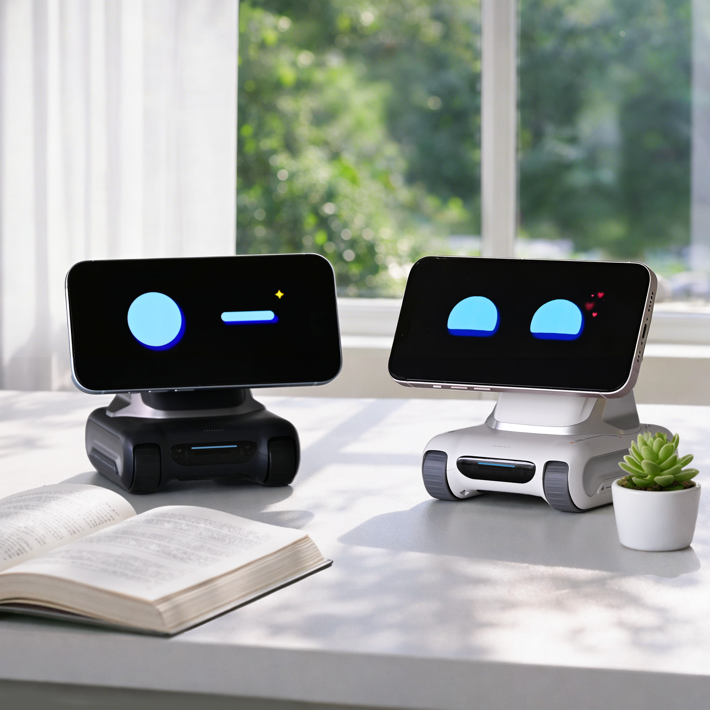
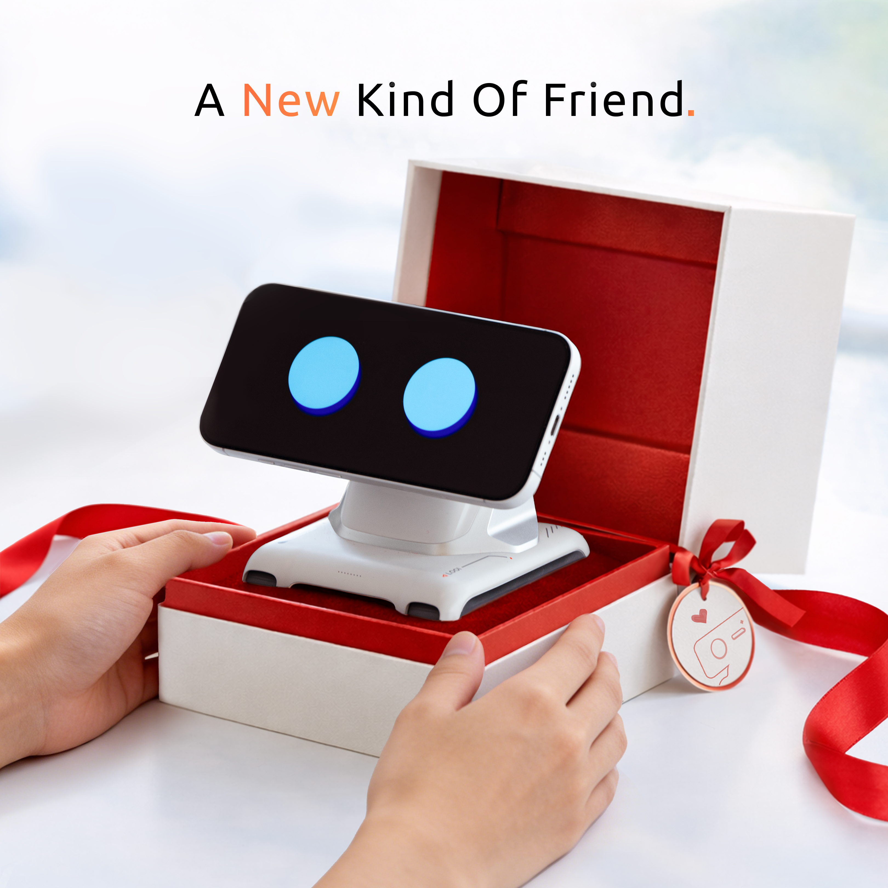
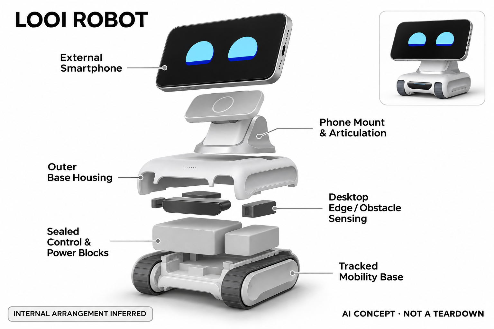

# LOOI Robot

**Tangobotics / LOOI** · 陪伴与宠物 · 核查 2026-11-04

让已有手机成为桌面机器人的表情与感知入口

消费渠道：个人零售。

## 产品图片与结构参考

### 产品图

LOOI Robot · 官方产品图 · 来源：[Tangobotics / LOOI · 官方图片](<https://looirobot.com/products/looi-robot>) · [原始图片](<https://cdn.shopify.com/s/files/1/0704/8809/6981/files/7faff43646b1579592b02588a48c8d22_2aa24c0a-7b34-4fea-a4b9-49902163dede.png?v=1793608038>)

### 参考图

LOOI Robot · 官方参考图 · 来源：[Tangobotics / LOOI · 官方图片](<https://looirobot.com/products/looi-robot>) · [原始图片](<https://cdn.shopify.com/s/files/1/0704/8809/6981/files/a924207a73fe87f543088b3c3f3d78ec.png?v=1773643379>)

### AI 生成爆炸示意

**AI 生成 · 非实物拆机。** 内部为概念推断，不能作为元件布局、BOM 或维修依据。[生成提示词](../../content/hardware/prompts/looi-robot.txt)

> 已目视核对外形、标签与非拆机声明；不代表内部结构经实测验证。

> 手机需自备；官方场景中两台机器人用于展示，不代表单机订单包含两台。

> 分析为基于公开资料的案头研究与 AI 辅助判断，未经用户访谈、销量审计或实物拆机。需求、画像、竞争冷门度、审美及商业机会均为研究假设，不是投资结论。

## 销售与购买

- 状态：在售。官方商品页有Add to cart；官方产品数据LOOI Solo各颜色available为true。只计单个机器人，Twins和组合套装不另计。

- 地区：美国及官网列出的配送市场

- 价格：官方单机 US$220。官网产品数据价格；需要用户自备兼容手机，运税和服务权益按当前地区结算确认。

- 中国大陆：本轮核实所列区域官方商店；未确认中国大陆官方现货、账户及完整服务，不把境外可购等同大陆可用。

- [官方产品 / 商店](<https://looirobot.com/products/looi-robot>)

## AI 的实际作用

利用手机与机器人底座进行视觉、多模态对话、记忆及桌面行为，官网介绍ChatGPT支持会话；不是只把手机当遥控器。

服务与联网依赖：必须自备兼容手机并运行LOOI应用；模型、账户、网络及对话权限受服务方案影响，不能当作完全独立机器人。

## 是否冷门

新兴竞争（研究判断）：手机与机器人底座结合较有差异，兼容与占用成本仍待真实使用验证。

## 需求与市场

需求假设：已有闲置或日常手机的用户可能愿意用较少独立屏幕硬件获得桌面陪伴。应验证手机被占用后是否妨碍原有用途，以及装卸、充电和启动应用的成本是否抵消了复用设备的便利。

### 产品任务与边界 · 研究判断

LOOI 让兼容手机成为屏幕及部分感知入口，底座提供实体动作，任务是用已有终端形成桌面角色。它可能减少重复购买屏幕和计算硬件，但真正需求取决于用户是否愿意把手机长期交给机器人，而不是复用概念本身。

依据：[LOOI官方零售页](<https://looirobot.com/products/looi-robot>) · [LOOI官方介绍](<https://looirobot.com/>)

### 需求判断 · 研究判断

闲置手机和日常主力手机对应完全不同的体验：前者可能延长旧设备用途，后者会与通讯和工作争夺屏幕。需求分析必须计算装卸、启动应用和充电的摩擦，不能只比较机器人底座价格与独立整机价格。

依据：[LOOI官方零售页](<https://looirobot.com/products/looi-robot>) · [LOOI官方介绍](<https://looirobot.com/>)

### 需求验证 · 待验证

可让用户分别用闲置与主力手机试用，记录每天主动安装、启动和取走的次数，观察角色互动是否因此中断。比较数周后仍保留的使用方式，判断复用硬件究竟降低门槛还是把成本转移为日常操作负担。

依据：[LOOI官方零售页](<https://looirobot.com/products/looi-robot>) · [LOOI官方介绍](<https://looirobot.com/>)

## 用户画像

画像推断：喜欢桌面机器人并愿意为其保留兼容手机的个人用户较匹配。不同手机尺寸、系统和电池状态可能影响体验；如果只有一部工作手机，陪伴角色与通讯任务可能频繁争夺屏幕。

### 适用行为与条件 · 研究判断

较匹配愿意保留一部兼容手机、喜欢桌面角色并能管理应用权限的人。仅有一部工作手机的用户可能频繁拆卸，旧手机用户则可能面临电池与系统限制，不能以手机普及率直接推算可服务人群。

依据：[LOOI官方零售页](<https://looirobot.com/products/looi-robot>) · [LOOI官方介绍](<https://looirobot.com/>)

### 人群取舍 · 研究判断

桌搭爱好者可能接受固定摆放和常驻应用，移动办公者更在意收纳与恢复速度。不同手机壳、尺寸和摄像方向还会改变装配与外观，画像需要包含设备条件和使用习惯，不能只用对人工智能有兴趣来概括。

依据：[LOOI官方零售页](<https://looirobot.com/products/looi-robot>) · [LOOI官方介绍](<https://looirobot.com/>)

### 画像验证 · 待验证

画像验证应记录用户实际手机型号、是否使用保护壳及日常离桌习惯，观察第一次设置后的持续启动率。再访谈未继续使用的原因，区分兼容问题、手机占用和角色内容不足，避免把所有流失都归因于聊天不够聪明。

依据：[LOOI官方零售页](<https://looirobot.com/products/looi-robot>) · [LOOI官方介绍](<https://looirobot.com/>)

## 竞争与替代

竞争判断：它与内置屏幕的桌面宠物、手机虚拟宠物和充电支架同时竞争。复用手机形成硬件成本结构差异，但兼容维护与用户占用感也更明显，不能仅由设备数量少推断价值更高。

### 比较对象与差异 · 研究判断

LOOI 同时面对独立桌面机器人、手机虚拟宠物和充电支架，其差异是让手机能力与实体动作结合。比较时应把手机机会成本纳入，不能仅凭少一块独立屏幕就断言方案更便宜或更环保，实际取决于用户已有设备。

依据：[LOOI官方零售页](<https://looirobot.com/products/looi-robot>) · [LOOI官方介绍](<https://looirobot.com/>)

### 竞争判断 · 研究判断

复用手机可获得成熟显示和感知能力，也引入系统更新、权限和机型适配负担。竞争优势可能来自低摩擦装卸及动作与手机角色的一致性，而不是单独接入聊天模型；兼容维护若不稳定，会削弱硬件复用的吸引力。

依据：[LOOI官方零售页](<https://looirobot.com/products/looi-robot>) · [LOOI官方介绍](<https://looirobot.com/>)

### 竞争验证 · 待验证

可让同一用户比较纯手机角色、LOOI 底座和独立机器人，记录主动互动及使用准备时间。还要观察手机被拿走后角色是否仍被认为连续存在，借此验证实体底座带来的价值，而不是只评价大屏幕表情是否好看。

依据：[LOOI官方零售页](<https://looirobot.com/products/looi-robot>) · [LOOI官方介绍](<https://looirobot.com/>)

## 供应链

供应链推断：底座运动、手机固定和充电接口需适应不同机型，软件适配是交付的重要部分。官方未披露完整工厂或物料表；手机系统升级、摄像方向和壳体厚度可能增加售后复杂度。

### 功能模块拆分 · 研究判断

功能层由手机的屏幕、摄像与语音入口，应用和联网会话及记忆，底座控制和实体运动构成。手机是系统的重要组成，不能把全部算力或感知写成底座内置，也不能根据外形推断固定结构与驱动的确切内部布局。

依据：[LOOI官方零售页](<https://looirobot.com/products/looi-robot>) · [LOOI官方介绍](<https://looirobot.com/>)

### 制造与供应约束 · 研究判断

制造约束是不同手机尺寸、壳体厚度和重心与底座运动之间的匹配，同时需要稳定的连接及充电使用流程。软件兼容维护与硬件装配同样重要，单一演示手机运行顺畅并不能证明所有支持机型都具有相同体验。

依据：[LOOI官方零售页](<https://looirobot.com/products/looi-robot>) · [LOOI官方介绍](<https://looirobot.com/>)

### 候选与证据缺口 · 研究判断

HLH 可支持手机固定和底座结构原型，SIIX 可作为控制板及电子装配候选。两者没有 LOOI 点名合作证据，手机系统兼容与应用体验也不由机械或电子制造能力自动覆盖，候选选型需明确硬件和软件责任。

依据：[LOOI官方零售页](<https://looirobot.com/products/looi-robot>) · [LOOI官方介绍](<https://looirobot.com/>)

## 技术路径

官方说明视觉、多模态回应、记忆和实体动作的结合。技术判断应区分手机侧感知、联网会话和底座实时控制，避免把全部算力写在机器人本体；桌缘检测仍需在真实表面条件下验证。

### 已披露技术边界 · 研究判断

官方说明视觉、多模态回应、记忆和实体动作的结合，兼容手机与 LOOI 应用是必要条件。技术评估应区分手机侧输入、联网生成和底座实时控制，不以应用能够安装推断所有功能、权限和机型长期可用。

依据：[LOOI官方零售页](<https://looirobot.com/products/looi-robot>) · [LOOI官方使用指南](<https://looirobot.com/pages/guide>)

### 系统难点判断 · 研究判断

系统难点在于手机和底座的状态同步，尤其在应用切换、来电或网络变化时保持可理解行为。桌缘感知与运动不能依赖长时间云端回答，角色需要清楚表达中断原因，否则手机日常功能会频繁破坏交互连续性。

依据：[LOOI官方零售页](<https://looirobot.com/products/looi-robot>) · [LOOI官方使用指南](<https://looirobot.com/pages/guide>)

### 技术验证 · 待验证

技术验证应覆盖支持机型、不同保护壳、系统升级和应用被中断后的恢复，分别记录感知、连接与动作问题。还应在真实桌面测试边缘和杂物，不能将标准机型演示或单一网络环境下的结果外推到全部用户设备。

依据：[LOOI官方零售页](<https://looirobot.com/products/looi-robot>) · [LOOI官方使用指南](<https://looirobot.com/pages/guide>)

## 产品审美

审美判断：手机屏幕变成大表情面部，底座姿态形成角色感，也让不同机型带来不同外观。屏幕黑边、手机壳和充电线会影响统一感；宣传渲染中的整洁不能代表用户实际桌面的样子。

### 外观与交互语言 · 研究判断

手机屏幕成为大表情面部，底座姿态让熟悉的终端获得角色感，同时也使外观随手机型号变化。屏幕黑边、保护壳和线材会进入整体视觉，产品审美需要容纳这些差异，而不是只依赖官方最整洁的组合。

依据：[LOOI官方零售页](<https://looirobot.com/products/looi-robot>) · [LOOI官方介绍](<https://looirobot.com/>)

### 使用中审美判断 · 研究判断

装卸动作会决定用户把它看作完整角色还是带表情的支架。若固定过程繁琐或手机明显倾斜，角色感容易被机械操作打断；反过来，清楚而自然的姿态可以让现有手机融入桌面，不必依赖复杂外壳装饰。

依据：[LOOI官方零售页](<https://looirobot.com/products/looi-robot>) · [LOOI官方介绍](<https://looirobot.com/>)

### 设计验证 · 待验证

设计验证应使用不同大小和外观的真实手机，观察插入、取走、来电和充电时的整体感受。记录用户是否愿意去掉保护壳或整理线材，避免把为了拍摄而完成的外观准备工作当作日常使用者自然愿意承担的成本。

依据：[LOOI官方零售页](<https://looirobot.com/products/looi-robot>) · [LOOI官方介绍](<https://looirobot.com/>)

## 关键风险

风险判断：手机权限、摄像头、会话记忆和账户服务需要清晰管理，桌面杂物与边缘仍有物理限制。兼容手机清单和订阅权益应逐项确认，不能把可安装应用等同所有功能长期可用。

### 主要失效与依赖 · 研究判断

风险包括手机权限、摄像和会话记忆管理、系统兼容变化，以及桌面运动的物理限制。用户自带设备不代表责任全部转移给手机厂商，LOOI 的应用和动作仍需明确边界，尤其不能把兼容列表视为永久服务承诺。

依据：[LOOI官方零售页](<https://looirobot.com/products/looi-robot>) · [LOOI官方介绍](<https://looirobot.com/>)

### 风险传播判断 · 研究判断

若主力手机被占用或应用升级后行为改变，用户可能快速停止使用底座。硬件本身仍能运动也未必保留角色体验，因此生命周期风险来自手机、应用和云服务三方变化，需要清晰的恢复和兼容沟通机制。

依据：[LOOI官方零售页](<https://looirobot.com/products/looi-robot>) · [LOOI官方介绍](<https://looirobot.com/>)

### 风险验证 · 待验证

风险验证应演练权限被拒绝、来电、应用退出、弱网及手机电池状态变化，观察底座是否可控且状态明确。还应检查用户能否理解订阅和数据处理条件，不以复用手机或安装成功作为隐私和长期可用性的保障。

依据：[LOOI官方零售页](<https://looirobot.com/products/looi-robot>) · [LOOI官方介绍](<https://looirobot.com/>)

## 机会与验证

市场观察：该产品代表“复用用户已有计算终端”的陪伴路径，区别于整机复制手机能力。可记录手机占用时间、每日主动启动和固定失败情况，确认这种成本取舍是否适合具体使用者。

### 可能的机会入口 · 研究判断

机会在于让已有终端获得实体交互，同时把装卸、权限和恢复设计得足够简单。新项目可先选择固定桌面场景和少量支持机型，验证用户确实愿意提供手机，再决定是否扩大兼容范围与生成式功能。

依据：[LOOI官方零售页](<https://looirobot.com/products/looi-robot>) · [LOOI官方介绍](<https://looirobot.com/>)

### 机会成立条件 · 研究判断

机会成立需要实体动作带来的增量价值超过手机占用和维护负担。如果用户必须额外购买手机才能获得理想体验，成本优势应重新计算；如果主要使用闲置手机，则需要把旧电池和系统生命周期纳入产品支持。

依据：[LOOI官方零售页](<https://looirobot.com/products/looi-robot>) · [LOOI官方介绍](<https://looirobot.com/>)

### 下一步验证 · 待验证

下一步可测试几种固定与启动流程，记录每日主动安装率、被通讯打断的次数和四周留存。先解决复用路径的摩擦，再扩展角色内容与动作，避免把更多对话功能当成弥补装卸和兼容问题的手段。

依据：[LOOI官方零售页](<https://looirobot.com/products/looi-robot>) · [LOOI官方介绍](<https://looirobot.com/>)

## 对应供应链公司

能力候选用于选型研究，不代表本产品实际采用；未公开的供货关系不作推断。

- [hlh-prototypes](../supply-chain/hlh-prototypes.md) — **能力候选 · 非已采用** / 手机固定与运动底座结构原型：HLH 的机加工、打印及低批量结构服务可用于比较手机尺寸、重心和固定接口，但必须按真实手机组合验证运动稳定；未发现其参与 LOOI 的公开证据，因此仅是结构开发候选。

- [siix](../supply-chain/siix.md) — **能力候选 · 非已采用** / 底座控制板与功能测试导入：SIIX 公开电子制造能力可支持底座控制和供电板的装配及测试，但手机应用、系统兼容和联网会话需另外负责；不能从控制板能力推断其为 LOOI 供货，当前关系只标记候选。

[浏览供应链目录](../supply-chain.md)

## 功能分层示意

这是功能关系，不是实物拆机、真实空间结构或已核实 BOM。

1. **手机输入**：兼容手机提供屏幕及视觉语音入口。（官方披露）

2. **智能会话**：应用与联网模型支持对话和记忆。（官方披露）

3. **行为控制**：感知与角色状态影响动作选择。（官方披露）

4. **实体输出**：底座运动与手机表情共同回应。（官方披露）

## 来源

1. [LOOI官方零售页](<https://looirobot.com/products/looi-robot>) — 已打开；单机available为true，不计重复套装。

2. [LOOI官方介绍](<https://looirobot.com/>) — 已打开，说明复用手机与ChatGPT对话定位。

3. [LOOI官方使用指南](<https://looirobot.com/pages/guide>) — 已打开，供核对手机与应用使用要求。

[返回目录](../hardware-market.md) · [网页分析](https://romanagent.github.io/Roman/#hardware/product/looi-robot)
