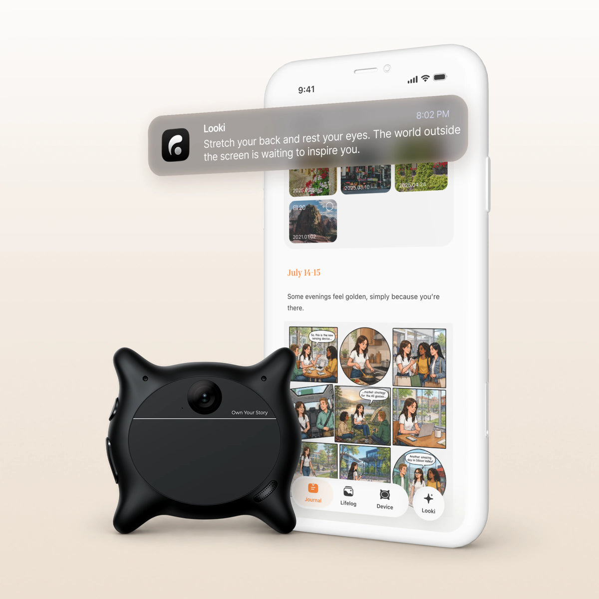
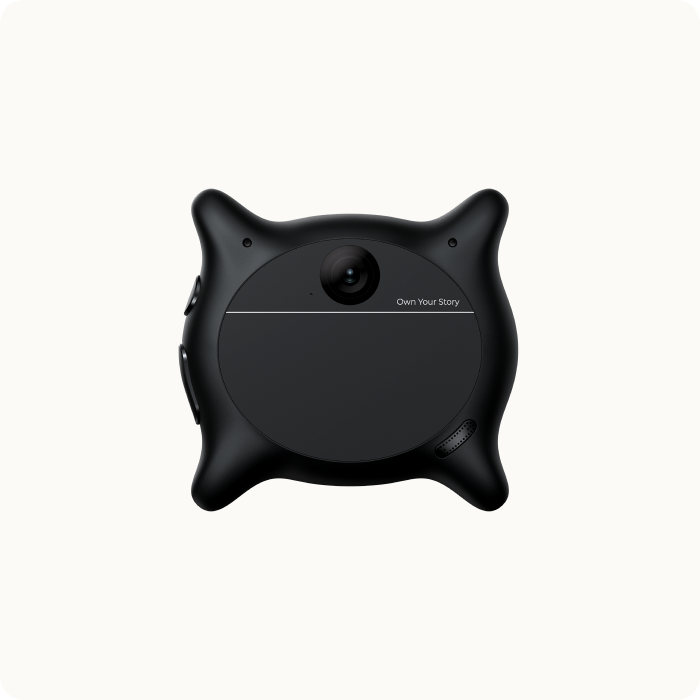
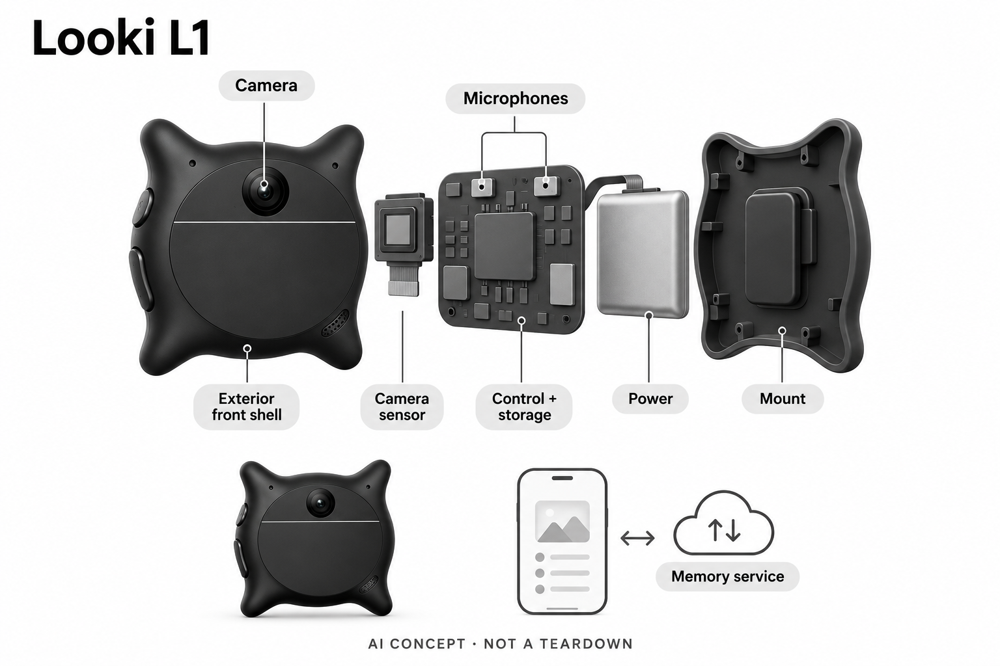

# Looki L1

**Looki** · 录音与记忆 · 核查 2026-11-04

带视觉情境的生活回查与自动叙事

消费渠道：个人零售。

## 产品图片与结构参考

### 产品图

Looki L1官方设备与应用情境图，界面内容为示意 · 来源：[Looki · 官方产品图片](<https://www.looki.ai/products/looki-l1>) · [原始图片](<https://cdn.shopify.com/s/files/1/0690/3808/0182/files/black-1-1.webp?v=1789968633&width=1200>)

### 参考图

Looki L1官方独立黑色设备外观参考 · 来源：[Looki · 官方产品图片](<https://www.looki.ai/products/looki-l1>) · [原始图片](<https://cdn.shopify.com/s/files/1/0690/3808/0182/files/black_01.png?v=1780413192&width=1200>)

### AI 生成爆炸示意

**AI 生成 · 非实物拆机。** 内部为概念推断，不能作为元件布局、BOM 或维修依据。[生成提示词](../../content/hardware/prompts/looki-l1.txt)

> 已视觉检查外形、灰阶、文字及无虚构参数；内部模块形状、板卡和布置仅为概念，不代表完整BOM。

> 源图逐张实际查看，按当前具体型号核对；未改色或裁切，宣传界面与效果文案不作为实测。

> 官网URL以.webp结尾但实际返回JPEG；已按图片签名保存为product.jpg，原始sourceImageUrl保持可追溯。

> 分析为基于公开资料的案头研究与 AI 辅助判断，未经用户访谈、销量审计或实物拆机。需求、画像、竞争冷门度、审美及商业机会均为研究假设，不是投资结论。

## 销售与购买

- 状态：在售。官方具体L1页面显示US$249与Add to cart，公开商品数据黑/白/绿均available=true；颜色和粉丝套装不重复计数。

- 地区：美国、英国、官网列出的欧洲及亚洲部分地区；具体地址以结算为准

- 价格：US$249（所见基础L1）。当前标准AI服务不强制月费；FAQ保留未来更高用量、储存或高级功能可选计划，不能承诺永久无限免费。

- 中国大陆：国际官网可见中国香港、澳门及台湾等地区选择，未见中国大陆选项；未核实大陆正式渠道，不把其他地区可买等同大陆直售。

- [官方产品 / 商店](<https://www.looki.ai/products/looki-l1>)

## AI 的实际作用

相机、麦克风和惯性输入支持场景分类与间隔采集，应用/云AI组织片段、搜索回忆、摘要及生成漫画和vlog。

服务与联网依赖：本地采集缓冲不等于全程本地AI；官方隐私页明确云端处理及存储，当前标准服务范围和未来可选收费需分别看。

## 是否冷门

新兴竞争（研究判断）：视觉输入明显不同于只收声音的挂件，但仍属于既有生活记忆任务；不以外形或颜色制造新需求。

## 需求与市场

需求假设是用户希望在忙于当下活动时保留一些可回看的情境，不必每次拿出手机拍照。视觉可能补充声音无法说明的物品、位置和活动线索，也会带来取景、遮挡和旁人隐私问题；价值应看后来是否真能找到需要的信息，而不只看自动生成的日记是否好看。

### 官方｜视觉与声音共同成为记忆输入 · 官方资料

Looki L1以相机、麦克风和惯性输入采集生活片段，再提供组织、回查、摘要及创意生成。它与单纯录音挂件的输入不同，但仍服务于生活记录和事后回忆，不能因增加相机就虚构全新需求；自动模式采用间隔短片，也不是完整、无遗漏地记录所有经历。

依据：[Looki L1官方当前商品与FAQ](<https://www.looki.ai/products/looki-l1>) · [Looki官方AI功能分层说明](<https://support.looki.ai/hc/en-001/articles/49659477121305-Looki-AI>)

### 判断｜找回没有主动拍摄的细节 · 研究判断

需求假设是用户希望在忙于当下活动时保留一些可回看的情境，不必每次拿出手机拍照。视觉可能补充声音无法说明的物品、位置和活动线索，也会带来取景、遮挡和旁人隐私问题；价值应看后来是否真能找到需要的信息，而不只看自动生成的日记是否好看。

依据：[Looki L1官方当前商品与FAQ](<https://www.looki.ai/products/looki-l1>) · [Looki Auto Mode官方说明](<https://support.looki.ai/hc/en-001/articles/49659302782233-Auto-Mode>)

### 验证｜用真实回查问题评估 · 待验证

可以先列出本人日常会回忆的问题，再检查片段是否捕获对应时间、搜索能否找到原始内容以及摘要是否漏掉条件。把没拍到、拍不清和AI解释错误分开记录，避免把检索没有结果当作事情没有发生；本研究没有长期佩戴或用户访谈，不能预判记忆帮助。

依据：[Looki L1官方当前商品与FAQ](<https://www.looki.ai/products/looki-l1>) · [Looki官方AI功能分层说明](<https://support.looki.ai/hc/en-001/articles/49659477121305-Looki-AI>) · [Looki Auto Mode官方说明](<https://support.looki.ai/hc/en-001/articles/49659302782233-Auto-Mode>)

## 用户画像

更可能适配的是愿意决定何时启用、何时暂停，并愿意检查和删除内容的人。持续记录不只是自己的选择，还会影响周围参与者，用户需要能够解释设备状态和尊重不愿被拍摄的环境；这种能力与喜欢科技或拍视频不同，不能按职业和年龄直接推定。

### 官方｜佩戴、应用与服务共同使用 · 官方资料

官方提供挂绳及兼容夹持方式，要求镜头朝外且不被遮挡，应用承担设置、查看和管理内容。拍摄入口在身体上并不自动解决取景和社交场合的使用条件；当前标准服务不强制月费，但手机、账号和同步流程仍是完整体验的一部分，不能仅按买下一件相机理解。

依据：[Looki L1官方当前商品与FAQ](<https://www.looki.ai/products/looki-l1>) · [Looki Auto Mode官方说明](<https://support.looki.ai/hc/en-001/articles/49659302782233-Auto-Mode>)

### 判断｜愿意管理记录边界的使用者 · 研究判断

更可能适配的是愿意决定何时启用、何时暂停，并愿意检查和删除内容的人。持续记录不只是自己的选择，还会影响周围参与者，用户需要能够解释设备状态和尊重不愿被拍摄的环境；这种能力与喜欢科技或拍视频不同，不能按职业和年龄直接推定。

依据：[Looki Auto Mode官方说明](<https://support.looki.ai/hc/en-001/articles/49659302782233-Auto-Mode>) · [Looki官方隐私与云处理说明](<https://www.looki.ai/pages/privacy>)

### 验证｜观察启停与内容整理习惯 · 待验证

试用应记录本人能否清楚辨认采集状态、停止记录、选择同步和找到删除入口，再查看这些操作是否影响日常活动。把设备放在不同合适位置检查视角，但不在不适合记录的场景验证边界；如果日后没有时间整理，更多自动内容可能成为新负担而非帮助。

依据：[Looki L1官方当前商品与FAQ](<https://www.looki.ai/products/looki-l1>) · [Looki官方隐私与云处理说明](<https://www.looki.ai/pages/privacy>)

## 竞争与替代

手机和运动相机能主动留下影像，但通常需要更多拍摄选择；音频挂件较少涉及视觉，却可能缺少回忆中的物品和场景线索。Looki把采集与自动整理结合，代价是更多私人内容、传输和误解可能；比较应围绕回查任务，不把生成漫画的趣味等同记忆准确。

### 官方｜标准服务与未来计划分开 · 官方资料

所见商品页价格为二百四十九美元，FAQ说明当前标准AI服务不强制订阅，同时保留未来更高用量、储存或高级功能可选计划。目录不把这一承诺写成永久无限免费，颜色与粉丝组合也不增加设备数量；配件、税运和具体地区服务仍需按实际购买配置确认。

依据：[Looki L1官方当前商品与FAQ](<https://www.looki.ai/products/looki-l1>)

### 判断｜与手机、运动相机和音频挂件比较 · 研究判断

手机和运动相机能主动留下影像，但通常需要更多拍摄选择；音频挂件较少涉及视觉，却可能缺少回忆中的物品和场景线索。Looki把采集与自动整理结合，代价是更多私人内容、传输和误解可能；比较应围绕回查任务，不把生成漫画的趣味等同记忆准确。

依据：[Looki L1官方当前商品与FAQ](<https://www.looki.ai/products/looki-l1>) · [Looki官方AI功能分层说明](<https://support.looki.ai/hc/en-001/articles/49659477121305-Looki-AI>)

### 验证｜分别评价记录和创作 · 待验证

可以把找回原始事实、形成摘要和生成漫画三项任务独立评分，再统计本人实际保留或分享了什么。成本包括设备、配件、整理时间及未来服务条件，不能只看无月费口号；没有销量、用户留存或独立效果资料，目录不据社交媒体展示推断稳定市场需求。

依据：[Looki L1官方当前商品与FAQ](<https://www.looki.ai/products/looki-l1>) · [Looki官方AI功能分层说明](<https://support.looki.ai/hc/en-001/articles/49659477121305-Looki-AI>)

## 供应链

同类穿戴视觉设备需要在记录长度、处理、传输和电量之间取舍，镜头朝向与衣物遮挡又会影响输入质量。间隔策略可以减少数据，但也会遗漏短暂事件，因此不能只追求更长续航数字；供应链评估应将结构佩戴、相机与软件采集节奏放在一起验证。

### 官方｜输入类别公开而核心器件未点名 · 官方资料

官方披露单相机、麦克风阵列、惯性输入、本地储存与无线连接类别，外部可见镜头、按键及声音出口。具体主控、图像传感器、麦克风厂商和装配工厂未公开，不能由外形或常见穿戴平台反推；概念图只表示功能层，不是完整电路、器件数量清单或拆机。

依据：[Looki L1官方当前商品与FAQ](<https://www.looki.ai/products/looki-l1>) · [Looki官方AI功能分层说明](<https://support.looki.ai/hc/en-001/articles/49659477121305-Looki-AI>)

### 判断｜视角与功耗限制采集策略 · 研究判断

同类穿戴视觉设备需要在记录长度、处理、传输和电量之间取舍，镜头朝向与衣物遮挡又会影响输入质量。间隔策略可以减少数据，但也会遗漏短暂事件，因此不能只追求更长续航数字；供应链评估应将结构佩戴、相机与软件采集节奏放在一起验证。

依据：[Looki L1官方当前商品与FAQ](<https://www.looki.ai/products/looki-l1>) · [Looki Auto Mode官方说明](<https://support.looki.ai/hc/en-001/articles/49659302782233-Auto-Mode>)

### 验证｜候选仅覆盖输入和控制功能 · 待验证

穿戴视觉主控可研究相机与音频采集，麦克风平台可研究声音前端，但它们不提供Looki的个人记忆服务和云端生成模型。需要分别确认画质、低光、声音、热量和同步，且不凭型号常见程度标为已采用；整机工厂与服务持续性还需独立资料支持。

依据：[Looki L1官方当前商品与FAQ](<https://www.looki.ai/products/looki-l1>) · [Looki官方AI功能分层说明](<https://support.looki.ai/hc/en-001/articles/49659477121305-Looki-AI>)

## 技术路径

漫画、摘要和自动剪辑会选择、重排或重新呈现记录，流畅故事未必保留所有上下文。用于娱乐分享时这种变化可能可接受，用于确认责任、时间或事件细节时就需要回到原片；技术评价应让用户能够区分记录、推断和创意加工，而不把所有输出统称为真实记忆。

### 官方｜端侧感知与云AI同时存在 · 官方资料

Auto Mode说明设备端感知参与间隔采集和场景识别，隐私页则明确云AI处理与云存储，应用进一步组织和生成内容。目录因此不把本地优先储存解释为所有AI都离线，也不将一段生成漫画当成相机原片；模型内部和每项任务的执行分配仍未完整公开。

依据：[Looki官方AI功能分层说明](<https://support.looki.ai/hc/en-001/articles/49659477121305-Looki-AI>) · [Looki Auto Mode官方说明](<https://support.looki.ai/hc/en-001/articles/49659302782233-Auto-Mode>) · [Looki官方隐私与云处理说明](<https://www.looki.ai/pages/privacy>)

### 判断｜生成故事会改变原始内容表达 · 研究判断

漫画、摘要和自动剪辑会选择、重排或重新呈现记录，流畅故事未必保留所有上下文。用于娱乐分享时这种变化可能可接受，用于确认责任、时间或事件细节时就需要回到原片；技术评价应让用户能够区分记录、推断和创意加工，而不把所有输出统称为真实记忆。

依据：[Looki官方AI功能分层说明](<https://support.looki.ai/hc/en-001/articles/49659477121305-Looki-AI>)

### 验证｜检查片段与解释的对应 · 待验证

可对相同时间段比较原始片段、搜索结果和生成摘要，记录是否遗漏短暂动作、误认物品或补出未记录信息。提醒功能也应与实际场景分开核对，不将姿态或情绪相关提示当客观健康结论；本目录没有模型性能实测，只描述可以复核的功能链路和失败类型。

依据：[Looki官方AI功能分层说明](<https://support.looki.ai/hc/en-001/articles/49659477121305-Looki-AI>) · [Looki Auto Mode官方说明](<https://support.looki.ai/hc/en-001/articles/49659302782233-Auto-Mode>)

## 产品审美

像随身饰物的外观可能降低用户佩戴顾虑，却也可能让旁人未意识到它具有相机和录音功能。审美评价应包含提示是否清楚、是否便于暂停，以及用户如何说明用途；不能仅以可爱、低调或轻便作为成功设计依据，记录边界需要在真实社交环境中被理解。

### 官方｜可见镜头与采集提示 · 官方资料

官方图显示圆角四角外形、中心面板上的镜头和侧边操作，隐私说明要求采集时保持视觉与声音提示。设备没有用于展示完整内容的屏幕，查看依赖应用；照片可确认外观，却不能证明他人总能理解提示，也不能由轻小形态推断所有佩戴方式都稳定舒适。

依据：[Looki L1官方当前商品与FAQ](<https://www.looki.ai/products/looki-l1>) · [Looki官方隐私与云处理说明](<https://www.looki.ai/pages/privacy>)

### 判断｜友好造型不消除拍摄含义 · 研究判断

像随身饰物的外观可能降低用户佩戴顾虑，却也可能让旁人未意识到它具有相机和录音功能。审美评价应包含提示是否清楚、是否便于暂停，以及用户如何说明用途；不能仅以可爱、低调或轻便作为成功设计依据，记录边界需要在真实社交环境中被理解。

依据：[Looki L1官方当前商品与FAQ](<https://www.looki.ai/products/looki-l1>) · [Looki官方隐私与云处理说明](<https://www.looki.ai/pages/privacy>)

### 验证｜观察佩戴稳定与状态识别 · 待验证

可以在衣领、挂绳等官方支持方式下记录镜头朝向、运动晃动与遮挡，再询问本人是否能轻松找到启停控制。取下收纳、充电和回看内容也要纳入流程，不只评价一张佩戴照片；本轮没有独立手感、耐久或长时使用观察，因此保留这些未知。

依据：[Looki L1官方当前商品与FAQ](<https://www.looki.ai/products/looki-l1>) · [Looki Auto Mode官方说明](<https://support.looki.ai/hc/en-001/articles/49659302782233-Auto-Mode>)

## 关键风险

用户自己的经历往往包含旁人、工作信息和私人空间，自动记录可能扩大内容范围，敏感过滤也不应被当成绝对保证。AI从视频推断活动或情绪尤其需要谨慎，不能等同内心事实或医学判断；在重要回忆中，缺片段和生成补充都可能影响理解，应保留原始资料与不确定性。

### 官方｜上传后本地清除不等于云端删除 · 官方资料

官方隐私页说明数据在云端托管和处理，并描述上传后设备内容会清除的机制。这个安排不能被解释成云端同样删除，或所有个人记录始终只留本地；厂家关于加密、过滤与训练用途的说明也不构成本研究独立安全审计，实际控制应按当前服务政策核对。

依据：[Looki官方隐私与云处理说明](<https://www.looki.ai/pages/privacy>)

### 判断｜第三方记录与错误解释并存 · 研究判断

用户自己的经历往往包含旁人、工作信息和私人空间，自动记录可能扩大内容范围，敏感过滤也不应被当成绝对保证。AI从视频推断活动或情绪尤其需要谨慎，不能等同内心事实或医学判断；在重要回忆中，缺片段和生成补充都可能影响理解，应保留原始资料与不确定性。

依据：[Looki官方AI功能分层说明](<https://support.looki.ai/hc/en-001/articles/49659477121305-Looki-AI>) · [Looki官方隐私与云处理说明](<https://www.looki.ai/pages/privacy>)

### 验证｜检查删除、分享和停止服务 · 待验证

试用可核对不同层级的删除与同步控制，确认哪些内容在设备、应用或云端，分享前是否能重新检查。还应了解停止使用和未来服务调整时如何处理记录，不把当前无月费当作永久储存承诺；这些验证关注信息管理，不对厂商隐私效果作未经证实的保证。

依据：[Looki L1官方当前商品与FAQ](<https://www.looki.ai/products/looki-l1>) · [Looki官方隐私与云处理说明](<https://www.looki.ai/pages/privacy>)

## 机会与验证

值得研究的是用户是否能较容易找到后来真正需要的内容，而不是得到越来越多无人回看的自动日记。片段选择与检索如果减少整理时间，可能形成具体价值；若生成故事掩盖事实或提醒过多，则需要调整使用方式。这个判断不预设全日记录比主动拍摄更好。

### 官方｜视觉扩展仍属于生活回查 · 官方资料

Looki增加了视觉情境和自动叙事，使它与只收声音的记忆挂件有明显实现差异，但核心仍是持续生活记录与事后回查。目录沿用已有需求分组，不为相机、漫画和摘要分别增加一个硬件需求；真正比较的是输入能够补充什么，以及相应的隐私和维护代价。

依据：[Looki L1官方当前商品与FAQ](<https://www.looki.ai/products/looki-l1>) · [Looki官方AI功能分层说明](<https://support.looki.ai/hc/en-001/articles/49659477121305-Looki-AI>)

### 判断｜少量可找回的片段可能更有用 · 研究判断

值得研究的是用户是否能较容易找到后来真正需要的内容，而不是得到越来越多无人回看的自动日记。片段选择与检索如果减少整理时间，可能形成具体价值；若生成故事掩盖事实或提醒过多，则需要调整使用方式。这个判断不预设全日记录比主动拍摄更好。

依据：[Looki官方AI功能分层说明](<https://support.looki.ai/hc/en-001/articles/49659477121305-Looki-AI>) · [Looki Auto Mode官方说明](<https://support.looki.ai/hc/en-001/articles/49659302782233-Auto-Mode>)

### 验证｜跟踪回查、删除与放弃原因 · 待验证

后续可记录本人实际发起的回查问题、成功找到的原片、删除原因和停止佩戴的场景，再比较手机或音频方案。把创意分享和事实回忆分开分析，保留不适合自动记录的情境；当前只有案头研究，没有独立用户访谈、留存或商业规模证据，不能据新颖形态预判收益。

依据：[Looki L1官方当前商品与FAQ](<https://www.looki.ai/products/looki-l1>) · [Looki官方AI功能分层说明](<https://support.looki.ai/hc/en-001/articles/49659477121305-Looki-AI>) · [Looki官方隐私与云处理说明](<https://www.looki.ai/pages/privacy>)

## 对应供应链公司

能力候选用于选型研究，不代表本产品实际采用；未公开的供货关系不作推断。

- [ingenic](../supply-chain/ingenic.md) — **能力候选 · 非已采用** / 同类穿戴视觉记忆设备的采集主控候选：君正CW080公开面向穿戴视觉并具备图像、音频和端侧处理能力，可用于研究Looki这类相机挂件的采集与功耗取舍。需要核对相机接口、存储、同步和热量，它不提供Looki云端记忆或生成服务；目前没有点名采用证据，候选不能成为原机主控或完整BOM结论。

- [syntiant](../supply-chain/syntiant.md) — **能力候选 · 非已采用** / 同类多模态挂件的MEMS声音输入候选：Syntiant的MEMS麦克风产品可作为穿戴相机声音前端的研究候选，需要结合衣物摩擦、佩戴方向、阵列同步和主控接口验证。它不证明Looki采用该品牌，也不自带完整场景或记忆模型；此处只比较输入器件能力，不将候选配置或料号添加到已披露硬件中。

[浏览供应链目录](../supply-chain.md)

## 功能分层示意

这是功能关系，不是实物拆机、真实空间结构或已核实 BOM。

1. **多模态采集**：相机、麦克风和惯性输入提供图像、声音与动作线索。（官方披露）

2. **场景与间隔控制**：Auto Mode按间隔采短片并结合设备端感知，不能称为无间断完整记录。（官方披露）

3. **本地缓存与同步**：设备先保存内容，再按应用流程同步；本地优先不是全部离线。（官方披露）

4. **云AI与记忆组织**：云服务处理回查、摘要及创意内容，具体模型未完整公开。（官方披露）

5. **查看与分享**：用户在应用中管理内容、选择保留或分享；生成漫画不等于原始事实记录。（分析推断）

## 来源

1. [Looki L1官方当前商品与FAQ](<https://www.looki.ai/products/looki-l1>) — 本轮已打开US$249、Add to cart、当前标准无强制订阅与未来可选计划；product.js三色均可售，不重复计数。

2. [Looki官方AI功能分层说明](<https://support.looki.ai/hc/en-001/articles/49659477121305-Looki-AI>) — 本轮已打开多模态分类、片段组织、搜索摘要和创意生成；情绪或健康洞察表述不作为客观状态识别与医学效果。

3. [Looki Auto Mode官方说明](<https://support.looki.ai/hc/en-001/articles/49659302782233-Auto-Mode>) — 本轮已打开间隔捕获、设备端场景感知和提醒；不将间隔记录写成全天无遗漏。

4. [Looki官方隐私与云处理说明](<https://www.looki.ai/pages/privacy>) — 本轮已打开：视觉/声音提示、云AI与AWS存储、上传后设备内容清除说明；不把本地优先写成完全不上传或安全保证。

[返回目录](../hardware-market.md) · [网页分析](https://romanagent.github.io/Roman/#hardware/product/looki-l1)
