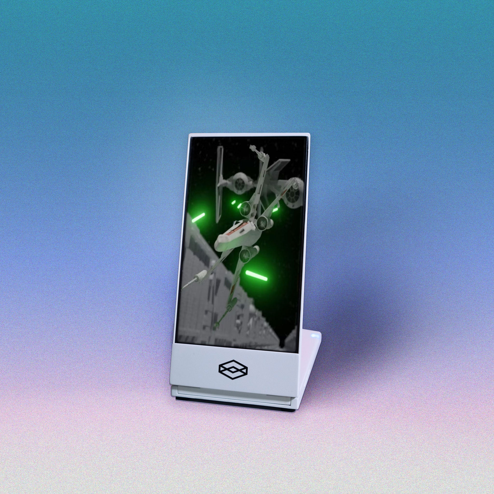
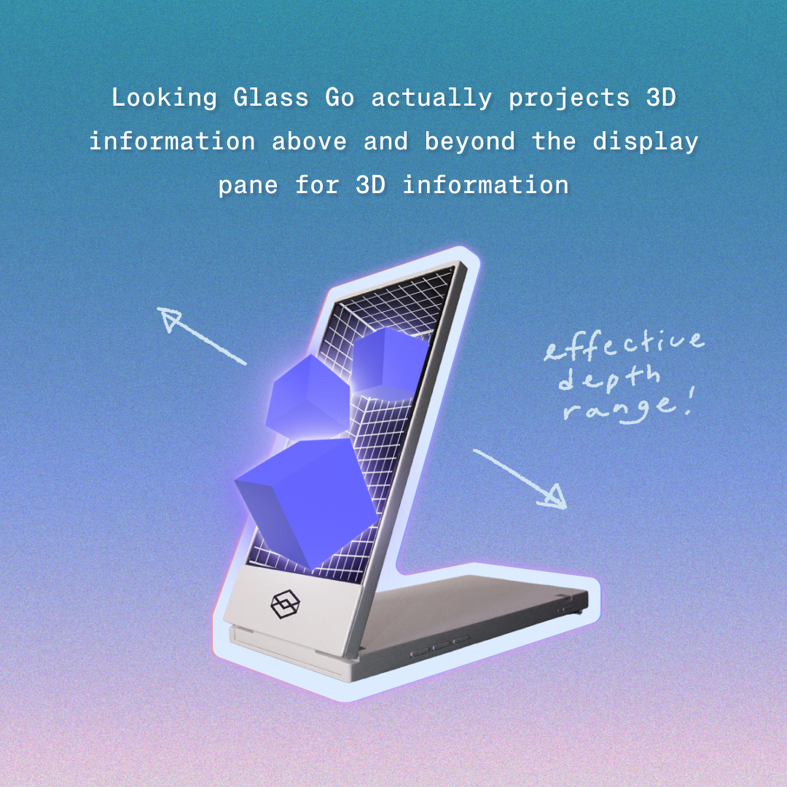
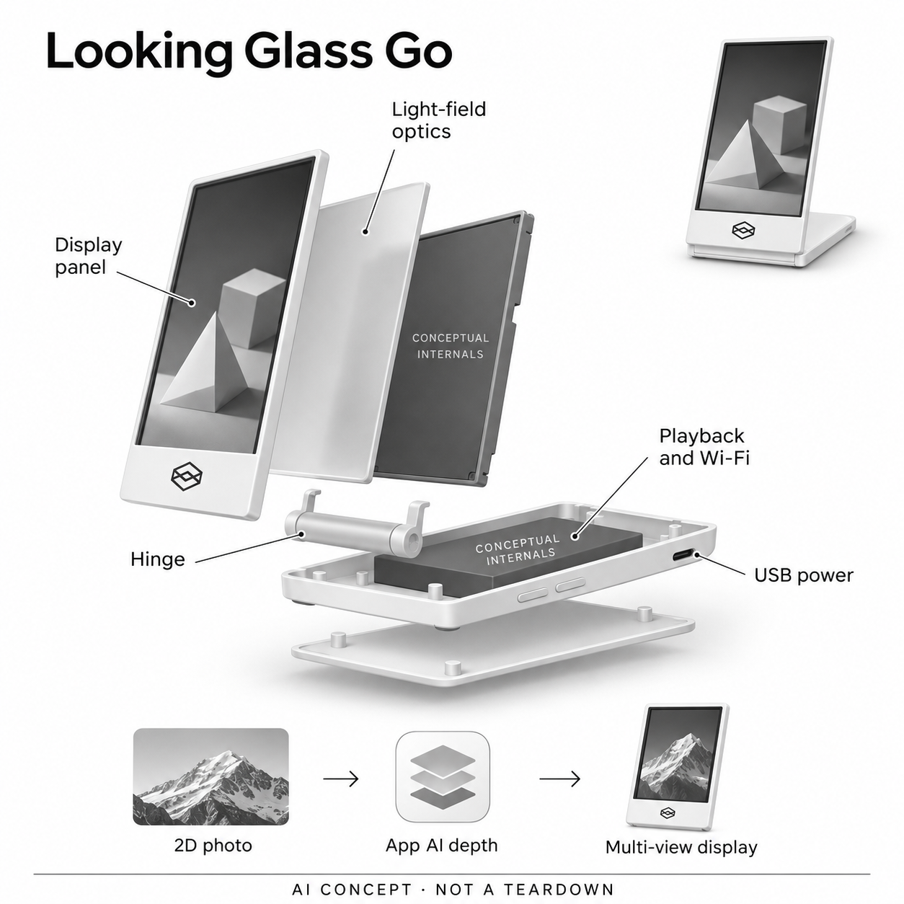

# Looking Glass Go（白色版）

**Looking Glass Factory** · 空间显示与交互 · 核查 2026-11-04

将AI推断的照片深度呈现在桌面多视图光场中的小屏

消费渠道：个人零售。

## 产品图片与结构参考

### 产品图

Looking Glass Go（白色版） 官方产品图 · 来源：[Looking Glass Factory · 官方资料](<https://checkout.lookingglassfactory.com/products/looking-glass-go?variant=40821839822937>) · [原始图片](<https://cdn.shopify.com/s/files/1/1323/9367/files/GO-square12_6733ecfb-3421-416f-b692-a6aa766aae4c.jpg?v=1718856212>)

### 参考图

Looking Glass Go 官方深度观看效果示意（非物体悬浮实拍） · 来源：[Looking Glass Factory · 官方资料](<https://checkout.lookingglassfactory.com/products/looking-glass-go?variant=40821839822937>) · [原始图片](<https://cdn.shopify.com/s/files/1/1323/9367/files/GO-productcard-04.png?v=1718956542>)

### AI 生成爆炸示意

**AI 生成 · 非实物拆机。** 内部为概念推断，不能作为元件布局、BOM 或维修依据。[生成提示词](../../content/hardware/prompts/looking-glass-go.txt)

> 以已目视核对的官方图片独立生成，未知内部为功能概念，不代表真实PCB、拆机或已采用供应商。

> 保留官方图片原貌；图片中的宣传数字和效果不作为本站实测。

> 分析为基于公开资料的案头研究与 AI 辅助判断，未经用户访谈、销量审计或实物拆机。需求、画像、竞争冷门度、审美及商业机会均为研究假设，不是投资结论。

## 销售与购买

- 状态：在售。核查日官方白色变体US$199且公开商品数据available=true；商店及帮助页说明新订单通常2–3工作日发出。透明外壳同硬件不另计，已停售Portrait不混入。

- 地区：美国、加拿大、欧洲、日本等商店支持地区

- 价格：官方白色版US$199（参考US$299）。不含内置电池；外置电池为另购配件，核查时相关附件有缺货提示。不同外壳、税运费与桌面电脑不包含在同一价格中。

- 中国大陆：官网地区列表含香港、澳门及台湾，未确认中国大陆直送或官方本地售后。照片上传、账号和App获取条件须独立核对；Android官方文档目前提供APK替代暂缺的Play上架。

- [官方产品 / 商店](<https://checkout.lookingglassfactory.com/products/looking-glass-go?variant=40821839822937>)

## AI 的实际作用

Looking Glass App工作流对上传的二维照片生成AI深度，并可调整焦点与深度；显示器以多视图光场呈现。AI结果是推断，不是实际三维扫描或真实悬浮投影。

服务与联网依赖：首次需要App、账户、2.4GHz Wi-Fi和固件设置；素材转换与设备播放分开。桌面实时内容另需电脑和Bridge，不能把独立播放模式解释为所有AI都在机内离线运行。

## 是否冷门

细分专业（研究判断）：个人光场陈列有鲜明观看方式，内容制作和重复观看需求仍窄；与普通电子相框相比的价值需要真实使用验证。

## 需求与市场

案头需求是把已有照片或个人三维作品变成桌面可从不同角度观看的陈列内容。与单人跟头移动的视频显示不同，它更偏向记忆和作品展示；是否长期留在桌上要看内容更新与观看习惯。

### 事实：任务边界 · 官方资料

Looking Glass Go的官方流程允许用户上传照片，由AI生成深度并调整焦点，再把内容放到小型多视图光场屏观看。它既可展示照片，也能连接电脑播放三维作品；本条核心任务是把个人内容变成桌面可换角度观看的陈列，而非普通显示器规格升级。

依据：[Looking Glass Go官方白色商品页](<https://checkout.lookingglassfactory.com/products/looking-glass-go?variant=40821839822937>) · [Looking Glass Go官方入门流程](<https://lfdocs.lookingglassfactory.com/getting-started/looking-glass-go/get-started-with-looking-glass-go>)

### 判断：真实需求 · 研究判断

需求判断要区分喜欢整理照片的人和只被立体演示吸引的人。前者可能愿意不断准备新内容，后者可能长期只播默认样片；若用户原本就很少更新电子相框，增加深度效果未必改变习惯，关键是内容是否值得反复展示和分享。

依据：[Looking Glass Go官方白色商品页](<https://checkout.lookingglassfactory.com/products/looking-glass-go?variant=40821839822937>) · [Looking Glass Go官方入门流程](<https://lfdocs.lookingglassfactory.com/getting-started/looking-glass-go/get-started-with-looking-glass-go>)

### 验证：任务完成 · 待验证

调研可让参与者选几张真正想摆在桌上的照片，完成上传、深度调整和播放列表，再观察一段时间后是否替换内容。访谈问想给谁看、哪张照片不适合立体化，以及如果转换需要纠错还愿不愿继续，避免把初次惊喜等同长期陈列需求。

依据：[Looking Glass Go官方白色商品页](<https://checkout.lookingglassfactory.com/products/looking-glass-go?variant=40821839822937>) · [Looking Glass Go官方入门流程](<https://lfdocs.lookingglassfactory.com/getting-started/looking-glass-go/get-started-with-looking-glass-go>)

## 用户画像

适合喜欢整理照片、制作三维小作品并愿意使用App或电脑工具的人。没有内容准备意愿的用户可能只播放默认演示；偏好多人日常大屏观看或严格图像测量的人也不是同一任务。

### 事实：使用条件 · 官方资料

官方提供手机App素材管理与独立播放模式，也提供连接电脑的桌面模式；首次设置需账户、网络和固件流程。它没有内置电池，便携外形不等于拿走即可无线播放；用户还需要选择内容及合适的供电和摆放位置，不能只按六英寸大小判断使用。

依据：[Looking Glass Go官方白色商品页](<https://checkout.lookingglassfactory.com/products/looking-glass-go?variant=40821839822937>) · [Looking Glass Go官方入门流程](<https://lfdocs.lookingglassfactory.com/getting-started/looking-glass-go/get-started-with-looking-glass-go>)

### 判断：人群筛选 · 研究判断

潜在画像是喜欢照片摆件、愿意整理家庭记忆，或希望展示个人三维作品的人。只想观看长视频、需要多人远距离大屏或要求精确几何测量的用户有不同目标；照片爱好者和开发者虽可用同一硬件，也不应混成同一种消费需求。

依据：[Looking Glass Go官方白色商品页](<https://checkout.lookingglassfactory.com/products/looking-glass-go?variant=40821839822937>) · [Looking Glass Go官方入门流程](<https://lfdocs.lookingglassfactory.com/getting-started/looking-glass-go/get-started-with-looking-glass-go>)

### 验证：参与者差异 · 待验证

招募应分别覆盖照片用户与三维内容创作者，记录现有素材、电脑平台和是否愿意注册上传。让他们自行完成一次换图并说明步骤，访谈包括是否会持续给家人更新内容、愿不愿电脑常连接，以及什么原因会让设备最终被收进抽屉。

依据：[Looking Glass Go官方白色商品页](<https://checkout.lookingglassfactory.com/products/looking-glass-go?variant=40821839822937>) · [Looking Glass Go官方入门流程](<https://lfdocs.lookingglassfactory.com/getting-started/looking-glass-go/get-started-with-looking-glass-go>)

## 竞争与替代

替代包括普通电子相框、手机的深度照片效果和个人视点追踪3D屏。Go提供多视图光场陈列，目录只选一个尺寸代表；不把透明外壳、Portrait或更大商用屏重复计作需求。

### 事实：方案范围 · 官方资料

普通电子相框、手机深度照片效果和个人眼追踪三维显示器都可提供相关观看体验。Go的官方路线无需眼部追踪，适合小型多视图陈列；本轮只保留一个Go代表，透明外壳和更大尺寸没有另计，已停售Portrait也不作为当前可购替代加入。

依据：[Looking Glass Go官方白色商品页](<https://checkout.lookingglassfactory.com/products/looking-glass-go?variant=40821839822937>) · [Looking Glass官方发货说明](<https://looking-glass.helpscoutdocs.com/article/236-when-do-looking-glass-displays-ship>) · [Looking Glass官方软件能力](<https://lookingglassfactory.com/software>)

### 判断：替代关系 · 研究判断

相较普通相框，Go可能使照片更有可探索感，却增加转换和摆放要求；相较眼追踪个人屏，它不围绕单个观看者动态映射，而更重视内容陈列。两种空间显示的任务不同，不能用尺寸或共同的三维标签直接判断哪种更先进或需求更大。

依据：[Looking Glass Go官方白色商品页](<https://checkout.lookingglassfactory.com/products/looking-glass-go?variant=40821839822937>) · [Looking Glass官方发货说明](<https://looking-glass.helpscoutdocs.com/article/236-when-do-looking-glass-displays-ship>) · [Looking Glass官方软件能力](<https://lookingglassfactory.com/software>)

### 验证：比较方法 · 待验证

对照可让参与者选择同一组照片，在普通相框、手机效果和Go上分别观看，记录愿意停留、换角度和邀请别人看的行为。也应比较创建播放列表所需步骤，避免只展示最适合深度转换的样片，或将共享小屏的体验外推为大型多人影院。

依据：[Looking Glass Go官方白色商品页](<https://checkout.lookingglassfactory.com/products/looking-glass-go?variant=40821839822937>) · [Looking Glass官方发货说明](<https://looking-glass.helpscoutdocs.com/article/236-when-do-looking-glass-displays-ship>) · [Looking Glass官方软件能力](<https://lookingglassfactory.com/software>)

## 供应链

功能链包含光场显示、控制存储、无线连接、折叠结构和外部供电，AI素材处理连接App工作流。面板与光学供应商未披露；多视图校准和内容格式兼容比普通屏幕堆规格更重要。

### 事实：功能组成 · 官方资料

公开功能包含光场显示、播放控制和存储、无线连接、USB供电及折叠底座；照片AI处理位于App上传和编辑工作流。品牌没有公开本型号面板、视图光学或控制芯片的完整供应关系，概念图的模块分离也不代表真实装配顺序和内部物料布局。

依据：[Looking Glass Go官方白色商品页](<https://checkout.lookingglassfactory.com/products/looking-glass-go?variant=40821839822937>) · [Looking Glass Go官方入门流程](<https://lfdocs.lookingglassfactory.com/getting-started/looking-glass-go/get-started-with-looking-glass-go>) · [Looking Glass官方软件能力](<https://lookingglassfactory.com/software>)

### 判断：交付约束 · 研究判断

工程判断是显示面板与多视图光学的标定、内容渲染和设备姿态必须配合，普通屏幕参数不能单独决定观看效果。折叠结构和散热、连接口也影响摆放；如果内容端生成深度不合适，硬件再精密也不能自动把原照片变成真实完整三维场景。

依据：[Looking Glass Go官方白色商品页](<https://checkout.lookingglassfactory.com/products/looking-glass-go?variant=40821839822937>) · [Looking Glass Go官方入门流程](<https://lfdocs.lookingglassfactory.com/getting-started/looking-glass-go/get-started-with-looking-glass-go>) · [Looking Glass官方软件能力](<https://lookingglassfactory.com/software>)

### 验证：选型缺口 · 待验证

天马可作为小中尺寸基础显示模组候选，Protolabs可作为折叠结构与外壳原型候选，但前者不等于提供完整光场光学，后者不负责AI深度模型。需要补充接口、标定、结构寿命与热量要求，本轮没有点名采用关系，也不推算其真实成本。

依据：[Looking Glass Go官方白色商品页](<https://checkout.lookingglassfactory.com/products/looking-glass-go?variant=40821839822937>) · [Looking Glass Go官方入门流程](<https://lfdocs.lookingglassfactory.com/getting-started/looking-glass-go/get-started-with-looking-glass-go>) · [Looking Glass官方软件能力](<https://lookingglassfactory.com/software>)

## 技术路径

官方入门文档明确上传照片后生成AI深度并可编辑焦点和深度。被遮挡部分和几何关系属于推断，不能当真实测量；桌面实时应用、独立播放与云端素材准备是不同运行条件。

### 事实：AI机制 · 官方资料

官方入门文档明确先上传照片，再由AI生成深度，并可调整焦点、深度与裁剪；厂商也提醒生成结果可能需要编辑。独立模式用于App同步和播放，桌面模式用于电脑实时内容，两者不能合并为设备在本机离线完成所有AI素材处理。

依据：[Looking Glass Go官方白色商品页](<https://checkout.lookingglassfactory.com/products/looking-glass-go?variant=40821839822937>) · [Looking Glass Go官方入门流程](<https://lfdocs.lookingglassfactory.com/getting-started/looking-glass-go/get-started-with-looking-glass-go>)

### 判断：系统边界 · 研究判断

单张照片的深度是模型推断，遮挡后的内容和物体边界不等于被真实测量。多视图显示提供变化的观察线索，但不能把转换结果用于精密尺寸或真实三维重建结论；照片内容、焦点选择与深度强度都会影响用户是否觉得自然。

依据：[Looking Glass Go官方白色商品页](<https://checkout.lookingglassfactory.com/products/looking-glass-go?variant=40821839822937>) · [Looking Glass Go官方入门流程](<https://lfdocs.lookingglassfactory.com/getting-started/looking-glass-go/get-started-with-looking-glass-go>)

### 验证：算法与体验 · 待验证

验证可选择前后景复杂、透明物体、细线和多人合影，保留原图与多种深度设置，记录边缘异常和用户修改步骤。还应分别测试首次联网、换图同步及已有素材播放，明确哪个阶段依赖服务，而不是只证明默认演示能在屏幕上出现。

依据：[Looking Glass Go官方白色商品页](<https://checkout.lookingglassfactory.com/products/looking-glass-go?variant=40821839822937>) · [Looking Glass Go官方入门流程](<https://lfdocs.lookingglassfactory.com/getting-started/looking-glass-go/get-started-with-looking-glass-go>)

## 产品审美

竖向白色边框和折叠底座让它接近桌面照片摆件，角度会影响可见效果。官方参考图中出屏物体是效果示意，概念图只画显示与光学模块，不添加投影光束、眼追摄像或内置电池。

### 事实：外观与交互 · 官方资料

白色Go采用竖向屏幕、较宽下边框和底部折叠支撑，外形更接近桌面摆件而非高脚显示器。官方参考图用物体伸出屏幕表达视差效果，这属于视觉示意；概念图仅说明显示、光学和播放模块，没有添加真实空气投影或未提供的内置电池。

依据：[Looking Glass Go官方白色商品页](<https://checkout.lookingglassfactory.com/products/looking-glass-go?variant=40821839822937>) · [Looking Glass Go官方入门流程](<https://lfdocs.lookingglassfactory.com/getting-started/looking-glass-go/get-started-with-looking-glass-go>)

### 判断：使用中的形态 · 研究判断

小屏适合近距离陈列，却需要用户找到能看出效果的摆放角度，桌面光线和内容构图也会改变观感。外形便携不代表供电线消失，折叠底座还会占用平面空间；是否愿意长期放置取决于整体环境，而不仅是设备单独拍摄时的精致程度。

依据：[Looking Glass Go官方白色商品页](<https://checkout.lookingglassfactory.com/products/looking-glass-go?variant=40821839822937>) · [Looking Glass Go官方入门流程](<https://lfdocs.lookingglassfactory.com/getting-started/looking-glass-go/get-started-with-looking-glass-go>)

### 验证：日常接受度 · 待验证

可让参与者在自己桌面、书架或常见展示位置反复摆放，记录是否经常改变角度、是否有人自然走近观察，以及线缆如何处理。访谈问喜欢它作为照片物件还是技术玩具，并观察换成自己的照片后是否仍愿意保留原先的展示位置。

依据：[Looking Glass Go官方白色商品页](<https://checkout.lookingglassfactory.com/products/looking-glass-go?variant=40821839822937>) · [Looking Glass Go官方入门流程](<https://lfdocs.lookingglassfactory.com/getting-started/looking-glass-go/get-started-with-looking-glass-go>)

## 关键风险

风险在于AI深度错误、照片上传和账号依赖，以及App分发变化。官方文档提示Android应用暂不在Play上架，使用者可能要走官方APK；不能仅看商店写支持Android就认为安装流程没有门槛。

### 事实：已知限制 · 官方资料

官方文档要求首次通过App与网络设置，且仍提示Android的Play上架暂时缺位、可使用官方APK；商店则明确没有内置电池。不能只看到支持Android或便携字样，就假设每个用户都能按普通应用商店流程安装，并立即获得无线独立使用。

依据：[Looking Glass Go官方白色商品页](<https://checkout.lookingglassfactory.com/products/looking-glass-go?variant=40821839822937>) · [Looking Glass Go官方入门流程](<https://lfdocs.lookingglassfactory.com/getting-started/looking-glass-go/get-started-with-looking-glass-go>)

### 判断：失效影响 · 研究判断

风险在于照片上传、账号与服务条件成为长期内容管理的一部分，以及AI深度错误让重要记忆看起来失真。桌面连接还可能涉及电脑接口和额外工具，本轮没有长期故障率或服务持续性证据；应准确陈述依赖，而不是承诺所有功能永久可用。

依据：[Looking Glass Go官方白色商品页](<https://checkout.lookingglassfactory.com/products/looking-glass-go?variant=40821839822937>) · [Looking Glass Go官方入门流程](<https://lfdocs.lookingglassfactory.com/getting-started/looking-glass-go/get-started-with-looking-glass-go>)

### 验证：风险处理 · 待验证

购买前核对当前App获取、网络条件和需要的内容工作流，试用时检查用户能否导入自己的照片、纠错和更新列表。对Android用户应按当时官方说明确认，不把文档中的临时分发状态写成永久结论，也不以默认样片播放代替完整设置验证。

依据：[Looking Glass Go官方白色商品页](<https://checkout.lookingglassfactory.com/products/looking-glass-go?variant=40821839822937>) · [Looking Glass Go官方入门流程](<https://lfdocs.lookingglassfactory.com/getting-started/looking-glass-go/get-started-with-looking-glass-go>)

## 机会与验证

可验证机会是让普通照片更值得再次观看。让用户转换自己选的照片，记录纠错、导入和播放列表更新，再跟踪一个月是否换内容、邀请别人看或把设备收起，不用初次惊喜预测长期需求。

### 判断：可尝试切口 · 研究判断

可尝试的切口是让普通用户更容易选出适合立体陈列的照片，并理解何时需要减弱深度或调整焦点。若用户最难的是整理值得看的内容，改善照片选择和编辑提示可能比换更大的显示面板更有价值；这仍是需要实际使用记录检验的假设。

依据：[Looking Glass Go官方白色商品页](<https://checkout.lookingglassfactory.com/products/looking-glass-go?variant=40821839822937>) · [Looking Glass Go官方入门流程](<https://lfdocs.lookingglassfactory.com/getting-started/looking-glass-go/get-started-with-looking-glass-go>) · [Looking Glass官方软件能力](<https://lookingglassfactory.com/software>)

### 判断：商业边界 · 研究判断

商业边界在于内容陈列的复用频率可能很低，送礼、自己收藏和创作展示的持续动力又不同。开发者能构建复杂应用不能直接证明普通家庭会经常更新照片，本轮没有销量或用户访谈，不把空间显示的新奇感外推为电子相框的普遍替代市场。

依据：[Looking Glass Go官方白色商品页](<https://checkout.lookingglassfactory.com/products/looking-glass-go?variant=40821839822937>) · [Looking Glass Go官方入门流程](<https://lfdocs.lookingglassfactory.com/getting-started/looking-glass-go/get-started-with-looking-glass-go>) · [Looking Glass官方软件能力](<https://lookingglassfactory.com/software>)

### 验证：下一步调研 · 待验证

下一步可以跟踪一个月，记录首次上传完成率、修改深度次数、主动换图与邀请他人观看的行为，再访谈收起设备的人。将内容投入、观看体验和价格接受度分别分析，不用模型创新评分预测成功，也不把单个积极演示当作长期留存证据。

依据：[Looking Glass Go官方白色商品页](<https://checkout.lookingglassfactory.com/products/looking-glass-go?variant=40821839822937>) · [Looking Glass Go官方入门流程](<https://lfdocs.lookingglassfactory.com/getting-started/looking-glass-go/get-started-with-looking-glass-go>) · [Looking Glass官方软件能力](<https://lookingglassfactory.com/software>)

## 对应供应链公司

能力候选用于选型研究，不代表本产品实际采用；未公开的供货关系不作推断。

- [tianma](../supply-chain/tianma.md) — **能力候选 · 非已采用** / 小型光场屏的基础显示模组候选：Go需要小尺寸显示面板承载多视图内容，天马公开小中尺寸显示及模组集成能力，可作为基础显示层候选。它不等于提供Looking Glass专有光学与校准，分辨、接口、亮度和叠层要求仍须验证，本轮没有实际采用点名证据。

- [protolabs](../supply-chain/protolabs.md) — **能力候选 · 非已采用** / 折叠底座与显示外壳原型候选：Go的竖屏和折叠底座需要结构、铰链及接口布局配合，Protolabs公开原型和结构制造能力，可作为外壳与支撑样件候选。疲劳、散热、线缆与光学定位须按整机验证，不能把加工能力视为已被Looking Glass采用或可提供完整显示系统。

[浏览供应链目录](../supply-chain.md)

## 功能分层示意

这是功能关系，不是实物拆机、真实空间结构或已核实 BOM。

1. **AI素材准备**：App上传照片并生成深度，支持焦点和深度编辑。（官方披露）

2. **多视图光场**：显示与光学模块让不同方向获得不同视图，无需头戴或眼追踪。（官方披露）

3. **播放与存储**：本机管理素材播放，桌面实时内容另依赖电脑工具。（官方披露）

4. **连接与供电**：无线配置和USB电源支持使用，无内置电池。（官方披露）

5. **折叠结构**：竖屏、底部转轴和折叠底座构成小型陈列设备，内部仅为概念拆分。（官方披露）

## 来源

1. [Looking Glass Go官方白色商品页](<https://checkout.lookingglassfactory.com/products/looking-glass-go?variant=40821839822937>) — 实际打开并读取公开商品数据；白色199美元有货、无内置电池与照片用途。

2. [Looking Glass官方发货说明](<https://looking-glass.helpscoutdocs.com/article/236-when-do-looking-glass-displays-ship>) — 实际打开；Go通常2–3个工作日发货，Portrait已停售。

3. [Looking Glass Go官方入门流程](<https://lfdocs.lookingglassfactory.com/getting-started/looking-glass-go/get-started-with-looking-glass-go>) — 实际打开；上传后AI深度、编辑焦点、独立和桌面模式、2.4GHz网络与Android APK临时方案。

4. [Looking Glass官方软件能力](<https://lookingglassfactory.com/software>) — 实际打开；无需眼追踪、多视图内容、Go陈列和不同创作工具分工。

[返回目录](../hardware-market.md) · [网页分析](https://romanagent.github.io/Roman/#hardware/product/looking-glass-go)
